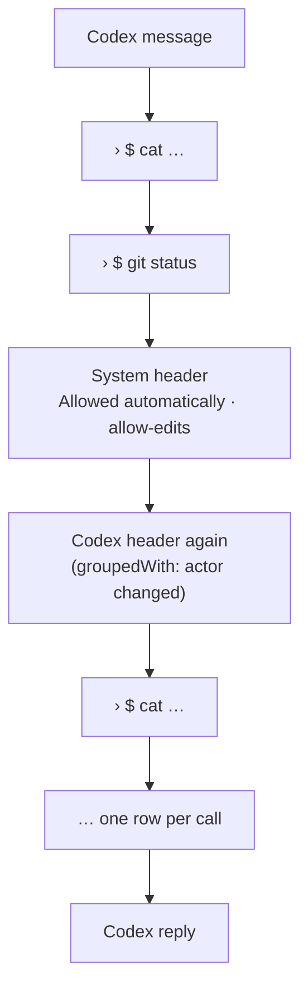
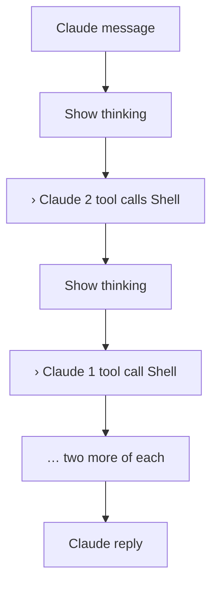
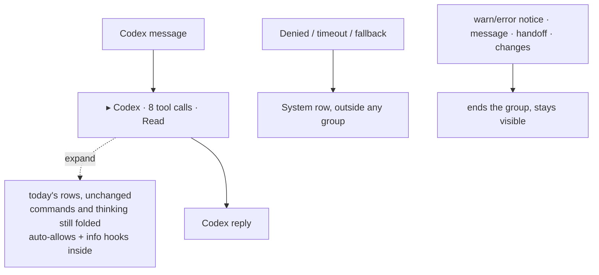
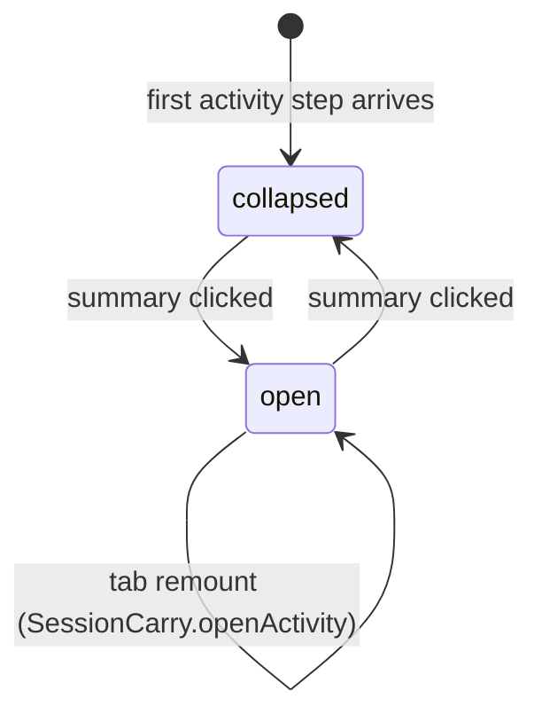
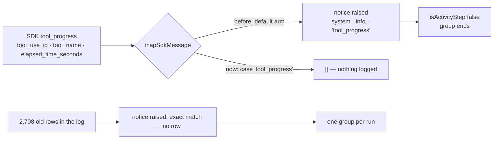
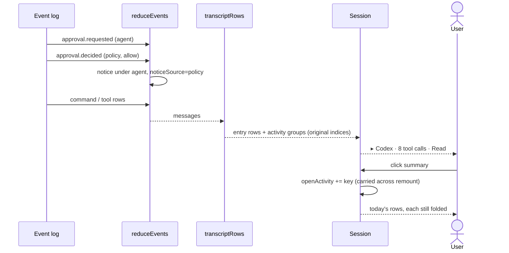

# Collapsed Tool Activity

Status: **implemented 2026-10-01, review corrections applied, runtime NOT VERIFIED.** Reading A approved by the user. **Refined 2026-10-02: thinking shares the activity block. Codex and Claude source reviews completed.** **Corrected 2026-10-02: progress ticks no longer split a group (see "Correction: progress ticks"). Source-reviewed by Codex and Claude, built and installed at `/Applications/Chorus.app`. Runtime NOT VERIFIED.** No tests, separate typecheck, lint or app launch were run. Quit and reopen Chorus to load the correction.

| Deviation / correction                                                                                  | Why                                                                                                                                                                                                  |
| ------------------------------------------------------------------------------------------------------- | ---------------------------------------------------------------------------------------------------------------------------------------------------------------------------------------------------- |
| Strings live under `tool.*`, not a top-level `activity`                                                 | A top-level `activity` key already holds QuickRail's usage strings; a second one would silently replace it                                                                                           |
| Summary content wrapped in `<span className="said">`                                                    | `.entry` is a grid; without the `said` area the line auto-places beside the mark                                                                                                                     |
| Extra CSS: `.turn-head:has(+ .activity)`, rules above and below a group, `changes` card excluded        | `<details>` breaks the `.entry + .entry` adjacency; the generic rule out-specified `.entry + .entry--changes { border-top: 0 }`                                                                      |
| `TranscriptMessage.activityKey`, set by `prependEvents`, kept by `tool.started`                         | An older page ending in the same agent's routine steps merged into the first group and changed its key: the open group closed and its rows remounted                                                 |
| Open state is membership over each step's `activity:` key                                               | `moveChangesBelow` lifts the `changes` card out from between two groups when a reply completes, so they merge; the later group's open state now survives                                             |
| Summary `onClick` stops following when it opens a group                                                 | While following, the `ResizeObserver` scrolled to the bottom and carried the clicked summary off-screen                                                                                              |
| Prepend compensation keys on `view.firstSeq` falling; `lastHeight` kept by the content `ResizeObserver` | It fired on any row-count growth, including live appends, and its height went stale across `<details>` toggles and typing, so the next row or page jumped by the expanded height                     |
| Agent, count and failure labels `flex: none; nowrap`                                                    | They wrapped mid-phrase in narrow panes; only the latest tool name truncates                                                                                                                         |
| Thinking joins the activity block (2026-10-02)                                                          | Each block of thinking between calls ended the group. One turn showed four "Show thinking" rows splitting seven calls into four summaries between two replies                                        |
| `isRoutineStep` renamed `isActivityStep`                                                                | It now admits thinking, which is not a routine step. A predicate that changes meaning is renamed in the same change                                                                                  |
| Zero-call label "Activity", not "Tool activity"                                                         | A thinking-only block has no tool in it                                                                                                                                                              |
| Progress ticks are not logged, and old ones are not drawn (2026-10-02)                                  | Each SDK `tool_progress` tick was logged as a `system` notice reading "tool_progress". It ended the group, so one stretch of work showed as 11, 8, 9 and 10 calls with "NOTE: tool_progress" between |

## Current / Issue



`transcript.ts:822` files every auto-decision as `actor: 'system'`. `groupedWith` (`transcript.ts:1169`) groups only on the same actor. `approval.decided` carries no agent (`events.ts:258`).

After the initial grouping change, thinking still split the turn:



`appendReasoning` (`transcript.ts:1158`) starts a new reasoning row whenever anything else came last, and `isRoutineStep` rejected reasoning, so every block of thinking ended the group.

## Proposed





## Code Changes

### `apps/desktop/src/renderer/src/transcript.ts`

`approval.decided`: the pending request names the agent. If it is missing (page boundary, hydration gap), fall back to today's System row.

```ts
    case 'approval.decided': {
      const id = str('approvalId')
      const asked = view.approvals.find((a) => a.approvalId === id)
      view.approvals = view.approvals.filter((a) => a.approvalId !== id)

      if (str('decidedBy') !== 'user') {
        const rule = str('policyRuleId')
        const outcome = str('outcome')
        const routineBy = outcome === 'allow' ? asked?.agentId : undefined
        view.messages.push({
          key: event.id,
          eventId: event.id,
          at: event.createdAt,
          actor: routineBy ?? 'system',
          kind: 'notice',
          text:
            outcome === 'timeout'
              ? 'Denied — nobody answered in time.'
              : `${outcome === 'allow' ? 'Allowed' : 'Denied'} automatically${rule === '' ? '' : ` · ${rule}`}`,
          status: 'complete',
          ...(routineBy === undefined ? {} : { noticeSource: 'policy', level: 'info' as const }),
        })
      }
      return
    }
```

A pure partition. It keeps the original indices for `entry()`, `groupedWith()` and `answersThinking()`.

```ts
export type TranscriptRow =
  | { readonly kind: 'entry'; readonly message: TranscriptMessage; readonly index: number }
  | {
      readonly kind: 'activity'
      readonly key: string
      readonly actor: TranscriptEvent['actor']
      readonly start: number
      readonly steps: readonly TranscriptMessage[]
      readonly calls: number
      readonly failed: number
      readonly latest: TranscriptMessage | undefined
    }

function isActivityStep(message: TranscriptMessage): boolean {
  if (message.actor === 'user' || message.actor === 'system') return false
  if (message.kind === 'command' || message.kind === 'tool') return true
  if (message.kind === 'reasoning') return true
  return (
    message.kind === 'notice' &&
    message.level === 'info' &&
    (message.noticeSource === 'hook' || message.noticeSource === 'policy')
  )
}

export function transcriptRows(messages: readonly TranscriptMessage[]): TranscriptRow[] {
  const rows: TranscriptRow[] = []
  let index = 0
  while (index < messages.length) {
    const first = messages[index]
    if (first === undefined) break
    if (!isActivityStep(first)) {
      rows.push({ kind: 'entry', message: first, index })
      index += 1
      continue
    }
    const steps: TranscriptMessage[] = []
    let calls = 0
    let failed = 0
    let latest: TranscriptMessage | undefined
    for (let at = index; at < messages.length; at += 1) {
      const step = messages[at]
      if (step === undefined || step.actor !== first.actor || !isActivityStep(step)) break
      steps.push(step)
      if (step.kind === 'command' || step.kind === 'tool') {
        calls += 1
        latest = step
        if (step.toolStatus === 'error') failed += 1
      }
    }
    rows.push({
      kind: 'activity',
      key: `activity:${first.activityKey ?? first.key}`,
      actor: first.actor,
      start: index,
      steps,
      calls,
      failed,
      latest,
    })
    index += steps.length
  }
  return rows
}
```

An older page that continues the first group carries that group's key, so the `<details>` and its rows keep their identity.

```ts
  readonly activityKey?: string
```

```ts
const head = view.messages[0]
let joined = rows.length
if (head !== undefined && isActivityStep(head)) {
  for (let at = rows.length - 1; at >= 0; at -= 1) {
    const row = rows[at]
    if (row === undefined || row.actor !== head.actor || !isActivityStep(row)) break
    joined = at
  }
}
const marked =
  head === undefined || joined === rows.length
    ? rows
    : rows.map((row, at) =>
        at === joined ? { ...row, activityKey: head.activityKey ?? head.key } : row
      )
```

```ts
        ...(prev?.activityKey === undefined ? {} : { activityKey: prev.activityKey }),
```

### `apps/desktop/src/renderer/src/Session.tsx`

```ts
import { Entry, ToolPatch } from './Entry.js'
import { transcriptRows, type TranscriptRow } from './transcript.js'

export interface SessionCarry {
  readonly openActivity?: readonly string[]
}
```

```tsx
const [openActivity, setOpenActivity] = useState<ReadonlySet<string>>(
  () => new Set(props.carry?.openActivity ?? [])
)
const setActivityOpen = useCallback((keys: readonly string[], open: boolean) => {
  setOpenActivity((current) => {
    if (keys.some((key) => current.has(key)) === open) return current
    const next = new Set(current)
    for (const key of keys) {
      if (open) next.add(key)
      else next.delete(key)
    }
    return next
  })
}, [])

latest.current = {
  view,
  following: following.current,
  scrollTop: score.current?.scrollTop ?? latest.current.scrollTop,
  openActivity: [...openActivity],
}

const rows = useMemo(() => transcriptRows(view.messages), [view.messages])
const startOf = (item: TranscriptRow): number => (item.kind === 'entry' ? item.index : item.start)

const row = (item: TranscriptRow): React.JSX.Element => {
  if (item.kind === 'entry') return entry(item.message, item.index)
  const groupKeys = item.steps.map((step) => `activity:${step.activityKey ?? step.key}`)
  const open = groupKeys.some((key) => openActivity.has(key))
  return (
    <details
      key={item.key}
      className={`activity entry--${item.actor}`}
      open={open}
      onToggle={(event) => {
        setActivityOpen(groupKeys, event.currentTarget.open)
      }}
    >
      <summary
        className="entry activity-summary"
        data-grouped="true"
        data-headless="true"
        onClick={() => {
          if (!open) stopFollowing()
        }}
      >
        <span className="entry-mark" aria-hidden="true">
          <span className="tick" />
        </span>
        <span className="said">
          <span className="command-summary">
            <span className="command-caret" aria-hidden="true">
              {open ? '⌄' : '›'}
            </span>
            <span className="activity-agent">{t(`actor.${item.actor}`)}</span>
            <span className="activity-count">
              {item.calls === 0
                ? t('tool.activity')
                : t('tool.activityCalls', { count: item.calls })}
            </span>
            {item.failed > 0 && (
              <span className="activity-failed">
                {t('tool.activityFailed', { count: item.failed })}
              </span>
            )}
            {item.latest !== undefined && (
              <span className="activity-latest">
                {item.latest.kind === 'tool' ? item.latest.text : t('tool.shell')}
              </span>
            )}
          </span>
        </span>
      </summary>
      {item.steps.map((message, offset) => entry(message, item.start + offset))}
    </details>
  )
}
```

```tsx
{
  ;(currentTurn === undefined ? rows : rows.filter((r) => startOf(r) < turnAt)).map(row)
}
```

```tsx
{
  rows.filter((r) => startOf(r) > turnAt).map(row)
}
```

`summary` is already in `FOCUS_KEEPS_ITS_OWN`, so a click does not move focus to the composer. `onToggle` has no follow side effect: restoring a tab and toggling a nested `<details>` both fire it.

The prepend correction, with `lastHeight` moved up beside `pinnedTop` and written by the existing content `ResizeObserver` (`lastHeight.current = height`, before its `following` early return):

```tsx
const lastFirstSeq = useRef(view.firstSeq)
useLayoutEffect(() => {
  const el = score.current
  const content = transcript.current
  if (el === null || content === null) return
  const grew = content.offsetHeight - lastHeight.current
  const prepended =
    lastFirstSeq.current > 0 && view.firstSeq < lastFirstSeq.current && !following.current
  lastHeight.current = content.offsetHeight
  lastFirstSeq.current = view.firstSeq
  if (prepended && grew > 0) el.scrollTop += grew
}, [view.firstSeq])
```

### `apps/desktop/src/renderer/src/i18n/en.json`

```json
  "tool": {
    "activity": "Activity",
    "activityCalls_one": "{{count}} tool call",
    "activityCalls_other": "{{count}} tool calls",
    "activityFailed_one": "{{count}} failed",
    "activityFailed_other": "{{count}} failed",
    "shell": "Shell"
  },
```

```json
    "source": {
      "policy": "Policy",
```

### `apps/desktop/src/renderer/src/styles.css`

```css
.turn-head:has(+ .activity) {
  border-bottom: 1px solid var(--line);
}

.entry + .activity > .activity-summary,
.activity + .activity > .activity-summary,
.activity + .entry:not([data-kind='message']):not([data-kind='changes']) {
  border-top: 1px solid color-mix(in srgb, var(--border-default) 60%, transparent);
}

.activity > summary {
  list-style: none;
  cursor: pointer;
}

.activity > summary::-webkit-details-marker {
  display: none;
}

.activity-summary:hover .command-summary,
.activity-summary:focus-visible .command-summary {
  color: var(--bone);
}

.activity-summary:focus-visible {
  outline: none;
}

.activity-agent,
.activity-count,
.activity-failed {
  flex: none;
  white-space: nowrap;
}

.activity-agent {
  color: var(--voice);
}

.activity-failed {
  color: var(--danger);
}

.activity-latest {
  overflow: hidden;
  min-width: 0;
  text-overflow: ellipsis;
  white-space: nowrap;
}
```

`--danger` is the existing error colour token in both palettes.

## Correction: progress ticks (2026-10-02)



- **Source.** In the pinned SDK (0.3.220, `sdk.d.ts:4553`), `tool_progress` is a top-level timer tick. Nothing in the adapter mapped it, so the default arm (`mapping.ts` `mapSdkMessage`) logged it. `notice.raised` keeps only `level`, `source`, `text`, `detail`, `code` and `detailOmittedBytes`, so an old row says nothing beyond its own name.
- **Nothing reads the tick's data.** The correlated `tool.progress` event has no consumer for elapsed time: the reducer only applies a non-empty note, and runtime, catch-up and projections treat it as a no-op. Mapping the tick there would only add a log row per tick.

### `packages/adapter-claude/src/mapping.ts`

```ts
    case 'tool_progress':
      return []
```

Other unmapped top-level types still become notices.

### `apps/desktop/src/renderer/src/transcript.ts`

Inside `case 'notice.raised'`, before any row is added or folded:

```ts
if (
  isAgent(event.actor) &&
  raw === 'info' &&
  source === 'system' &&
  str('text') === 'tool_progress' &&
  detail === '' &&
  code === '' &&
  omitted === 0
) {
  return
}
```

`reduceEvents` advances `lastSeq` before `apply`, so a skipped row still moves the high-water mark. `prependEvents` folds pages with the same reducer: an older page ending in ticks joins the head group under its key, and a page of only ticks still moves `firstSeq` (the `rows.length === 0` branch). `isActivityStep`, the database, event schemas and the read path are unchanged.

**Not in this correction:** `commands_changed` (a REPLACE-state `system` subtype), `vcs_state_changed` and `dev_intent` also land as `system` info notices and sometimes sit between two of an agent's calls. In the log they did so 34, 40 and 1 times. The last two are not in the pinned SDK types. Each is a separate decision.

## Decisions

- **Failed calls stay inside the group.** The summary shows the failure count in the error tint. Pulling a failed call out would split the group mid-stream and remount everything after it, and Claude's tool errors (a failed `Edit`, a missing `Read`) are routine retries.
- **The group starts at the first activity step, even if it is the only step.** Its DOM shape never changes, and its key (`activity:<first key>`) stays the same as the run grows.
- **Thinking is part of the work, not the reply (2026-10-02).** The reply is what the reader came for; thinking between calls is the agent still working. A block of thinking now joins the group, adds no call to its count, and folds behind its own "Show thinking" toggle inside it. Thinking alone opens the block from its first event, so when tools follow, the key and the DOM shape stay the same and expanded thinking is not reset. Requiring a tool before grouping was considered and rejected for exactly that remount.
- **What happens when a request is missing.** If `approval.requested` sits on the other side of a page boundary from its decision, the decision shows as today's System row. Multiple decisions can cross a boundary; all unmatched decisions remain visible rather than being attributed to an agent without evidence.
- **Zero-call groups use a neutral label.** A hook, an automatic approval or a block of thinking can have no recorded command/tool row, including completed edits recorded as `changes`. Such a group says "Activity" rather than claiming a call is being prepared.
- **The audit trail is untouched.** No orchestrator, event-store or policy change. The only adapter change is the 2026-10-02 correction, which stops logging the `tool_progress` timer tick. The auto-decision is still visible, now one click away (§4.4's purpose).

## Final Flow



## Acceptance

- An auto-allow with its pending request available shows no "System" header, and the agent's name does not repeat on its next step. An unmatched decision keeps its existing System row.
- Every run of an agent's activity steps (commands, tool calls, info hook and policy notices, thinking) renders as one collapsed summary from its first step, both while running and after.
- Four blocks of thinking between seven calls render as one summary between the two replies.
- Thinking adds no call to the count. A thinking-only run shows "Activity", and a tool arriving later updates the summary without changing the group's key.
- Expanding a group shows today's rows unchanged, in order, and each command and block of thinking is still folded.
- Messages, handoffs, `changes` cards, warn/error notices, other actors, denials and timeouts are never inside a group.
- An open group stays open across a tab switch, and the restored scroll position lands where it was.
- Pending approval cards behave as they do today.
- No event schema or stored event changes.
- A run of Claude's or DeepSeek's calls with progress ticks between them renders as one summary, live, hydrated and across a page boundary, and no "NOTE: tool_progress" row appears.
- A tick notice that is not plain `info`, carries a detail, code or omitted bytes, or is not an agent's still renders. Every other `system` notice still ends a group.

## Verification

| Check                                                                       | Status                                                                                                                                                                                                                                                                                            |
| --------------------------------------------------------------------------- | ------------------------------------------------------------------------------------------------------------------------------------------------------------------------------------------------------------------------------------------------------------------------------------------------- |
| Source and diff review (Claude and Codex, adversarial)                      | Done, 2026-10-01. No source-level blocker remains                                                                                                                                                                                                                                                 |
| Thinking refinement, source and diff review (Codex and Claude, adversarial) | Done, 2026-10-02. No source-level blocker                                                                                                                                                                                                                                                         |
| Progress-tick correction, source and adversarial review (Codex and Claude)  | Done, 2026-10-02. No supported source-level findings. Tests written in `mapping.test.ts` and `transcript.test.ts`, **NOT RUN**                                                                                                                                                                    |
| UI acceptance criteria above                                                | **NOT VERIFIED**                                                                                                                                                                                                                                                                                  |
| Dependency build, desktop build and local packaging                         | **PASS**, 2026-10-02. `pnpm exec turbo run build '--filter=@chorus/desktop^...'` succeeded for all eight dependencies (seven cache hits). `node build/package-local.mjs` succeeded from `apps/desktop`, building and signing the macOS arm64 bundle.                                              |
| Local installation                                                          | **PASS**, 2026-10-02. `CHORUS_INSTALL_KEEP_RUNNING=1 node build/install-local.mjs` succeeded from `apps/desktop`, including `codesign --verify --deep --strict`. Installed at `/Applications/Chorus.app`; the previous bundle was preserved at `/Applications/Chorus.app.replaced-1790940574041`. |
| Unit tests, separate typecheck, lint, e2e                                   | **NOT RUN**, by the user's standing instruction                                                                                                                                                                                                                                                   |
| Dev app and packaged app                                                    | **NOT VERIFIED**                                                                                                                                                                                                                                                                                  |
| Event logging, permission engine, orchestrator, event-store, adapters       | Untouched: no file outside the renderer changed                                                                                                                                                                                                                                                   |

The task-only diff was read against the pre-task copies with:

```bash
B=/private/tmp/collapsed-tool-activity-xvo1x8zx
git diff --no-index -- "$B/apps/desktop/src/renderer/src/transcript.ts" apps/desktop/src/renderer/src/transcript.ts
git diff --no-index -- "$B/apps/desktop/src/renderer/src/Session.tsx" apps/desktop/src/renderer/src/Session.tsx
git diff --no-index -- "$B/apps/desktop/src/renderer/src/i18n/en.json" apps/desktop/src/renderer/src/i18n/en.json
git diff --no-index -- "$B/apps/desktop/src/renderer/src/styles.css" apps/desktop/src/renderer/src/styles.css
git diff --no-index -- "$B/docs/plans/01-collapsed-tool-activity.md" docs/plans/01-collapsed-tool-activity.md
```

Exit status 1 from each means "differences were shown", not a failure.

The thinking refinement's diff, against its own pre-task copies:

```bash
B=/private/tmp/focused-agent-activity-r163er93
git diff --no-index -- "$B/apps/desktop/src/renderer/src/transcript.ts" apps/desktop/src/renderer/src/transcript.ts
git diff --no-index -- "$B/apps/desktop/src/renderer/src/i18n/en.json" apps/desktop/src/renderer/src/i18n/en.json
git diff --no-index -- "$B/docs/plans/01-collapsed-tool-activity.md" docs/plans/01-collapsed-tool-activity.md
```

**The only scope expansion** is the scroll correction in `Session.tsx` (prepend detection on `view.firstSeq`, `lastHeight` kept by the content `ResizeObserver`, and `stopFollowing` when a summary is clicked open). It is directly necessary: without it, opening a group moved the reader's position. No external research was needed.

Known limitations:

- An automatic allow whose `approval.requested` sits across a page boundary keeps its System notice outside any group.
- When `moveChangesBelow` lifts a `changes` card out from between two groups, the later group's rows move to a new parent. Open state survives, but state held inside a row (an expanded command, expanded thinking, an open hook detail) resets.
- Very narrow panes are not verified. The agent, count and failure labels do not shrink, so a pane narrower than all three overflows.
- The existing comment above the prepend effect in `Session.tsx` still describes the row-count trigger. It was left unedited under the user's no-comment rule.
- Reading thinking takes two clicks: open the group, then "Show thinking".
- While thinking streams, the summary's latest label still names the previous tool.
- Inside an open group, `styles.css` draws separators around thinking rows but not between commands. Not verified visually.

The `transcript.test.ts` shape, to be written only if the user asks:

```ts
it('files a routine auto-allow under the agent that asked', () => {
  const view = reduceEvents(EMPTY_VIEW, [
    event(
      'approval.requested',
      { approvalId: 'a1', kind: 'fileChange', request: {}, expiresAt: 0 },
      'codex'
    ),
    event('approval.decided', {
      approvalId: 'a1',
      outcome: 'allow',
      decidedBy: 'policy',
      policyRuleId: 'allow-edits',
    }),
  ])
  expect(view.messages.at(-1)).toMatchObject({
    actor: 'codex',
    noticeSource: 'policy',
    level: 'info',
  })
})

it('keeps the System row when the request is not held', () => {
  const view = reduceEvents(EMPTY_VIEW, [
    event('approval.decided', {
      approvalId: 'a1',
      outcome: 'allow',
      decidedBy: 'policy',
      policyRuleId: 'allow-edits',
    }),
  ])
  expect(view.messages.at(-1)?.actor).toBe('system')
})
```

`e2e/specs.mjs` and `e2e/shots-changes.mjs` select `.command-fold` / `.tool-line`, and `shots-changes.mjs` reads `.entry--reasoning` / `.reasoning-toggle`. Those rows will sit inside a closed `<details>`, so the drivers need to open the group first. Not run.
