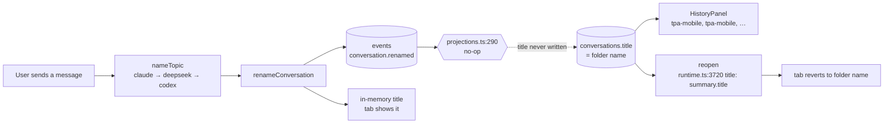
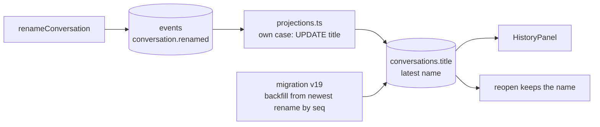
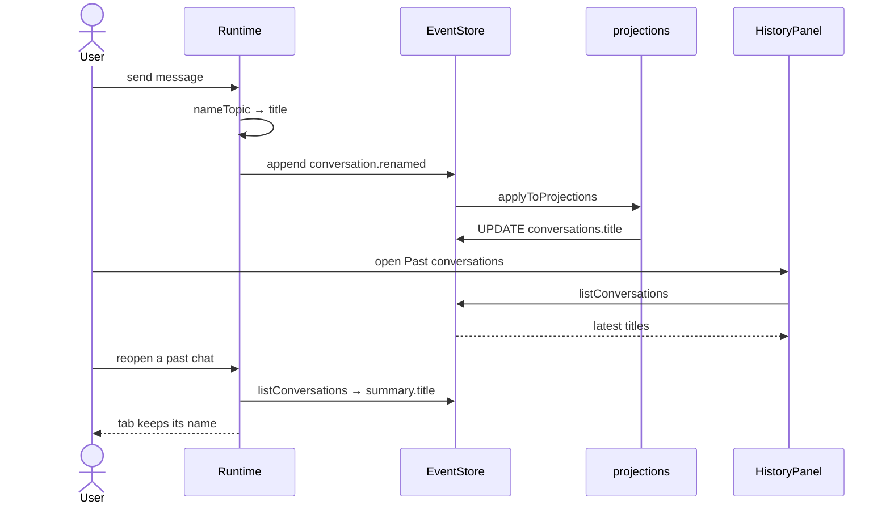

# Generated Titles in Past Conversations

Status: **implemented 2026-10-01 as planned, no deviations. Runtime NOT VERIFIED.** Approved by the user. No tests, typecheck, lint or build run, no migration applied to a real database, no app launched.

## Current / Issue



Measured read-only on the live `chorus.v2.db`: 442 listed conversations, 199 renamed at least once, **197 of them still showing a stale title**. There are 1,502 `conversation.renamed` events, all with a non-empty `title`. The no-op dates from `d245dad`, the commit that introduced renaming.

## Proposed



## Code Changes

### `packages/event-store/src/projections.ts`

`conversation.renamed` leaves the no-op group and gets its own case. `updated_at` is already bumped for every event by the shared update at the end of `applyToProjections`, so ordering does not change.

```ts
    case 'conversation.renamed':
      db.prepare('UPDATE conversations SET title = @title WHERE id = @id').run({
        id: base.conversationId,
        title: payload.title,
      })
      break

    case 'project.changed':
    case 'policy.changed':
```

### `packages/event-store/src/migrations.ts`

Appended after version 18. It is driven by the 1,502 rename rows through `events_type`, not by a subquery per conversation over 1,179,653 events. It runs inside `migrate()`'s single transaction.

```ts
  {
    version: 19,
    name: 'the-name-a-conversation-goes-by',
    up: `
      UPDATE conversations
         SET title = latest.title
        FROM (
          SELECT conversation_id, json_extract(payload, '$.title') AS title
            FROM events
           WHERE seq IN (
             SELECT MAX(seq) FROM events
              WHERE type = 'conversation.renamed'
              GROUP BY conversation_id
           )
        ) AS latest
       WHERE conversations.id = latest.conversation_id;
    `,
  },
```

## Before / After

| Past conversations row | Before | After |
| --- | --- | --- |
| `01a0f8a1` · …/tpa/tpa-mobile | tpa-mobile | Pull to refresh on all pages |
| `01a0f843` · …/tpa/tpa-mobile | tpa-mobile | Action sheet bottom safe area |
| `01a0f867` · …/code/workbench | workbench | Generated titles for chat log |
| `01a0f668` · …/code/workbench | workbench | Build and install live indicator |
| a 0-message chat · …/tpa/tpa-mobile | tpa-mobile | tpa-mobile |

## Final Flow



## Acceptance

Every criterion below is **source-reviewed**. Every one is **runtime NOT VERIFIED**.

- **Live rename:** a title generated after the upgrade appears in Past conversations the next time it is opened.
- **Existing named chats:** after the upgrade, every listed chat with a rename shows its newest title by `seq`, including the 197 stale rows.
- **Reopen:** a reopened chat's tab shows its latest name, and the namer receives `Current title:` rather than starting from the folder name.
- **Replay:** `rebuildProjections` produces the same titles as the live projection plus the backfill. `conversation.created` upserts first and later renames overwrite it in `seq` order. No conversation has a creation after its latest rename (read-only check).
- **Manual and reset renames:** a typed title, and an emptied field that resets to the folder name, both show as recorded.
- **Unchanged:** unnamed and empty chats keep the folder name; no new event type or event is written; history ordering is the same; the namer's policy of renaming over a typed title is untouched.

## Startup Cost

The next launch takes a `VACUUM INTO` snapshot (`runtime.ts:5567`) of the roughly 1 GB database, as `chorus.v2.pre-v18.db`, before applying v19. That is the existing policy for every migration: about 1 GB more on disk and a few seconds at startup. Nothing is run or launched as part of planning.

## Out of Scope

- Renderer and runtime code, including a live refresh while Past conversations is open (it fetches once on mount).
- AI providers and the namer order.
- Generating titles for chats that were never renamed. They are named on their next message after being reopened.

## Challenge Results

- **Backfill shape changed** from per-conversation correlated subqueries to `UPDATE … FROM` over the rename rows. The bundled SQLite is 3.53.4 (better-sqlite3 13), and `UPDATE … FROM` needs 3.33.
- **`NOT NULL` safety:** 0 of 1,502 renames lack a title, and the event schema requires one on append, so no guard is needed.
- **Other readers:** `listAsides` (`store.ts:471`) also reads `title`, so a renamed aside shows its new name there too, which is the same intent.
- **No `projection_state` change:** `conversations` is already at the head of the log, and v19 only corrects a field the projection now owns.

## Verification

| Check | Status |
| --- | --- |
| Source and diff review (Claude and Codex, adversarial) | Done, 2026-10-01. No evidence-backed defect found |
| Acceptance criteria | Source-reviewed. Runtime **NOT VERIFIED** |
| v19 against a real database | **NOT RUN**. It runs on the next launch, after the existing snapshot |
| Unit tests, typecheck, lint, build, app launch | **NOT RUN**, by the user's standing instruction |
| Events, contracts, runtime, renderer, namer policy, ordering | Untouched |

Read-only evidence behind the review, from `sqlite3` with `mode=ro` on the live database:

- `user_version` is 18, so v19 is pending.
- 1,503 renames: all `schema_ver` 1, none with a null or empty `title`, none orphaned. Every renamed conversation is a listed one, and no aside has a rename.
- `UPDATE … FROM` needs SQLite 3.33. The port's only driver is better-sqlite3, which bundles 3.53.4.
- The main build aliases `@chorus/event-store` to `src/index.ts`, so a stale `dist/` cannot shadow the change.
- The sibling `chorus` app opens `chorus.db`, not `chorus.v2.db`, so its migration numbers cannot collide with v19.

The task-only diff was read against the baseline with these commands. Exit status 1 means differences were shown, not a failure.

```bash
B=/private/tmp/generated-chat-titles-y46o6sxf
git diff --no-index -- "$B/packages/event-store/src/projections.ts" packages/event-store/src/projections.ts
git diff --no-index -- "$B/packages/event-store/src/migrations.ts" packages/event-store/src/migrations.ts
git diff --no-index -- "$B/docs/plans/02-generated-chat-log-titles.md" docs/plans/02-generated-chat-log-titles.md
```

No external research was needed, and there were no scope deviations. Test shapes, to be written only if asked: a projection test that appends `conversation.created` and then two `conversation.renamed` events and expects `listConversations` to return the second title; and a migration test that seeds a v18 database with renames and expects the newest title after `migrate()`.
