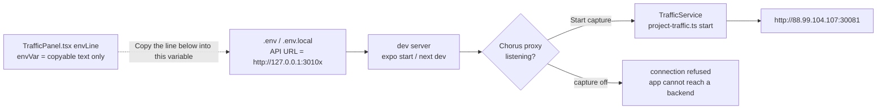
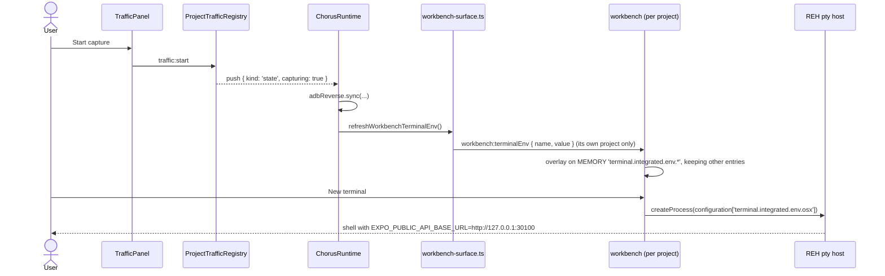
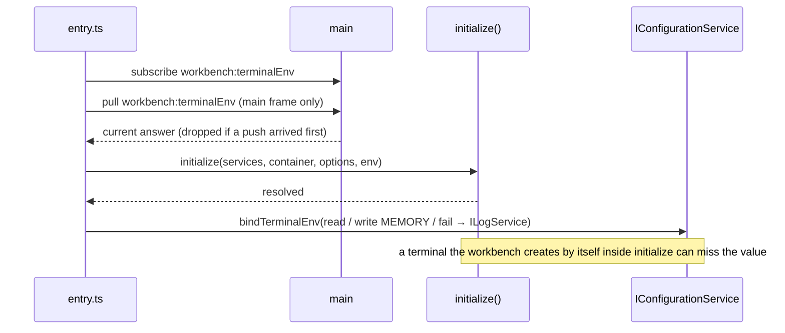
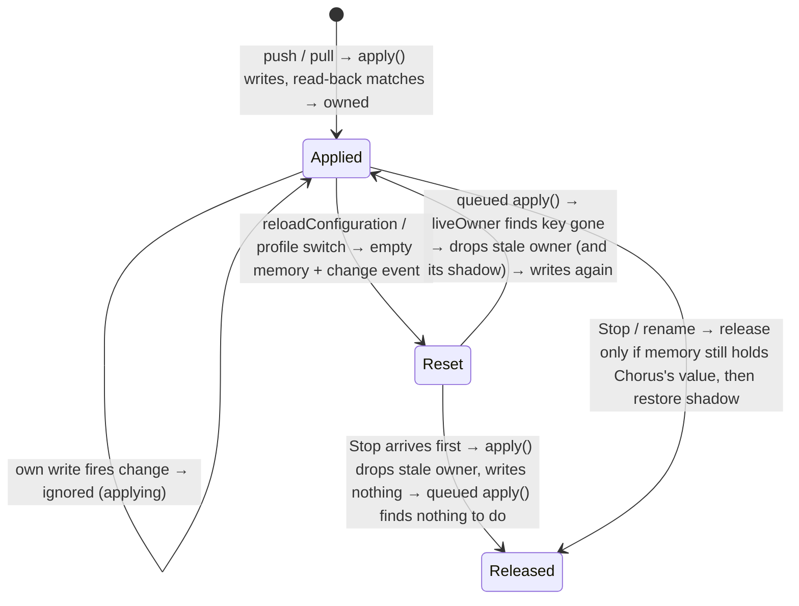
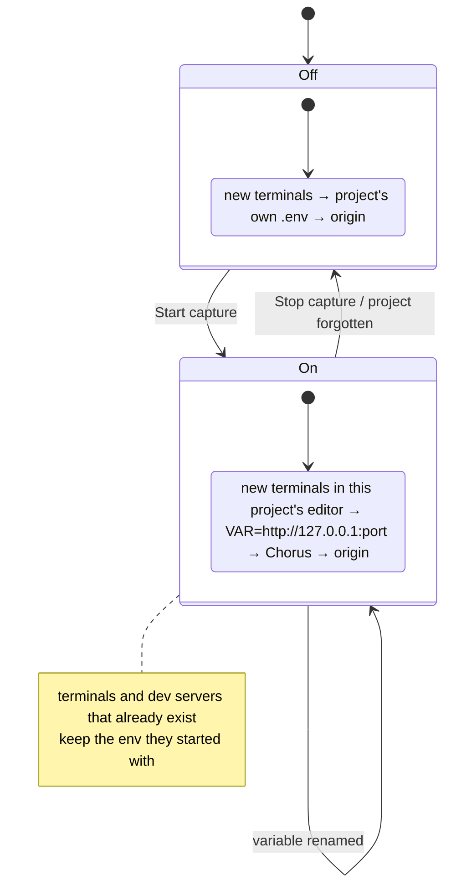

# Capture Without the Env File

Status: **implemented 2026-10-02, reviewed by Codex and Claude, env restored for MOBILE and TPA-1 through TPA-4, built and installed. Runtime NOT VERIFIED.** Chorus 0.20.0 for macOS arm64 was installed at `/Applications/Chorus.app` on 2026-10-02. No tests, separate typecheck, lint, format check or app launch has been run. The regression tests below are written and unrun. Capture behavior remains source-reviewed only. Quit and reopen Chorus to load the installed update.

**Final source review, found and fixed 2026-10-02 (runtime still NOT VERIFIED, tests still unrun):**

1. Any debug start wiped the override for the rest of a capture. `saveAllBeforeDebugStart` calls `reloadConfiguration()` (`debugUtils.js:311`, from `debugService.js:321,752`). `loadConfiguration` then rebuilds `Configuration` with an empty memory model (`configurationService.js:687-698`). `terminal-env.ts` still believed it owned the key and skipped every later push. It now re-validates ownership against live memory and re-applies after relevant configuration changes. Details are in the `terminal-env.ts` section.
2. The panel promised automatic capture even with no variable named, or for a remote project. `empty`, `pointAt` and `envVarHint` are now conditional in wording.
3. The `frameToken` rationale cited the renderer `WebFrame` doc. It now cites `WebFrameMain`.

**Changed from the reviewed plan:** the renderer no longer replaces the whole MEMORY value. It preserves every existing memory entry, restores a value it shadowed, and on stop or rename removes only the key Chorus itself set. `terminal-env.ts` is monaco-free and `entry.ts` injects the configuration calls, so the logic is testable in node. The pull handler also requires the main frame. `empty` and `pointAt` changed with `envVarHint`, because both told the person to point the app's URL at Chorus.

## Current / Issue



| Project (installed profile) | File | Line that points at Chorus | Origin without it |
|---|---|---|---|
| MOBILE `~/code/tpa/tpa-mobile` | `.env` | `EXPO_PUBLIC_API_BASE_URL=http://127.0.0.1:30100` | `src/config/api.ts:3` fallback `http://88.99.104.107:30081` |
| TPA-2 `~/code/tpa/tpa-web-2` | `.env.local` | `JAVA_API_DEV_BASE_URL=http://127.0.0.1:30102` | `JAVA_API_BASE_URL` in the same file |
| TPA-1 `~/code/tpa/tpa-web-1` | `.env.local` | `JAVA_API_DEV_BASE_URL=…30101`, never read by its source | unaffected, left as is |

Expo decides what "restore" has to mean. In development the client reads `process.env.EXPO_PUBLIC_*` through `expo/virtual/env` (`babel-preset-expo/build/plugins/inline-env-vars.js:47-56`, enabled for app code by `common.js:169-177`). That module's dev body is `{ ...process.env, ...dotEnvFiles }` (`@expo/metro-config/build/transform-worker/transform-worker.js` ~150-158). **A key present in `.env` beats any value in the dev server's environment**, so the redirect line is deleted rather than rewritten to the origin. Next is the other way round: `@next/env` `processEnv` only fills keys absent from the initial `process.env`.

## Proposed





**Why the MEMORY target and not the defaults registry.** `configurationRegistry.registerDefaultConfigurations` exists before `initialize`, which would close the startup window above. But `DefaultConfiguration` caches non-language default overrides and seeds the next surface's defaults from that cache (`configuration-service-override/.../browser/configuration.js:20-75`, `DefaultOverridesCacheExists` in `localStorage`). Every surface shares the `chorus-workbench` partition, so one project's proxy URL could reach another project's surface. MEMORY belongs to one configuration-service instance and is never cached.

## Code Changes

### `apps/desktop/src/shared/traffic-ipc.ts`

```ts
export const TRAFFIC_ENV_NAME = /^[A-Za-z_][A-Za-z0-9_]*$/

export const TrafficConfig = z
  .object({
    origin: z.string().nullable().optional(),
    port: z.number().int().min(0).max(65_535).nullable().optional(),
    access: TrafficAccesses.optional(),
    envVar: z.string().max(64).regex(TRAFFIC_ENV_NAME).nullable().optional(),
  })
  .strict()
```

`traffic-ipc.ts:110` already `safeParse`s every request against `TRAFFIC_CONTRACT`. So a name like `MY VAR` is refused at the boundary, and the panel's existing `.catch` shows `traffic.actionFailed`. A name stored before this change is caught again in `terminalEnvOf`.

### `apps/desktop/src/shared/workbench-ipc.ts`

```ts
export const WORKBENCH_TERMINAL_ENV_CHANNEL = 'workbench:terminalEnv'

export interface WorkbenchTerminalEnv {
  readonly name: string
  readonly value: string
}
```

```ts
  readonly terminalEnv: () => Promise<WorkbenchTerminalEnv | null>
  readonly onTerminalEnvChanged: (handler: (env: WorkbenchTerminalEnv | null) => void) => void
```

### `apps/desktop/src/main/project-traffic.ts`

```ts
export function terminalEnvOf(state: ProjectTrafficState | null): WorkbenchTerminalEnv | null {
  if (state === null || !state.capturing || state.port === null) return null
  if (state.envVar === null || !TRAFFIC_ENV_NAME.test(state.envVar)) return null
  return { name: state.envVar, value: `http://${LOOPBACK}:${String(state.port)}` }
}
```

### `apps/desktop/src/main/runtime.ts`

```ts
    this.traffic.subscribe((push) => {
      if (push.kind !== 'state') return
      this.adbReverse.sync(this.traffic.capturingPorts())
      refreshWorkbenchTerminalEnv()
    })
```

```ts
  terminalEnvFor(place: WorkbenchPlace): WorkbenchTerminalEnv | null {
    if (place.host !== LOCAL_HOST) return null
    const project = this.projects.findByPlace(place)
    if (project === null) return null
    return terminalEnvOf(this.traffic.state(project.id))
  }
```

`traffic.dispose` emits no `state` push, which is why both of its callers already re-sync adb by hand. `forgetProject` and `disposeProjectTraffic` now also call `refreshWorkbenchTerminalEnv()` right after that line.

### `apps/desktop/src/main/workbench-surface.ts`

One resolver answers both directions, so a pull and a push cannot disagree about which project a surface belongs to. `findByPlace` uses the registry's case-normalised key, and roots are unique per `(host, canonicalRoot)`. Every state push re-sends every surface its own answer, so same-project panes and detached views stay in step and no project-to-surface matching is needed.

```ts
let terminalEnvSource: ((place: WorkbenchPlace) => WorkbenchTerminalEnv | null) | null = null

export function setWorkbenchTerminalEnvSource(
  source: ((place: WorkbenchPlace) => WorkbenchTerminalEnv | null) | null
): void {
  terminalEnvSource = source
}

function terminalEnvForSurface(surface: Surface): WorkbenchTerminalEnv | null {
  return terminalEnvSource?.({ host: surface.host, root: surface.projectRoot }) ?? null
}

export function refreshWorkbenchTerminalEnv(): void {
  for (const surface of byId.values()) {
    if (surface.view.webContents.isDestroyed()) continue
    surface.view.webContents.send(WORKBENCH_TERMINAL_ENV_CHANNEL, terminalEnvForSurface(surface))
  }
}

function fromMainFrame(event: IpcMainInvokeEvent): boolean {
  const frame = event.senderFrame
  const main = event.sender.mainFrame
  return (
    frame !== null && frame.processId === main.processId && frame.frameToken === main.frameToken
  )
}
```

```ts
  ipcMain.handle(WORKBENCH_TERMINAL_ENV_CHANNEL, (event) => {
    const surface = byContents.get(event.sender)
    if (surface === undefined || !fromMainFrame(event)) throw new Error('unknown workbench surface')
    return terminalEnvForSurface(surface)
  })
```

`processId` plus `frameToken` rather than object identity. Electron documents `WebFrameMain.frameToken` as uniquely identifying a frame within its renderer process (`electron.d.ts` ~18977), so the pair identifies one frame.

### `apps/desktop/src/main/index.ts`

```ts
  registerWorkbenchHandlers(devServerUrl, (projectId) => opened.projects.workbenchTarget(projectId))
  setWorkbenchTerminalEnvSource((place) => opened.terminalEnvFor(place))
```

### `apps/desktop/src/preload/workbench.ts`

Type-only imports and a spelled-out channel, per the file's build constraint.

```ts
export const TERMINAL_ENV_CHANNEL = 'workbench:terminalEnv'

export function asTerminalEnv(value: unknown): WorkbenchTerminalEnv | null {
  if (typeof value !== 'object' || value === null) return null
  const { name, value: url } = value as { name?: unknown; value?: unknown }
  if (typeof name !== 'string' || name === '' || typeof url !== 'string' || url === '') return null
  return { name, value: url }
}
```

```ts
  terminalEnv: async () => asTerminalEnv(await ipcRenderer.invoke(TERMINAL_ENV_CHANNEL)),

  onTerminalEnvChanged: (handler: (env: WorkbenchTerminalEnv | null) => void) => {
    ipcRenderer.on(TERMINAL_ENV_CHANNEL, (_event, env: unknown) => {
      handler(asTerminalEnv(env))
    })
  },
```

A malformed answer becomes `null`, which means no override.

### NEW: `apps/desktop/src/renderer/src/workbench/terminal-env.ts`

Monaco-free. `entry.ts` hands it `read`, `write`, `watch` and `fail`.

```ts
export function overlayTerminalEnv(
  memory: TerminalEnvMemory | undefined,
  owned: OwnedTerminalEnv | null,
  next: WorkbenchTerminalEnv | null
): { readonly memory: TerminalEnvMemory | undefined; readonly owned: OwnedTerminalEnv | null } {
  const releasing =
    owned !== null && memory !== undefined && memory[owned.env.name] === owned.env.value
      ? owned
      : null
  const entries: Record<string, string | null> = Object.fromEntries(
    Object.entries(memory ?? {}).filter(([name]) => name !== releasing?.env.name)
  )
  if (releasing?.shadowed.present === true) entries[releasing.env.name] = releasing.shadowed.value
  if (next === null) {
    return { memory: Object.keys(entries).length === 0 ? undefined : entries, owned: null }
  }
  const present = Object.hasOwn(entries, next.name)
  const shadowed = { present, value: present ? (entries[next.name] ?? null) : null }
  return { memory: { ...entries, [next.name]: next.value }, owned: { env: next, shadowed } }
}
```

```ts
function liveOwner(key: string, memory: TerminalEnvMemory | undefined): OwnedTerminalEnv | null {
  const held = owned.get(key)
  if (held === undefined) return null
  const { name, value } = held.env
  if (memory !== undefined && Object.hasOwn(memory, name) && memory[name] === value) return held
  owned.delete(key)
  return null
}

function apply(): void {
  const bound = target
  if (bound === null) return
  applying = true
  try {
    for (const key of TERMINAL_ENV_KEYS) {
      const memory = bound.read(key)
      const held = liveOwner(key, memory)
      if (sameEnv(held?.env ?? null, wanted)) continue
      const next = overlayTerminalEnv(memory, held, wanted)
      void bound.write(key, next.memory).catch(bound.fail)
      if (!sameMemory(bound.read(key), next.memory)) continue
      if (next.owned === null) owned.delete(key)
      else owned.set(key, next.owned)
    }
  } finally {
    applying = false
  }
}

function schedule(): void {
  if (scheduled) return
  scheduled = true
  queueMicrotask(() => {
    scheduled = false
    apply()
  })
}

export function bindTerminalEnv(next: TerminalEnvTarget): void {
  target = next
  next.watch((affects) => {
    if (!applying && TERMINAL_ENV_KEYS.some((key) => affects(key))) schedule()
  })
  apply()
}
```

`seedTerminalEnv` is `window-focus.ts`'s pattern: subscribe first, pull second, keep the pull only if no push arrived.



- **Memory preserved.** Each write starts from the current `inspect(key).memoryValue`. Entries Chorus did not set are left alone.
- **Shadowing.** If the name was already in memory, its value is remembered and put back on stop or rename. If someone else overwrites Chorus's key while capturing, the change event re-applies. Chorus takes the key back and shadows their value, so Stop restores theirs. Release never removes a value that is not Chorus's.
- **Ownership is checked against live memory, not trusted.** `liveOwner` drops a recorded owner whose value is no longer in memory. That covers `loadConfiguration` building `Configuration` with `ConfigurationModel.createEmptyModel(...)` as `_memoryConfiguration` (`configurationService.js:687-698`; constructor order at `configurationModels.js:677-689`), reached from `reloadConfiguration()` with no target or `USER` (`:357-384`), from a profile switch (`:722-744`), and from every debug start (`debugUtils.js:311`). A dropped owner's shadow is discarded rather than written into the new, reset layer.
- **Re-applied after a reset.** `loadConfiguration(..., true)` fires a change. `Configuration.compare` compares `getValue(key)`, which includes memory (workbench `configurationModels.js:127-153`), so `affectsConfiguration('terminal.integrated.env.*')` is true. `watch` coalesces that into one `queueMicrotask`. The queued `apply()` reads current `wanted` and current memory, so a Stop or rename that lands first wins.
- **Own writes never re-trigger.** The MEMORY branch fires its change synchronously inside `updateValue` (`configurationService.js:1055-1063`), while `applying` is true, so the event is ignored. That stops Chorus's own value being recorded as the shadow. It also prevents a write/notify loop if a read-back ever disagreed with the write.
- **No async queue for writes.** With an explicit target, `updateValue` reaches `writeConfigurationValue`, whose MEMORY branch updates the model before any `await`. So writes land in call order, and `undefined` removes the key (`configurationModels.js:719-720`).
- **Failure is not "applied".** Ownership is recorded only when the value read back synchronously matches what was written. A rejection goes to `fail`, which logs through `ILogService`, and the next push or relevant change retries.
- The MEMORY layer deep-merges over the user's and workspace's `terminal.integrated.env.*` (`configurationModels.js:194-203`). Those layers are never written or copied into memory.

### `apps/desktop/src/renderer/src/workbench/entry.ts`

```ts
  await seedWindowFocus()
  await seedTerminalEnv()
```

```ts
  await initialize(services, container, options, env)

  const configuration = await getService(IConfigurationService)
  const terminalLogs = await getService(ILogService)
  bindTerminalEnv({
    read: (key) => configuration.inspect<TerminalEnvMemory>(key).memoryValue,
    write: (key, memory) => configuration.updateValue(key, memory, ConfigurationTarget.MEMORY),
    watch: (listener) => {
      configuration.onDidChangeConfiguration((event) => {
        listener((key) => event.affectsConfiguration(key))
      })
    },
    fail: (error) => {
      const detail = error instanceof Error ? (error.stack ?? error.message) : String(error)
      terminalLogs.error(`Chorus: capture terminal environment could not be applied — ${detail}`)
    },
  })
```

### `apps/desktop/src/renderer/src/i18n/en.json`

```json
    "empty": "Start capture above. If this project is on this machine and a variable is named below, then start the dev server in a new terminal in this project's editor. Otherwise, point the app's API base URL at the address shown once capture starts.",
    "pointAt": "If this project is on this machine and a variable is named below, new terminals in this project's editor set it to this listener's 127.0.0.1 address. Run the dev server in a new terminal there, and restart it in another new terminal after Start or Stop. Otherwise, point the app's API base URL at {{host}}.",
    "envVarHint": "If this project is on this machine, new terminals in its editor get this variable set to the listener's 127.0.0.1 address while capturing. Terminals and dev servers already running keep their old value, so open a new terminal and restart after Start or Stop. With a variable named, the line below is an assignment to put in front of a command run anywhere else. Without one, it is the address to set as the app's API base URL by hand.",
```

Conditional in wording rather than in rendering. `TrafficPanel` knows the variable but not whether the project is local, and threading the host through as a prop is a larger change than the copy needs. The automatic value is named as the listener's `127.0.0.1` address, separate from the displayed `{{host}}`, which is the LAN address when access is `lan`. The copyable line (`TrafficPanel.tsx` `envLine`: `VAR=http://<address>`, or a bare `http://<address>` with no variable) is unchanged. It stays the route for external terminals, physical devices and remote projects.

### Tests — written, NOT RUN

| File | What fails if the regression returns |
|---|---|
| `main/project-traffic.test.ts` | loopback value only while capturing; rename followed; stop clears; a legacy `MY VAR` or `null` name hands over nothing |
| `main/workbench-surface.test.ts` | each surface answered about its own project from the sender; the shell, a non-main frame and a `null` frame are refused; a refresh pushes every surface its own answer; no source means `null` |
| `preload/workbench.test.ts` | channel spelled the same as the shared constant; exactly 27 exposed methods; malformed payloads become `null`; pushes reach the subscriber checked |
| NEW `renderer/src/workbench/terminal-env.test.ts` | other memory entries kept; shadowed value restored; rename drops only the old key; someone else's value not taken back; stale pull loses to a push; failed write logged and retried, not recorded; override re-applied on all three keys after a memory reset and released again on Stop; a pre-reset shadow is not restored into the reset layer; a Stop before the queued reapply wins; a rename after a reset leaves only the new name; own change events neither re-shadow nor re-write; a read-back that disagrees does not loop |

`FakeWebContents` in `workbench-surface.test.ts` gained a `mainFrame`, and the `beforeEach` there resets the source.

## One-time restoration, outside this repository

Completed by Codex after integrated source review and filesystem escalation. Only the named line was removed from each file. A byte comparison with the private backups confirmed that every other byte was preserved. MOBILE uses its existing original-backend fallback; TPA-2 uses its existing original `JAVA_API_BASE_URL`. TPA-1 was left untouched.

Private backups: `/private/tmp/chorus-capture-baseline-j8hxte9i/env-backups-ttcg0mrl`. Files have mode 0600 inside a mode-0700 directory. Restoration command: `python3 /private/tmp/chorus-capture-baseline-j8hxte9i/restore-env.py`. Exit status: 0.

| File | Delete | Leaves |
|---|---|---|
| `~/code/tpa/tpa-mobile/.env` | `EXPO_PUBLIC_API_BASE_URL=http://127.0.0.1:30100` | `src/config/api.ts` fallback → origin |
| `~/code/tpa/tpa-web-2/.env.local` | `JAVA_API_DEV_BASE_URL=http://127.0.0.1:30102` | `JAVA_API_BASE_URL` → origin |

## Delivery record

The confirmed cause was a permanent project env redirect to a Chorus proxy whose listener exists only during capture. The project could not reach its backend while that listener was stopped. The correction restores normal project configuration and puts the optional override in Chorus's per-project terminal configuration.

Meaningful files are the main traffic mapper and runtime, workbench surface and bootstrap, shared traffic/workbench contracts, workbench preload, renderer `terminal-env.ts` and `entry.ts`, translated Traffic guidance, and four regression test files. The complete source change is recorded above. The task-only diff is `/private/tmp/chorus-capture-baseline-j8hxte9i/final-task.patch`; it excludes the working tree's pre-existing changes.

| Acceptance criterion | Result | Evidence |
|---|---|---|
| Remove the two active permanent proxy redirects, preserving other env data | PASS | Both files were written successfully and compared byte-for-byte with their private backups after removing only the selected line. |
| Normal fresh dev starts reach the original backend independently of Chorus | NOT VERIFIED | Original configuration and fallback were source-reviewed; neither dev server was launched. |
| Capture sets the configured URL in fresh local project terminals | NOT VERIFIED | Routing and installed terminal configuration source were reviewed; no running terminal was observed. |
| Stop, rename and project disposal remove only Chorus's override | NOT VERIFIED | Source review and written, unrun regression tests. Existing shells still require a fresh terminal. |
| Other projects and remote hosts do not inherit the override | NOT VERIFIED | Owned-surface resolver and local-host guard reviewed; isolation tests are unrun. |
| A surface opened during capture gets current state | NOT VERIFIED | Initial pull and stale-pull guard reviewed; no app launch. |
| Existing terminal settings survive, including configuration reload | NOT VERIFIED | MEMORY overlay, reload listener and re-entrancy guard reviewed; regression tests are unrun. |
| Start/Stop require no persistent env or editor-settings edits | PASS, source scope | Capture writes only ConfigurationTarget.MEMORY. The separate, one-time env restoration is recorded above. |

Verification performed: source and diff review against the initial baseline and the review-fix snapshot, installed dependency API/source inspection, and static review of the env-file deltas. At the user's explicit build-and-install request, `pnpm exec turbo run build '--filter=@chorus/desktop^...'` succeeded for all eight dependencies (cache hits), `node build/package-local.mjs` succeeded, and `CHORUS_INSTALL_KEEP_RUNNING=1 node build/install-local.mjs` installed the app and passed its `codesign --verify --deep --strict` step. Both Node commands ran from `apps/desktop`. Installed metadata reads `0.20.0` and `dev.chorus.desktop`. **No executable capture acceptance checks were run.** `pnpm test`, `pnpm typecheck`, `pnpm lint` and `pnpm check` remain unrun, in accordance with the standing no-testing instruction.

Written regression coverage includes start/stop/rename, foreign IPC senders, per-surface routing, stale pulls, shadowed and unrelated memory values, rejected writes, debug/profile memory resets and queued reapply ordering. The adjacent running-app flows remain unverified.

Research references: [Expo environment variables](https://docs.expo.dev/guides/environment-variables/) describes Expo's environment mechanisms; the precedence conclusion for installed Expo 57 comes from its installed transform-worker and Babel sources. [VS Code terminal profiles](https://code.visualstudio.com/docs/terminal/profiles) documents `terminal.integrated.env.<platform>`; the per-surface behavior was checked in the pinned Code-OSS dependency source.

Remaining limits are listed below. The updated build is installed, while the current session continues in the previous copy at `/Applications/Chorus.app.replaced-1790938044659`. That copy can be deleted after quitting it. No commit, push or deployment was performed. Scope expanded by the user's later requests to restore TPA-1 through TPA-4 and build and install Chorus.

## Limits — stated in the panel, not hidden

- **The env is fixed when a process starts.** A dev server running before Start stays on the origin and is not captured. After Stop, a terminal opened during capture still has the variable exported, and a dev server restarted inside it hits a dead port. The answer both ways is a new terminal.
- **Revived terminals keep their old env.** `RemoteTerminalBackend.getTerminalLayoutInfo` revives processes from `TerminalBufferState` in workspace storage (`remoteTerminalBackend.js:337-365`), and Chorus made that storage durable. Whether a Chorus quit counts as `QUIT`/`LOAD` for `_shouldReviveProcesses` (`terminalService.js:694-710`) has not been checked.
- **A terminal the workbench creates by itself during `initialize`** (e.g. a panel left open on the terminal view) may be created before `bindTerminalEnv` runs.
- **A terminal profile's own `env`, or a task's `options.env`, overrides the setting** for the same key. This is upstream VS Code's `createTerminalEnvironment` merge order, not read in this build's REH.
- **Not covered:** external terminals, Chorus's global terminal, debug launches and commands agents run. These use the copied line as a command prefix.
- **Local projects only.** A remote-host surface gets `null`, because its REH cannot reach this Mac's loopback.
- **Loopback, not the LAN address.** This reaches the Next server, the iOS simulator, and Android through Chorus's `adb reverse`. It does not reach a physical iOS device, or an Android device without adb. Those use the panel's LAN line.
- **A valid but harmful name such as `PATH` is not refused.** The person typed it, and Stop clears it for new terminals.

## Verification — NOT RUN

Source proof (read in this checkout, 2026-10-02):

- `remoteTerminalBackend.js:201-206`: every new remote terminal sends the surface's `terminal.integrated.env.{windows,osx,linux}`.
- `services.ts:613`: Workspace Trust is disabled, so the restricted setting is not gated.
- `configurationService.js:1046-1063`: the MEMORY write is synchronous. `configurationModels.js:194-203, 719-722`: deep merge, and `undefined` removes the key. `inspect().memoryValue` reads the live memory model.
- `window-focus.ts:81-93`: the subscribe-first, pull-second, stale-pull guard pattern reused here.
- `@expo/env/build/index.js:270,456`, the `transform-worker.js` virtual env, and `@next/env` `processEnv`: precedence as stated above.

Runtime proof still owed, when asked for:

1. The four test files above pass, and typecheck and lint are clean.
2. With capture off, `expo start` and `next dev` from a fresh terminal reach `http://88.99.104.107:30081`.
3. Start capture, then a new terminal in MOBILE: `echo $EXPO_PUBLIC_API_BASE_URL` prints `http://127.0.0.1:30100`. The same in a TPA-2 terminal prints nothing.
4. The Expo app on the Samsung (adb reverse) shows rows in Traffic. A TPA-2 dev server started under capture shows rows.
5. Stop: a new MOBILE terminal has no variable.
6. Open MOBILE's editor while capture is already running: the first manually opened terminal has the variable.
7. Rename the variable mid-capture: a new terminal has the new name and not the old one.
8. The user's own `terminal.integrated.env.osx` entries are still present in a terminal, and `settings.json` is unchanged.
9. `expo start` restarted without `--clear` picks up the changed value.
10. Mid-capture, start any debug session in MOBILE's editor, then open a new terminal: the variable is still set. After Stop, a new terminal has none.

## Final Flow


