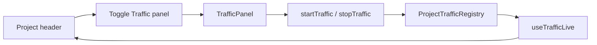
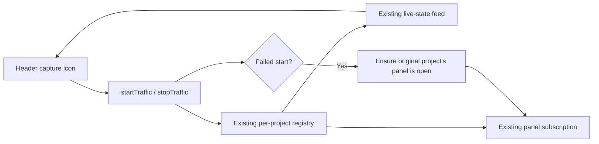
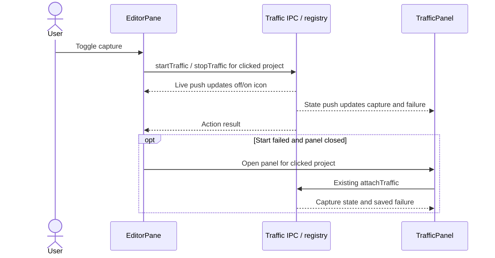

# Project header capture toggle

## Current / Issue



Capture is controlled only inside the panel. Header capture state already arrives independently through `traffic:livePush`. A second `attachTraffic` would replace the panel's document subscription.

## Proposed



One atomic change: the header control, its off/on styles, panel failure synchronization, and selectors affected by the duplicated accessible name. Preserve the existing panel action, its origin guard, and the traffic-view toggle.

Acceptance: icon beside the view toggle; hollow off / filled red on; localized action name and `aria-pressed`; operation with the panel closed; project-scoped updates; visible registry and IPC failures; field refusals retain their current placement; setup follows newly assigned ports; existing selectors keep targeting the panel; reduced-motion preference respected.

## Code Changes

### `apps/desktop/src/renderer/src/workspace/EditorPane.tsx`

Use the existing `trafficLive` boolean and IPC actions. Read panel openness imperatively at response time with `useWorkspaceStore.getState()` before calling `toggleTraffic(projectId)` and `commitLayout()`. Retain the clicked project id throughout the request. Keep a project-tagged local IPC failure and render `t('traffic.actionFailed')` with `role="alert"` below the header when that project is active.

```tsx
<button
  type="button"
  className="conversation-dock-add"
  data-traffic-capture="true"
  data-capturing={trafficLive}
  aria-pressed={trafficLive}
  aria-label={trafficLive ? t('traffic.stop') : t('traffic.start')}
  title={trafficLive ? t('traffic.stop') : t('traffic.start')}
  onClick={toggleCapture}
>
  <span className="traffic-capture-icon" aria-hidden="true" />
</button>
```

### `apps/desktop/src/renderer/src/TrafficPanel.tsx`

Synchronize the displayed failure alongside capture state for this project's state pushes and initial attachment. Preload fans each push out to every listener, so the project guard prevents another panel's push from overwriting this panel's port draft or error. Same-project panels can still share capture state. The `capturing` configuration refusal remains owned by its field handler so attachment and unrelated pushes do not show it at the panel's foot. Retain current local action/refusal handlers.

```ts
if (push.kind === 'state' && push.projectId === projectId) {
  setCapture(push.state)
  if (push.state.failure !== 'capturing') setFailure(push.state.failure)
}

setCapture(opened.state)
setFailure(opened.state.failure === 'capturing' ? null : opened.state.failure)
```

The existing panel action synchronizes `portDraft` from its action response. Header actions have no such response handler in the panel. Follow actual committed-port changes, including an automatically allocated port, while preserving drafts on other pushes:

```ts
useEffect(() => {
  setPortDraft(String(capture.wantedPort ?? DEFAULT_TRAFFIC_PORT))
}, [capture.wantedPort])
```

### `apps/desktop/src/renderer/src/styles.css`

Draw a small hollow ring in the stopped state and a filled `var(--danger)` circle during capture. Reuse the live pulse and its reduced-motion handling. Add no dependencies or new components.

### `apps/desktop/e2e/traffic-drive.mjs`

```js
document.querySelector('.traffic-panel [aria-label="Start capture"]')
```

Scope the existing Start selectors to the panel so its disabled-origin observation and start action keep their original target.

Code and complete diff review are authorized. Tests, typecheck, lint, builds, app launches, and runtime/UI verification are not run under the repository's explicit testing restriction. No new tests for this small reversible control change.

## Review outcome

Implemented locally. Codex inspected the complete product/driver diff. Claude performed an adversarial source review. The confirmed cross-project draft/failure regression was corrected with the project guard and reviewed again with no further supported findings.

| Acceptance criterion                                                                     | Status                    | Evidence                                                                                                       |
| ---------------------------------------------------------------------------------------- | ------------------------- | -------------------------------------------------------------------------------------------------------------- |
| Capture control beside the traffic-view control, existing panel control retained         | PASS by source inspection | `EditorPane` header JSX; unchanged `TrafficPanel` action JSX                                                   |
| Hollow off / filled red on, localized action labels, `aria-pressed`                      | PASS by source inspection | Existing `trafficLive` feed; `data-capturing`; icon CSS; existing i18n keys                                    |
| Start/stop the clicked project with the panel closed                                     | NOT VERIFIED at runtime   | Code reviewed: `toggleCapture` uses existing start/stop IPC without attaching a new subscription               |
| Failed Start opens a closed panel without closing an open panel                          | NOT VERIFIED at runtime   | Code reviewed: pinned project id and response-time store read in `toggleCapture`                               |
| Rejected IPC visibly reports for its project                                             | NOT VERIFIED at runtime   | Code reviewed: project-tagged local failure and translated `role="alert"` notice                               |
| Initial/pushed capture errors synchronize; configuration refusals stay with their fields | NOT VERIFIED at runtime   | Code reviewed: guarded state branch, attach failure adoption, preserved field handlers                         |
| Assigned port synchronizes without ordinary pushes overwriting drafts                    | NOT VERIFIED at runtime   | Code reviewed: port-draft effect depends only on committed `capture.wantedPort`; push state is project-guarded |
| Existing driver selectors still target the panel action                                  | PASS by source inspection | Both Start selectors scoped to `.traffic-panel`                                                                |
| Reduced-motion preference disables the new pulse                                         | PASS by source inspection | Media rule uses the same specificity as the animated selector                                                  |
| Runtime behavior and visual appearance                                                   | NOT VERIFIED              | No app launch, UI driver, screenshot, or runtime harness authorized                                            |
| Typecheck, lint, formatting, tests, build                                                | NOT VERIFIED              | Not run under the explicit repository testing restriction                                                      |

Verification commands included `git diff --stat`, `git status --short`, and the complete scoped diff:

```sh
git diff -- apps/desktop/src/renderer/src/workspace/EditorPane.tsx apps/desktop/src/renderer/src/TrafficPanel.tsx apps/desktop/src/renderer/src/styles.css apps/desktop/e2e/traffic-drive.mjs
```

Adjacent behavior reviewed in source: traffic-view toggle, panel Start's origin guard, field refusal placement, committed-port restoration, project switching, empty panes, and existing driver targets. No new tests were added. No external research was needed.

Remaining risk: runtime/visual behavior and automated checks remain unverified. Main's existing one-subscription-per-document limitation can leave an earlier panel without updates after a second traffic panel attaches; it requires separate work. Scope covers the requested control, required panel state/selector compatibility updates, and this plan. No unrelated implementation work, dependencies, commits, or publishing.

## Final Flow


