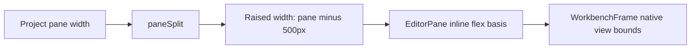
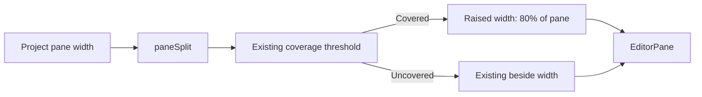
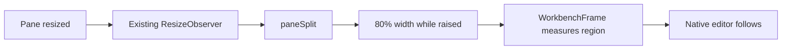

# Floating editor at 80% of its pane

## Status

| Item | Result |
| --- | --- |
| Implementation | Complete: two product files and existing test expectations updated |
| Codex integrated review | Complete: actual diff and all three changed files read |
| Claude adversarial review | Complete: no findings |
| Runtime verification | NOT VERIFIED: no tests, typechecks, lint, builds, or app checks run |

## Current / Issue



## Proposed



## Code Changes

### `apps/desktop/src/shared/workspace-layout.ts`

```ts
export const EDITOR_WIDTH = { resizeFloor: 400, peek: 61, raisedFraction: 0.8 } as const
```

### `apps/desktop/src/renderer/src/workspace/layout.ts` → `paneSplit`

```ts
const uncovered = Math.max(pane - CHORUS_WIDTH.min, EDITOR_WIDTH.peek)
const covered = chorus > 0 && beside < uncovered
return {
  chorus,
  editor: covered ? Math.min(EDITOR_WIDTH.resizeFloor, uncovered) : uncovered,
  raised: covered ? Math.round(pane * EDITOR_WIDTH.raisedFraction) : uncovered,
  covered,
}
```

### `apps/desktop/src/renderer/src/workspace/layout.test.ts` → `paneSplit`

Update the existing covered-case `raised` expectations:

| Pane / stored Chorus width | Raised width |
| --- | --- |
| 1000 / 601 | 800 |
| 900 / 501 | 720 |
| 1000 / 5000 | 800 |
| 899 / 700 | 719 |

## Acceptance and verification

Raised width is 80% of the measured project pane, rounded to a pixel, including after resizing. Coverage detection, unraised editor widths, Chorus sizing, and raise/lower controls retain their existing behavior. No CSS, native-view, persistence, or dependency changes.

PASS by code review: `paneSplit` returns the rounded 80% width in covered cases. The four expected raised widths are 800, 720, 800, and 719. PASS by code review: coverage detection, unraised editor widths, Chorus sizing, and controls retain their existing formulas and call paths. NOT VERIFIED: live raising/lowering, resizing, split-pane behavior, and native-view presentation.

The prior raised width came from `Math.max(pane - CHORUS_WIDTH.min, EDITOR_WIDTH.peek)`, with a 500px Chorus minimum. That expression now remains only as the coverage and unraised-sizing threshold.

Codex reviewed the complete task diff with this command:

```sh
git diff -- apps/desktop/src/shared/workspace-layout.ts apps/desktop/src/renderer/src/workspace/layout.ts apps/desktop/src/renderer/src/workspace/layout.test.ts
```

Codex also read all three changed files and the existing ResizeObserver → paneSplit → WorkbenchFrame path. Claude's final adversarial review returned no findings. Existing regression expectations for unraised sizing and coverage remain unchanged; four raised-width expectations were updated but not executed.

Tests, typechecks, lint, builds, and app verification remain unrun under the project instructions. If later requested, run `pnpm test -- apps/desktop/src/renderer/src/workspace/layout.test.ts` and manually check resizing and raising/lowering in a split workspace. Runtime presentation is the remaining unverified risk.

No external research was needed. Scope: the width change, existing test expectations, and this required plan record. Concurrent traffic changes were left untouched.

## Final Flow


