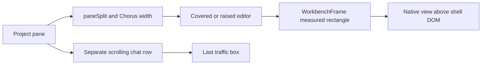
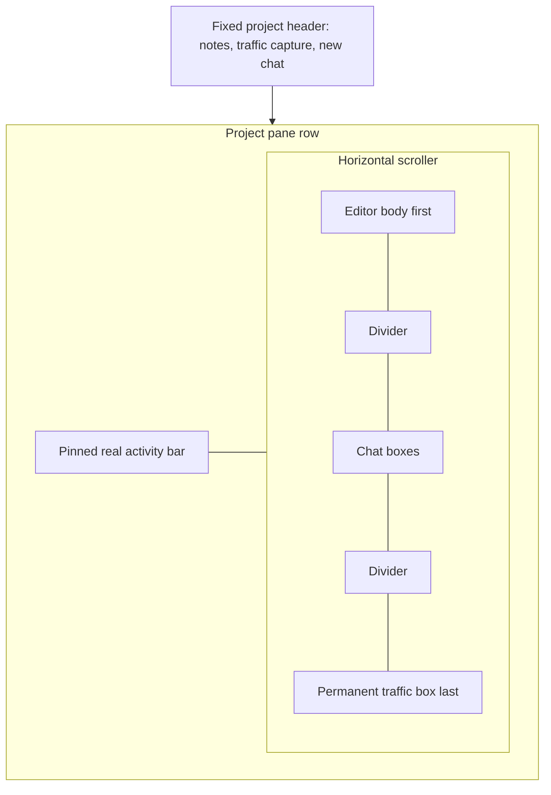

# Editor, chats and traffic in a horizontal row

## Status

| Unit                                                | Result                                                                                                                                                                                                                                                         |
| --------------------------------------------------- | -------------------------------------------------------------------------------------------------------------------------------------------------------------------------------------------------------------------------------------------------------------- |
| Investigation                                       | Complete by source inspection; native behavior NOT VERIFIED                                                                                                                                                                                                    |
| U1: widths, persistence and divider math            | Implemented; Codex diff/context review complete; authored tests NOT RUN                                                                                                                                                                                        |
| U2: workbench viewport and activity bar             | Implemented and Codex diff/context review complete; agent-edit reveal removed in U3                                                                                                                                                                            |
| U3: horizontal row and removal of floating controls | Implemented; both Codex findings corrected and reviewed; authored tests NOT RUN                                                                                                                                                                                |
| Integrated review                                   | Complete by Codex diff/context inspection and Claude adversarial review, including the final corrections; no unresolved source-review findings                                                                                                                 |
| Fixed 800px editor revision                         | Superseded by the fixed 80% revision. Implemented by Claude; finished and source-reviewed by Codex after the user's takeover instruction; authored tests NOT RUN                                                                                               |
| Fixed 80% editor and wheel forwarding               | Implemented by Codex and Claude; Codex integrated diff/context review and Claude adversarial review complete; tab-strip and formatting corrections inspected by Codex; no unresolved required source corrections; authored tests NOT RUN; runtime NOT VERIFIED |
| Swipe interruption at the native editor edge        | JavaScript cancellation correction IMPLEMENTED by Claude and source-reviewed by Codex and Claude; user subsequently reports the swipe is fixed; task closed on that manual confirmation; native proposal remains unimplemented                                 |
| Runtime verification                                | Authorized running-dev check previously reproduced the stop in both directions; temporary hooks and debugger removed; user now reports corrected swipe behavior; no agent-run verification of the correction or broad checks                                   |
| Permanent Traffic and one header capture control    | T1 and T2 implemented by Claude; Codex integrated diff/context review and Claude adversarial review complete; no unresolved required source findings; authored regressions NOT RUN; runtime NOT VERIFIED; checks NOT AUTHORIZED for this revision              |
| Capture header refusal feedback and live-read race  | Implemented by Claude; Codex diff/context review and Claude integrated adversarial review complete; no required findings remain; two regressions authored NOT RUN; runtime NOT VERIFIED                                                                        |

## Current / Issue



The floating editor and its toggles are superseded by this request, including the earlier 80% change. Shell overflow cannot clip a native editor view. Existing capture controls and unrelated traffic changes must survive.

## Proposed



| Box                               | Default                                  | Minimum                                                    |
| --------------------------------- | ---------------------------------------- | ---------------------------------------------------------- |
| Editor, including activity gutter | Always 80% of the app window's CSS width | Fixed proportional width; no saved override or drag resize |
| Each chat column                  | 500px                                    | 500px                                                      |
| Traffic                           | 800px                                    | 800px                                                      |

The whole row scrolls except the activity gutter. Boxes retain their widths instead of flex-growing or shrinking. Chat and traffic dividers allow pointer dragging and arrow-key resizing; the editor's boundary is fixed. Double-clicking any divider resets all chat and traffic widths for the project. Traffic is always the last box for an active project. Its header icon starts or stops capture, and its visibility toggle and close button are removed by the latest request.

The latest instruction supersedes the editor's 800px default/minimum: keep its full box at `round(window.innerWidth * 0.8)` on window resize. Chat and traffic dividers remain adjustable; the editor boundary becomes a fixed separator that still permits double-click reset. Remove obsolete editor-width overrides and their owned persistence/actions/tests so a previously stored large width cannot override the proportion.

Horizontal wheel and Shift-wheel gestures over the native workbench must reach this project's row while hovered, without requiring shell focus. A capture-phase workbench listener converts supported wheel units to CSS pixels and forwards only horizontal browsing gestures through a validated sender-scoped main/preload push. The visible frame routes that push to its project scroller. Ordinary vertical editor scrolling and modified zoom gestures over the native editor remain local; previews have weaker guarantees, recorded under Known limits. The standalone probe, which has no row geometry or logical-width override, keeps its current wheel behavior. Native bounds still crop to the pane and retain the real activity gutter.

## Code Changes

### U1: `apps/desktop/src/shared/workspace-layout.ts`

```ts
export const EDITOR_WIDTH = { fraction: 0.8 } as const
export const TRAFFIC_WIDTH = { default: 800, min: 800 } as const
```

U1 first added a defaulted `editorWidths` snapshot field and an optional `editorWidth` slice field. The fixed 80% revision removed both, with their action, hook and clamp; old snapshots and slices strip the field on parse. The editor constant owns only the 0.8 window fraction.

### U1: `apps/desktop/src/renderer/src/workspace/layout.ts`

```ts
export function pushDivider(
  widths: readonly number[],
  index: number,
  delta: number,
  minimums: readonly number[] = widths.map(() => BOX_WIDTH.min)
): { widths: number[]; scroll: number }
```

Retain the existing push behavior while applying the left item's supplied minimum: chat 500px, traffic 800px. The editor's boundary is a fixed separator, so no drag or key changes the editor. `editorWidthIn(windowWidth)` returns `round(windowWidth * 0.8)`.

Traffic's closed/default state and normalization use `TRAFFIC_WIDTH`, rather than the chat clamp. Old stored traffic widths below 800 become 800 without changing open/closed state. Editor widths are not stored.

### U1: `apps/desktop/src/renderer/src/workspace/store.ts` and `hooks.ts`

`resetProjectWidths` resets chats to 500 and traffic to 800 in one update. The editor follows the window and has nothing to reset.

Author regression cases in `layout.test.ts`, `store.test.ts`, and `main/open-projects.test.ts` for old snapshots, including a stored `editorWidths` being stripped on parse, independent chat and traffic minima, non-finite clamps, and reset. No editor slice exists to round-trip. Leave them unrun.

### U2: `apps/desktop/src/shared/workbench-ipc.ts`, `main/workbench-surface.ts`, `preload/workbench.ts`

```ts
'workbench:setBounds': {
  request: z.object({
    viewId: z.string().min(1),
    rect: WorkbenchRect,
    layoutWidth: z.number().int().positive().optional(),
  }),
  response: z.object({ ok: z.literal(true) }),
}
```

Main caches optional logical width per surface and pushes it on change and `did-finish-load`. Preload buffers the latest width for late subscription. Views remain direct children of `contentView`; existing zoom conversion, ownership checks, handoff, and overlay visibility remain authoritative. The probe supplies no override and retains its current layout.

### U2: `apps/desktop/src/renderer/src/workbench/entry.ts` and `renderer/workbench.html`

```ts
window.chorusWorkbench.onLayoutWidth((width) => {
  container.style.width = `${width}px`
  window.dispatchEvent(new Event('resize'))
})
```

Subscribe after creating the root, before initialization. The workbench root keeps its logical width while its native viewport narrows. Use `overflow: clip` on `html, body` to prevent focus scrolling the document away from its activity bar.

The installed `IWorkbenchLayoutService` exposes `getContainer(window, Parts.ACTIVITYBAR_PART)`, `isVisible`, layout events, and part visibility events. Report the actual left activity-bar width to the shell using a narrow sender-scoped push; compact mode must reserve its actual width. If settings move or hide the bar, reserve no false bar. Do not overwrite user settings.

The logical width is capped at the space available inside the pane at rest. No editor width is stored. When 80% of the window exceeds the pane, as in a split, the editor box is wider than the pane and pushes chats further right, while the logical width stays capped so the workbench's controls fit within the pane. With `x` at gutter left plus 3px, use the rounded positive `min(editorWidth - 11, scrollerRect.right - 3 - x)` logical width, as `editorViewport` below computes it. Cropping from horizontal browsing is independent of that width. Returning the row to zero restores the complete logical layout.

Interaction with a cropped workbench reveals its row, including when the native view already has focus. Capture-phase pointer/key events send a reveal only while the viewport is narrower than the root. The installed `IQuickInputService.onShow` and `IDialogService.onWillShowDialog` cover extension-driven palettes and modal dialogs. Existing file-reveal and opening ask-diff requests also reveal the row. Automatic agent edits preserve the user's row position. This corrects the initial plan's edit-triggered reveal after reviewing the agent-driven request path. Route through main's `byContents` lookup to only that surface's owner; use a channel distinct from the existing file-reveal request. Clean shell subscriptions on unmount or handoff.

Bar reports require a cached initial read as well as change pushes, so a late frame or detached window does not remain at a guessed width. The real bar is preserved when left-positioned and visible. User settings that hide or relocate it remain authoritative. Automatic notifications may arrive while browsing other boxes; returning to the editor makes its notification center accessible. This does not force horizontal browsing back for every toast.

### U3: `apps/desktop/src/renderer/src/workbench/WorkbenchFrame.tsx`

Accept optional measured geometry containing native viewport rectangle and logical width. Deduplicate on both. Preserve startup ordering and inactive-frame hiding. Remove floating `covered` behavior by ownership. An overlay still must occupy the actual pinned native rectangle, including the gutter, rather than the body box's scrolling rectangle.

### U3: `apps/desktop/src/renderer/src/workspace/EditorPane.tsx`, `PaneWorkbench.tsx`, `ProjectNotes.tsx`, `styles.css`

Keep the project header outside the scroller and use `useShellOverlay` while project notes are open. Build editor first, chats next and traffic last. All project workbench slots remain mounted; only inactive project slots hide. Preserve capture start/stop, failure notice, and traffic close handling.

Fixed gutter plus editor body must sum to the editor's 80% width. Reserve the horizontal scrollbar's height from native bounds. The view must stay inside the pane and stop before the editor divider and any overlying chat. Width calculations must use the current DOM rects and actual bar width.

Generalize `startRowPush` with per-item minimums for chats and traffic, and preserve its overflow scroll adjustment. Add keyboard handlers using the existing 8px and Shift-40px increments.

Remove editor toggle bar, raise shortcut, `ChorusSash`, floating/covered CSS, `paneSplit`, old width/hidden state and slice fields, `useRaisedEditor`, obsolete tests, composer toggle props/button and `Session.tsx` wiring, and owned unused translation keys. Remove the unused covered IPC tail when its callers are gone; retain overlay and per-frame visibility channels. Never remove unrelated terminal controls or concurrent capture changes.

### U3 implementation revisions

- `.workspace-pane-content` is now the column and the stacking context: header, capture notice, then `.workspace-pane-row`. The old `.workspace-pane-chorus` wrapper and its absolute and `data-full` rules are gone.
- The fixed gutter is `.workspace-pane-gutter` holding `.workspace-pane-bar`. Its 3px left inset is `ROW_EDGE_INSET` from `layout.ts`, applied inline, so the body width `editorWidth - (3 + bar)` has one source. The body keeps `padding: 3px 8px 3px 0` in CSS.
- `editorViewport(bar, surface, scroller)` in `layout.ts` measures the bar element, the frame's own `.workbench-surface` (the body's content box), and the scroller's border box. All values are rounded CSS pixels:
  - `limit = scroller right - ROW_EDGE_INSET` (3px clear of the rounded pane edge);
  - `floor = scroller bottom - ROW_SCROLLBAR_STRIP` (12px kept for the horizontal scrollbar);
  - `x = bar left`, `y = surface top`;
  - `right = max(min(bar right, limit), min(surface right, limit))`, `bottom = min(surface bottom, floor)`;
  - `rect = { x, y, width: max(0, right - x), height: max(0, bottom - y) }`;
  - `layoutWidth = min(surface width + bar width, limit - x)`, omitted below 1.
- The strip is measured from the scroller's border box, so it covers both scrollbar modes with no `offsetHeight - clientHeight` probe. With an overlay scrollbar the native view stops 12px above the row's bottom. With a classic scrollbar, the bar already sits below the surface, so the surface bottom (3px above the client area) is the tighter bound and nothing extra is taken unless the scrollbar is thinner than 9px (the strip less that 3px inset). The scroller keeps `scrollbar-width: thin`.
- `clampActivityBar(reported, editorWidth, paneWidth)` limits a report to half of the smaller of the editor box and the pane; non-finite or negative gives 0.
- `WorkbenchFrame` takes optional `geometry`, `onActivityBar` and `onRevealRow`, held in a latest-value ref so a replaced callback never reopens the surface. Geometry results are deduplicated on rectangle and layout width. The activity-bar subscription runs while mounted, with a cached read that a newer push overrides; the row subscription runs only while visible.
- The overlay still uses CSS custom properties written beside each bounds report and `position: fixed` under `[data-native]`, so it covers the gutter and the visible body exactly. No pane ancestor uses `transform`, `filter` or `contain`.
- Row dividers share one handler set: pointer push with per-item minimums (chat 500, traffic 800; the editor boundary is fixed), arrow keys at 8px or Shift-40px with `preventDefault`, commit on arrow keyup, and double-click reset. A divider whose right item is the fixed empty state does not scroll.
- The covered tail is removed from the shell contract, both preloads' types, main (`setSurfaceCovered`, `coveredHidden`, `coverWanted`, `lastStills`) and the tests. `requestWorkbenchEdit` no longer reveals the row.

### U3 corrections

- **Drag returning to its start (historical).** The row-drag helpers moved to `workspace/row-drag.ts` so they can be driven in jsdom, and `startRowPush` briefly kept a drag-local `editorTouched` latch so a drag returning to its origin rewrote the editor width. The latch went with the saved editor widths in the fixed 80% revision: the editor boundary is now static and no drag or key writes an editor width.
- **Scrollbar strip and right inset.** The native viewport leaves `ROW_SCROLLBAR_STRIP` at the bottom of the row and stops `ROW_EDGE_INSET` short of the pane's right edge, per the contract above. Box widths, the 8px sash clearance and the left and top/bottom insets are unchanged.

### Final corrections

- **Earlier 450px minimum, superseded.** Installed Code-OSS 33.0.9 needs 48px for the activity bar (`activitybarPart.js` `ACTIVITYBAR_WIDTH`), 170px for the sidebar (`sidebarPart.js:96`) and 220px for the editor (`editor.js:7`, `DEFAULT_EDITOR_MIN_DIMENSIONS`): 438px. The row's insets take 11px of the box (3px left, 8px sash clearance), which justified the provisional 450px floor. A later instruction replaced that floor and the pane-derived default with fixed 800px sizing, which the fixed 80% revision has since superseded. There is no editor minimum now.
- **Activity-bar size changes.** Toggling compact mode runs the activity-bar part's own `_onDidChange.fire()` (`activitybarPart.js:113-119`), a grid size change that does not by itself go through `Layout.layout()`, so `onDidLayoutMainContainer` is not guaranteed to fire. `watchWorkbenchChrome` therefore also observes `getContainer(window, Parts.ACTIVITYBAR_PART)` with a `ResizeObserver` and remeasures through the same deduplicated report. The layout and visibility subscriptions stay. When the container is unavailable, no observer is created.
- **Captured gutter (historical).** While the editor boundary was draggable, a drag froze the body width and the gutter width together, and persisted their sum plus the drag delta, which stayed correct even if a bar report changed the DOM gutter mid-drag. The fixed 80% revision removed editor drags and editor-width persistence, so nothing is captured or persisted for the editor now.

### Fixed 800px editor revision (superseded by the 80% revision)

The user requested that the editor match traffic's 800px default and minimum. Claude implemented the constant, helper/caller and regression updates before reaching its session limit. Codex took over on the user's instruction, reviewed the partial edits and finished the plan. The earlier integrated Claude review remains a review of the preceding layout revision; Codex reviewed this sizing revision.

- `shared/workspace-layout.ts`: `EDITOR_WIDTH` now owns `{ default: 800, min: 800 }`.
- `workspace/layout.ts` and `EditorPane.tsx`: the helper and caller no longer derive editor width from pane width. Pane measurement stays for native geometry and activity-bar bounds.
- Existing normalization and store setters lift widths below 800px, preserve larger widths and retain non-finite handling. Reset clears the override and returns the editor to 800px.
- `layout.test.ts` covers the fixed default and migration of 400, 450 and 799px overrides to 800px while preserving 1200px. `store.test.ts` checks the effective default after reset. `row-drag.test.ts` keeps the 8px/40px keyboard cases above the new floor and covers growing the next chat instead of shrinking a minimum-width editor. All tests remain NOT RUN.
- Chats remain 500px default/minimum and traffic remains 800px default/minimum. Native viewport geometry, activity-bar pinning, capture and other concurrent work are unchanged by this revision.

### Fixed 80% editor and swipe routing

- **Width.** `EDITOR_WIDTH = { fraction: 0.8 }`. `EditorPane` measures `window.innerWidth` on resize and sizes the editor box at `round(innerWidth * 0.8)`. Pane measurement remains for native geometry and the activity-bar bound. Stored editor widths, their action, hook, clamp and slice field are removed; the editor boundary is a fixed separator that still allows double-click reset.
- **Over the native editor.** `entry.ts` listens for `wheel` on the workbench window in the capture phase, non-passive. When the root has a logical width, `horizontalRowWheel` keeps horizontal-dominant and Shift-wheel gestures, converts line and page units, and ignores vertical-dominant, Ctrl and Meta gestures. Kept gestures stop propagating without being cancelled (see "JavaScript prerequisite implemented" below) and go through `workbench:row:scroll`, validated in main and routed to the surface's active owner only, then to that project's scroller.
- **Over chats and traffic.** `routeRowWheel(row)` (`row-drag.ts`) attaches a capture-phase, non-passive `wheel` listener to the scroller and returns its cleanup; `EditorPane` uses it in an effect keyed on the pane. React's `onWheel` is passive, so `preventDefault` there would be ignored. Every gesture that `horizontalRowWheel` keeps — horizontal-dominant trackpad or tilt deltas, and Shift-wheel — moves the outer row immediately and stops there, including over inner sideways layouts such as `.traffic-panes`, split conversation rows, code blocks and tables. Those keep their own scrollbars. The one exception is the conversation and terminal tab strips (`.conversation-dock-tabs`, `.terminal-tabs`), which hide their scrollbars, so a sideways gesture is their only pointer route to overflowed tabs. Over one of them, a kept gesture scrolls that strip while it overflows and can still move in the gesture's direction; at the strip's edge, or when every tab fits, the same gesture moves the row. Either way the listener prevents the default and stops propagation, so no browser Shift-wheel mapping is relied on. Vertical, Ctrl and Meta gestures stay local, and capturing at the scroller also stops Chromium latching a sideways swipe onto a vertically scrolling transcript.
- **Over webviews and image previews.** A window wheel listener cannot see inside a webview iframe. Installed 33.0.9 webview content posts every wheel as `did-scroll-wheel` (`pre/index.html` `handleWheel`, attached at `contentWindow.addEventListener('wheel', ...)`) with only `deltaMode`, `deltaX`, `deltaY`, `deltaZ`, `detail` and `type`, and `WebviewElement` re-fires it as `onDidWheel`. `IWebviewService` exposes `webviews` but no creation event. The webview is registered before it is mounted: `_createElement` builds a detached `<iframe>` (`webviewElement.js:368-369`), the service registers the constructed element, and `mountTo` appends that iframe itself (`:420-447`); overlays attach their root first and then mount the inner iframe into it (`overlayWebview.js:79-88`, `_show`). So `forwardWebviewWheels` keeps an initial scan and adds a `MutationObserver` on `document.body` (child list, subtree) that re-scans `webviews.webviews` only when `addsIframe` finds an `IFRAME` among the added nodes. A preview mounted under a stationary pointer is therefore covered without movement or focus, and other DOM changes do no scan. `OverlayWebview` re-fires its inner element's event object (`overlayWebview.js:196-197`) and both are registered (`webviewService.js` `registerNewWebview`), so `watchWheelSources` skips an event object it has just forwarded. It runs in its own `.catch`, so a missing service cannot stop the activity-bar reporting.
- **Modifier keys.** The cropped-editor reveal on `keydown` ignores modifier-only keys (`isModifierKey`), so pressing Shift before a Shift-wheel does not snap the row back. Because the webview wheel payload carries no modifiers, `trackModifiers` holds the Shift, Ctrl and Meta state from the workbench window's own `keydown` and `keyup`, and resets it on `blur`. That covers keys typed while the editor has focus and keys typed in a focused webview, which `handleKeyEvent` re-dispatches on the workbench window (`webviewElement.js:646-651`). Forwarded webview wheels combine their deltas with that state; no flag is taken from the payload. When keyboard focus is in the Chorus shell instead, the workbench sees no key event, so Shift-wheel over a preview reads as vertical and stays inside it. Trackpad and tilt-wheel horizontal deltas are forwarded either way.
- **Regressions, NOT RUN.** `viewport.test.ts` covers modifier-only keys, modifier tracking with blur reset feeding `horizontalRowWheel`, iframe-only mount detection, single forwarding through an overlay that re-fires its element, and single subscription per webview with later pickup. `row-drag.test.ts` dispatches real `WheelEvent`s: sideways and Shift-wheel over a chat move the row, vertical and Ctrl gestures stay local, a swipe over a scrollable traffic pane or code block moves the outer row without reaching the inner element, and cleanup stops routing. For both `.conversation-dock-tabs` and `.terminal-tabs`: a swipe or Shift-wheel toward hidden tabs scrolls the strip, keeps the row still and does not reach inside; at the strip's edge the row moves; a strip whose tabs all fit hands the gesture to the row; vertical, Ctrl and Meta gestures stay local.

### Final adversarial review

| Finding                                                                                                                                                               | Resolution                                                                                                                               |
| --------------------------------------------------------------------------------------------------------------------------------------------------------------------- | ---------------------------------------------------------------------------------------------------------------------------------------- |
| Strict routing took every sideways gesture over the conversation and terminal tab strips, whose scrollbars are hidden, leaving overflowed tabs unreachable by pointer | Corrected by Claude with the tab-strip exception above; implementation and authored regressions inspected by Codex. Runtime NOT VERIFIED |
| The workbench's capture listener takes horizontal gestures before Code-OSS content sees them                                                                          | Accepted as the user's requested browsing behaviour; recorded under Known limits. No `.monaco-scrollable-element` exception              |
| `rowWidths` signature would fail Prettier's check                                                                                                                     | Collapsed onto one line; the formatter was not run                                                                                       |
| Preview wheels carry no modifiers and cannot be cancelled from outside the iframe                                                                                     | Recorded under Known limits; no threshold or speculative fix                                                                             |
| Plan statements left over from stored editor widths and the editor minimum                                                                                            | Tightened in place                                                                                                                       |

### Known limits

- There is no editor minimum. When the logical width available inside the pane falls below Code-OSS's part requirements (438px by default: 48px activity bar, 170px sidebar, 220px editor), Code-OSS still lays out at those minimums inside the smaller root and crops its right-hand controls there. NOT VERIFIED at runtime.
- Sideways gestures over the editor's content browse the row. The workbench's capture listener stops a horizontal-dominant or Shift-wheel gesture before Monaco's `ScrollableElement`, which listens on its own node in the bubble phase, sees it. Long lines, diff editors, the terminal and wide lists therefore scroll sideways only by their own scrollbars or the keyboard. Editor tabs still scroll with a vertical wheel. This is the requested behaviour, not a defect. NOT VERIFIED at runtime.
- Preview zoom is not universally preserved. The webview wheel message omits modifiers, and the shell cannot cancel the default inside the iframe. A zoomed image wider than its preview may therefore pan inside the preview and also move the row on the same swipe. A pinch while Shift is tracked as held may be read as a Shift-wheel and scroll the row. With keyboard focus in the Chorus shell, the workbench sees no key event, so Shift-wheel over an unfocused preview lacks the held modifier and stays in the preview. NOT VERIFIED at runtime.
- At a fractional zoom, rounding in the shell's rectangle and in main's device pixels can leave the root a pixel or two wider than the viewport at rest. `isCropped` may then report a crop, and a pointer or key event sends a row reveal that changes nothing because the row is already at zero. NOT VERIFIED at runtime.
- The shell cancels each forwarded wheel, so Blink retargets each event. A conversation or terminal tab strip moving under the pointer can take later events in the same swipe. The earlier review's assumption that Blink always retained that DOM target was incorrect. This follows from the cancellation path; the tab-strip transition itself was NOT VERIFIED at runtime.

## Acceptance and verification

| Criterion                                                                                                          | Result                             | Evidence                                                                                                                                                                          |
| ------------------------------------------------------------------------------------------------------------------ | ---------------------------------- | --------------------------------------------------------------------------------------------------------------------------------------------------------------------------------- |
| Editor first, chats next, optional traffic last                                                                    | NOT VERIFIED at runtime            | Integrated DOM/CSS source review confirms the requested order                                                                                                                     |
| Editor fixed at 80% of the window; chats 500 and traffic 800 default/minimum                                       | NOT VERIFIED in full               | Running-dev editor measured 1382px in a 1728px window, matching the fraction; window resizing and chat/traffic minima remain verified only by source review; regressions authored |
| Editor follows window resize; reset restores chats and traffic                                                     | NOT VERIFIED at runtime            | No editor persistence remains; reset path and fixed separator reviewed                                                                                                            |
| Horizontal swipes browse editor, previews, chats and traffic without a focus click                                 | FAIL at the native editor boundary | Real throws stop at the moving editor edge in both directions; two losses identified below; corrections not implemented; preview flows remain unverified                          |
| Overflowed conversation and terminal tabs stay reachable by sideways swipe, handing to the row at the strip's edge | NOT VERIFIED at runtime            | Codex inspected directional strip routing, both strip classes, edge handoff, non-overflow fallback and cleanup; regressions authored                                              |
| Chat and traffic dividers drag and nudge; double-click resets them; the editor boundary is static                  | NOT VERIFIED at runtime            | Pointer capture, per-item minimums, keyboard steps, fixed separator and atomic project reset reviewed; regressions authored                                                       |
| Editor toggles and floating mode removed completely                                                                | PASS by source inspection          | Owned UI, state, schema, IPC, translations and styles removed; historical comment mentions do not retain executable paths                                                         |
| Real activity bar remains visible without native overpaint                                                         | NOT VERIFIED on platform           | Viewport geometry, actual-width reporting and direct bar ResizeObserver reviewed; geometry regressions authored                                                                   |
| Editor controls and overlays remain reachable when cropped                                                         | NOT VERIFIED at runtime            | Pane-limited logical width and pointer/key/palette/dialog reveal paths reviewed; tiny-pane limitation recorded above                                                              |
| Project tabs, detach/reattach, notes and capture preserved                                                         | NOT VERIFIED at runtime            | Lifecycle, ownership, cached reads, project slices and shell overlay paths reviewed                                                                                               |

Do not run tests, typecheck, lint, builds, launch, screenshots, or a spike. If explicitly requested later, use the actual repository Vitest commands for affected layout/store/open-projects/workbench/preload suites, then `pnpm check`, and manually inspect scrolling, the 80% editor across window sizes and split panes, overflowed tab strips, divider reset, bar clicks, command palette, settings variants, zoom, notes, tab switching and detach/reattach.

Codex reviews the actual diff after each unit. Claude gives a final adversarial review. No dependencies, commits, pushes, packaging, or unrelated cleanup.

Codex's integrated inspection traced the ResizeObserver and default width, project snapshot/slice persistence, native bounds and logical-width transport, view parking/adoption and inactive tabs, scoped activity-width and row-reveal subscriptions, header notes overlay, capture controls, row divider writes, reset, and removal of the covered IPC. Two confirmed findings were corrected: a drag returning to its origin restored the editor width (since removed with editor-width persistence), and native bounds reserve the scrollbar strip plus the pane's right inset. The authored cases were read, not executed.

### Delivery record

The reviewed local implementation replaces the floating editor with the first box of the horizontal row, followed by chats and optional traffic. The editor is fixed at 80% of the app window, chats default and floor at 500px, and traffic defaults and floors at 800px. Pointer and keyboard dividers resize chats and traffic, double-click resets those widths for the project, and the traffic icon remains the on/off control. The real left activity bar occupies a fixed gutter while the native editor viewport crops from the right, and horizontal swipes browse the row from the editor, its previews, chats and traffic.

The layout owner was `EditorPane` and the former `paneSplit`/Chorus-width state. Its separate floating region and raw native bounds could not provide a scrolling editor box with a pinned activity bar. The change carries the row geometry through the existing frame and sender-owned main/preload boundary and gives the workbench document a logical width independent of the crop.

The reported scrolling fault is supported by the document boundary: the native editor's `WebContentsView` receives wheel events in its own document, so the shell row never receives them through DOM bubbling. Image previews add another iframe boundary. The fix forwards horizontal editor deltas through the owning surface's main/preload path and subscribes to Code-OSS webview wheel reports. Source investigation established these paths; the user's original reproduction has not been rerun. The fixed 80% revision also removes editor-width overrides, so an old saved width cannot replace the requested window proportion.

Meaningful changed modules:

- Workspace row and state: `workspace/EditorPane.tsx`, `PaneWorkbench.tsx`, `ProjectNotes.tsx`, `layout.ts`, `store.ts`, `hooks.ts`, and new `row-drag.ts`.
- Native workbench flow: `workbench/WorkbenchFrame.tsx`, `entry.ts`, new `viewport.ts`, `renderer/workbench.html`, `main/workbench-surface.ts`, and `preload/index.ts` / `preload/workbench.ts`.
- Shared contracts: `shared/workspace-layout.ts` and `shared/workbench-ipc.ts`.
- Toggle removal and presentation: `Composer.tsx`, `Session.tsx`, `styles.css`, and `i18n/en.json`. Owned `ChorusSash.tsx` and raised-editor `hooks.test.tsx` were deleted.
- Authored regression coverage: workspace layout/store/row-drag, workbench frame/viewport, main open-projects/surface, and workbench preload tests. All remain NOT RUN.

Representative exact read-only review commands and outcomes:

```sh
git diff -- apps/desktop/src/shared/workspace-layout.ts apps/desktop/src/renderer/src/workbench/entry.ts
git diff --stat
git diff --cached --name-only
```

The first command exposed the actual constants, width transport and activity-bar observer for review. The second showed the tracked integrated diff, including pre-existing concurrent work; new untracked row-drag and viewport files were read separately. The third returned no names: the index remains unchanged. `rg`/`sed` source inspection and installed Code-OSS source reads supplied the other review evidence. At that implementation-review stage, no tests, typecheck, lint, build, app launch, screenshot, driver or runtime experiment was executed. The user later authorized the focused running-dev checks recorded below.

Codex reviewed each actual implementation diff and its surrounding code. Claude completed the preceding integrated adversarial review and a final adversarial pass over the former 450px minimum, migration regression and direct bar observation with no remaining supported finding. After the takeover instruction, Codex reviewed the 800px sizing revision, since superseded, including helper call sites, normalization, reset and the updated keyboard floor behavior. Claude's final adversarial review of the fixed 80% and swipe revision is recorded under Final adversarial review. Codex inspected its tab-strip correction and authored cases, confirmed the collapsed signature, and accepted the documented editor-content routing and preview limitations. Adjacent behavior examined in source includes inactive tabs, parked/adopted views, detach ownership, notes overlays, capture controls, traffic closing, old snapshots and non-finite width handling. None of these live flows is claimed verified.

The editor minimum initially increased from the provisional 400px to 450px after inspecting the installed workbench's 438px default part minimums and the row's 11px insets. The user then requested fixed 800px default/minimum sizing, which was implemented next. Both the earlier 80% floating-width change and pane-derived default are superseded. Native geometry, IPC and notes-overlay changes are necessary for this requested layout. Concurrent `TrafficPanel.tsx` and `e2e/traffic-drive.mjs` work was left intact. No dependency changes, commits, pushes, packaging or unrelated cleanup were performed. The user then asked for the editor to stay at 80% of the app window and for easy horizontal swiping across every box; that is now the implementation, and the 800px sizing is superseded.

Remaining runtime risks include native crop presentation and lag, workbench overlays near the cropped edge, zoom rounding, tiny panes or additional workbench side panels, and how forwarded wheel deltas feel compared with native scrolling. A shared scroller retains its position across project-tab switches. The known limits above remain NOT VERIFIED. This deliverable is reviewed local code; it is not a tested application build.

## Research

Installed monaco-vscode-api and workbench-service-override 33.0.9 establish element-based workbench sizing, part geometry, and resize behavior. Electron 43.2.0's [View implementation](https://raw.githubusercontent.com/electron/electron/v43.2.0/shell/browser/api/electron_api_view.cc) exposes no arbitrary clip API. A native clipping parent remains unverified and is not the selected implementation.

The W3C [WheelEvent specification](https://w3c.github.io/pointerevents/) defines pixel, line and page delta modes. `horizontalRowWheel` preserves signed horizontal deltas, maps page units to the logical viewport width, and uses 16 CSS pixels per line as an application convention. Gesture direction filtering and modifier handling are application choices rather than guarantees made by the specification.

## Final Flow

```mermaid
sequenceDiagram
    actor User
    participant Row as EditorPane row
    participant Store as Workspace store
    participant Frame as WorkbenchFrame
    participant Main
    participant Editor as Workbench document
    User->>Row: Drag divider
    Row->>Store: Persist changed widths with individual minimums
    Row->>Frame: Current viewport geometry and logical width
    Frame->>Main: Sender-owned bounds report
    Main->>Editor: Logical width only when changed
    User->>Row: Browse horizontally
    Row->>Frame: Crop viewport; retain activity gutter
    User->>Editor: Use activity bar
    Editor->>Main: Reveal this surface
    Main->>Row: Restore this row's editor view
    User->>Row: Double-click any divider
    Row->>Store: Reset chats to 500 and traffic to 800
```

## Swipe interruption at the native editor edge

The user reports that a fast horizontal swipe moves the chat boxes until the moving editor edge reaches the stationary pointer. This is a new unresolved defect, separate from forwarding wheel events between documents. No product code changed during this investigation; the JavaScript prerequisite recorded below came after it.

### Supported cause and uncertainty

Electron 43.2.0 pins Chromium 150.0.7871.129. Each top-level workbench `WebContentsView` has its own input router. A phased wheel continuation uses that router's previously latched target. If it has no target, it acknowledges and drops the event before reaching the renderer. The Mac phase handler synthesizes a beginning only for phaseless wheels; it does not repair a phased trackpad continuation that arrives in another view. Electron's public input hooks are downstream of this drop, and the Mac acknowledgement is empty.

The real capture below confirms continuation events losing their router target when the moving editor edge crosses the pointer. Momentum sometimes keeps its original native recipient instead, exposing a second loss inside the workbench page. A normal phaseless mouse wheel need not reproduce the router loss.

The second loss has a source-backed cause in our forwarded-wheel handler: `entry.ts` calls `preventDefault()`, consuming the beginning of the sequence and cancelling its DOM wheels. Chromium keeps a consumed sequence blocking. Outside the workbench viewport, its compositor can drop blocking events that miss the handler region. Blink also clears its DOM wheel target after cancellation and hit-tests again, finding no target outside the viewport. The recorder's passive page listener changed compositor behavior, so the capture demonstrates the Blink loss while the compositor path is supported by source. Keeping the native recipient alone cannot correct this.

Primary source inspected by both agents:

- [Chromium router](https://chromium.googlesource.com/chromium/src/+/150.0.7871.129/components/input/render_widget_host_input_event_router.cc): `FindMouseWheelEventTarget` and `DispatchMouseWheelEvent`, including the empty-target return.
- [Mac wheel phase handler](https://chromium.googlesource.com/chromium/src/+/150.0.7871.129/content/browser/renderer_host/input/mouse_wheel_phase_handler.cc): `AddPhaseIfNeededAndScheduleEndEvent`.
- [Mac native view](https://chromium.googlesource.com/chromium/src/+/150.0.7871.129/content/app_shim_remote_cocoa/render_widget_host_view_cocoa.mm): `scrollWheel:` and `shortCircuitScrollWheelEvent:`, including the existing ended/cancelled monitor.
- [WebContents router ownership](https://chromium.googlesource.com/chromium/src/+/150.0.7871.129/content/browser/web_contents/web_contents_impl.cc): `GetInputEventRouter`.
- [Blink wheel target](https://chromium.googlesource.com/chromium/src/+/150.0.7871.129/third_party/blink/renderer/core/input/mouse_wheel_event_manager.cc): `HandleWheelEvent` clears the target after cancellation; `FindTargetNode` hit-tests the event position.
- [Wheel event queue](https://chromium.googlesource.com/chromium/src/+/150.0.7871.129/components/input/mouse_wheel_event_queue.cc): `ProcessMouseWheelAck` switches to asynchronous wheels after an unconsumed, nonzero beginning; `TryForwardNextEventToRenderer` marks continuations non-blocking.
- [Compositor wheel dispatch](https://chromium.googlesource.com/chromium/src/+/150.0.7871.129/third_party/blink/renderer/platform/widget/input/input_handler_proxy.cc): `HandleMouseWheel` reuses the beginning's result for non-blocking continuations and can drop blocking wheels outside the handler region.
- [Electron input hooks](https://raw.githubusercontent.com/electron/electron/v43.2.0/shell/browser/api/electron_api_web_contents.cc): `OnInputEvent` and `SendInputEvent`; its [Chromium mouse-hook patch](https://raw.githubusercontent.com/electron/electron/v43.2.0/patches/chromium/revert_partial_remove_unused_prehandlemouseevent.patch) applies to mouse events rather than wheel events.
- [Apple local event monitors](https://developer.apple.com/library/archive/documentation/Cocoa/Conceptual/EventOverview/MonitoringEvents/MonitoringEvents.html): an application-local monitor runs before normal dispatch and can stop dispatch by returning nil.

### Authorized running-dev check

The user asked to check the already running dev app. Codex and Claude attached to that process without restarting it. The window measured 1728px wide and the full editor box measured 1382px, matching `round(0.8 * 1728)`. A controlled Electron wheel event produced a workbench DOM delta of 10px, moved the row from 0 to 10, and moved the native right edge from 1473 to 1463. This confirms the existing forwarding and bounds update for that event. Electron's injected wheel bypasses the native router, so it does not prove trackpad phase or momentum behavior.

Synthetic CoreGraphics input did not reach the app. Accessibility trust was false. The first two passive capture windows, including a 300-second capture, recorded no wheel input in either relevant WebContents. Those empty captures neither confirmed nor contradicted recipient loss at the native editor edge. Their router traces were empty, and the native trace category and argument encoding were unvalidated at that stage. Codex requested a physical throw in the frontmost Electron dev window, with the pointer near the middle so the row retained travel beyond the crossing point. The later real capture is recorded below.

The temporary recorder initially used `performance.timeOrigin + performance.now()` across processes, which had different offsets after sleep. Codex changed its main and renderer timestamps to `Date.now()` for the real capture below. Earlier non-empty control timestamps cannot be compared across processes without correction.

The passive capture restored `scrollLeft` to 1078. Codex confirmed that both renderer hooks, the main hook and the expiry timer were absent, then closed the Node inspector and confirmed its endpoint was no longer listening. No product or build code changed for this check. No test suite, typecheck, lint, build or new app launch ran. Evidence remains in `/tmp/chorus-swipe/evidence-control.json`, `/tmp/chorus-swipe/evidence-user.json` and `/tmp/chorus-swipe/summary-user.json`.

### Real trackpad capture and independent review

After the user prepared the dev window, Codex attached to its restarted main process, PID 11886, without restarting it. The capture contains 1776 router events, 1444 WebContents input observations, 1029 shell DOM wheels, 91 workbench DOM wheels, 532 row scroll samples and 412 native bounds samples. Claude grouped 18 apparent sequences; the final two may be a split of one throw and were excluded from the main conclusions. Codex inspected the scripts, raw evidence and selected sequences independently.

Gesture 10 starts over the shell with the pointer at content x=646. The native right edge crosses from 644 to 799. The receiving router then lacks a target for 140 of 147 events, and the row remains at `scrollLeft=674` while momentum continues. Gesture 9 starts over the editor and retains the workbench router target throughout. Nevertheless, its 16 workbench DOM wheels stop at the crossing, and the row remains at 968 while browser input observations continue. Gesture 12 retains shell delivery and DOM wheels beyond its crossing. These observations reproduce the abrupt stop in both directions and distinguish the two losses.

The router trace encodings are now validated, including phased beginnings, momentum and null targets. Main and renderer timestamps use `Date.now()`. Router trace time was aligned using the first DOM wheel and first traced beginning, so crossing timing has roughly one frame of uncertainty; bounds samples are 8ms apart. Gesture summary windows can include later row changes, so raw samples and stable stops carry more weight than summary end positions.

Both agents inspected Chromium 150.0.7871.129 to challenge the editor-page explanation. Cancellation clears Blink's target and keeps the wheel queue blocking. A passive observer can mask the compositor drop but does not preserve Blink's target. Future verification should count existing row-scroll IPC in main and avoid adding a passive workbench wheel listener. No implementation has been exercised.

Cleanup removed the temporary listeners and restored the capture's initial row position of 773. The later finish read saw the row at 0; no further restoration was applied to override subsequent user interaction. Both renderer hooks, the main hook and the timer were absent. The debugger was closed and port 9229 refused connections. Evidence remains in `/tmp/chorus-swipe/evidence-user.json`, `/tmp/chorus-swipe/trace-wheel-user.json` and `/tmp/chorus-swipe/gestures-user.json`. These user-named evidence files now contain the real capture; `summary-user.json` is a historical zero-input capture summary. No product or build files changed, and the git index remains untouched.

### Proposed correction, pending a project exception

First remove `preventDefault()` from the workbench's forwarded horizontal-row wheel handler while retaining `stopPropagation()` and IPC forwarding. Leave the shell's cancellation in place. For a horizontal unconsumed beginning, Chromium should retain the Blink target and send non-blocking continuations without checking the cropped viewport again until an ended or cancelled phase. This is source-backed and NOT VERIFIED after a change. Browser-default scrolling of the native scroll sources listed under "JavaScript prerequisite implemented" must be checked, as must page bounce or history gestures. A sequence that begins vertical and is cancelled by Monaco before turning horizontal remains an unresolved edge case.

The JavaScript correction is a prerequisite for native routing. Keep the existing native editor, isolation, fixed 80% width and horizontal row. Add a macOS-only Objective-C Node-API component that keeps a horizontal phased wheel sequence directed to the original native view, including momentum. Use an application-local AppKit monitor, not a global input tap. Forward the original event to the original responder only when normal delivery would switch views within the same registered row. Do not invent wheel deltas, introduce an idle threshold, expand the editor's input area, or change chat pointer handling. The JavaScript prerequisite has since been implemented (see below); native routing has not. Neither is VERIFIED at runtime.

The component must use weak native references, clear cancelled sequences, preserve the original target across the regular-ended to momentum transition, and remove its monitor on shutdown. Leave regular ended/cancelled events to Chromium's existing monitor to prevent duplicate delivery. Clear routing when the original view disappears, a window deactivates or closes, or a surface is parked or handed off. A new beginning replaces the old target. Scope registration to Chorus windows and project-row bounds. Phaseless wheels, vertical gestures, modifier-based zoom and non-row input pass through. An implementation review must establish the actual AppKit recipient without method swizzling or depending on private Chromium class names.

**Design gap, unresolved.** Keeping the original native view as the recipient is necessary but not sufficient for an editor-origin sequence whose fingers lift after the pointer has left the editor viewport. Chromium's existing monitor delivers the finger-ended event to the editor view at that outside position. `InputHandlerProxy::HandleMouseWheel` resets its stored result for an ended event, hit-tests the current widget position, finds no handler region there and stores `DROP_EVENT`. Non-blocking momentum then returns that stored result early, so it never reaches the editor's main thread. Blink also clears its wheel target at a finger-ended event that it receives. The design above therefore does not yet carry that sequence across the finger-ended to momentum transition. This must be resolved before native implementation; no mechanism for it is proposed or proven here.

Proposed implementation units and affected files:

1. JavaScript prerequisite: change only the workbench horizontal-wheel cancellation in `renderer/src/workbench/entry.ts`. Review default-scroll regressions and verify editor-origin momentum crossings with IPC observations that do not alter compositor listener properties. Expect browser-router losses to remain until the native unit is available. Implemented 2026-10-03 and source-reviewed; runtime NOT VERIFIED.
2. Native routing: add `apps/desktop/native/row-wheel/row-wheel.mm` and a dedicated `apps/desktop/build/build-row-wheel.mjs`, producing a Node-API binary for each supported Mac architecture. Add `apps/desktop/src/main/row-wheel.ts` as the typed Darwin-only loader and registration owner. No third-party FFI dependency is proposed.
3. Row/window integration: register windows in `main/index.ts`; carry the sender-owned row bounds with the existing bounds path through `shared/workbench-ipc.ts`, `WorkbenchFrame.tsx` and the row geometry owner. Wire surface park, handoff, disposal and overlay transitions in `main/workbench-surface.ts` to invalidate routing. Keep the standalone probe unchanged.
4. Build delivery: add the dedicated native-build script in `apps/desktop/package.json`, include the architecture-matched binary in `electron-builder.yml`, and wire Mac development/package and release-matrix builds. Keep `npmRebuild: false` for the existing native dependencies. Check the new binary is included in the existing signing flow in `build/sign-adhoc.cjs` before final bundle signing.
5. Review and later verification: inspect the complete native, lifecycle and packaging diff independently, then request Claude's adversarial review. Build and runtime checks require separate explicit authorization under the current no-testing instruction.

This introduces an Xcode/Clang build step and a third native component. It conflicts with `CLAUDE.md`, “There is no toolchain and no rebuild step. Keep it that way.” The exception needs the user's decision before product or build code is written. No dependency installation, native build or native implementation has occurred. The later authorized running-dev check is recorded above.

### Alternatives examined

Moving the workbench to an embedded guest would share the router but undo the existing ownership/security decision and live-view handoff. Electron's guest API permits its shell embedder to execute JavaScript inside the workbench; that would expose its bridge and connection credentials. It is not the selected correction. An FFI method swizzle would depend on private Chromium internals and introduce another native dependency. Hiding or stretching the editor during a swipe would either fix only one direction or interfere with chat interaction. None is proposed as a complete fix.

### JavaScript prerequisite implemented

On 2026-10-03 the user reported that leftward swipes work and rightward swipes still stop at the mouse position. That report preceded any product change and did not record which surface each rightward throw began over, so the direction word alone does not identify the losing path. The user also asked whether hovering the fixed divider between the editor and the first chat is the cause. Codex found that `.conversation-sash[data-fixed]` has only a double-click handler and its hover rule changes only its background, so hover has no mechanism for taking a trackpad wheel. The shared `.conversation-sash` rule also sets `-webkit-app-region: no-drag` (`styles.css:12834-12838`), so the divider is not in an Electron drag region, the one CSS mechanism this stylesheet records as swallowing wheel input (`styles.css:6226-6227`). Its highlight under a stopped pointer is consistent with the pointer resting on the moving editor boundary.

The workbench window's capture listener in `entry.ts` no longer calls `preventDefault()` on a kept horizontal wheel. It still returns early when the root has no logical width or `horizontalRowWheel` returns zero for vertical-dominant, Ctrl and Meta wheels, still calls `stopPropagation()`, and still forwards the converted delta through `requestRowScroll`. The shell's cancellation in `routeRowWheel` is unchanged.

The Chromium 150.0.7871.129 sources support the correction. In `MouseWheelEventQueue::ProcessMouseWheelAck`, an unconsumed phase-began wheel with a nonzero delta sets `send_wheel_events_async_`, and `TryForwardNextEventToRenderer` marks every later event of the sequence, momentum included, `kEventNonBlocking` until the next phase-began. `InputHandlerProxy::HandleMouseWheel` returns the stored result for a non-blocking changed or momentum event without checking the handler region at the new position. An ended or cancelled event is the exception: it resets the stored result, hit-tests its own widget position and stores the new result for what follows. `MouseWheelEventManager::HandleWheelEvent` clears its wheel target only on an ended phase or a cancelled DOM event, so an uncancelled sequence dispatches the finger phase to the target found at its start and momentum to the target found where momentum began. The implemented benefit therefore applies to momentum that begins over the editor, inside its viewport, before the crossing: the listener keeps receiving that momentum after the pointer leaves the cropped viewport. Native receipt by the editor view is necessary for this, but not sufficient on its own; see the design gap above.

Native receipt is the first limit. The change addresses only the editor-page loss seen in gestures 9, 13 and 18, where momentum began over the editor and the editor's router kept the sequence. It cannot reach the router losses in gestures 1, 5, 10 and 14, which Chromium drops in the browser process before any renderer sees them, in either direction. Both shell-origin stops in the capture, gestures 10 and 14, were router losses. If the user's rightward throws begin over the chats and move the row back toward the editor, this change is not expected to help them; native routing remains the only supported correction for that path, and its build exception is still not approved.

Risks, all NOT VERIFIED:

- An uncancelled kept wheel now produces native gesture scrolling in the workbench page. The root is `overflow: clip` in `workbench.html`, and Code-OSS sets `overscroll-behavior: none` on its web parts (`vs/workbench/browser/media/style.css:78-81`, when the workbench carries its `web` class), so the source suggests no page scroll or bounce. A natively scrollable element under the pointer when the sequence begins may scroll while the row moves. Across the installed `@codingame` packages, the CSS rules that allow that are comment-review content (`review.css:114`, `:408`), the debug hover (`debugHover.css:72`) and main-DOM notebook output paragraphs (`notebookCellOutput.css:24`). Editor tabs qualify only while a drag is over them: `multiEditorTabsControl.js:306` adds `.scroll` on drag enter, which forces `overflow: scroll !important` (`multieditortabscontrol.css:82-84`), and drag leave, end and drop remove it (`:325`, `:329`, `:334`, `:1688`). Otherwise `ScrollableElement` sets inline `overflow: hidden` on its element and its own node (`scrollableElement.js:133`, `:152`), so those regions do not scroll natively and still never see the event. Inline overflow styles set elsewhere at runtime were not surveyed. Notebook output rendered inside the webview iframe never reaches this listener; its wheels take the separate `forwardWebviewWheels` path, and no guarantee is made here for every output type.
- A sequence that begins horizontal stays non-blocking if it turns vertical; Monaco still scrolls those vertical events itself but cannot cancel their default. A sequence that begins vertical is still cancelled by Monaco, stays blocking and keeps the old retargeting if it turns horizontal.
- If a finger phase ends with the pointer already outside the editor viewport while the editor still receives that ended event, `HandleMouseWheel` re-evaluates the handler region for it and stores the result, so momentum delivered to the editor afterwards would still be dropped by its compositor.
- No wheel listener in the installed `@codingame/monaco-vscode-api` 33.0.9 sits on the workbench window; all are element-level, so window-capture `stopPropagation()` still precedes them. Webview wheels arrive separately through `forwardWebviewWheels`, so no wheel is forwarded twice.
- Electron's handling of an unconsumed horizontal overscroll on macOS, including any history-swipe behaviour, was not checked, nor was whether the workbench document has a history entry to navigate to.

Acceptance, NOT VERIFIED: an editor-origin throw whose momentum begins over the editor before the crossing continues after the chats reach the stationary pointer; vertical editor scrolling, Ctrl and Meta zoom, editor-tab vertical-wheel scrolling and preview swipes behave as before; no editor content scrolls sideways along with the row. No test, typecheck, build or app launch ran.

Review: Codex reviewed the task-only diff against its pre-change snapshots of `entry.ts` and this plan, and checked the Chromium wheel queue, compositor and Blink sources independently. Claude then ran an adversarial source review covering propagation, default scroll, overscroll and history, axis and modifier changes, phase transitions, webview forwarding, detached wheel targets and the divider hypothesis. Neither review found a supported required code correction. The review found the plan overstatements corrected in this section and the native design gap recorded above. No runtime verification was run.

### Acceptance and remaining proof

The user subsequently reports the swipe is fixed with the JavaScript correction. The reported swipe outcome is PASS by user confirmation; the detailed platform and regression criteria below remain NOT VERIFIED. Native-specific criteria concern the unimplemented alternative, not the delivered correction:

- A fast rightward fling starting over the editor continues after chats reach the stationary pointer.
- A fast leftward fling starting over chats continues through the editor boundary to the row's start.
- A slow held swipe and a stationary phase keep the original recipient across that boundary.
- Momentum and ended/cancelled events are delivered once; a click after a gesture works immediately.
- Chat-to-traffic swipes, overflowed tab strips, vertical scrolling, classic wheels and zoom remain usable.
- Detach, project closure, overlays and window deactivation during a fling do not route to a stale view or crash.
- The native binary loads and is signed in both Apple Silicon and Intel packaged builds; other platforms never load it.

These criteria are requirements, not claims about current behaviour. The first one is not reachable by the native design as written when fingers lift after the crossing; see the design gap under "Proposed correction".

### User confirmation

On 2026-10-03, after the cancellation correction and source reviews, the user replied, "not it's fixed", correcting the preceding statement that the rightward swipe remained unresolved. The task is closed on the user's manual confirmation. The native proposal remains unimplemented; its build exception and unresolved design are no longer prerequisites for this request. The user did not report a detailed regression run, and no tests, typecheck, build or app launch ran for this correction.

## Permanent Traffic and one header capture control

The user requested removing the Traffic visibility toggle, keeping Traffic in the view, and using the header button for capture start/stop. Traffic remains the last horizontally browsed box, with its 800px default/minimum, saved widths, divider resizing and reset. It is present whenever a project is active, including an empty project. One header ⇄ button uses the existing capture APIs, localized Start/Stop labels, `aria-pressed` and live dot. The separate circle button and Traffic's × close are removed. The panel's setup and own capture controls remain.

The required subscription prerequisite is supported by `main/traffic-ipc.ts`: before T1, it replaced a shell document's sole subscription on every attach. Permanently showing Traffic in two or more visible project panes would leave only the last panel receiving traffic. The index now uses document and project keys, replacing only a subscription for that pair. Document release removes all its subscriptions; detach removes only the matching project entry. The existing ownership checks, per-subscription credit and pending bounds remain. `TrafficPanel` rejects pushes for another subscription before updating state or acknowledging; otherwise one mounted panel could release its own credit in response to another panel's delivery.

Retain `TrafficPanelState.open`, `CLOSED_TRAFFIC`, snapshot fields and slice fields for older-build compatibility. They continue to carry saved widths but no longer control current visibility. Removing the required persisted boolean could make an older build reject the whole workspace snapshot. Dev and installed builds may share a profile, but that sharing has not been verified and is not required for the compatibility decision. Remove the `toggleTraffic` action and its consumers, and make existing `open: false` workspaces render Traffic unconditionally.

Capture failures continue through the panel's project-scoped state feed and the header's project-tagged IPC failure notice. Delete the obsolete success callback that opened a closed panel after refusal. Do not add automatic scrolling to Traffic; an error shown in the last box may require horizontal browsing to read. Remove only the obsolete driver wait/click for `[data-traffic-open]`; the next step already waits for the panel, so the driver must not accidentally start capture by clicking the repurposed button. Preserve all other concurrent driver and panel changes.

Implementation units:

1. T1, subscription prerequisite: `main/traffic-ipc.ts`, `renderer/src/TrafficPanel.tsx` and their existing test files. Author regressions for concurrent projects, same-project replacement, late detach, document release, independent credit, and ignoring foreign subscription pushes. Leave them unrun. Done when the actual diff preserves ownership and credit and both reviewers have inspected it.
2. T2, permanent box and header merge: `workspace/EditorPane.tsx`, `store.ts`, `hooks.ts`, `styles.css`, `i18n/en.json`, and the two obsolete driver lines. Depends on T1. Remove visibility conditions/actions/close, repurpose ⇄, remove duplicate circle and owned CSS/translation keys. Keep legacy persistence and capture APIs. No new tests for the reversible button change. Done when the complete diff and surrounding code are reviewed with no unresolved required findings.
3. Integrated review: Codex inspects both units together and Claude challenges lifecycle, credit, capture state, failures, project switching and compatibility. Record remaining unverified behavior here.

Acceptance:

- Every active project's Traffic box remains last and visible in the row, independent of saved `open` or capturing state.
- Exactly one header traffic button starts/stops the clicked project and displays the existing live state and localized action name.
- There is no visibility toggle or close button; traffic width, keyboard/pointer dividers and reset keep their existing behavior.
- Multiple visible projects receive their own traffic without replacing or acknowledging another project's subscription.
- Same-project reattachment and late detach do not remove a newer subscription; document release removes all of its subscriptions.
- Persisted workspace/slice shapes remain readable by older builds; saved widths and detach/reattach transport remain intact.
- Main ownership, queue bounds and credit remain unchanged; capture refusals and IPC failures retain their existing display paths.
- The existing driver waits for permanent Traffic without starting capture during setup.

T1 and T2 are implemented and source-reviewed together by Codex. The document/project index preserves same-project replacement, late-detach safety and document release. The panel filters foreign projects before queuing and foreign subscriptions before updating or acknowledging. Five IPC regressions and one mounted-panel regression are authored but NOT RUN. The permanent box and single capture control preserve saved widths, resize handlers, existing failure display paths and legacy persisted shapes. The obsolete visibility action, close control, duplicate circle and driver wait/click are removed. Claude's integrated adversarial review is complete; Codex evaluated its observations and found no required correction.

Source-review acceptance results (PASS here means inspected code paths, not executed behavior):

| Criterion                                                                    | Source review                                                                                                   | Runtime      |
| ---------------------------------------------------------------------------- | --------------------------------------------------------------------------------------------------------------- | ------------ |
| Permanent last box, including empty projects and saved `open: false`         | PASS: `EditorPane` renders after chat columns or the empty placeholder whenever a project is active             | NOT VERIFIED |
| One header capture control with localized action, pressed state and live dot | PASS: retained ⇄ calls the existing project-scoped start/stop handler; duplicate and close controls removed     | NOT VERIFIED |
| Width, resizing and reset retained                                           | PASS: unchanged `TRAFFIC_WIDTH` 800/800, saved width setters and row-divider handlers                           | NOT VERIFIED |
| Concurrent subscriptions, independent credit and foreign-push isolation      | PASS: document/project index and panel guards inspected; regression cases authored                              | NOT VERIFIED |
| Reattachment, late detach and document release                               | PASS: replacement scoped to the project; detach and release remove only the intended subscriptions              | NOT VERIFIED |
| Legacy traffic persistence and detach/reattach width transport               | PASS: required `open` and width schema, defaults, snapshots and slices unchanged                                | NOT VERIFIED |
| Ownership, pending bounds, credit and failure display paths                  | PASS: main guards and limits unchanged; registry refusals publish state and header IPC rejection catch retained | NOT VERIFIED |
| Driver setup does not start capture                                          | PASS: only obsolete visibility wait/click removed; setup waits for the panel                                    | NOT VERIFIED |

Reviewed files: `main/traffic-ipc.ts` and its test, `TrafficPanel.tsx` and its test, `workspace/EditorPane.tsx`, `store.ts`, `hooks.ts`, `styles.css`, `i18n/en.json`, and `e2e/traffic-drive.mjs`, plus this plan record. File diffs were inspected against the untouched task baselines in `/tmp/chorus-traffic-permanent`. The git index remains unchanged and empty. No executable verification commands were run.

The adversarial review identified existing limits rather than required regressions: the driver's queries assume the first visible panel, other panels can retain a legacy-settings question until remount, the fixed empty placeholder does not grow when its divider moves right, and broadcast validation/reattachment costs increase with visible panels. These were left outside this request. An off-screen refusal still requires browsing to Traffic. The subscription prerequisite expands the UI change only as needed to prevent permanent panels in split panes from replacing each other's streams.

All new behavior is NOT VERIFIED at runtime. The global and project instructions prohibit checks unless explicitly requested. The earlier user-authorized runtime diagnosis concerned the swipe fault and does not authorize tests, typecheck, lint, formatting, builds, launches or runtime/UI checks for this revision. Verification here is source and diff inspection only; authored regressions remain NOT RUN. No dependencies, commits, packaging, native changes or unrelated fixes are included.

## Capture header refusal feedback and live-read race

The user reports that clicking the capture icon does not start capture or change the panel's Start/Stop button. The supplied screenshot shows `Not listening`, a disabled `Start capture`, and the `traffic.noOrigin` refusal. Source inspection confirms that the header can request a start without a configured forwarding address. Main publishes `no-origin` and leaves capture stopped. The panel displays that refusal, but the header drops the resolved state and shows only rejected-IPC errors. This is the supported cause of the pictured behavior; no successful start or failed successful-start synchronization is evidenced.

The header remains clickable and renders resolved refusal feedback in its existing project-scoped alert slot, using the panel's localized failure mapping and response port. Feedback clears on the next click. A refused notice is also removed when that project becomes live, including a start from the panel or a late refusal response; it cannot reappear after stopping. IPC rejection notices remain visible even if capture is running, so a failed Stop request still explains itself. No forwarding address is invented and a refused start is never marked as capturing. The panel's configuration guard and existing state/live push paths are retained. The header's pressed capture button now has a theme-based active border, background and text color in addition to its live dot. No automatic reveal or setup opening is added.

Source inspection also identifies a live-read race in `useTrafficLive`: a late initial read could overwrite a newer push, and the change-only main feed would then leave the header stale. The initial read is now ignored once a push has arrived. This race is not demonstrated by the screenshot; the correction protects the same capture control against a supported stale-state path.

One implementation unit: `workspace/EditorPane.tsx` for project-tagged refusal feedback, `TrafficPanel.tsx` to export its existing failure-key mapping without changing panel behavior, `workspace/hooks.ts` for push-before-read protection, `styles.css` for the active capture cue, and focused regression coverage in the existing `TrafficPanel.test.tsx` DOM harness for live-read ordering. Preserve all concurrent edits, permanent Traffic, 800px width, per-project subscriptions and capture APIs. Codex reviews the actual diff and Claude challenges the integrated correction. Tests and all executable checks remain NOT RUN.

Acceptance criteria:

- The pictured unconfigured click explains `no-origin` under the header and retains stopped/Start state.
- Other refused starts use the panel's existing localized wording and response port; IPC rejection retains `traffic.actionFailed`.
- Feedback is scoped to the clicked project and clears on retry.
- Resolved refusal feedback clears on an authoritative live state and stays cleared after stopping; rejected Stop IPC still retains its alert.
- Configured start/stop continue through the existing authoritative state/live feeds; the active header has a visible cue.
- A push arriving before the initial read cannot be overwritten by that read; a read with no intervening push still initializes live state.
- Permanent box, saved widths, multiple-project subscriptions and swipe routing remain untouched.

Implementation, Codex's complete diff/context review and Claude's integrated adversarial review are complete. No required source-review findings remain. Review baselines in `/tmp/chorus-capture-header` preserve concurrent edits. The five changed files are `workspace/EditorPane.tsx`, `TrafficPanel.tsx`, `workspace/hooks.ts`, `styles.css`, and `TrafficPanel.test.tsx`, plus this plan record. The two new regression cases cover push-before-read ordering and initialization without a push; both remain NOT RUN.

Every acceptance criterion above passes source inspection only. Actual configured start/stop synchronization, notice placement, active styling in both themes and race behavior remain NOT VERIFIED at runtime. No tests, typecheck, lint, formatter, build, app launch or runtime harness was run. The git index remains empty and unchanged; no commits, dependencies, native changes or unrelated fixes were introduced.

The final review noted a possible brief refusal before its cleanup effect, duplicate refusal text in the header and panel, and extreme overlapping request ordering. These are unverified observations, not required source corrections. The request-counter change remains outside this unit. The supported screenshot condition still requires the user to commit a forwarding address in Capture setup before capture can begin.
