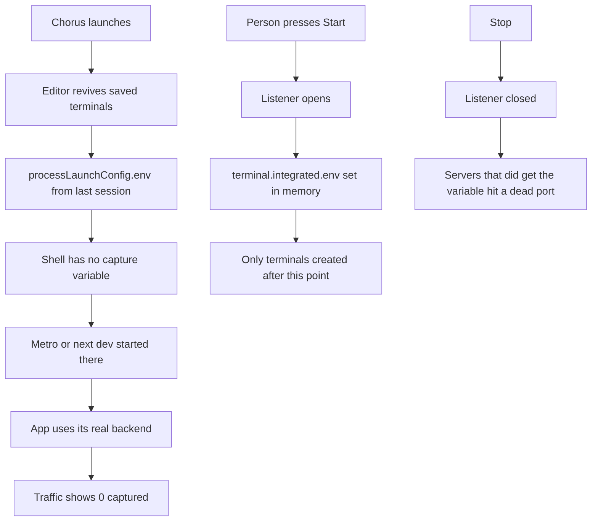
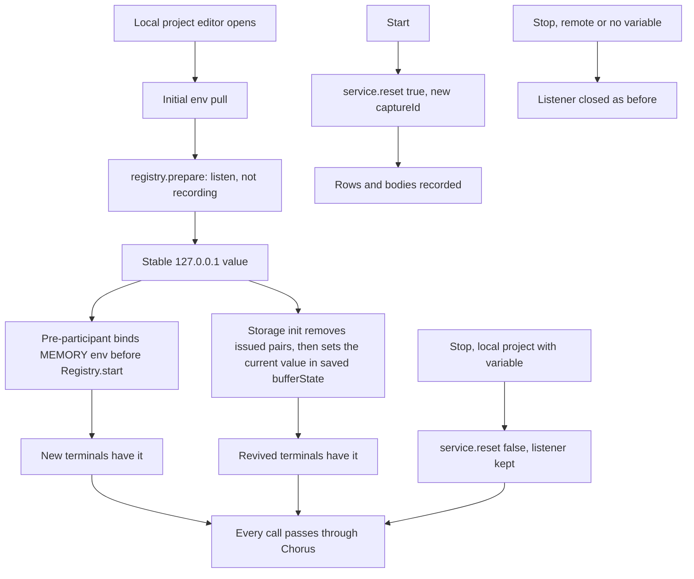
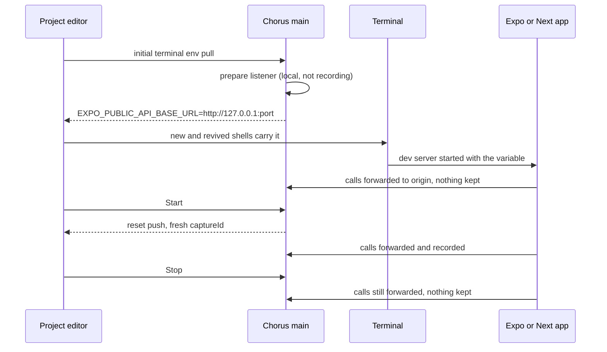

# Stable capture: forward always, record on Start

## Status

| Unit                                   | Result                                                                                                                                                                                                              |
| -------------------------------------- | ------------------------------------------------------------------------------------------------------------------------------------------------------------------------------------------------------------------- |
| Investigation                          | Complete by source and live-process inspection: every Chorus shell and Metro lacked the variable; capture never resumed at launch; revived terminals replay their saved env                                         |
| Design review                          | Codex and Claude source review of the pinned lifecycle, configuration, storage, terminal backend and bundled pty host; accepted                                                                                     |
| U1: forwarding separate from recording | Implemented by Claude; Codex diff/context review found six issues                                                                                                                                                   |
| U1 corrections                         | Implemented by Claude: failed rebind advertises nothing, remote projects keep manual Stop, teardown invalidates capture work, tap stops with its generation, conditional copy, this plan made exact; Codex reviewed |
| Final review corrections               | Implemented by Claude: `CaptureStore.clear` forgets cleared ids instead of calling them evicted; port allocation failures publish `failed` with no variable; Codex reviewed                                         |
| Stale variable in revived terminals    | Ownership record in workspace storage implemented by Claude; Codex reviewed the correction and source context                                                                                                       |
| Final integrated review                | Codex review and Claude adversarial review completed; no further defect found in the supported single-editor lifecycle; simultaneous realms for one workspace remain a documented limitation                        |
| Regressions                            | PASS: five targeted suites (186 tests), then full workspace suite (3,057 tests; four skipped)                                                                                                                       |
| Runtime                                | PASS: signed package and all seven packaged startup checks; installed and signature verified. iOS, Android and tpa-web application flows remain NOT VERIFIED                                                        |

## Root cause and evidence

Commit `da746e1` replaced redirects in application environment files with terminal MEMORY settings applied only during capture. A shell inherits its environment when it starts. Starting a terminal or Metro before pressing Start therefore bypassed Chorus even after the listener opened. The application continued to succeed against its real backend, leaving Traffic empty.

Claude's process inspection after reinstall found nine restored Chorus shells and Metro PID 73542 without `EXPO_PUBLIC_API_BASE_URL`. In `tpa-mobile/src/config/api.ts`, the missing value selects `http://88.99.104.107:30081`. Chorus alone held the capture port. These observations support the missing redirect as the cause of that reproduction.

The editor also bound its terminal MEMORY setting after `initialize()`. The pinned lifecycle constructs the terminal service and starts restore before that binding. Revive uses the saved final spawn environment rather than current terminal settings. These source paths explain why setting the variable later did not repair restored terminals.

Earlier, Metro PID 50787 did have the proxy value and its served bundle contained it. Expo Go's active JavaScript was not inspected, so a stale loaded bundle remains an inference for that earlier case. The last Android device listing was empty; no physical-device failure was reproduced.

## Current / Issue



```ts
export function terminalEnvOf(state: ProjectTrafficState | null): WorkbenchTerminalEnv | null {
  if (state === null || !state.capturing || state.port === null) return null
  if (state.envVar === null || !TRAFFIC_ENV_NAME.test(state.envVar)) return null
  return { name: state.envVar, value: `http://${LOOPBACK}:${String(state.port)}` }
}
```

## Proposed



## Code Changes

### `apps/desktop/src/main/traffic.ts`

```ts
const generation = this.recording ? this.generation : null
const live = (): boolean => generation === this.generation
const kept = (): TrafficCaptured | null => (live() ? capture : null)
```

```ts
reset(recording: boolean): void {
  this.generation += 1
  this.recording = recording
  this.rows.length = 0
  this.outbox.length = 0
  if (this.flush !== null) {
    this.flush()
    this.flush = null
  }
  this.captures.clear()
}

async close(): Promise<void> {
  this.reset(false)
  const server = this.server
  this.server = null
  if (server === null) return
  await new Promise<void>((resolve) => {
    server.close(() => {
      resolve()
    })
    server.closeAllConnections()
  })
}
```

```ts
const envelope = answered === null ? Promise.resolve(UNREAD) : this.tap(upRes, live)

private tap(res: IncomingMessage, live: () => boolean): Promise<Envelope>
```

`tap` drops its prefix on the first chunk after the generation moves and resolves `UNREAD` at the end. `CaptureStore.clear()` releases its bodies and empties entries, touch order and eviction history, so only `drop` records an eviction and a persistent listener's Start/Stop cycles do not grow the history. Logs, logcat, upgrade-501 and CONNECT-501 add no row while not recording. `CapturedBody.release()` sets `released`; `push` returns early and `decodeWithinSlot` checks `isReleased()` before and after decompression, so nothing is charged after Stop, Clear, eviction or close.

### `apps/desktop/src/main/project-traffic.ts`

```ts
const RELINQUISHED: Partial<ProjectTrafficState> = {
  capturing: false,
  port: null,
  address: null,
  forwardedDevices: 0,
}

private forwards(projectId: string, config: ProjectTrafficConfig | null): config is ReadyConfig {
  return (this.deps.localProject?.(projectId) ?? false) && readies(config)
}
```

```ts
prepare(projectId: string): Promise<ProjectTrafficState> {
  const entry = this.entry(projectId)
  return this.serialize(entry, async () => {
    if (this.gone(entry) || entry.service !== null) return entry.state
    const config = this.deps.config(projectId) ?? entry.config
    entry.config = config
    if (!this.forwards(projectId, config)) return entry.state
    return this.listen(entry, config, config.origin, false)
  })
}
```

```ts
const forwarding = entry.service
if (forwarding !== null && this.forwards(projectId, entry.config)) {
  forwarding.reset(false)
  this.dischargeProject(projectId)
  return this.publish(entry, { capturing: false, failure: null })
}
```

```ts
private async shut(entry: Entry, service: TrafficService): Promise<void> {
  entry.service = null
  entry.unsubscribe?.()
  entry.unsubscribe = null
  entry.state = { ...entry.state, ...RELINQUISHED }
  const closing = service.close()
  this.dischargeProject(entry.projectId)
  await closing
}
```

`configure` returns `Promise<ProjectTrafficState>` and is serialized. It refuses origin, port and access only while recording. On a forwarding listener it calls `service.setOrigin`, rebinds for port or access through `shut` and `listen`, and closes once the project stops qualifying. Every allocation, bind or remember failure publishes `RELINQUISHED` with the failure; `nextPort` runs inside the same `try` as `listen`. `dispose` starts `close()` before discharging. Every serialized body checks `gone(entry)`, so work queued behind a dispose publishes nothing.

### `apps/desktop/src/main/runtime.ts`

```ts
wantsReady: (projectId) => this.ownsLocalSurface(projectId),
localProject: (projectId) => this.projects.get(projectId)?.host === LOCAL_HOST,
```

```ts
async ensureTerminalEnv(place: WorkbenchPlace): Promise<WorkbenchTerminalEnv | null> {
  if (place.host !== LOCAL_HOST) return null
  const project = this.projects.findByPlace(place)
  if (project === null) return null
  await this.traffic.prepare(project.id)
  return terminalEnvOf(this.traffic.state(project.id))
}
```

`localProject` is identity and decides Stop retention. `wantsReady` is presence and only decides whether a configure may open a listener nobody pulled yet. A hidden, reloaded or closed editor does not close a listener.

### `apps/desktop/src/main/workbench-surface.ts`, `index.ts`

```ts
export interface WorkbenchTerminalEnvSource {
  readonly current: (place: WorkbenchPlace) => WorkbenchTerminalEnv | null
  readonly ensure: (place: WorkbenchPlace) => Promise<WorkbenchTerminalEnv | null>
}
```

```ts
setWorkbenchTerminalEnvSource({
  current: (place) => opened.terminalEnvFor(place),
  ensure: (place) => opened.ensureTerminalEnv(place),
})
```

The pull validates sender and main frame synchronously and returns `ensure`. Pushes use `current` only.

### `apps/desktop/src/renderer/src/workbench/entry.ts`

```ts
registerServiceInitializePreParticipant(async (accessor) => {
  const configuration = accessor.get(IConfigurationService)
  const workspace = accessor.get(IWorkspaceContextService)
  const terminalLogs = accessor.get(ILogService)
  await workspace.getCompleteWorkspace()
  bindTerminalEnv({
    read: (key) => configuration.inspect<TerminalEnvMemory>(key).memoryValue,
    write: (key, memory) => configuration.updateValue(key, memory, ConfigurationTarget.MEMORY),
    watch: (listener) => {
      configuration.onDidChangeConfiguration((event) => {
        listener((key) => event.affectsConfiguration(key))
      })
    },
    fail: (error) => {
      const detail = error instanceof Error ? (error.stack ?? error.message) : String(error)
      terminalLogs.error(`Chorus: capture terminal environment could not be applied — ${detail}`)
    },
  })
})
```

### `apps/desktop/src/renderer/src/workbench/terminal-env.ts`, `storage.ts`

Code-OSS writes `terminal.integrated.bufferState` only on quit or load (`_shouldReviveProcesses`, default `onExit`), revives from it on the next start, and passes each saved `processLaunchConfig.env` to the new process unchanged. A saved env cannot say which entries Chorus put there, so Chorus records every pair it hands out, at the moment it hands it out, in the same project's workspace storage under `chorus.terminal.issuedEnv`:

```json
{
  "version": 1,
  "pairs": [{ "name": "EXPO_PUBLIC_API_BASE_URL", "value": "http://127.0.0.1:30100" }]
}
```

```ts
export function issueTerminalEnv(
  issued: readonly WorkbenchTerminalEnv[],
  env: WorkbenchTerminalEnv
): readonly WorkbenchTerminalEnv[]

export function parseIssuedTerminalEnv(raw: string | undefined): readonly WorkbenchTerminalEnv[]

export function serializeIssuedTerminalEnv(issued: readonly WorkbenchTerminalEnv[]): string

export function retainIssuedTerminalEnv(
  issued: readonly WorkbenchTerminalEnv[],
  cleaned: boolean,
  current: WorkbenchTerminalEnv | null
): readonly WorkbenchTerminalEnv[]

export function reviveTerminalEnv(
  raw: string | undefined,
  issued: readonly WorkbenchTerminalEnv[],
  current: WorkbenchTerminalEnv | null
): { readonly raw: string | undefined; readonly cleaned: boolean }

export function bindIssuedTerminalEnv(record: (env: WorkbenchTerminalEnv) => void): void
```

```ts
function receive(env: WorkbenchTerminalEnv | null): void {
  wanted = env
  if (env !== null) issue?.(env)
  apply()
}
```

```ts
private reviveTerminals(): void {
  const saved = this.get(TERMINAL_BUFFER_STATE_KEY, StorageScope.WORKSPACE)
  const issued = this.issuedTerminalEnv()
  const current = currentTerminalEnv()
  const revived = reviveTerminalEnv(saved, issued, current)
  if (revived.raw !== undefined && revived.raw !== saved) {
    this.store(
      TERMINAL_BUFFER_STATE_KEY,
      revived.raw,
      StorageScope.WORKSPACE,
      StorageTarget.MACHINE
    )
  }
  const retained = retainIssuedTerminalEnv(issued, revived.cleaned, current)
  if (retained.length > 0) this.keepIssuedTerminalEnv(retained)
  else if (revived.cleaned) this.remove(TERMINAL_ISSUED_ENV_KEY, StorageScope.WORKSPACE)
  bindIssuedTerminalEnv((env) => {
    this.keepIssuedTerminalEnv(issueTerminalEnv(this.issuedTerminalEnv(), env))
  })
}
```

The contract:

- **Removal is exact.** For each saved terminal, every variable whose name and value equal a recorded pair is removed; then the current value, if any, is set. Unrelated variables and a same-name value Chorus never handed out are kept.
- **Null current still cleans.** A failed bind, a cleared variable or a remote project answers null, and every recorded pair is still removed.
- **Rename and port changes.** Each distinct pair is recorded when received, so an old name or port from earlier in the session is removed and the current one set.
- **No churn.** A terminal whose env ends up identical, including removing and reapplying the same value, keeps the original string; the record is written only when its serialized text changes, and a repeated value returns the same array.
- **Recording precedes use.** Binding the record writes the current seeded value immediately; each later non-null value is recorded before `apply()` can hand it to new terminals.
- **Lifetime.** Pairs are deduplicated, never capped, and kept across reloads, reconnects, malformed saved states and states with an unreadable entry. They are retired only when a saved state was present and every entry in it was rewritten (`cleaned`), after which only the current value, if any, is kept. The record grows with configuration changes, not requests.
- **Malformed data.** An unreadable saved state is left exactly as stored and retires nothing. An unreadable record contributes no pairs; it is removed only after a complete cleanup and otherwise overwritten only by the next recorded value. Pairs with a name failing `TRAFFIC_ENV_NAME` or a non-string value are skipped, and a partly valid record is rewritten with its valid pairs the next time it is kept. Only names and values are stored, never a process env.

### `apps/desktop/src/renderer/src/i18n/en.json`, `TrafficPanel.tsx`

`pointAt` and `envVarHint` say Stop keeps forwarding only for a local project with a variable, Stop closes the listener otherwise, origin, port and reach change only while not capturing, and a new name, a new port or a process started before Chorus listened needs one restart and one full Expo reload. The Android badge follows the listener.

## Final Flow



## Acceptance

| Criterion                                                       | Status and evidence                                                                                  | Remaining proof                                                                  |
| --------------------------------------------------------------- | ---------------------------------------------------------------------------------------------------- | -------------------------------------------------------------------------------- |
| New and revived local terminals carry the variable before Start | NOT VERIFIED in real terminals; pure revive, issued-pair and awaited-pull tests PASS                 | Mount a configured editor and inspect both new and revived terminal environments |
| Terminal and server first, then Start, records with no restart  | PASS for registry and real HTTP regression tests: ready listener retains the same port through Start | iOS, Android and web dev-server application flows NOT VERIFIED                   |
| Stop forwards with no rows, bodies or charges                   | PASS: forwarding, row, capture-body and ledger regressions                                           | Packaged app's complete mobile flow NOT VERIFIED                                 |
| A later Start shows a fresh list with no late rows              | PASS: new captureId, reset push and in-flight Stop/Start/Clear regressions                           | Packaged panel with actual mobile requests NOT VERIFIED                          |
| Android attached later is reversed while forwarding             | NOT VERIFIED on a physical device; full adb tracker suites PASS                                      | Connect the Samsung and exercise a mobile API request                            |
| Port in use shows in-use and hands terminals nothing            | PASS: bind/rebind/allocation and revived exact-pair cleanup regressions                              | Actual restored shell after a failed bind NOT VERIFIED                           |
| Remote and manual projects keep their Stop                      | PASS: registry regression confirms Stop closes the listener                                          | Remote app execution NOT VERIFIED                                                |
| tpa-web BFF keeps working                                       | NOT VERIFIED in the web application; unchanged forwarding path covered by HTTP regressions           | Exercise the BFF in an updated Chorus terminal                                   |

## Regressions

All authored regressions passed in the targeted run and again in the full workspace suite. The table records the limits of their evidence:

| Test                                                                                                   | Proves                                                                                                                                                                                                  | Does not prove                                                                         |
| ------------------------------------------------------------------------------------------------------ | ------------------------------------------------------------------------------------------------------------------------------------------------------------------------------------------------------- | -------------------------------------------------------------------------------------- |
| `traffic.test.ts` forwarding while not recording                                                       | Same response, no rows, no `retain` calls                                                                                                                                                               | —                                                                                      |
| `traffic.test.ts` keeps no more body and writes no row once recording ends part-way through a response | No retain after `reset`, ledger back to zero, no row                                                                                                                                                    | That `tap` stops parsing; `tap` is private and not observable here                     |
| `traffic.test.ts` a request still in flight when recording restarts                                    | No row or body crosses `reset`                                                                                                                                                                          | That the `live()` guard is what stops it; cleared rows and released bodies stop it too |
| `traffic.test.ts` closing a service                                                                    | `close()` invalidates: ledger at zero, queued outbox never delivered                                                                                                                                    | A decode still pending at close, which usually finishes first                          |
| `traffic.test.ts` charges nothing for a decode that finishes after the release                         | Pending decode after release charges nothing, deterministically                                                                                                                                         | —                                                                                      |
| `traffic.test.ts` forgets what it cleared rather than calling it evicted                               | `clear` empties eviction history; later drops are still recorded                                                                                                                                        | —                                                                                      |
| `project-traffic.test.ts` answers not-found, not evicted, for a body read after Stop                   | Stop with a kept listener answers `not-found`                                                                                                                                                           | —                                                                                      |
| `project-traffic.test.ts` advertises nothing once a move to a taken port fails                         | No port, address or variable; old port released                                                                                                                                                         | —                                                                                      |
| `project-traffic.test.ts` a port that cannot be allocated                                              | `prepare` and `configure` publish `failed` and no variable; the saved setting matches the reply                                                                                                         | —                                                                                      |
| `project-traffic.test.ts` keeps manual capture (remote)                                                | Remote Stop closes the listener                                                                                                                                                                         | —                                                                                      |
| `project-traffic.test.ts` announces nothing for a request that outlives its project                    | No ghost pushes after dispose                                                                                                                                                                           | Teardown invalidation; unsubscribe alone also gives this                               |
| `project-traffic.test.ts` closes a listener whose project was disposed while it was opening            | No socket or state survives dispose during listen                                                                                                                                                       | —                                                                                      |
| `workbench-surface.test.ts` waits for the listener before answering                                    | Pull waits for readiness; a rejection answers null                                                                                                                                                      | —                                                                                      |
| `terminal-env.test.ts` revived terminals                                                               | Exact removal with null current, port change, rename, a same-name value never issued, unrelated keys, no-op returns the original string, more than 32 recorded pairs, incomplete state, malformed input | The storage wiring itself; it is not mounted in a test                                 |
| `terminal-env.test.ts` the record of what Chorus handed to terminals                                   | Parsing trusts only valid pairs; a repeated value does not grow it; pairs survive reloads and retire only after a complete cleanup                                                                      | —                                                                                      |
| `terminal-env.test.ts` records the seeded value when the record binds                                  | Initial value recorded on binding; a later value recorded before the memory layer holds it; null not recorded                                                                                           | —                                                                                      |

## Verification

User authorization changed on October 3, 2026: “Test and install the updated build.” Codex then ran the checks below and installed the verified package. Before that authorization, verification was source review only. Claude performed two integrated adversarial reviews. Codex inspected the actual task and correction diffs against the original workspace snapshots.

| Command or check                                                                                                                                                                                                          | Outcome                                                                                                                          |
| ------------------------------------------------------------------------------------------------------------------------------------------------------------------------------------------------------------------------- | -------------------------------------------------------------------------------------------------------------------------------- |
| `pnpm --filter @chorus/desktop exec vitest run src/main/traffic.test.ts src/main/project-traffic.test.ts src/main/traffic-ipc.test.ts src/main/workbench-surface.test.ts src/renderer/src/workbench/terminal-env.test.ts` | PASS: 186 tests in five files                                                                                                    |
| `pnpm test`                                                                                                                                                                                                               | PASS: 3,057 tests; four skipped. 159 files passed; two skipped                                                                   |
| `pnpm check`                                                                                                                                                                                                              | Typecheck PASS across all 11 packages. Gate FAIL at three pre-existing lint errors; later gate stages run separately below       |
| Focused ESLint for `project-traffic.ts`, `runtime.ts`, `terminal-env.ts` and `preload/workbench.test.ts`                                                                                                                  | PASS after narrow corrections                                                                                                    |
| `pnpm run format:check`                                                                                                                                                                                                   | FAIL: 30 preserved files outside this task have existing formatting differences; no task file is listed                          |
| Prettier check of correction files and plan                                                                                                                                                                               | PASS                                                                                                                             |
| `pnpm run workbench:check`                                                                                                                                                                                                | PASS: pinned manifest matches all five upstream platform artifacts                                                               |
| `pnpm exec turbo run build --filter=@chorus/desktop^...`                                                                                                                                                                  | PASS: all eight dependency packages                                                                                              |
| `node apps/desktop/build/package-local.mjs`                                                                                                                                                                               | PASS: arm64 bundle built with the existing Chorus Local Dev identity, including the full 76,210,372-byte workbench server        |
| `pnpm --filter @chorus/desktop run verify:package`                                                                                                                                                                        | PASS: all seven checks at full scope; terminal helper, bundled server, renderer launch, SQLite store, composer and agent startup |
| `CHORUS_INSTALL_KEEP_RUNNING=1 node apps/desktop/build/install-local.mjs`                                                                                                                                                 | PASS: installed `/Applications/Chorus.app`; preserved the running copy until it is quit                                          |
| `codesign --verify --deep --strict /Applications/Chorus.app`                                                                                                                                                              | PASS outside the sandbox with keychain access                                                                                    |
| SHA-256 comparison of packaged and installed `Contents/Resources/app.asar`                                                                                                                                                | PASS: both `961745f277179c19eccc868b6b7f1d22e6ee20bcc162be957c70d98f1545d976`                                                    |
| Installed `CFBundleShortVersionString`                                                                                                                                                                                    | `0.20.0`; local rebuild, no version bump or release                                                                              |

The remaining root lint failures are `renderer/src/transcript.ts:484` and `:1251` (`prefer-optional-chain`) and `shared/collaboration.ts:41` (`no-unnecessary-condition`). They were present before this task and were left untouched. The full test suite and remaining manifest stage were run separately because the combined gate stops at lint. Local installation is complete; this is not a release with a green root gate.

The initial sandboxed socket tests failed with `listen EPERM`, and the manifest fetch failed with restricted DNS. Both passed when rerun with the required execution permissions. The installed signature also passed with keychain access after the sandboxed check reported an untrusted certificate. These are permission restrictions, not changes to the application.

After restart, start Metro once from a fresh tpa-mobile terminal and fully reload Expo Go. Exercise a request with capture off, on, off, and on again. Repeat on the Android device connected through adb and in a tpa-web BFF terminal. Those app/device flows have not been run and remain NOT VERIFIED.

## Sources

- Expo public environment changes require a full application reload. [Expo environment variables](https://docs.expo.dev/guides/environment-variables/).
- Terminal environment configuration is supplied to terminal processes. [VS Code terminal profiles](https://code.visualstudio.com/docs/terminal/profiles).
- Persistent terminals can reconnect or revive with saved process state. [VS Code terminal advanced](https://code.visualstudio.com/docs/terminal/advanced).
- Physical Android loopback routing requires a connected device and adb reverse. [Android Debug Bridge](https://developer.android.com/tools/adb).

The specific behaviour this relies on comes from the pinned sources, not the docs: `@codingame/monaco-vscode-api` 33.0.9 `lifecycle.js` startup order, the configuration override's pre-participant and `completeWorkspaceBarrier`, `remoteTerminalBackend.js` `getTerminalLayoutInfo`, the bundled REH `ptyHostMain.js` `_reviveTerminalProcess`, and Expo 57's `expo/virtual/env` and serializer prelude.

## Risks

- A local listener lives from the editor's first pull until Chorus quits, the project is removed, or it stops qualifying. With access `lan` it is reachable on the network for that whole time.
- Processes started before this build keep their old environment: one Metro restart and one full Expo reload.
- Terminals that reconnect to a still-running REH keep their spawn env.
- Terminals saved by builds before this one have no ownership record, so their Chorus values cannot be told apart from user values and are left as saved. After adopting this build, start the dev server once from a fresh terminal and fully reload an Expo app.
- A user value that Chorus shadowed at spawn cannot be reconstructed from the saved spawn env. Removal leaves that name unset in the revived shell; a new terminal gets the user's value back once Chorus's memory override is released.
- A user value exactly equal to a recorded pair, same name and same URL, is removed with it.
- Ownership cleanup assumes one live editor realm per project workspace. The current pane and detach/return flow preserves that lifecycle. The lower-level `openSurface` API can create duplicate realms, however. Their ownership records can overwrite one another, and one realm's complete restore can retire a pair still used by the other's live terminal. This is not hardened here; Code-OSS's buffer-state key already has the same workspace-sharing limitation.
- The pre-participant and the `terminal.integrated.bufferState` key depend on `@codingame` 33.0.9 internals.

## Local delivery

The reviewed local source has been tested, packaged and installed at `/Applications/Chorus.app`. The running conversation still uses the previous bundle. Restart Chorus to load the update. The intended behavior is that eligible local projects listen before terminal creation, and Start/Stop controls recording while forwarding continues. The same path applies to mobile and web projects. Android reverse follows ready listeners through the existing tracker.

Meaningful files changed, relative to `apps/desktop/src/`:

| Area                                | Files                                                                                                                                                               |
| ----------------------------------- | ------------------------------------------------------------------------------------------------------------------------------------------------------------------- |
| Forwarding, recording and lifecycle | `main/traffic.ts`, `main/project-traffic.ts`                                                                                                                        |
| Main wiring and IPC                 | `main/traffic-ipc.ts`, `main/runtime.ts`, `main/index.ts`, `main/workbench-surface.ts`                                                                              |
| Terminal startup and persistence    | `renderer/src/workbench/entry.ts`, `renderer/src/workbench/terminal-env.ts`, `renderer/src/workbench/storage.ts`                                                    |
| Capture copy and Android badge      | `renderer/src/i18n/en.json`, `renderer/src/TrafficPanel.tsx`                                                                                                        |
| Authored regressions                | `main/traffic.test.ts`, `main/project-traffic.test.ts`, `main/traffic-ipc.test.ts`, `main/workbench-surface.test.ts`, `renderer/src/workbench/terminal-env.test.ts` |

The verification correction also changes `preload/workbench.test.ts`: its test interface now includes the existing `requestRowScroll` method.

The source/test/plan change covers 18 files, including the one-line preload test interface correction needed for typechecking. The task-specific diff is `/private/tmp/chorus-stable-capture-5lggr0lz/task.diff`, separated from the uncommitted work that existed before this task.

Source scope checks: PASS for keeping the tpa application repositories unchanged, adding no dependencies, and preserving the existing manual/remote teardown path. Automated behavioral regressions PASS with the limits listed above. Actual iOS, Android and tpa-web application execution remains NOT VERIFIED.

Scope impact: automatic forwarding also applies to configured local `tpa-web-*` editors, so their Start/Stop now controls recording. Body-release and queued-delivery corrections are necessary because the service now survives Stop. Verification also required adding the existing requestRowScroll method to the preload test interface. No unrelated product cleanup or application environment-file edits were made. Packaging and installation were explicitly authorized later. No commit or publication was performed.

Installed-build handoff: the prior running bundle is `/Applications/Chorus.app.replaced-1791020056986`. Keep it until that process has quit. The installed update preserves the existing user data and requires one Chorus restart; pre-update Metro/Expo processes also need the one-time fresh-terminal restart and full application reload described above.
