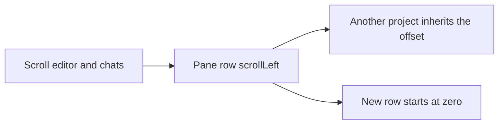
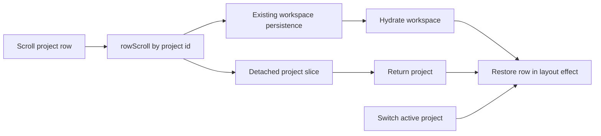

# Remember each project's layout position

## Status

| Unit                                              | Result                                                                                                                                                                              |
| ------------------------------------------------- | ----------------------------------------------------------------------------------------------------------------------------------------------------------------------------------- |
| Investigation and plan challenge                  | Complete by source inspection; `scrollend` commit dropped                                                                                                                           |
| U1: row offset persistence                        | Implemented by Claude; Codex reviewed the actual incremental and integrated diffs, including the corrected `selectActions` contract; authored tests NOT RUN; runtime NOT VERIFIED   |
| Final adversarial review                          | Claude found F1: the active chat's mount focus can scroll the row after restoration and overwrite the saved offset. No other supported findings                                     |
| F1 correction: passive re-apply of a saved offset | Implemented by Claude in `EditorPane`; Claude source review found no new supported findings; Codex inspected the actual correction and installed React source; runtime NOT VERIFIED |
| Delivery                                          | Reviewed local changes complete; tests, typecheck, lint, build and UI verification NOT RUN                                                                                          |

## Current / Issue

`EditorPane` owns one horizontal row for all project tabs in its pane. Arrangement, chat widths and traffic width already reach `open-projects.json`; the row's `scrollLeft` is DOM-only. Switching projects shares an offset, and reopening or detaching creates a row at zero.



## Proposed

Store the row offset under the project id in the existing workspace snapshot. Keep the store current on scroll; reuse `App`'s existing 180ms disk debounce. Transfer the offset with the existing detached project slice. Immediate commits would reach synchronous file writes during the programmatic scrolling used by wheel routing, so the row adds no commit or extra timer.

Restore in a layout effect when the active project changes. Read the store imperatively so scroll saves do not subscribe the pane to scroll state. Let the browser clamp the restored offset to the current available width. Explicit file and diff reveal continues setting the row to zero.

Final adversarial review found that `Session`'s mount effect calls `ComposerHandle.focus()` without `preventScroll`. That focus can scroll the row after the layout restore and save the unintended offset. Re-apply an existing saved offset in `EditorPane`'s passive effect after child mount effects. Limit this to project changes/remounts with a saved offset so a newly mounted conversation in the same project retains its existing reveal behavior. The user's requested saved position takes precedence over automatic mount reveal.

Delivery covers the horizontal row and existing chat arrangement. No reply expanded the scope to vertical transcript reading position across an app relaunch; that remains the existing in-memory session carry. Editor width remains the current 80% of window width.

## Code Changes

### `apps/desktop/src/shared/workspace-layout.ts`

Add a defaulted map to `WorkspaceSnapshot`, and an optional scalar to `ProjectLayoutSlice`:

```ts
rowScroll: z.record(z.string(), z.number()).default({})
```

```ts
rowScroll: z.number().optional()
```

### `apps/desktop/src/renderer/src/workspace/layout.ts`

Initialize `EMPTY_WORKSPACE.rowScroll` to `{}`. Carry it in `sliceOf` and `mergeSlice` using `withEntry`. `normalizeWorkspace` removes non-finite and negative entries:

```ts
rowScroll: Object.fromEntries(
  Object.entries(workspace.rowScroll).filter(([, left]) => Number.isFinite(left) && left >= 0)
)
```

### `apps/desktop/src/renderer/src/workspace/store.ts`

Include `rowScroll: state.rowScroll` in `snapshot`. Add:

```ts
setRowScroll: (projectId: string, left: number) => void
```

The action ignores non-finite or negative values and avoids updates for an unchanged offset. `sameWorkspaceSnapshot` already derives its fields from the schema.

### `apps/desktop/src/renderer/src/workspace/EditorPane.tsx`

Import `useWorkspaceStore`. In a project-keyed `useLayoutEffect`, restore the offset, install a passive row `scroll` listener, and remove it during cleanup. The listener writes directly to the store with the project id captured by the effect. Do not add a second trailing timer: detach takes a slice before unmount cleanup and must see the latest offset.

Do not read the DOM during old-project cleanup to save its offset: the new project's content may already have clamped the shared row. Use a non-capturing listener on the row so descendant transcript scrolls do not reach it.

```tsx
useLayoutEffect(() => {
  const row = scroller.current
  if (row === null || projectId === null) return undefined
  const store = useWorkspaceStore.getState()
  row.scrollLeft = store.rowScroll[projectId] ?? 0
  const save = (): void => {
    store.setRowScroll(projectId, row.scrollLeft)
  }
  row.addEventListener('scroll', save, { passive: true })
  return () => {
    row.removeEventListener('scroll', save)
  }
}, [projectId, hasPane])
```

```tsx
useEffect(() => {
  const row = scroller.current
  if (row === null || projectId === null) return
  const left = useWorkspaceStore.getState().rowScroll[projectId]
  if (left !== undefined) row.scrollLeft = left
}, [projectId, hasPane])
```

### Existing persistence, layout and store tests

Update the explicit default-snapshot expectation in `main/open-projects.test.ts`. Author focused cases for old-file defaults, independent project offsets, slice transfer/removal and invalid offsets. Preserve the pre-existing test changes. Tests remain unrun.

## Acceptance and verification

One atomic unit changes the snapshot contract, its store/slice paths and row lifecycle together. It is complete when codex has reviewed the incremental and integrated diffs and claude has performed a final adversarial review.

Runtime acceptance: two projects retain distinct row offsets through switching and reopen; detach/reattach carries the latest offset; reveal resets and saves zero; old snapshots restore all conversations; changing window width clamps safely; chat arrangement, widths, divider gestures and wheel routing keep their current behavior.

Tests, typecheck, lint, builds, app launches and verification harnesses are NOT RUN under the standing instructions. Baseline is source and working-tree inspection. Runtime acceptance is NOT VERIFIED. If the user later requests verification, use `pnpm check` and drive reopen, project switching, detach/reattach and reveal in the running app.

No commits, pushes, packaging, dependency changes or unrelated cleanup are included. Abrupt termination before the existing disk write completes cannot be claimed durable without runtime evidence.

Implementation differs from the code above in two places. The finite, nonnegative test is a single exported `isRowScroll` in `layout.ts`, beside `clampTrafficWidth`, shared by `normalizeWorkspace` and `setRowScroll`; `normalizeWorkspace` filters `rowScroll` right after `trafficPanels`. And `apps/desktop/src/renderer/src/workspace/hooks.ts` changes after all: `selectActions` is typed as `WorkspaceActions`, so the new required `setRowScroll` is added beside `setTrafficWidth` in both its destructuring and its returned object. The earlier note that `hooks.ts` needed no change was wrong, and Codex's diff review caught it. It exposes a stable action only; nothing subscribes to `rowScroll`. The same review removed a stray blank line before the end of `describe('project widths')` in `store.test.ts`. Authored cases: `layout.test.ts` "row scroll" (slice round trip, absent-offset removal, detached open and return, invalid offsets, launch reconcile); `store.test.ts` "row scroll" (separate offsets, unchanged and invalid values publish nothing, zero is kept, snapshot carries every schema key); `open-projects.test.ts` (old-file default and a stored map surviving the parse). All NOT RUN.

Plan challenge accepted: use one synchronous store update per row scroll, preserve the existing disk debounce, and avoid a cleanup save after a project switch. Detached windows already relay project slices and flush them before return; the new field follows those paths. Their per-frame relay cost and browser restoration timing remain unmeasured. No additional timer or scroll-state render subscription is introduced.

Focus evidence: `Session.tsx` mount focus, `Composer.tsx` imperative focus and the [HTML focus API](https://html.spec.whatwg.org/multipage/interaction.html#dom-focus-dev), which specifies scrolling by default. Installed React DOM 19.2.0 `commitPassiveMountOnFiber` traverses child passive mount effects before invoking the parent's passive hooks. `App` hydrates and updates sessions in the same restore callback. This supports the passive re-apply design; actual focus and commit timing remains NOT VERIFIED.

Correction source review. At relaunch the store hydrate is a `useSyncExternalStore` change on SyncLane (`forceStoreRerender`, lane 2), and `updateSessions` runs in the same promise callback. React DOM 19.2.0 `getHighestPriorityLanes` groups `lanes & 42` (Sync, InputContinuous and Default). These source paths support the inference that the active `Session` mounts with `EditorPane`. A project-tab switch changes the store and mounts the newly keyed session. A commit containing SyncLane flushes passive effects before paint, with child effects before parent effects; this supports re-applying the saved offset after mount autofocus. Visible timing and event delivery have not been observed. A conversation added while its project stays active does not change this effect's dependencies. Explicit reveal remains a separate later action.

Remaining runtime limits, NOT VERIFIED: Chromium's exact focus-scroll alignment; the relaunch commit grouping as observed rather than read; the per-frame detached slice relay cost. A restored offset can leave the focused composer off-screen with the caret in it. That is the accepted cost of the saved position winning.

## Delivery report

### What changed and cause

Each project now owns its horizontal editor/chat row offset in the existing durable workspace snapshot. The previous offset belonged only to a pane's DOM, so it was shared on project switching and lost on remount or reopen. The offset now travels through hydration and detached project slices. A second restore phase protects the saved position from the active composer's mount autofocus.

### Files changed

Production: `apps/desktop/src/shared/workspace-layout.ts`; `apps/desktop/src/renderer/src/workspace/EditorPane.tsx`, `layout.ts`, `store.ts`, `hooks.ts`.

Authored coverage: `apps/desktop/src/main/open-projects.test.ts`; `apps/desktop/src/renderer/src/workspace/layout.test.ts`, `store.test.ts`. Ten focused cases were added and the existing old-file default expectation updated. This plan records design, progress and delivery.

### Acceptance criteria

| Criterion                                                                 | Result                         | Evidence available                                                                                                                           |
| ------------------------------------------------------------------------- | ------------------------------ | -------------------------------------------------------------------------------------------------------------------------------------------- |
| Separate offsets across project switching and reopening                   | NOT VERIFIED at runtime        | Reviewed project-keyed effects, snapshot/hydrate flow and authored independent-offset/reconcile cases                                        |
| Offset carried through detach and reattach                                | NOT VERIFIED at runtime        | Reviewed `sliceOf`, `mergeSlice`, bootstrap and return paths; authored slice/returned-offset cases                                           |
| Explicit reveal resets and saves zero                                     | NOT VERIFIED at runtime        | Existing `revealRow` is retained; zero accepted by the store; authored zero-offset case                                                      |
| Old snapshots restore all conversations                                   | NOT VERIFIED by execution      | Defaulted schema field and updated explicit old-file expectation reviewed                                                                    |
| Window/content changes clamp safely                                       | NOT VERIFIED at runtime        | DOM assignment uses browser clamping; invalid stored values are filtered; authored invalid-offset cases                                      |
| Existing widths, arrangement, wheel routing and divider behavior retained | NOT VERIFIED at runtime        | Incremental diffs preserve these implementations; existing adjacent coverage read                                                            |
| Mount autofocus does not replace a saved offset                           | NOT VERIFIED at runtime        | Corrected parent passive restore and installed React effect ordering reviewed                                                                |
| New persistence field reaches the written snapshot                        | PASS by source inspection only | `snapshot` carries `rowScroll`; comparison derives schema keys; existing IPC embeds `WorkspaceSnapshot`; execution case authored but NOT RUN |

### Verification performed

Read-only source and actual incremental diff review were completed by Codex. Claude completed the adversarial integrated review and reviewed its focus correction. The static action-contract omission was corrected and inspected. Representative exact commands:

```sh
diff -u /private/tmp/workbench-layout-position-baseline/EditorPane.tsx apps/desktop/src/renderer/src/workspace/EditorPane.tsx
diff -u /private/tmp/workbench-layout-position-baseline/hooks.ts apps/desktop/src/renderer/src/workspace/hooks.ts
git diff --cached --name-only
```

The first two showed the intended lifecycle and action-contract changes. Matching incremental diffs for the other six changed source/test files were also read in full. `diff` exit 1 denotes differing files, not a failed test. The index command returned no paths; no staging or commits occurred. Full-file source reads, `rg`/`sed` inspection of persistence and native-view paths, and installed React source supplied the remaining evidence. `git diff --stat` includes pre-existing work and was not used as this task's change count.

`pnpm check`, targeted tests, builds and UI reproduction were NOT RUN, following the explicit standing restriction in the global and project `CLAUDE.md`. No baseline test results exist for this task.

### Regression coverage, research and risks

Source review covered existing arrangement/width retention, unchanged and invalid store updates, old snapshots, detached slices, listener cleanup, reveal and autofocus ordering. The authored cases exercise serialization, snapshot inclusion and normalization; they do not prove browser layout or component lifecycle behavior. No DOM lifecycle coverage was added.

The only external source used was the [HTML focus API](https://html.spec.whatwg.org/multipage/interaction.html#dom-focus-dev), supporting the default focus-scroll behavior. Installed React DOM 19.2.0 supplied effect ordering and scheduling evidence.

The existing 180ms disk debounce can lose the latest offset if the app exits before the write completes. A smaller available width clamps the offset and can replace a formerly larger saved value. Detached relay cost and native-view alignment remain unmeasured. The existing detach path applies a snapshot after an await; changes during that await can still be replaced. These limits are recorded, not represented as verified behavior.

### Scope deviations

No product scope expansion. `hooks.ts` was required to satisfy the existing complete-action return contract. The autofocus correction stays in `EditorPane`; no `Session.tsx` or `Composer.tsx` edit was made for this task. One pre-existing blank line in the adjacent store test block was removed during review. No dependencies, commits, pushes, packaging or deployment were added.

## Final Flow


