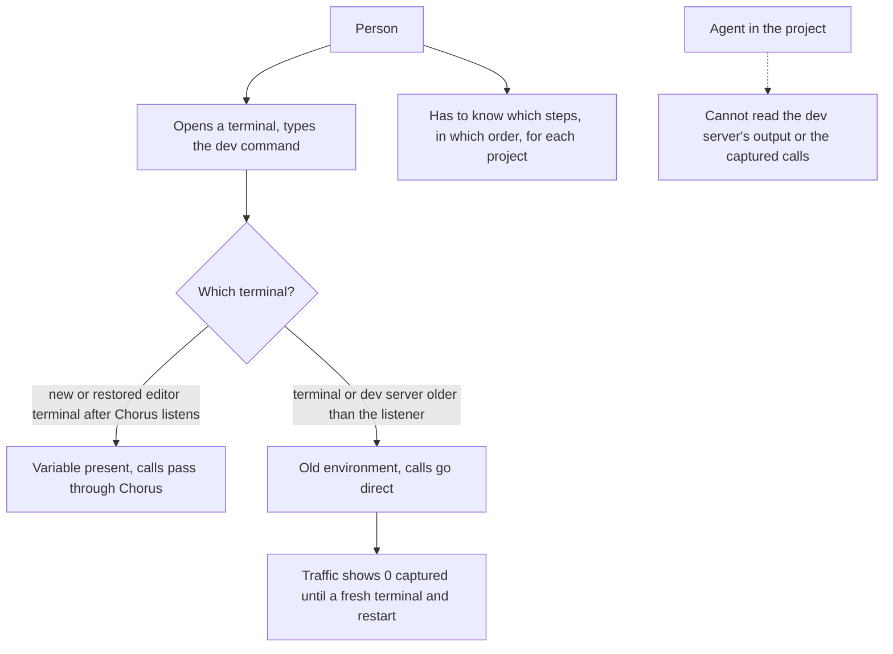
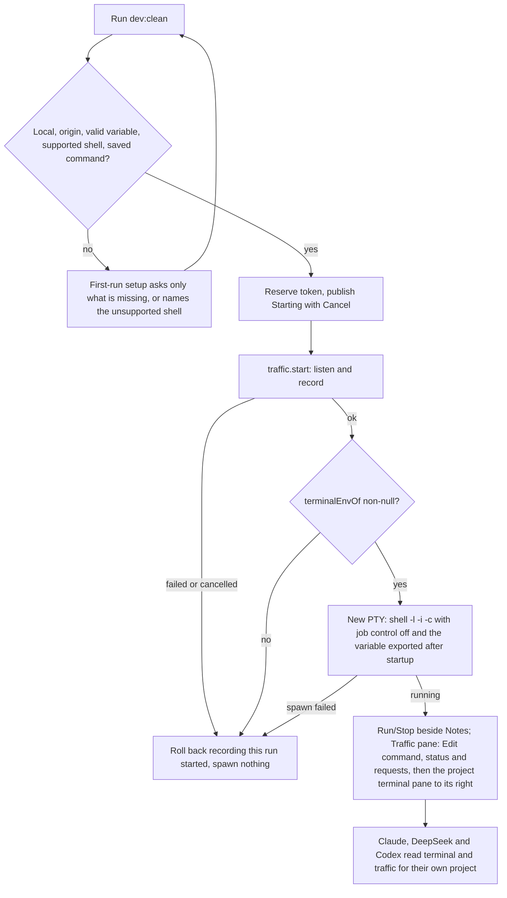
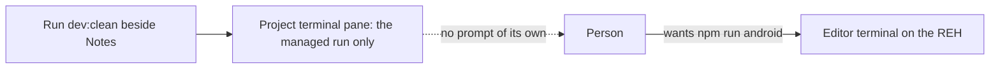
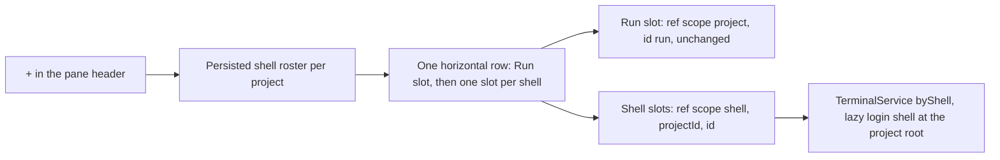

# Run the project's dev command from Traffic

## Status

| Unit                                            | Result                                                                                                                                                                                                                                                                                                                                                                                                                                                                                                                                                                                                                                                                                                                                                                                                                                                                                                                                                                                                                                                                                                                                                                                                                                                                                                                                                                                                             |
| ----------------------------------------------- | ------------------------------------------------------------------------------------------------------------------------------------------------------------------------------------------------------------------------------------------------------------------------------------------------------------------------------------------------------------------------------------------------------------------------------------------------------------------------------------------------------------------------------------------------------------------------------------------------------------------------------------------------------------------------------------------------------------------------------------------------------------------------------------------------------------------------------------------------------------------------------------------------------------------------------------------------------------------------------------------------------------------------------------------------------------------------------------------------------------------------------------------------------------------------------------------------------------------------------------------------------------------------------------------------------------------------------------------------------------------------------------------------------------------ |
| Research                                        | Source inspection of the terminal service and view, terminal IPC, traffic registry, Codex adapter and generated protocol, node-pty 1.1.0, project storage                                                                                                                                                                                                                                                                                                                                                                                                                                                                                                                                                                                                                                                                                                                                                                                                                                                                                                                                                                                                                                                                                                                                                                                                                                                          |
| Plan                                            | Reviewed and corrected by Codex and Claude; final recovery and teardown findings resolved in the plan                                                                                                                                                                                                                                                                                                                                                                                                                                                                                                                                                                                                                                                                                                                                                                                                                                                                                                                                                                                                                                                                                                                                                                                                                                                                                                              |
| Layout revision                                 | Codex reviewed the separate fixed pane immediately right of Traffic, the width persistence and detach paths; project identity and platform availability are explicit; the `Requests` / `Terminal` tabs are superseded                                                                                                                                                                                                                                                                                                                                                                                                                                                                                                                                                                                                                                                                                                                                                                                                                                                                                                                                                                                                                                                                                                                                                                                              |
| U1: saved commands and detection                | Implemented by Claude and accepted by Codex source review, including the detector correction; authored regressions NOT RUN; runtime NOT VERIFIED                                                                                                                                                                                                                                                                                                                                                                                                                                                                                                                                                                                                                                                                                                                                                                                                                                                                                                                                                                                                                                                                                                                                                                                                                                                                   |
| U2: the project terminal                        | Implemented by Claude. Plan corrected: a project `attach` with no run resolves `null` rather than rejecting, `retire` releases a pending `attach` and disposes the mirror only once its writes drain, and `readText` cuts on a character boundary. Codex review found three issues: a synchronous `term.reset()` let queued old output and the not-started notice draw into the new run, `readText` dropped spaces at a wrap, and three new comments. Corrected by Claude; Codex accepted the ordered reset and its component regressions by source review. A last correction stops `readText` reading the padding cell a wide character leaves at a wrap as a space. Accepted by Codex source review. Authored regressions, including a new `TerminalView` component test, NOT RUN; runtime NOT VERIFIED                                                                                                                                                                                                                                                                                                                                                                                                                                                                                                                                                                                                          |
| U3: the runner                                  | Implemented by Claude in `main/project-run.ts` with fake-driven regressions in `main/project-run.test.ts`. Codex accepted by source review: `cleanupPending` beside `process` in every snapshot and change, an `unsupported-platform` failure, `exited.code` nullable, a Stop during a Restart's cleanup cancelling the relaunch, and a 500 ms natural-exit grace kept as an unverified UX choice. Codex review found three issues: Stop released its reservation before recording stopped and recording was read before an earlier capture change had applied; quit left an older cleanup loop signalling after it returned; and a removed project could be run again once its entry was gone, with removal waiting forever on a capture. Corrected by Claude: one ordered capture queue per project, Stop reserved until its recording change settles, a single cancellable cleanup owner per run, and a removed-id guard with a 10 s removal deadline; accepted by Codex source review. A further finding: a removal overtaken by quit still deleted the entry and disposed the terminal while quit's cleanup ran. Corrected by Claude: only the teardown that wins finalizes, an overtaken removal joins the quit, a removal asked for during quit joins it, and repeated quit and removal calls join the one in progress. Accepted by Codex source review. Authored regressions NOT RUN; runtime NOT VERIFIED |
| U4: IPC, Traffic controls and the terminal pane | Implemented by Claude and accepted by Codex source review. Run IPC with main-frame and shell-role ownership, the runner wired into the runtime's removal and quit paths, project refs refused on the generic teardown channels, Run controls and once-only setup in Traffic, the fixed `ProjectTerminalPane` right of Traffic with persisted width, and manual capture ordered through the runner's queue. Codex review found five issues: setup could close before Forward to or the variable was stored; manual capture bypassed removal and quit; the pane arriving after scroll restoration let a clamp be saved; command text was truncated and long script ids could collide; and a late script scan could fill another project's form or overwrite edits. Corrected by Claude; accepted by Codex source review, including all five corrections. Authored regressions NOT RUN; runtime NOT VERIFIED                                                                                                                                                                                                                                                                                                                                                                                                                                                                                                          |
| U5: read access for agents                      | Implemented by Claude. `ProjectReader` on `SessionOpts`, main's capture-scoped reader with byte-exact limits, one shared header mask, Claude/DeepSeek's `chorus_project` server with exactly three auto-allowed names, and Codex `dynamicTools` on `thread/start` with `item/tool/call` routing and `dynamicToolCall` mapping. Codex review found five issues: retries fired on any error naming a field; resume was silent about unconfirmed tools; interactive asides had no reader; failed reader-enabled connections stayed open; and failure text was unbounded. Corrected by Claude and accepted by Codex source review. Retries now need code `-32600` and 0.159.2's exact rejection wording. Resume and fork announce unconfirmed tools. Question, explanation and translation asides get the parent's reader. Reader-enabled connections close on failure. Failure text is held to 1 KiB. Legacy Codex threads are a known compatibility gap. Authored regressions NOT RUN; runtime NOT VERIFIED                                                                                                                                                                                                                                                                                                                                                                                                          |
| Integrated source review                        | U1–U5 implemented and accepted by Codex source review. Runtime wiring, capture ordering, terminal-pane placement and agent-reader scope reviewed. No tests, typecheck, lint, formatter, build, launch, CLI experiment, package or install run for this feature                                                                                                                                                                                                                                                                                                                                                                                                                                                                                                                                                                                                                                                                                                                                                                                                                                                                                                                                                                                                                                                                                                                                                     |
| Checks                                          | NOT RUN                                                                                                                                                                                                                                                                                                                                                                                                                                                                                                                                                                                                                                                                                                                                                                                                                                                                                                                                                                                                                                                                                                                                                                                                                                                                                                                                                                                                            |
| Run menu correction                             | The Run dropdown inherited the request inspector header's scrolling overflow and was clipped below the Traffic header. The panel header now overrides it with `max-height: none` and `overflow: visible`. Written by Codex; visual verification NOT RUN                                                                                                                                                                                                                                                                                                                                                                                                                                                                                                                                                                                                                                                                                                                                                                                                                                                                                                                                                                                                                                                                                                                                                            |
| Command setup scrolling                         | Setup spans the Traffic pane's full width and is capped at 50% of its height, with vertical scrolling and child controls kept at their natural height. Long command lists no longer determine the section's full height. The 50% width cap was removed at the user's request. Written by Codex and Claude; visual verification NOT RUN                                                                                                                                                                                                                                                                                                                                                                                                                                                                                                                                                                                                                                                                                                                                                                                                                                                                                                                                                                                                                                                                             |
| Single-select command setup                     | At the user's request, setup chooses one command with a radio group instead of checkboxes plus a Default radio. Choosing replaces the previous choice; Save sends only that command as the default; an added custom command becomes the choice; older multi-command data opens on its default. `run.tooMany` and `run.default` are gone, and the copy reads `Command to run`, `Choose a command` and `Edit command…`. Written by Claude and accepted by Codex source review after correcting two duplicate declarations. Authored regressions NOT RUN; visual verification NOT RUN                                                                                                                                                                                                                                                                                                                                                                                                                                                                                                                                                                                                                                                                                                                                                                                                                                 |
| Run beside Notes                                | At the user's request, the Run controls moved from the Traffic header to the project header beside Notes, merged with the ⇄ capture mark that replaced the standalone capture button. A later request made it one Run/Stop toggle with Restart removed; Set up and Stop recording moved into the menu. `TrafficPanel` keeps ownership and portals into hosts `EditorPane` renders. Setup stays in Traffic and is scrolled into view when opened from the header. Codex review found three issues: late replies could act on the next project, the group could crowd Notes, and the menu could be clipped by the pane. Corrected by Claude. A further review found two more: an old reply could still apply after returning to the same project, and the menu kept a stale height after a pane resize. Corrected by Claude and accepted by Codex source review. Authored regressions NOT RUN; visual verification NOT RUN                                                                                                                                                                                                                                                                                                                                                                                                                                                                                           |
| Run inside Traffic                              | At the user's latest requests the dropdown, its overlay and sizing, `Capture only`, the legacy alternate-command buttons and the notice host are gone, and only the Run/Stop toggle stays beside Notes through one portal; the status, `Edit command…`, `Stop recording` and every message are in Traffic. `Edit command…` is a toggle for the command panel, which has no Save or Close. A choice applies at once: the last of rapid choices is saved, pushes are ignored while saving, Run is disabled while saving, and a refused choice is reverted with an alert. Forward to and the variable commit on Enter and blur. Codex review found two synchronization gaps: a successful save waited on a push before rollback, reopening and the Run label used it, and a same-id change from another window was taken for an echo. Corrected by Claude with a confirmed configuration fed by `run:configure`'s answer and a full-content echo check. Accepted by Codex source review; the remaining nullable command lookup is explicit. Authored regressions NOT RUN; visual verification NOT RUN                                                                                                                                                                                                                                                                                                                 |
| Project shells and splits                       | Writable project shells implemented by Claude beside the managed Run, with repeated splits, a persisted roster and safe close handling. U1, U2 and their corrections accepted by Codex source review. Removal and quit refuse new shells before awaiting teardown. A per-window close registry and transfer holds preserve close ownership through remount, detach, redock and flush. Final adversarial findings corrected and source-reviewed: Run keeps a 640 px floor beside 320 px shell floors; a shell pending close renders no terminal view; profiling mode opens no new project shells. Authored regressions NOT RUN; compilation, runtime and visual behaviour NOT VERIFIED                                                                                                                                                                                                                                                                                                                                                                                                                                                                                                                                                                                                                                                                                                                              |
| Clickable terminal links                        | At the user's request after confirming split terminals work, every `TerminalView` makes links clickable: Run, project shells, and the global and session terminals. It loads xterm's `@xterm/addon-web-links@^0.12.0` for http and https addresses written as text, including wrapped lines, and sets xterm's `linkHandler` for explicit OSC 8 links. Both hand the address to one `openLink`, which is guarded by the existing `isSafeHref` and calls `window.open(uri, '_blank', 'noopener,noreferrer')`. Main's existing window-open handler then sends it to the system browser and denies the window. 0.12.0 is the published `latest` with no peer pin; the 0.13 betas require xterm `^6.1.0-beta.304`, newer than the installed beta.302. Added by Claude with lifecycle scripts disabled and accepted by Codex source review. Authored regressions NOT RUN; clicking in the app NOT VERIFIED                                                                                                                                                                                                                                                                                                                                                                                                                                                                                                               |
| Terminal colours                                | At the user's request, every `TerminalView` (Run, project shells, global and session terminals) now uses the editor terminal's palette instead of the previous pastel set. The sixteen `terminal.ansi*` colours and `terminal.foreground` come from the workbench's installed `terminalColorRegistry` defaults, in dark and light; in dark, green is `#0dbc79`, cyan `#11a8cd`, yellow `#e5e510` and text `#cccccc`. A new `--terminal-foreground` token carries the text and cursor colour, and the neutral `--sunken` canvas is unchanged. xterm gets the editor's `minimumContrastRatio` of 4.5, so dark slots on the dark canvas and pale slots on white stay readable. No shell, environment or output colouring changed. Written by Claude and accepted by Codex source review. `CHORUS_INSTALL_KEEP_RUNNING=1 pnpm app:install` passed, including packaging and signature verification; installed at `/Applications/Chorus.app` with the current session kept running. Tests NOT RUN; visual comparison with the reference NOT VERIFIED                                                                                                                                                                                                                                                                                                                                                                     |
| Runtime                                         | NOT VERIFIED                                                                                                                                                                                                                                                                                                                                                                                                                                                                                                                                                                                                                                                                                                                                                                                                                                                                                                                                                                                                                                                                                                                                                                                                                                                                                                                                                                                                       |

## Current / Issue



The installed stable-forwarding fix already removed the terminal-before-Start ordering failure for terminals prepared correctly: a local project with an address and a variable listens when its editor opens, and new and restored editor terminals carry the variable before Start. What is left:

- **Manual steps.** The person still opens a terminal, remembers the command, and starts it there.
- **Old environments.** A terminal or dev server started before Chorus listened, or one saved by an earlier build, still carries the old environment and goes direct until restarted.
- **No agent read access.** Agents cannot read the dev server's output or the captured calls.

Historical, and fixed: before the stable-forwarding fix, the variable was set only for terminals opened after Start, so the order of the two steps decided whether anything was captured.

What exists today and is reused:

| Capability                                                                                                                                   | Where                                                                                                                                                                                                              |
| -------------------------------------------------------------------------------------------------------------------------------------------- | ------------------------------------------------------------------------------------------------------------------------------------------------------------------------------------------------------------------ |
| PTY that outlives its view, bounded headless mirror (5,000 lines), attach / detach / write / resize / ack / clear / describe / dispose, taps | `main/terminal.ts` `TerminalService`                                                                                                                                                                               |
| Login shell resolution                                                                                                                       | `main/shell.ts` `resolveShell` → `{ file, args: ['-l'] }`                                                                                                                                                          |
| Terminal IPC keyed by `TerminalRefShape`                                                                                                     | `shared/ipc.ts:391`, `terminal:*` channels                                                                                                                                                                         |
| xterm view with subscribe-before-attach, epoch and seq filtering                                                                             | `renderer/src/TerminalView.tsx`, `terminal-stream.ts`                                                                                                                                                              |
| Listener readiness, recording, `terminalEnvOf`, adb sync                                                                                     | `main/project-traffic.ts`, `runtime.ts`                                                                                                                                                                            |
| Capture-scoped reads that answer null for another capture                                                                                    | `ProjectTrafficRegistry.detail` / `bodyPage` / `decodedReady` (`projectId, captureId, requestId`)                                                                                                                  |
| Read-only tools for Claude-adapter agents                                                                                                    | `packages/adapter-claude` `chorus_transcript` (auto-allowed in `canUseTool`), `chorus_editor`                                                                                                                      |
| Codex JSON-RPC with server-request handler, one connection per session                                                                       | `packages/adapter-codex` `JsonRpcClient`, `CodexAdapter.handshake`                                                                                                                                                 |
| Codex dynamic tool types                                                                                                                     | generated `DynamicToolSpec`, `DynamicToolCallParams`, `DynamicToolCallResponse`, `ServerRequest` arm `"item/tool/call"`, `ThreadItem` arm `dynamicToolCall` with `status: 'inProgress' \| 'completed' \| 'failed'` |
| Tool events                                                                                                                                  | `agent-protocol` `tool.started` / `tool.completed`                                                                                                                                                                 |
| Credential header mask                                                                                                                       | `renderer/src/traffic-body.ts` `MASKED`, `maskHeaders`                                                                                                                                                             |
| Project settings columns, migrations                                                                                                         | `packages/event-store` `projects.ts`, `migrations.ts` (latest version 19)                                                                                                                                          |

Gaps found in source:

- `TerminalService.attach` is `find(ref) ?? open(ref)`, and `TerminalView` rebuilds every non-session ref as `{ scope: 'global', id }` (`TerminalView.tsx:114-115`). Mounting a project terminal today would open an idle global shell.
- A replacement session starts again at `epoch 0`, so the new session's first attach reuses the old view's epoch, and that view's stale `write` / `ack` / `detach` would act on the new PTY.
- Every spawn uses one `env` fixed when the service is built.
- `ProjectTrafficRegistry.routeLogLine` compares `ref.id` and `ref.scope` only (`project-traffic.ts:474`), so two projects' identically named terminals would cross.
- node-pty 1.1.0 on macOS spawns with `POSIX_SPAWN_SETSID` (`src/unix/pty.cc`), and `kill()` signals only `this.pid` (`lib/unixTerminal.js:228`). An interactive shell with job control puts a foreground job in its own process group, so signalling the shell alone does not stop Metro.
- `CodexAdapter.handshake` sends `capabilities: {}`, unrecognised server requests are answered `{}` (`codex-adapter.ts:439`), and `mapItem` returns null for item types it does not list, including `dynamicToolCall`. The generated `ThreadStartParams` has no `dynamicTools`, because the repository's schema was generated without experimental fields.

## Proposed



The person sets a project up once; afterwards one click captures first and then runs the saved command in a terminal Chorus starts with the right environment.

## Decisions

| Question             | Decision                                                                                                                                                                                                                                                                                  | Why                                                                                                                                                  |
| -------------------- | ----------------------------------------------------------------------------------------------------------------------------------------------------------------------------------------------------------------------------------------------------------------------------------------- | ---------------------------------------------------------------------------------------------------------------------------------------------------- |
| Where                | The Run/Stop toggle sits beside Notes; `Edit command…`, the status and `Stop recording` sit in Traffic's header, with no menu; Traffic keeps its requests and the command panel; a separate fixed `ProjectTerminalPane` sits immediately to its right as the last item of the project row | The user asked for Run beside Notes in one control with capture, and for Traffic and the dev server's output side by side, independent of the editor |
| Editor terminal      | Optional and untouched; the managed workflow never creates, uses or depends on it, its env injection, or the REH                                                                                                                                                                          | The custom PTY in main owns the dev command, its input and `⌃C`                                                                                      |
| Commands             | One command saved per project in Chorus, chosen with a single radio group and applied the moment it is chosen; an older saved list stays readable until the person chooses                                                                                                                | Setup once, one click after; the user asked for single select applied directly                                                                       |
| Detection            | `package.json` `packageManager` first, then lockfiles                                                                                                                                                                                                                                     | `tpa-mobile` declares `npm@10.9.4`                                                                                                                   |
| Variable             | Reuse the saved one; for an Expo project, suggest `EXPO_PUBLIC_*` names read through `process.env`; otherwise ask once                                                                                                                                                                    | Never launch without a usable redirect                                                                                                               |
| Process              | The command is the PTY's process (`shell -l -i -c`), one per project                                                                                                                                                                                                                      | Exit code is the command's; no idle shell; `.zshrc` functions apply                                                                                  |
| Stop                 | Interrupt, then the run's process group, bounded, verified gone; then stop recording                                                                                                                                                                                                      | Owns only the run it started                                                                                                                         |
| Recording vs process | Independent states; exit keeps recording until Stop recording                                                                                                                                                                                                                             | Failing calls stay captured after a crash                                                                                                            |
| Agents               | Read-only `read_terminal`, `read_traffic`, `read_request`, bound to the session's project, for all three providers                                                                                                                                                                        | The user asked to read; running is extra scope                                                                                                       |
| Codex                | `dynamicTools` on the existing app-server connection, experimental                                                                                                                                                                                                                        | Documented path; no new subprocess or socket                                                                                                         |
| Platform             | Runtime acceptance on this Mac; Linux compatible but unverified; Windows and remote projects keep today's buttons                                                                                                                                                                         | `-i -c` and `set +m` are POSIX shell features                                                                                                        |
| Not done             | No edits to application source, `.env`, `package.json` or project configuration; no auto-run on launch; no agent run/stop; no terminal refactor beyond the project arm                                                                                                                    | Scope                                                                                                                                                |

## Code Changes

### U1 — Saved commands and detection

`packages/event-store/src/migrations.ts`, version 20:

```sql
ALTER TABLE projects ADD COLUMN run_commands TEXT;
```

`packages/event-store/src/projects.ts`:

```ts
export const RunCommand = z.object({
  id: z.string().min(1).max(64),
  label: z.string().min(1).max(40),
  command: z.string().min(1).max(500),
})

export const RunCommands = z
  .object({
    version: z.literal(1),
    defaultId: z.string().min(1).max(64),
    commands: z.array(RunCommand).min(1).max(12),
  })
  .refine((value) => new Set(value.commands.map((each) => each.id)).size === value.commands.length, {
    message: 'command ids must be unique',
  })
  .refine((value) => value.commands.some((each) => each.id === value.defaultId), {
    message: 'defaultId must name a saved command',
  })

setRunCommands(projectId: string, commands: z.infer<typeof RunCommands> | null): Project
```

`Project` gains `runCommands: RunCommands | null`. An unreadable column reads as `null` and asks for setup again rather than failing the project.

New `apps/desktop/src/main/project-scripts.ts`, read-only:

```ts
export type PackageManager = 'npm' | 'pnpm' | 'yarn' | 'bun'

export interface DetectedScripts {
  readonly manager: PackageManager
  readonly managerSource: 'packageManager' | 'lockfile' | 'default'
  readonly conflictingLockfiles: readonly string[]
  readonly scripts: readonly { readonly name: string; readonly command: string }[]
  readonly expo: boolean
  readonly variables: readonly string[]
}

export async function detectScripts(root: string): Promise<DetectedScripts>
```

- `package.json` larger than 1 MiB, unreadable, a symlink or not an object yields no scripts, not an error. Every file is checked with `lstat` and then read through a handle capped at the limit plus one byte, so a file that grows after the check is still refused.
- Manager: a `packageManager` value matching `^(npm|pnpm|yarn|bun)@` wins. Otherwise `pnpm-lock.yaml` → pnpm, `yarn.lock` → yarn, `bun.lock` or `bun.lockb` → bun, `package-lock.json` → npm, none → npm. More than one lockfile is reported in `conflictingLockfiles`, and the person can edit the command.
- Command: `npm run <name>`, `pnpm run <name>`, `yarn run <name>`, `bun run <name>`; a name outside `^[\w:.@/-]+$` is single-quoted. A name starting with `-` is not offered: npm treats flags as options, and literal-argument support has not been established for every manager. Such a script can still be saved as a custom command.
- `variables`: only for an Expo project (`expo` in dependencies or devDependencies), the distinct names matching `process.env.EXPO_PUBLIC_[A-Z0-9_]+` as a whole identifier, so a longer name such as `EXPO_PUBLIC_API_URL_suffix` suggests nothing. The scan reads root-level source files, then `app/` and `src/` breadth-first, skipping `node_modules` and anything that is a symlink, and stops at the first of 2,000 source files, 1,000 directories or 20,000 directory entries; each file over 512 KiB is skipped. Directories are read with `opendir`, whose iterator closes the handle when the scan stops early. For `tpa-mobile` this is `EXPO_PUBLIC_API_BASE_URL`.

### U2 — The project terminal

`shared/ipc.ts`:

```ts
export const TerminalRefShape = z.discriminatedUnion('scope', [
  z.object({ scope: z.literal('global'), id: z.string() }),
  z.object({ scope: z.literal('session'), conversationId: z.string(), id: z.string() }),
  z.object({ scope: z.literal('project'), projectId: z.string(), id: z.literal('run') }),
])

export const terminalRefKey = (ref: TerminalRefShape): string => {
  switch (ref.scope) {
    case 'global':
      return `global:${ref.id}`
    case 'session':
      return `session:${ref.conversationId}:${ref.id}`
    case 'project':
      return `project:${ref.projectId}:${ref.id}`
  }
}
```

`TerminalPush` gains `{ kind: 'replaced'; ref; generation }`, and `data` / `exit` pushes and `TerminalAttachment` carry `generation`.

`main/terminal.ts` `TerminalService`:

```ts
interface LaunchSpec {
  readonly cwd: string
  readonly env: NodeJS.ProcessEnv
  readonly file: string
  readonly args: readonly string[]
  readonly generation: number
}

type LaunchResult =
  | { readonly kind: 'launched'; readonly pid: number }
  | { readonly kind: 'refused'; readonly reason: 'live-run' }

launch(ref: ProjectTerminalRef, spec: LaunchSpec): LaunchResult
interrupt(ref: ProjectTerminalRef, generation: number): boolean
readText(ref: ProjectTerminalRef, maxLines: number, maxBytes: number): string | null
```

The contract:

- **Separate storage.** A third map, `byProject`, keyed by `projectId`; nothing that walks globals or sessions can reach it.
- **No accidental shell.** `attach` on a project ref only finds. With no session it resolves `null`, and the view writes `terminal.notStarted` rather than today's `terminal.openFailed` line. An attach whose session was replaced while it awaited the mirror also resolves `null`.
- **Monotonic epochs.** One service-wide counter mints every epoch, so a replacement session's attachments never reuse an epoch an old view holds. `write`, `ack`, `detach`, `resize` and `clear` from an old view fail `live(ref, epoch)` and do nothing.
- **Replacement refuses a live run.** `launch` returns `refused` while the current session has not exited; it never kills a leader to make room, because that would orphan the leader's children and drop their output. The runner's Stop ends the run first. An exited session is forgotten and replaced.
- **Registration order.** `launch` spawns, registers `onData` / `onExit` on the new PTY, and puts the session in `byProject` with its generation, all in the same synchronous call. node-pty delivers output and exit as later I/O events, so no callback can run before the session is in the map. The runner records its token before calling `launch`.
- **Late callbacks.** After replacement, a forgotten session's `data` and `exit` are dropped: `absorb` and the exit handler return when `find(session.ref) !== session`, so neither pushes nor taps carry an old run's output under the shared ref.
- **Completed output stays.** An exited session stays in the map with its mirror and exit code until the next `launch`, `clear`, project removal or quit.
- **Retiring is one path.** `dispose` and replacement both forget the session, cancel its queued frame, empty its outbox and release any `attach` awaiting its mirror. The mirror is disposed once its outstanding writes drain, because xterm's write buffer keeps parsing after `dispose`.
- **Interrupt is owned.** `interrupt` writes `\x03` only when the session in the map has the given generation and has not exited.
- **Reading back.** `readText` joins wrapped rows into logical lines. A row followed by a wrapped row keeps its full width, so spaces at a wrap survive; only the last row of a logical line is trimmed. One cell is excluded: when the row's last cell is empty (code point 0, width 1) and the wrapped row starts with a width-two cell, that cell is the padding xterm's `print` leaves when a wide character, or a character a combining mark widened, did not fit, and it is not text. A printed space there has code point 32 and stays. The check uses only the public `getCell`, `getCode`, `getWidth` and `translateToString`'s end column. It returns the last `maxLines` lines, cut to `maxBytes` from the end on a character boundary.

`renderer/src/terminal-stream.ts` `sameTerminal` and `renderer/src/TerminalView.tsx` handle the third arm. `shouldApply` never applies a `replaced` push: it is a signal to attach again, not output. For a project ref the view keeps its subscription and filters every push by the whole ref before queuing it.

On a `replaced` push with a higher generation, the view, in this order:

1. Records the generation, drops its attachment and its queued pushes, and detaches the old epoch.
2. Writes `ESC c` (RIS, full reset) into xterm's write stream rather than calling `term.reset()`.
3. Attaches again, and writes the new snapshot when that resolves.

The order is the contract. xterm parses writes asynchronously from a write buffer, and `term.reset()` resets the screen at once without discarding that buffer, so a snapshot, output or the not-started notice already queued for the old run would parse into the fresh screen. `ESC c` in the same stream is processed after everything queued before it and before the new snapshot. ESC enters the escape state from any parser state, so an old chunk that ended mid-sequence cannot swallow the reset. No private xterm API is involved.

Attaches are numbered; one that resolves after a later attach began, after unmount, or with a generation lower than the highest seen is detached and discarded without writing anything. That covers replacement while the pane is on screen (re-attach), unmounted because its project is hidden or swapped (the next mount attaches the new run), and mid-attach (stale result dropped). Unmounting only detaches.

`main/project-traffic.ts` `routeLogLine` compares the whole key with `terminalRefKey`, and `runtime.ts` `cwdFor` returns the project root for a project ref.

### U3 — The runner

New `apps/desktop/src/main/project-run.ts`:

```ts
export interface ActiveCommand {
  readonly id: string
  readonly label: string
  readonly command: string
}

export type RunProcess =
  | { readonly kind: 'idle' }
  | { readonly kind: 'starting'; readonly token: number; readonly active: ActiveCommand }
  | {
      readonly kind: 'running'
      readonly token: number
      readonly active: ActiveCommand
      readonly pgid: number
    }
  | { readonly kind: 'stopping'; readonly token: number; readonly active: ActiveCommand }
  | {
      readonly kind: 'exited'
      readonly token: number
      readonly active: ActiveCommand
      readonly code: number | null
    }
  | { readonly kind: 'failed'; readonly reason: RunFailure; readonly active: ActiveCommand | null }

export interface RunSnapshot {
  readonly process: RunProcess
  readonly cleanupPending: boolean
}

export interface RunChange extends RunSnapshot {
  readonly projectId: string
}

export type RunFailure =
  | 'not-local'
  | 'unsupported-platform'
  | 'unsupported-shell'
  | 'no-command'
  | 'no-origin'
  | 'no-variable'
  | 'capture-failed'
  | 'no-redirect'
  | 'spawn-failed'
  | 'cancelled'
  | 'stop-incomplete'

export interface ProjectRunnerDeps {
  readonly project: (projectId: string) => RunProject | null
  readonly traffic: Pick<ProjectTrafficRegistry, 'start' | 'stop' | 'state'>
  readonly terminals: Pick<TerminalService, 'launch' | 'interrupt' | 'tap' | 'dispose'>
  readonly shell: () => ShellChoice
  readonly env: () => NodeJS.ProcessEnv
  readonly platform: NodeJS.Platform
  readonly kill: (pid: number, signal: NodeJS.Signals | 0) => void
  readonly log: Pick<Logger, 'warn'>
}

export class ProjectRunner {
  constructor(deps: ProjectRunnerDeps)
  subscribe(listener: (change: RunChange) => void): () => void
  run(projectId: string, commandId?: string): Promise<RunSnapshot>
  restart(projectId: string): Promise<RunSnapshot>
  stop(projectId: string): Promise<RunSnapshot>
  stopRecording(projectId: string): Promise<RunSnapshot>
  state(projectId: string): RunProcess
  snapshot(projectId: string): RunSnapshot
  dispose(projectId: string): Promise<void>
  close(): Promise<void>
}
```

`RunProject` is `Pick<Project, 'host' | 'canonicalRoot' | 'runCommands' | 'trafficOrigin' | 'trafficEnvVar'>`. Runtime wiring (`resolveShell`, `process.kill`, the app logger) belongs to U4.

**Cleanup is observable.** `cleanupPending` is true while the process is `exited` or `failed` and the runner still owns a group it has not confirmed gone. It travels with `process` in every snapshot, action result and change, so the header blocks Run and offers Stop or Restart without guessing from an exit code. A natural-exit probe that answers `ESRCH` publishes the cleared flag as a change of its own.

`ActiveCommand` is a snapshot taken at launch. Editing or deleting saved commands while a run is active changes neither what the header names nor what Restart runs.

The runner retains an internal run record containing the token, command snapshot, process-group id, cancellation flag and leader exit result until cleanup establishes that the owned group is gone. Public `exited` and `failed` states describe the UI; neither discards this record or proves cleanup. A previous run with unresolved group ownership blocks Run even when its leader has exited. Stop and Restart can retry cleanup from `exited` or `failed: stop-incomplete`.

**Launch.** Everything up to step 3 is synchronous, so no second click can slip in:

1. Refuse when the state is `starting`, `running` or `stopping`, or the previous run's group is not confirmed gone, returning the current state. A second click, a second window or a queued duplicate never makes a second process. If an exited run needs cleanup, offer Stop before another Run.
2. Validate, in this order: local project, macOS or Linux (`unsupported-platform` otherwise), a saved command (the default when none is named), origin, a variable passing `TRAFFIC_ENV_NAME`, and a shell whose basename is `zsh`, `bash` or `sh`. A failure is published with its reason and nothing else happens; it consumes no token.
3. Mint `token`, snapshot `ActiveCommand`, publish `starting`. Tokens come from one runner-wide counter that only increases: every reserved launch consumes one, including launches that later fail or are cancelled, and nothing resets it on Stop, exit or replacement. The token is `LaunchSpec.generation`. It is not persisted, because every view restarts with the app.
4. Through the project's capture queue (below): read whether recording is on, then `await traffic.start(projectId)`, unless the run was cancelled or the project removed while it waited, in which case nothing is started. After the await, check `token` is still current, not cancelled and the project not removed. A rejected start, `capturing: false` or a null port is `capture-failed`. A stale `failure` on a state that is capturing is not, because a refused settings change while recording leaves one there.
5. `terminalEnvOf(state)` must be non-null, otherwise `no-redirect`. This is the rule that keeps the zero-traffic bug from coming back.
6. Check cancellation again, then `launch` with `file` = the resolved shell and `args` = `['-l', '-i', '-c', script]`, where `script` is:

```sh
set +m; export EXPO_PUBLIC_API_BASE_URL='http://127.0.0.1:30100'; npm run dev:clean
```

`-l -i` loads the person's profile and `.zshrc`, so nvm, PATH and the `npm` wrapper apply. The `export` runs after that startup, so nothing in it can override the redirect. `set +m` turns job control off, so jobs stay in the PTY child's process group. The variable is also in the spawn env. The value is single-quoted with embedded quotes escaped; the name already matches `TRAFFIC_ENV_NAME`, a shell identifier. Nothing is awaited between the post-capture check and `launch`, so no cancellation can land in between. A `launch` that throws or answers `refused` is `spawn-failed`. 7. Store the returned pid as the internal record's `pgid` unconditionally, before deciding the public state. If the state is still `starting` with this token, move to `running`. Preserve an exit already recorded for the token. Real node-pty events arrive after this synchronous block; a defensive early callback records the exit result and defers its group probe until `pgid` is available. 8. Any failure or cancellation after step 3 stops only recording that this launch started; recording that was already on stays on. The state becomes `failed` with the reason.

**Capture queue.** Every capture change the runner makes for a project, the launch's `traffic.start`, a rollback, Stop's `traffic.stop` and Stop recording, runs through one ordered queue per project. Each change reads recording state only when its turn comes, after the runner's earlier changes have applied, so a launch queued behind a pending Stop recording sees recording off and rolls back what it started. Changes made outside the runner, such as Traffic's own Start and Stop, are still ordered only by the registry.

**Exit.** The exit tap is not queued behind Stop. It accepts its token in `starting`, `running` or `stopping`, records the exit code, resolves that token's waiter, and ignores any other token. In `starting` or `running` it moves to `exited` and, once the record has its `pgid`, probes the owned group once, 500 ms after the exit. The 500 ms grace is an unverified UX choice: it allows for workers still exiting when the leader is reaped after a `⌃C` reaches the whole group, so the header does not ask for a Stop that is not needed. Whether workers in practice outlive the leader by that margin has not been observed. Until that probe answers, `cleanupPending` is true. `ESRCH` releases the ownership record and enables Run, and publishes the cleared flag. If the group is still present, ownership stays and the header offers Stop or Restart to finish cleanup; Run stays blocked. Probe errors other than `ESRCH` do not establish cleanup. In `stopping` the tap only resolves the waiter, and Stop owns the probe and final transition.

**Stop.** Called synchronously, outside the action queue for the parts that must not wait:

1. In `starting`: mark the token cancelled and return. The pending launch sees it at its next check, spawns nothing, rolls recording back by the rule above, and ends in `failed: 'cancelled'`.
2. With a retained spawned run, whether the UI is `running`, `exited` or `failed: stop-incomplete`: move to `stopping`, then:
   1. While the leader is live, `interrupt(ref, token)` and wait up to 5 s for its exit. Skip this wait when the leader has already exited.
   2. Probe the group with `process.kill(-pgid, 0)`. `ESRCH` means it is gone.
   3. While it is still there: `process.kill(-pgid, 'SIGTERM')`, poll the probe for up to 2 s, then `SIGKILL`, and poll for up to 1 s.
   4. Gone: release the internal ownership record and move to `exited`. If the leader's own exit has not been reported yet, wait up to 250 ms for it; `exited.code` is null when it still has not, rather than an invented code. Still there after `SIGKILL`: retain the record and publish `failed: 'stop-incomplete'`; Run remains blocked and Stop can retry. Never claim cleanup completed merely because the leader exited.
3. Then `traffic.stop(projectId)` through the capture queue. For a local project with a variable this stops recording and keeps forwarding, as installed. Stop stays `stopping`, so Run and Restart stay refused, until that change has applied; only then does it publish `exited` or `failed: stop-incomplete`. A Run pressed after Stop therefore cannot have its new recording stopped by the old Stop. The terminal session and its output stay; only project removal and quit dispose them.

**One cleanup owner.** Each escalation registers itself as the run's cleanup owner, and starting a new one supersedes the old: the old one's pending interrupt wait or poll timer is cancelled at once, and it returns without another probe or signal. Removal and quit supersede a Stop or Restart already cleaning, which then settles without publishing or relaunching. A later teardown also supersedes an earlier one, so quit takes over a removal in progress, including one still waiting on in-flight work, whose wait ends at once.

**One finalizer.** Only the teardown that wins finalizes, and it does so after its cleanup completes: it records a surviving group, drops ownership, removes the entry, and only then disposes the terminal session, so the winning cleanup keeps receiving that session's exit until it is done. A removal overtaken by quit leaves the entry and the terminal to quit and resolves when quit does. The exit tap is released once every quit teardown has finished.

Escalation continues after the leader exits, because the leader's exit alone does not mean its children have gone. The group id remains assigned while any member is alive, and once a probe answers `ESRCH` that group is never probed or signalled again. The probe-to-signal reuse race remains a limitation, as stated under Risks. Probe or signal errors other than `ESRCH` must not be reported as successful cleanup. Processes that start their own session or group, such as watchman, are outside ownership on purpose and are left running.

**Restart.** Snapshot the current run's `ActiveCommand`, complete Stop's step 2 for any retained group, then launch that command with the current env, while recording stays on. This applies after a leader exit as well as while running, and from a `failed` state that still names a command. The relaunch re-runs every validation except the command lookup, so changed settings apply and a now-invalid one fails with its reason. A Restart that cannot complete Stop ends in `stop-incomplete` and launches nothing. A Stop pressed during a Restart's cleanup cancels the relaunch and stops recording when the cleanup ends.

**Stop recording.** Only `traffic.stop`, through the capture queue, for `idle`, `exited` or `failed`, and only if recording is on when its turn comes.

**Teardown.** `dispose` runs on project removal, before `traffic.dispose`. It records the project id as removed for the runner's lifetime, whether or not the project ever ran, so Run, Restart and Stop recording refuse it even while the store still holds the project; a project added again gets a new id. It cancels a `starting` token and a pending relaunch, supersedes a cleanup in progress, waits for an in-flight launch or Stop, runs Stop's step 2, then disposes the project's terminal session, all inside one removal deadline 10 s away: the normal 8 s escalation plus room for in-flight work, so a capture that never answers cannot hold removal forever. No late capture, exit or settle timer can spawn or publish for it. A repeated removal returns the removal already in progress. A removal asked for while quitting records the id and resolves when quit finishes, rather than reporting completion while the project is still being cleaned. `close` runs on quit, before `terminals.close()`; it is one shared promise, so a repeated call joins the first without restarting escalation, moving the deadline, warning twice or disposing twice. It refuses new runs and tears every project down in parallel against one shared deadline 2 s away, so the cap is overall rather than per project: waiting for in-flight work, then interrupt, up to 250 ms grace, SIGTERM, up to 750 ms of polling, then SIGKILL and polling until the deadline. If a group remains at the removal or shutdown deadline, record the command label and process-group id in the internal diagnostic log before discarding ownership. The blocked-Run and Retry Stop guarantees apply while the project and app are live; incomplete teardown is reported diagnostically and is not claimed as successful cleanup.

### U4 — IPC, Traffic controls and the terminal pane

`shared/run-ipc.ts` and `main/run-ipc.ts`, built like `TrafficIpc` (main-frame check, `mayInspect`, zod contracts):

| Channel             | Request                     | Response                                                      |
| ------------------- | --------------------------- | ------------------------------------------------------------- |
| `run:detect`        | `{ projectId }`             | `DetectedScripts`                                             |
| `run:configure`     | `{ projectId, commands }`   | `{ process, cleanupPending, commands, available }`            |
| `run:start`         | `{ projectId, commandId? }` | `{ process, cleanupPending }`                                 |
| `run:restart`       | `{ projectId }`             | `{ process, cleanupPending }`                                 |
| `run:stop`          | `{ projectId }`             | `{ process, cleanupPending }`                                 |
| `run:stopRecording` | `{ projectId }`             | `{ process, cleanupPending }`                                 |
| `run:state`         | `{ projectId }`             | `{ process, cleanupPending, commands, available }`            |
| push `run:changed`  | —                           | `{ projectId, process, cleanupPending, commands, available }` |

As built: every push carries the whole state, so a saved-command edit reaches the main window and the project's detached window without waiting for a process transition; `run:configure` pushes as well as answering. A request is refused unless it comes from a registered shell's main frame, and a main shell may act only on adopted projects while a detached shell may act only on its own. `available` is a local project on macOS or Linux, independent of the shell; Run checks the shell and fails with `unsupported-shell`. `run:detect` refuses a project where Run is not available. Contracts live in `shared/run-ipc.ts`, handlers in `main/run-ipc.ts`, and the bridge in `preload/index.ts` validates every response and push.

**Wiring.** The runtime owns one `ProjectRunner` built beside the traffic registry, with `resolveShell`, `process.env`, `process.platform`, `process.kill` and the app logger. `forgetProject` and `disposeProjectTraffic` await `runner.dispose` before `traffic.dispose` and before the project row is forgotten; `close` awaits `runner.close` before `terminals.close`. `RunIpc` registers and releases with every main and detached window beside `TrafficIpc`, and is closed at the start of shutdown.

**Capture only stays behind a managed run.** `traffic:start` and `traffic:stop` go through `ProjectRunner.captureOnly`, which refuses while a run is `starting`, `running` or `stopping` and otherwise runs the change in the project's capture queue. A manual Stop that is still pending when Run is pressed therefore applies before the launch reads whether recording was on, so Cancel rolls back only what Run started; a pending manual Start makes the recording the person's, so Cancel leaves it on. The runner's own `traffic.start` and `traffic.stop` call the registry directly and are never refused. The Traffic menu item and the project header's capture button are disabled while a run is busy. Without the route, as in the existing tests, `TrafficIpc` calls the registry as before. `captureOnly` refuses a project that is being removed or a runner that is quitting, and a manual change already queued checks again when its turn comes, so neither reaches the registry after teardown; a change queued before a Run still runs in its place.

**Row scroll.** `useRowScroll` restores a project row's saved offset and holds it until the run state for that project has resolved. Until then, and for the echo of its own restore afterwards, it saves nothing, so a clamp against a row that has not yet grown by the terminal pane is never stored. A wheel, pointer, key or touch gesture in the row, observed in the capture phase, counts as the person scrolling and is saved at once; when Run is unavailable the saved offset stays as it was. Limitation: if the run state never answers, the row never settles, so a programmatic scroll such as the editor's reveal is not saved for that project until the person scrolls it.

**Teardown stays with the runner.** The generic `terminal:kill` and `terminal:dispose` channels refuse a project ref at the wire and runtime boundary, so a renderer cannot end a run without the runner's process-group cleanup; the renderer stops a run with `run:stop`. `terminal:attach`, `write`, `resize`, `ack`, `detach` and `clear` keep accepting project refs under their epoch checks, because `TerminalView` needs them. `TerminalService.dispose` stays available inside main to runner teardown once cleanup has run. Decided during the U2 review; the guard is built in U4.

`renderer/src/TrafficPanel.tsx` keeps today's request list, detail and setup, and owns the Run controls. At the user's latest requests the Run/Stop toggle sits beside Notes and everything else sits in Traffic's own header, with no dropdown menu and no `Capture only`:

- **Controls.** Beside Notes, one Run/Stop toggle carrying the ⇄ mark and the live dot. In Traffic's header, the run status, an `Edit command…` toggle, and `Stop recording` only while recording and not busy.
- **One owner, one button.** `EditorPane` renders an empty `.project-run` host between Notes and `+` and passes it, with a `reveal` callback, as `TrafficPanel`'s optional `runHost`. `TrafficPanel` keeps every handler and portals the one toggle there with `createPortal`. While the host is still null the toggle is drawn nowhere, and a changed host moves it without remounting anything. Without `runHost` the toggle stays in Traffic's header, which only the component tests use. There is no menu, overlay or menu sizing.
- **Setup from beside Notes.** When Run is pressed while something is missing, it opens the command panel in Traffic and calls `reveal`, which scrolls the project row just enough to bring Traffic into view. The host is capped at 40% of the header's width and the toggle's label is cut with an ellipsis, with the full text as its title.
- **One Run/Stop toggle.** There is no Restart anywhere in this UI. Run goes through `run:start`, which starts capture before launching the chosen command; Stop goes through `run:stop`, never `traffic:stop` alone. The runner and its IPC, including `run:restart`, are unchanged; only the button is gone.
- **Projects Run cannot manage.** Remote, Windows and unsupported projects keep the ordinary Start/Stop capture toggle in Traffic, with `aria-pressed`. It stays disabled with the missing-origin reason when there is nowhere to forward to, and its failures show at the foot of Traffic.
- **Edit command is a toggle.** It carries `aria-expanded` and `aria-controls` naming the command panel's id, and opens or closes the panel. Closing only hides it: a choice already applied, or one still saving, is kept.
- **Feedback in Traffic.** A failed Run action, a refused command choice and the pending-cleanup reason are shown under the Traffic header.
- **Replies belong to the project lifetime that asked.** Each time the panel's project is set it mints a fresh identity token, and a project change or unmount invalidates it. `toggle`, `act`, the command sends and the setup field commits capture the token and compare it on both resolve and reject. A reply or rejection from an earlier lifetime changes nothing. This holds even after leaving a project and returning to it, because the return mints a new token; a reply to an action taken in the current lifetime still applies.

The states the controls show:

| Process                                        | Status                                                         | Toggle                                                                                                                               | Also shown                       |
| ---------------------------------------------- | -------------------------------------------------------------- | ------------------------------------------------------------------------------------------------------------------------------------ | -------------------------------- |
| `idle`, `exited`, `failed`, no cleanup pending | `Not started`, `<label> exited (code)` or the failure in words | `Run <default>`, or `Set up Run` while something is missing; disabled, titled `Saving the chosen command…`, while a choice is saving | `Stop recording` while recording |
| `starting`                                     | `Starting <label>…`                                            | `Stop`, which cancels the pending launch                                                                                             | —                                |
| `running`                                      | `<label> running`                                              | `Stop`, which stops the process and its recording                                                                                    | —                                |
| `stopping`                                     | `Stopping…`                                                    | `Stop`, disabled, titled `Stopping…`                                                                                                 | —                                |
| `exited` or `failed` with cleanup pending      | as above, plus the cleanup reason under the header             | `Stop`, or `Retry Stop` after `stop-incomplete`, which finishes cleanup                                                              | `Stop recording` while recording |

There is never a disabled Run beside a cleanup Stop: while `cleanupPending` is true outside a run, the toggle is the cleanup Stop and Run is not drawn until cleanup completes. An exited leader alone does not enable another launch. This rule applies regardless of recording state. `Edit command…` is shown in every managed state.

- **Unsupported shell.** The Run button stays visible and says why, for example "Run needs zsh, bash or sh; your shell is fish". It is never silently hidden. Remote projects and Windows keep capture Start/Stop in Traffic, with a line saying Run is for local projects on macOS and Linux.
- **First-run setup.** Shown only when something is missing: the detected scripts with the default selected, a custom command field, `Forward to` when there is no origin, and the variable, prefilled from the saved value or the Expo scan and asked once when neither exists. Port and reach stay in the existing Setup details.
  As built: while commands, origin or variable are missing the Run button reads `Set up Run` and opens this panel instead of running. `Edit command…` opens and closes it. There is no Save and no Close. The command list is one radio group named from the panel's unique field id, so choosing a command replaces the previous choice and there is no separate Default selector.
  - **A choice applies at once.** Choosing a radio, or adding a valid custom command, which then becomes the choice, saves exactly that one command with `defaultId` equal to its id. It goes through the unchanged `RunCommands` version-1 contract in `run:configure`. That does not wait on Forward to or the variable. The panel stays open. Nothing is migrated: an older list is replaced only when the person chooses.
  - **A new project applies its suggestion.** Once the scan finds `dev`, then `start`, then the first usable script, it is chosen and saved without running anything. Opening a project with saved commands starts on the saved default and saves nothing.
  - **The last choice wins.** At most one `run:configure` is in flight per project lifetime. A choice made while one is saving becomes the next one sent, replacing any choice still waiting. When the request in flight answers, the latest choice is sent if it differs, so rapid choices end with the last one saved.
  - **One confirmed configuration.** The panel keeps the last commands main confirmed. These come from `run:configure`'s own answer or from a push, whichever arrives later, and are reset from props when the project changes. The Run label, `Set up Run`, the rollback after a refusal and reopening the panel all read it, so none of them waits on a push.
  - **Pushes do not undo a local choice.** While a choice is saving, commands arriving from main update the confirmed configuration but do not re-seed the panel. An echo, meaning a saved default whose id, label and command all equal the shown choice, re-seeds nothing, so the list does not reorder under the person. Anything else, including another window saving different text under the same id, re-seeds the open panel, so the row shows and later sends the new label and command.
  - **Run waits for a choice.** While a choice is saving, Run is disabled, labelled with the choice and titled `Saving the chosen command…`, so it can never launch the previously saved command in its place.
  - **A refused choice says so.** When the latest choice is refused, the radio returns to the last confirmed command, which may be an earlier choice confirmed only by its answer or a command another window saved meanwhile. Its row is restored with the confirmed label and command, added if the list lacked it. A project with nothing saved returns to no choice. An alert under the Traffic header says the command could not be saved. Run then runs what the radio and its label show. Choosing again retries and clears the alert.
  - **Closing and reopening keep a saving choice.** Closing the panel does not cancel a choice that is saving; reopening shows it chosen until it answers. Where it shares an id with an older saved entry, its own label and command are the ones shown.
  - **Fields commit without Save.** Forward to and the variable are committed on Enter and on blur through `configureTraffic`. Each is validated first, so an empty or invalid value is named under the panel and nothing is sent. A refusal while recording or a failure is named the same way, and the draft is kept. A suggested variable chosen among several is applied at once. When the scan finds exactly one variable, the field is empty, and the person has not typed into it, that variable is filled in and applied.
  - **Executable text is never truncated.** A custom command over 500 characters or a name over 40 is refused with an explanation, and a detected script over 500 characters is shown but cannot be chosen. Detected ids are bounded at 64 and kept unique with a suffix. The command store still trims outer whitespace from labels and commands, as U1 documents, so outer whitespace is not preserved.
  - **A scan belongs to the panel that asked for it.** It applies only to the project and panel opening it was started for; closing the panel drops it. Its variable fills and applies only if the person has not edited it, and its scripts are merged in without undoing a custom command or a choice made while it ran. It suggests and applies a command only when nothing is chosen yet.
- **Settings while recording.** Origin, port and reach stay refused while recording, as now. The setup says "Stop, change, then Run"; Restart does not apply a refused edit.
- **No tabs.** Traffic has no `Requests` / `Terminal` tabs; the terminal is the separate pane described next, to Traffic's right.
- **Copy.** New keys in `i18n/en.json` only.

**The project terminal pane.** The project row in `renderer/src/workspace/EditorPane.tsx` is today `editor`, sash, conversation slots, sash, `traffic-box`, with Traffic last. The new pane is added after it, and nothing before it moves. `run:state.available` is true only for local projects on macOS or Linux. The project-bound run-state hook exposes it as `projectRunAvailable`; remote projects and Windows keep the existing row without an empty unsupported terminal. Shell validation stays in Run, so a local fish user still sees the pane and the explanatory Run message.

```tsx
{
  projectId !== null && projectRunAvailable && (
    <>
      {rowSash}
      <section
        className="project-terminal-box"
        style={{ flex: `0 0 ${String(terminalPane.width)}px` }}
      >
        <ProjectTerminalPane key={projectId} projectId={projectId} />
      </section>
    </>
  )
}
```

New `renderer/src/ProjectTerminalPane.tsx`, one component:

- **Header.** The same `conversation-dock` strip Traffic uses, titled `Terminal`, with the run state in words (`Not started`, `<label> running`, `<label> exited (code)`). Using that strip keeps `routeRowWheel`'s tab-strip scrolling working unchanged.
- **Body.** `TerminalView` on `{ scope: 'project', projectId, id: 'run' }`. Before the first run, `attach` resolves `null` and the pane shows an empty state naming the Run button in Traffic. After an exit, the last run's output and exit line stay until the next Run or `⌘K`. As built: while the run state is `idle` the pane draws the empty state and mounts no `TerminalView`, so nothing attaches; from `starting` on it mounts the view, which re-attaches on the launch's `replaced` push.
- **Input.** Typing reaches the custom PTY only, so Metro's `r` and `i` work, and `⌃C` interrupts the command. The runner sees the exit, and both the pane and the Traffic header move to `exited`.
- **Lifetime.** The pane is keyed by project so output, exit state and input never carry into another project. Layout may hide the view or unmount it when switching or detaching; unmount only detaches. The process lives in main and is never stopped by layout.

Width and persistence follow Traffic's path exactly; no second layout system:

| File                                    | Change                                                                                                                                                                                                                                                                                                                                                                                                        |
| --------------------------------------- | ------------------------------------------------------------------------------------------------------------------------------------------------------------------------------------------------------------------------------------------------------------------------------------------------------------------------------------------------------------------------------------------------------------- |
| `shared/workspace-layout.ts`            | `PROJECT_TERMINAL_WIDTH = { default: 640, min: 480 }`; `ProjectTerminalPaneState = z.object({ width: z.number() })`; `WorkspaceSnapshot.projectTerminals: z.record(z.string(), ProjectTerminalPaneState).default({})`, defaulted under the same warning as `trafficPanels`, because a required field loses every open conversation; `ProjectLayoutSlice.projectTerminal: ProjectTerminalPaneState.optional()` |
| `renderer/src/workspace/layout.ts`      | `projectTerminals: {}` in the empty snapshot; `sliceOf` / `mergeSlice` carry `projectTerminal` so detaching and returning keeps the width; `clampProjectTerminalWidth` in the per-project normalisation beside `clampTrafficWidth`; `DEFAULT_PROJECT_TERMINAL`                                                                                                                                                |
| `renderer/src/workspace/store.ts`       | `projectTerminals` in the persisted snapshot; `setProjectTerminalWidth(projectId, width)`; `resetProjectWidths` also resets this width, so the row's double-click reset covers it                                                                                                                                                                                                                             |
| `renderer/src/workspace/hooks.ts`       | `useProjectTerminalPane(projectId)`, and the action exported through `useWorkspaceActions`                                                                                                                                                                                                                                                                                                                    |
| `renderer/src/workspace/row-drag.ts`    | `RowItemKind` gains `'terminal'` for `.project-terminal-box`, with `PROJECT_TERMINAL_WIDTH.min`; `RowWidths` gains `terminal: number \| null`                                                                                                                                                                                                                                                                 |
| `renderer/src/workspace/EditorPane.tsx` | The section above; `applyRow` also calls `setProjectTerminalWidth`                                                                                                                                                                                                                                                                                                                                            |
| `renderer/src/styles.css`               | `.project-terminal-box`, matching `.traffic-box`                                                                                                                                                                                                                                                                                                                                                              |

The default is 640 px because 80 columns of the 12 px monospace face are about 580 px, and the minimum of 480 px keeps a readable Metro line. Row order, scroll restoration (`rowScroll`), and the editor, conversation and Traffic widths are unchanged. The row grows by the pane's width and already scrolls horizontally.

### U5 — Read access for agents

As built. Two plan corrections are recorded here: the reader is asynchronous, because `read_request` waits on `decodedReady`; and `thread/resume` does not send `dynamicTools`, because the installed server's resume parameters have no such field.

`packages/agent-protocol/src/project-tools.ts`, exported from the package index:

```ts
export interface ProjectReader {
  readonly terminal: (request: { readonly lines: number }) => Promise<string>
  readonly traffic: (request: { readonly count: number; readonly skip: number }) => Promise<string>
  readonly request: (request: {
    readonly captureId: string
    readonly requestId: string
  }) => Promise<string>
}

export interface SessionOpts {
  readonly project?: ProjectReader
}

export async function runProjectTool(
  reader: ProjectReader | undefined,
  tool: string,
  args: unknown
): Promise<{ readonly ok: boolean; readonly text: string }>
```

`runProjectTool` is the one validation route for both providers. It fails with `NO_PROJECT_READER` when there is no reader, `Unknown project tool` for any name but the three, and `Invalid arguments: …` from the strict zod objects. A reader that throws or rejects becomes `ok: false` with its message.

Every failure text goes through `boundFailure`, which holds it to `PROJECT_FAILURE_BYTES` (1,024 UTF-8 bytes), the `…` marker included. It counts code points and cuts between them, so it never splits a character, and it uses no Node API. A successful read is returned untouched, because main's reader already bounds it.

| Tool            | Input                                                 | Default |
| --------------- | ----------------------------------------------------- | ------- |
| `read_terminal` | `lines` integer 1–400                                 | 200     |
| `read_traffic`  | `count` integer 1–50, `skip` integer 0–1,000          | 20, 0   |
| `read_request`  | `captureId`, `requestId`, strings 1–64, both required | —       |

Unknown keys are refused, so no call can name a project. The same bounds are published to Codex as hand-written JSON schemas with `additionalProperties: false`.

**Main.** `apps/desktop/src/main/project-read.ts` exports `projectReader(projectId, deps)`. `runtime.sessionOptsFor` builds one only when `where.projectId` names a project whose host is `LOCAL_HOST`.

- Every path that starts a conversation's participant goes through `sessionOptsFor`: start, reopen with resume and its fresh-start fallback, restart, add participant, and promotion's fork.
- `sessionOptsFor` and `openAside` share one helper, `projectReaderFor(projectId)`. It answers `undefined` unless the id names a local project.
- Question, explanation and translation asides belong to the parent's project, so their fork gets that reader. Their options are otherwise unchanged: the read-only sandbox, no instructions, no transcript.
- The recap, the namer and the probe build their own options and get no reader.
- `deps.local` is checked on every call, and again after the decode await. A removed or non-local project answers `PROJECT_GONE` before any registry, runner or terminal call.
- The reader only calls `runner.snapshot`, `terminals.readText`, and `traffic.journal`, `state`, `detail`, `decodedReady` and `bodyPage`. None of them creates an entry, a terminal or a capture.

Each tool answers JSON:

- **`read_terminal`.** A first line `{ run, label, exitCode, failure, cleanupPending, lines, cut }`, a newline, then the last lines of the run terminal's mirror. At most 64 KiB, header included. An oversized tail is cut from the front on a character boundary.
- **`read_traffic`.** `{ captureId, recording, total, skip, rows, cut }`, with HTTP rows newest first. Each row is `{ requestId, method, path, pathCut?, status, outcome, code, nextAction, transport }`.
  - `outcome` is `aborted`, `pending`, `failed` (a transport failure) or `answered`.
  - A row with no capture behind it has `requestId: null`.
  - At most 64 KiB; rows that do not fit are dropped whole and `cut` is set.
  - `path` is held to 2 KiB and the other strings to 256 bytes, both measured JSON-escaped.
- **`read_request`.** An unreadable request answers `{ state, captureId, requestId }` with `cleared`, `evicted` or `not-found`. Otherwise `{ state: 'found', captureId, requestId, method, url, forwardedUrl, status, transport, timing, requestHeaders, responseHeaders, trailers, requestBody, responseBody, cut }`.
  - A header list is `{ total, shown }`.
  - A body is `{ state, reason, contentType, contentEncoding, decoding, observedBytes, capturedBytes, binary, text }`.
  - Body `state` is `complete`, `truncated` (with `reason` `body-limit`, `project-budget` or `global-budget`), `pending`, `aborted`, `unavailable`, `evicted`, `cleared`, `not-found` or `unsupported`.
  - `forwardedHeaders` are not returned.
- **Totals.** `read_request` stays within 32 KiB with metadata and headers counted. The document is first measured with empty lists, null texts and the longest possible `cut` list. It is then filled with exact byte deltas, in this order: response body, request body, response headers, request headers, trailers. Each header list stops at 100 entries; names are held to 256 bytes and values to 1 KiB, JSON-escaped. Body text is read to 8 KiB of raw bytes first. `cut` names every field that was shortened.
- **Capture identity.** The journal's `captureId` is compared first, so an old id answers `cleared` without reading anything else. Every registry call carries the caller's `captureId`. A capture cleared while the bodies decode makes `detail` null, and the probe answers `cleared`.
- **UTF-8.** Every byte cut backs off to a character boundary. A body with control bytes, or one that fails strict UTF-8 decoding, is `binary: true, text: null`.
- **One mask.** `MASKED`, `MASK` and `maskHeaders` moved unchanged to `shared/traffic-mask.ts`. `TrafficRequestInspector.tsx`, `traffic-body.test.ts` and the reader import it.

**Claude and DeepSeek.** `packages/adapter-claude/src/project-tool.ts` serves an in-process `chorus_project` MCP server through `projectMcpServer(opts.project)`. It is merged into `mcpServers` in `spawn`, so start, resume and fork all carry it. `canUseTool` auto-allows exactly `mcp__chorus_project__read_terminal`, `read_traffic` and `read_request`, and only when this session registered the server. Every other tool, including other names in that namespace, still goes to `handlePermission`.

**Codex.** On the existing per-session connection:

- **Handshake.** `connect(opts)` sends `initialize` with `capabilities: { experimentalApi: true, requestAttestation: false }` when `opts.project` is present. Without a reader it is the unchanged `handshake()` with `{}`.
- **Identified refusals only.** A retry needs code `-32600` and one of two exact wordings in the message. Diagnostic `data` is never read.
  - `refusedCapability`: the message starts with ``Invalid request: unknown field `experimentalApi` `` or the same for `requestAttestation`.
  - `refusedTools`: the message is exactly `thread/start.dynamicTools requires experimentalApi capability`, or starts with ``Invalid request: unknown field `dynamicTools` ``.
  - Internal (`-32603`), invalid-params (`-32602`), auth, transient, transport and timeout failures propagate with no fallback.
- **Initialize retry.** A `refusedCapability` error closes that connection and opens one stable connection with `{}`. It happens before any thread request is sent, so start, resume and fork keep their own thread ids. Any other error closes the experimental connection and is thrown.
- **Start.** `thread/start` sends `dynamicTools: [{ type: 'namespace', name: 'chorus_project', description, tools: [{ type: 'function', name, description, inputSchema }] }]`. A `refusedTools` error retries `thread/start` once on the same connection without tools. Both wordings are produced in 0.159.2 before the request is dispatched to any processor: the serde rejection in `deserialize_client_request`, and the experimental gate at the top of `dispatch_initialized_client_request`. Only that evidence makes the retry safe; it is not a general claim that a rejected request created no thread. If the single fallback fails too, its error is thrown.
- **Resume and fork.** `thread/resume` and `thread/fork` send no `dynamicTools`.
- **Connection ownership.** For a reader-enabled session, `owned` closes the connection when `thread/start` (including its fallback), `thread/resume` or `thread/fork` fails before a tracked `CodexSession` owns it. It also closes the stable fallback connection if its own `initialize` fails. On success the session owns the connection and closes it in `close()`. The no-reader path keeps its pre-existing behaviour, including leaving the app-server running when `initialize` fails.
- **`item/tool/call`.** `handleServerRequest` routes it to `callTool`, which checks the thread id, then the `chorus_project` namespace and a string tool, then calls `runProjectTool` with the session's reader. It answers `DynamicToolCallResponse` `{ contentItems: [{ type: 'inputText', text }], success }`, never `{}`.
- **Mapping.** `mapItem` maps `dynamicToolCall`. `item/started` becomes `tool.started` with `itemRef`, `name: '<namespace>.<tool>'` and `detail`, the arguments as compact JSON cut to 120 characters. `item/completed` becomes `tool.completed`, `ok` only when `status === 'completed' && success === true`.
- **Notices.** Two coded notices, added to agent-protocol `Notice.code`, the event store's `notice.raised` enum and `en.json`.
  - `projectToolsUnavailable` (warn): a start that registered no tools, or a resume or fork whose connection was refused the capability.
  - `projectToolsUnconfirmed` (info): every reader-enabled resume or fork whose experimental negotiation succeeded. The copy covers continued and branched conversations. It says the tools depend on how the thread was first started, and suggests a new conversation if they are unavailable. The thread id and history are unchanged; there is no resume override and no replacement thread.

**Source evidence.**

- **Generated bindings.** `InitializeCapabilities` has `experimentalApi` and `requestAttestation`. Also present: `DynamicToolSpec`, `DynamicToolNamespaceSpec`, `DynamicToolNamespaceTool`, `DynamicToolFunctionSpec`, `DynamicToolCallParams` and `DynamicToolCallResponse`; the `ThreadItem` arm `dynamicToolCall`; and the `ServerRequest` arm `item/tool/call`.
- **No tool list in responses.** `ThreadResumeResponse` and `ThreadForkResponse` carry no tool list, so a client cannot confirm what was restored.
- **[Pinned 0.159.2 protocol source, `v2/thread.rs`](https://github.com/openai/codex/blob/rust-v0.159.2/codex-rs/app-server-protocol/src/protocol/v2/thread.rs).** `ThreadStartParams` declares `dynamic_tools` with `#[experimental("thread/start.dynamicTools")]`. `ThreadResumeParams` and `ThreadForkParams` have no such field. No params struct there denies unknown fields.
- **Pinned 0.159.2 server source.**
  - `app-server/src/error_code.rs` sets `INVALID_REQUEST_ERROR_CODE = -32600` and `INTERNAL_ERROR_CODE = -32603`.
  - `app-server/src/message_processor.rs` maps a deserialize failure to `invalid_request("Invalid request: {err}")`, and an ungated experimental field to `invalid_request(experimental_required_message(reason))`, both before dispatch.
  - `app-server-protocol/src/experimental_api.rs` formats that as `{reason} requires experimentalApi capability`.
  - `InitializeCapabilities` in `protocol/v1.rs` defaults `experimentalApi` and `requestAttestation` and does not deny unknown fields.
- **Installed `codex` 0.159.2, strings extracted from the binary.** It contains `requires experimentalApi capability`, and `dynamic_tools` sits among the persisted thread metadata fields.
- **[App-server docs](https://learn.chatgpt.com/docs/app-server#dynamic-tool-calls-experimental).** `dynamicTools` on `thread/start` is experimental and needs `capabilities.experimentalApi = true`. The tools persist in rollout metadata and are restored on `thread/resume` when none are supplied. Fork is not covered.
- **Not run.** No CLI or protocol experiment was run; the source was read, not built.

**Remaining limitations.**

1. **Legacy threads are a known compatibility gap.** A Codex thread started before U5, or through the no-tools fallback, was never registered with the tools. 0.159.2 offers no way to add them on resume, so that conversation has no project tools. Every reader-enabled resume says so with `projectToolsUnconfirmed`, and the copy suggests a new conversation. Restoration for a thread that was registered is documented, not observed.
2. **Fork parity is not established.** The docs do not cover fork. A `thread/resume` of the returned fork id cannot register tools either, because resume has no `dynamicTools` parameter. Promotion's fork and every interactive aside's fork therefore announce `projectToolsUnconfirmed`.
3. **The fallback is not parity.** It is announced, and it is not evidence that Codex can read the project.
4. **Retries depend on exact wording.** They follow 0.159.2's two rejection texts. A server that refuses in other words fails the session start like any other error.
5. **A server that silently ignores the fields is undetected.** 0.159.2 denies no unknown fields, so a server without these features would accept `experimentalApi` and `dynamicTools`, ignore them, and start without tools and without a notice.
6. **Masking covers headers only.** URLs and query strings, bodies and terminal text are not masked. Only the six existing credential headers are.
7. **Bodies are not paged.** Body text starts at offset 0 and stops at 8 KiB.
8. **Notice text is English only.** `en.json` is the only locale.
9. **Nothing has run.** Authored regressions are NOT RUN and runtime is NOT VERIFIED, including whether the installed CLI accepts the capability and the tools.

## Extension — writable project shells, split side by side

### Current / Issue



The pane draws one terminal, the managed run. It has no prompt before Run, and a second command needs the editor terminal.

### Proposed



**Identity.** A fourth ref arm, `{ scope: 'shell', projectId, id }`, in `TerminalRef`, `TerminalRefShape`, `terminalRefKey` and `sameTerminal`. The managed run's `{ scope: 'project', projectId, id: 'run' }` stays byte-identical. Every run-only guard keys on `scope === 'project'` and so never matches a shell: the attach refusal, the teardown refusal on `terminal:dispose`/`terminal:kill`, the runner's exit tap, `launch`/`interrupt`/`readText`, and agent reads through `runRef`. Shells use the ordinary teardown channels. `TerminalView` rebuilds its ref exhaustively, so a shell can never fall back to a global terminal with the same id.

**Spawn.** Lazy on attach, like the global terminal, with the same login-shell resolution. `cwd` is the project's `canonicalRoot`. A shell opens only for a known local project on a Run platform (`runAvailable`, the predicate Run already uses), and never under `CHORUS_PROFILE_READONLY`, because the pane now mounts a shell by itself. Otherwise `cwdFor` answers `null` and nothing spawns, never at the home directory or at a remote path. The editor host and the global and session terminals keep their existing profiling behaviour.

**Environment.** Snapshotted at creation: the app environment plus the project's current traffic redirect (`terminalEnvOf`). Nothing is ever written into a running shell. A shell opened before capture listened, or before the variable changed, keeps the environment it started with until it is closed and reopened.

**Lifecycle.**

- Unmount and project switch only detach.
- An explicit close goes through `describeTerminal`, then `ConfirmKillTerminal` when busy, then `terminal:kill`, then removal from the roster. A shell's session is forgotten only after its kill call returns, so a failed kill leaves it reachable and the slot stays.
- **New shells are refused synchronously, before the first `await`.** `runtime.forgetProject` and `runtime.disposeProjectTraffic` call `TerminalService.refuseShells(projectId)` as their first statement, so an attach that arrives while conversations close or while the runner and traffic stop spawns nothing, even though the project's row still exists. `runtime.attachTerminal` refuses every shell once `runtime.closing` is set, which is the first statement of `close()`, before startups drain and the runner closes.
- The kills come later, unchanged: both removal paths dispose the project's shells after the runner and traffic teardown they already do, in that order, and a failure is logged without stopping the removal. Quit kills every shell in `TerminalService.close()`, which also refuses shells from then on.
- The refusal lasts for the rest of the app's life, as the runner refuses a removed project, and covers a project that never opened a shell. It blocks spawning only: a shell whose kill failed stays reachable to describe and kill again. A removal that fails part-way still leaves the project's new shells refused until relaunch.

**Persistence (Splits U2).** `ProjectTerminalPaneState` gains `shells`, permissive in the schema and repaired in normalization, following `normalizeTerminalPanel`. Blank ids are dropped, duplicates collapse to the first, and an empty or missing roster becomes `[{ id: 'main' }]`. An older snapshot therefore parses, keeps every conversation, and opens one shell. `setProjectTerminalWidth` and `resetProjectWidths` keep `shells`. `sliceOf`/`mergeSlice` carry it through detach and return. Relaunch restores the roster, not the processes or the scrollback.

**Split UI (Splits U2).** One horizontal row inside the existing pane: the Run slot, then one slot per shell, each slot with its own header, `TerminalView`, focus, PTY size and, for shells, a close button. The Run slot has a floor of 640 px, the width the managed run had on its own, and every shell slot a floor of 320 px; slots share any extra width. The pane's minimum is 640 px plus 320 px per shell; `row-drag` reads it from the element, and the existing row scroll keeps every slot reachable. There is no split tree and there are no per-slot sashes. `+` appends a shell, focuses it and scrolls it into view. Slots are keyed by ref, so adding or closing a neighbour never remounts the others. The last shell has no close button. Run/Stop placement and the Traffic UI are unchanged.

**As built (Splits U2).**

- **Schema.** `PROJECT_TERMINAL_WIDTH` gains `run: 640` and `slot: 320`; `default` stays 640 as the stored preference. `ProjectTerminalPaneState` is `{ width, shells: z.array(TerminalTab).default(() => [{ id: MAIN_PROJECT_SHELL }]) }` with no `.min(1)`, so main parses an empty or malformed roster as written and the renderer repairs it.
- **Repair.** `normalizeProjectShells` in `layout.ts` drops `''` ids and later duplicates, as `normalizeTerminalPanel` does, and turns an empty result into `[{ id: 'main' }]`. `normalizeWorkspace` applies it beside the width clamp, so every hydrate and reconcile passes through it. `DEFAULT_PROJECT_TERMINAL` carries one `main` shell.
- **Store.** `setProjectTerminalWidth` and `resetProjectWidths` spread the current pane and change only `width`. `addProjectShell(projectId)` mints a `newTerminalId()`, appends it, widens the stored width to at least `projectTerminalMinimum(shells.length)` for the resulting roster without narrowing a wider pane, and returns the id. `removeProjectShell(projectId, id)` refuses the last shell, an unknown id and a project with no pane. There is no cap. Both are exposed through `useWorkspaceActions`, and `EditorPane` commits the layout after each.
- **Width.** `projectTerminalMinimum(shells)` is `640 + 320 × shells`. `projectTerminalWidth(pane)` is `max(width, minimum)`, so a pane stored at the old 640 renders at 960 with Run kept at 640. `EditorPane` renders the box at that width and gives it `data-min-width`; `addProjectShell` widens the stored width to the same minimum, and reset still stores 640. The Run slot carries `project-terminal-slot--run` with `min-width: 640px`; shells keep 320, and every slot keeps `flex: 1 1 0`. `rowItems` uses that value only when it is finite and above 480. Today the pane is the row's last item, and `pushDivider` floors only the item left of a dragged sash, so the attribute never binds a drag. What holds the floor is the rendered maximum; the attribute keeps the floor right if anything is ever placed after the pane.
- **Pane.** `ProjectTerminalPane` takes `shells`, `onAddShell(projectId)`, `onRemoveShell(projectId, id)` and `onReveal(slot)`. Slots are keyed by `terminalRefKey`, so the run is `project:<id>:run` and a shell called `run` is `shell:<id>:run`. `TerminalView` gains `focusOnOpen`, defaulting to today's behaviour. Shells pass it only for the one just added, so a pane mounting on a project switch does not take the focus. The added slot is revealed through `EditorPane`'s `revealInRow`, which `revealTraffic` now uses too, once the slot is rendered.
- **Close.** Owned by `renderer/src/project-shell-closes.ts`, a module-level registry, one per window. A pane mount is no longer the owner, because a mount ends on every project switch. It holds at most **one close per project**: `requestShellClose` refuses while one is in flight or the project is held, and the pane disables every `×` meanwhile.
  - The workflow is `describeTerminal`, then a question only for a busy or undescribable shell, then `terminal:kill`, then `removeProjectShell` through `EditorPane`'s committing callback.
  - A rejected kill leaves the roster and the session. Cancel, a failed kill and success all end the workflow in its `finally`.
  - A question is posed only while a pane for that project is mounted and the project is not held. Otherwise it answers itself "no", so a busy reply after unmount strands nothing. The last pane unmounting declines an open question.
  - `ConfirmKillTerminal` reads the question from the registry through `useShellCloses`, and answers it with `answerShellClose`.
- **Window transfers.** `holdShellCloses(projectId)` marks the project held, which refuses new closes and disables `+`. It declines an open question and waits for an authorized close to finish, so its removal lands in the window that still owns the roster. App calls it before capturing the slice in all three hand-offs: `detachProject` before `sliceOf` and the captured `detachTab` workspace, `redockProject` before `commitRedock`, and the detached window's flush before `sendFlushResult`. It releases in each chain's `finally`. No main or IPC change was needed. The roster stays renderer-owned, and the hold keeps the outcome and the transfer in one order inside the owning window.
- **Review findings, corrected.** Codex found three:
  - The per-mount reservation vanished on remount, so two kills could leave no live shell.
  - A close finishing around detach, redock or flush could miss the captured slice, and the closed id was then respawned in the new window.
  - Overlapping busy descriptions could overwrite one confirmation and strand the other's reservation.

  The registry and the transfer hold replace the per-mount reservation. `runPane.empty` now points to Run beside Notes.

- **No view for a closing shell.** `useShellCloses` exposes `closingId`. While a close is pending, that shell's slot keeps its header but shows `runPane.closing` instead of a `TerminalView`, on every mount. So no attach can reach main between its kill and the reply, and spawn a fresh, orphaned shell there.
  - A cancelled or failed close clears the id, and the view re-attaches to the session main kept.
  - On success, the roster removal runs before the registry clears the id, so the closed id never renders a view again.
- **i18n.** `runPane.run`, `runPane.shellLabel`, `runPane.split`, `runPane.closeShell` and `runPane.closing`.
- **Known limits.**
  - A detached window's flush is bounded at 2 s (`FLUSH_TIMEOUT_MS`). A window that is unresponsive or destroyed returns its last pushed slice, so a close whose reply never reaches that window can leave its id in the roster.
  - A renderer that dies between a successful kill and its reply leaves the id in the roster. The next mount opens a fresh shell under it.

### Code Changes

| Unit      | File                                                                                                                             | Change                                                                                                                                                                                                                                               |
| --------- | -------------------------------------------------------------------------------------------------------------------------------- | ---------------------------------------------------------------------------------------------------------------------------------------------------------------------------------------------------------------------------------------------------- |
| Splits U1 | `main/terminal.ts`                                                                                                               | `shell` ref arm; `byShell`; `cwdFor` may answer `null`; `envFor`; `refuseShells(projectId)` blocks spawning only; `disposeShells(projectId)` refuses and kills; a shell is killed before it is forgotten; `close()` refuses and disposes shells last |
| Splits U1 | `main/project-run.ts`, `main/run-ipc.ts`                                                                                         | `runAvailable(project, platform)` exported from the runner and used by `RunIpc`; semantics unchanged                                                                                                                                                 |
| Splits U1 | `main/runtime.ts`                                                                                                                | `cwdFor` and `envFor` shell routes; `refuseShells` first in `forgetProject` and `disposeProjectTraffic`, `disposeProjectShells` after their runner and traffic teardown; `attachTerminal` refuses shells while `closing`                             |
| Splits U1 | `shared/ipc.ts`                                                                                                                  | `TerminalRefShape` and `terminalRefKey` shell arm; `TeardownTerminalRefShape` unchanged                                                                                                                                                              |
| Splits U1 | `renderer/src/terminal-stream.ts`, `renderer/src/TerminalView.tsx`                                                               | `sameTerminal` shell arm; `terminalRefFrom` rebuilds every scope exhaustively                                                                                                                                                                        |
| Splits U2 | `shared/workspace-layout.ts`, `workspace/layout.ts`, `workspace/store.ts`, `workspace/hooks.ts`                                  | `shells` roster, normalization repair, width/reset preservation, `addProjectShell`/`removeProjectShell`                                                                                                                                              |
| Splits U2 | `ProjectTerminalPane.tsx`, `TerminalView.tsx`, `workspace/EditorPane.tsx`, `workspace/row-drag.ts`, `styles.css`, `i18n/en.json` | The slot row, `+`, close with confirmation, `focusOnOpen`, the element-read minimum, focus and scroll on add                                                                                                                                         |
| Splits U2 | `project-shell-closes.ts`, `App.tsx`                                                                                             | The per-window close registry; `holdShellCloses` before the slice is captured in detach, redock and flush                                                                                                                                            |

### Acceptance

| Criterion                                                                                                                                        | Runtime      |
| ------------------------------------------------------------------------------------------------------------------------------------------------ | ------------ |
| A local project's pane opens with the Run slot and one writable shell at the project root before any Run                                         | NOT VERIFIED |
| `dev:clean` runs from the Run button while `npm run android` runs in a shell beside it; Run, Stop and a replacing Run never touch a shell        | NOT VERIFIED |
| `+` repeatedly adds shells side by side; each new one is focused and reachable by the row scroll; adding or closing one never redraws the others | NOT VERIFIED |
| Closing a busy shell asks first; closing an idle one does not; the last shell cannot be closed; a failed close keeps the shell                   | NOT VERIFIED |
| Project switch, hide and detach/return keep every shell running; relaunch restores the roster and widths with fresh shells                       | NOT VERIFIED |
| Removing a project, or disposing its traffic, ends its shells, and none comes back from a late attach; quitting ends them all                    | NOT VERIFIED |
| A shell opened while capture listens carries the redirect variable; one opened earlier keeps its old environment                                 | NOT VERIFIED |
| Remote projects and Windows show no shells and spawn none                                                                                        | NOT VERIFIED |
| Global and session terminals, the run's epochs and generations, Traffic, and agent reads behave as before                                        | NOT VERIFIED |

### Tests to author

All NOT RUN.

- **Splits U1:**
  - `terminal.test.ts`: several shells per project and across projects stay isolated; a shell never reaches or replaces the run; shells attach lazily with the project `cwd` and `envFor` environment; a `null` `cwd` spawns nothing; `disposeShells` before and after a shell exists blocks later attaches, including one already waiting on the mirror; `close()` blocks resurrection; a throwing kill keeps the shell reachable; stale epochs are refused per shell.
  - `ipc.test.ts`: the shell ref parses and passes the teardown shape while the run ref is still refused; `terminalRefKey` separates a shell from the run of the same project.
  - `terminal-stream.test.ts`: `sameTerminal` compares every part of a shell ref; `terminalRefFrom` rebuilds every scope exactly.
  - `TerminalView.test.tsx`: a shell view attaches, draws and detaches with its exact ref, and a refused attach says it could not open.
  - `project-shells.test.ts`, through a real runtime with `resolveShell` mocked to throw, so a regression fails instead of starting a native shell: an unknown or remote project opens no shell; neither does one whose traffic was disposed while its row still exists, nor a forgotten one. While `forgetProject`, `disposeProjectTraffic` or `close()` is still pending, a first shell for a project whose row still exists is refused with no spawn. `RunIpc`'s existing remote and Windows cases already drive `runAvailable`.
  - `terminal.test.ts` also covers `refuseShells` blocking new shells while leaving running ones for the later kill.
- **Splits U2:**
  - `open-projects.test.ts`: a pane without `shells`, and empty, blank and duplicated rosters, parse with the conversation kept.
  - `layout.test.ts`: the default and the Run and slot constants; `projectTerminalMinimum` for one and three shells; `projectTerminalWidth` lifting an older 640 to 960 and 1600, and keeping a wider pane; normalization keeps a valid roster and repairs a broken one; the slice round trip keeps `shells`; an older snapshot defaults to one shell.
  - `store.test.ts`: width and reset keep `shells`; repeated adds get fresh ids, past six, and widen only to `640 + 320 × shells`; a wider pane is not narrowed; the last shell, an unknown id and a project with no pane are refused.
  - `row-drag.test.ts`: a valid `data-min-width` stops the terminal shrinking, and an unreadable or too-small one falls back to 480.
  - `ProjectTerminalPane.test.tsx`: a free shell before any run, without focus; exact refs, with the run and a shell called `run` kept apart; repeated splits with stable neighbours, focus and reveal for each new shell; no close on the last shell; project isolation; unmount only detaches; idle close, busy and unanswerable confirmation, a failed kill kept, overlapping closes, and a close finishing after unmount; the run keeping its output across exit beside a shell.
    - Ownership: a pending close survives a remount, and the other last shell's `×` stays disabled, so only one kill is issued.
    - Ownership: a second close cannot replace an open question, and cancel frees it.
    - Ownership: a busy reply after unmount strands nothing.
    - Ownership: a hold drops an open question and disables `×` and `+` until released.
    - Ownership: another project's close is independent.
    - Closing shell: never re-attached across a remount while its kill is in flight. Its header stays, `main` keeps its view, and it disappears with no fresh attach once the kill answers.
    - Closing shell: re-attached to the kept session after a failed kill or a cancel.
    - The Run slot alone carries the Run floor class.
  - `project-shells.test.ts` also refuses a shell under `CHORUS_PROFILE_READONLY` for a local project that still exists, with no `resolveShell` call, restoring the variable after every test.
  - `project-shell-closes.test.ts`, through the real store, `sliceOf`, `detachedSnapshot` and `mergeSlice`:
    - A detach slice captured after a hold that met an in-flight kill no longer holds the closed id, and new closes for that project are refused meanwhile.
    - A returned slice replaces main's stale copy without the closed id.
    - A failed kill keeps the shell in the transferred roster.
    - A hold refuses closes for its own project only, and only until released.

## Final Flow

```mermaid
sequenceDiagram
    participant P as Person
    participant UI as Traffic panel
    participant PT as Project terminal pane
    participant R as ProjectRunner
    participant T as ProjectTrafficRegistry
    participant S as TerminalService
    participant A as Agent
    P->>UI: Run dev:clean
    UI->>R: run:start
    R->>R: validate, reserve token, publish Starting
    R->>T: start (listen and record)
    T-->>R: port 30100, variable name
    R->>S: launch shell -l -i -c "set +m; export ...; npm run dev:clean"
    S-->>PT: replaced, then output
    PT-->>P: Terminal output to the right of Traffic
    UI-->>P: Running, Traffic's request list fills in
    A->>R: read_terminal / read_traffic / read_request (own project only)
    P->>UI: Stop
    UI->>R: run:stop
    R->>S: interrupt
    R->>R: probe the group, TERM, KILL until gone
    R->>T: stop recording, forwarding stays
```

## Acceptance

Runtime acceptance is on this Mac. Linux is expected to work and is not part of the required verification.

| Criterion                                                                                                                                                                                                  | Runtime                                                                                                                                       |
| ---------------------------------------------------------------------------------------------------------------------------------------------------------------------------------------------------------- | --------------------------------------------------------------------------------------------------------------------------------------------- |
| `tpa-mobile`, first click: setup offers `dev` and `dev:clean` with `npm`, variable prefilled `EXPO_PUBLIC_API_BASE_URL`; after saving, every later click runs with no setup                                | NOT VERIFIED                                                                                                                                  |
| Click `Run dev:clean`: Traffic is live before Metro starts, Metro's env carries the variable, iOS simulator calls appear in Traffic's request list with no manual terminal                                 | NOT VERIFIED                                                                                                                                  |
| Missing origin or variable, a failed capture or a null redirect never starts the command                                                                                                                   | NOT VERIFIED                                                                                                                                  |
| A second click, a second window, or Restart while starting never makes a second process; Cancel during Starting spawns nothing and rolls recording back                                                    | NOT VERIFIED                                                                                                                                  |
| Stop ends Metro and its children in the run's group, confirmed by the group probe, then stops recording; forwarding continues                                                                              | NOT VERIFIED                                                                                                                                  |
| After a leader exits with workers still alive, Stop/Restart still clean the retained group; an incomplete Stop preserves ownership, blocks Run and allows Retry Stop                                       | NOT VERIFIED                                                                                                                                  |
| `⌃C` in the terminal pane or a crash shows the exit code and keeps recording; a group confirmed gone enables Run, while surviving workers offer Stop/Restart; Stop recording remains available             | NOT VERIFIED                                                                                                                                  |
| The terminal pane sits immediately right of Traffic, shows an empty state before the first Run, and keeps the last run's output after exit until the next Run                                              | NOT VERIFIED                                                                                                                                  |
| Switching projects, hiding panes, or detaching the project never stops the process; the pane re-attaches to the same run                                                                                   | NOT VERIFIED                                                                                                                                  |
| The pane's width persists per project across relaunch and detach/return; the row's double-click reset restores it; editor, conversation and Traffic widths, row order and scroll restoration are unchanged | NOT VERIFIED                                                                                                                                  |
| Run works with no editor terminal ever opened and without depending on the editor's env injection or the REH; typing and `⌃C` reach only the custom PTY                                                    | NOT VERIFIED                                                                                                                                  |
| Remote projects and Windows keep the existing row without the managed terminal pane; switching local projects never carries output or input into another project                                           | NOT VERIFIED                                                                                                                                  |
| Claude, DeepSeek and Codex in the project read the terminal and the last calls without a prompt; no read crosses into another project or capture                                                           | NOT VERIFIED; Codex parity requires the installed CLI to accept `experimentalApi` and `dynamicTools`, and the no-tools fallback is not a pass |
| `tpa-web-*` runs `npm run dev` through the `npm` wrapper on its pinned port; editor terminals and remote projects behave as before                                                                         | NOT VERIFIED                                                                                                                                  |
| Chorus edits no application source, `.env`, `package.json` or project configuration; the dev command's own caches and build output are expected                                                            | NOT VERIFIED                                                                                                                                  |
| An unsupported shell shows its reason instead of a hidden button                                                                                                                                           | NOT VERIFIED                                                                                                                                  |

## Verification

All NOT RUN until authorized:

```bash
pnpm --filter @chorus/event-store exec vitest run src/projects.test.ts src/migrations.test.ts
pnpm --filter @chorus/desktop exec vitest run src/main/terminal.test.ts src/main/project-run.test.ts src/main/project-scripts.test.ts src/main/project-read.test.ts src/main/run-ipc.test.ts src/main/project-traffic.test.ts src/renderer/src/TrafficPanel.test.tsx src/renderer/src/terminal-stream.test.ts src/renderer/src/ProjectTerminalPane.test.tsx src/renderer/src/workspace/row-drag.test.ts src/renderer/src/workspace/layout.test.ts src/renderer/src/workspace/store.test.ts src/renderer/src/traffic-body.test.ts src/main/aside.test.ts
pnpm --filter @chorus/agent-protocol exec vitest run src/project-tools.test.ts
pnpm --filter @chorus/adapter-claude exec vitest run
pnpm --filter @chorus/adapter-codex exec vitest run
pnpm check
```

Tests to author:

- **Storage:** duplicate command ids and a `defaultId` naming no command are refused; an unreadable column reads as null.
- **Terminal service:** project isolation; `attach` without a run; monotonic epochs; `launch` refused while live and allowed after exit; a forgotten session's output dropped; `interrupt` refused for another generation or after exit.
- **Runner** (fake traffic, terminals and process table):
  - token reserved before the first await; duplicates refused during `starting`;
  - Cancel during `starting` spawns nothing and rolls back only what this launch started;
  - an exit during `starting` is kept, and step 7 does not overwrite it;
  - a leader that exits while a child stays alive, and a child that ignores SIGINT, are escalated until the probe says gone;
  - a group that survives SIGKILL ends in `stop-incomplete`;
  - ownership survives leader exit and `stop-incomplete`; Run stays blocked, and Stop/Restart can retry cleanup without losing the command snapshot;
  - natural exit with an absent group releases ownership and enables Run without an extra Stop; another probe error retains ownership;
  - no signal after a probe answered `ESRCH`;
  - Restart uses the `ActiveCommand` snapshot after the saved commands are edited;
  - dispose and close during `starting` and `running`;
  - shortened shutdown escalation stays within its deadline, and incomplete removal/shutdown records diagnostics before ownership is discarded.
- **Scripts:** `packageManager` precedence, `bun.lock`, conflicting lockfiles, no scripts, oversized `package.json`, the Expo variable scan bounds.
- **Reader** (authored in `project-read.test.ts` and `project-tools.test.ts`): input bounds and refused extra keys, total byte limits with headers and metadata counted, the 100-header and 1 KiB value caps, UTF-8 cuts, masking, every body state, an old `captureId` answering `cleared`, a capture replaced during decode, project isolation, and a removed project doing no reads.
- **Adapters** (authored in `adapter-codex/src/project-tools.test.ts` and `adapter-claude/src/project-tool.test.ts`):
  - Codex `item/tool/call`: a wrong thread, an unknown namespace or tool, invalid arguments, a failed read, and no reader.
  - `dynamicToolCall` mapping.
  - Capability and `dynamicTools` negotiation, and a retry only on an identified refusal, at `initialize` or `thread/start`. No retry on internal, invalid-params, auth, data-only or transport failures, and a failed single fallback.
  - Reader-enabled connections closed when start, resume, fork or the fallback `initialize` fails, and owned by the session on success.
  - Resume keeping its thread id through the fallback, and the resume and fork notices.
  - Shared failure text bounded to 1 KiB for an oversized unknown key, a long tool name and multibyte reader errors.
  - Asides (`aside.test.ts`): question, explanation and translation forks carry a live reader with their read-only options unchanged; a recap and a remote project's aside carry none.
  - Claude: the server on start, resume and fork; exactly three auto-allowed names, and only when the server is registered.
- **Panel:** every Traffic header state, Cancel, the unsupported-shell reason.
- **Terminal pane:** empty state on `no-run`, re-attach on `replaced`, project identity isolation, exited output kept, and remote/Windows availability; `row-drag` with a `terminal` item and its minimum; `layout` empty snapshot, `sliceOf` / `mergeSlice` round trip and clamping; `store` `setProjectTerminalWidth` and `resetProjectWidths`; an older snapshot without `projectTerminals` still parses with every conversation kept.

Runtime checks once installed, on this Mac:

- `ps -o pid,pgid,stat,command -t <pty>` during a run, to see whether Metro and its workers share the run's group.
- Stop leaves no Metro process and the probe reports the group gone.
- `codex app-server` with the installed CLI accepts `experimentalApi` and `dynamicTools` on `thread/start`, and calls `item/tool/call`. Whether the tools survive resume and fork has to be observed; Chorus cannot register them there.

## Uncertainties and risks

- **Codex protocol.** Registration is on `thread/start` only, established from the docs and the installed binary rather than the repository's schema, which omits experimental fields. Restoration on resume is documented but not observed. Fork restoration is undocumented and cannot be forced. Installed-CLI support is unverified. `experimentalApi` may add notifications the mapping does not list; its default arm already ignores unknown items.
- **Process tree.** Whether every Metro worker stays in the run's group is established from node-pty source and shell semantics, not yet observed. A process that changes its own group or session is not owned and is not stopped; Stop reports `stop-incomplete` only for the group it owns. POSIX forbids reusing a group id only while the group is alive, so in the instant between its last member exiting and the next probe, the same number could in principle be given to a new process; the bounded polling interval and macOS's sequential pid allocation make that practically remote, not impossible.
- **Shell.** Only zsh, bash and sh run the command. A `.zshrc` that prompts or prints still runs, because `-i` loads it.
- **Secrets.** Agents reading terminal output or bodies send them to the agent's provider. Credential headers are masked; bodies and terminal text are not.
- **Platform.** Required runtime acceptance is on this Mac. Linux is unverified; Windows and remote projects keep today's capture buttons.
- **Ports.** The `npm` wrapper's port-busy prompt appears in the terminal pane and waits for an answer.
- **Row width.** The project row grows by at least 480 px, so smaller windows scroll the row sooner. The pane is fixed rather than hideable in this version.
