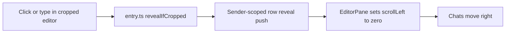
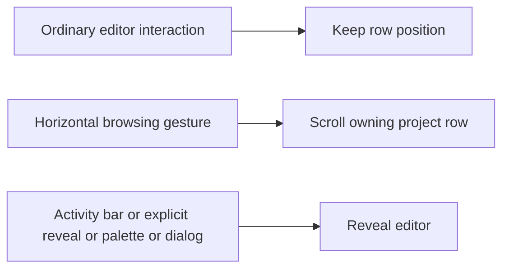

# Keep chats in place when focusing the editor

## Status

| Unit | Result |
| --- | --- |
| Independent investigation | Codex and Claude traced the same reset path in source; runtime NOT VERIFIED |
| Plan challenge | Initial source challenge found no required findings; final review subsequently found F1, the activity-bar return regression |
| U1: remove interaction reveal | Implemented by Claude; Codex inspected the three actual incremental diffs and full changed source files, including F1 correction |
| Integrated review | Claude found F1; correction implemented and reviewed by both agents; no unresolved supported source findings |
| Delivery | Reviewed local changes built and installed on the user's subsequent request; actual editor interaction and regression behavior remain NOT VERIFIED |
| Executable verification | Requested build and installer signature verification PASS; standalone tests/checks and UI verification NOT RUN |

## Current / Issue



`entry.ts` registers both interaction triggers. `EditorPane.revealRow` resets the active project's row. `useRowScroll` can then save that reset. This is the behavior introduced in plan 06, now superseded for ordinary editor interaction. The user's report and this executable source path are the available reproduction evidence; no app was launched.

## Proposed

Clicking, focusing, selecting and typing in the editor body retain the current row position. Keep pinned activity-bar navigation, explicit file and approval-diff reveal, quick input and modal dialog reveal, horizontal wheel routing, modifier tracking, project isolation and the existing crop geometry.

The logical editor width still exceeds its visible viewport while cropped. If the editor retains keyboard focus while its body is fully hidden, typing still edits the open file without revealing it. The caret, find widget, suggestions and other editor widgets can remain outside the visible area until the user browses back. Palettes, modal dialogs and deliberate activity-bar navigation retain their existing reveal behavior.

## Code Changes

### `apps/desktop/src/renderer/src/workbench/entry.ts`

Remove the `pointerdown` reveal listener and the non-modifier reveal call. Keep the key listener for wheel modifiers:

```ts
window.addEventListener(
  'keydown',
  (event) => {
    modifiers.update(event)
  },
  true
)
```

Keep `revealIfCropped` connected to `watchWorkbenchChrome`. Its existing activity-bar element receives the targeted listener:

```ts
const activityBar = layout.getContainer(window, Parts.ACTIVITYBAR_PART)
activityBar?.addEventListener('pointerdown', revealIfCropped, true)
```

This preserves plan 06's pinned-bar return path without revealing on ordinary editor-body clicks. Main/preload/IPC, `WorkbenchFrame`, `EditorPane`, persistence and geometry require no changes.

### `apps/desktop/src/renderer/src/workbench/viewport.ts`

Remove the now-unused `MODIFIER_KEYS` set and `isModifierKey` export. Keep `trackModifiers`, `horizontalRowWheel` and `isCropped`.

### `apps/desktop/src/renderer/src/workbench/viewport.test.ts`

Remove only the obsolete `isModifierKey` import and the whole `describe('keys that bring a cropped editor back')` block. Keep existing wheel, cropping, webview and modifier-tracking cases. No new abstraction or entry-point test harness is required for this listener removal.

One atomic unit, U1, covers these three files. Claude implements it after the plan challenge. Codex reviews the actual incremental diff against the task baselines in `/private/tmp/chorus-editor-focus.oqYuUW`, then the integrated behavior. Claude performs a final adversarial review. Done means reviewed local edits with runtime limitations recorded.

## Acceptance and verification

| Criterion | Source review | Runtime |
| --- | --- | --- |
| Ordinary editor interaction preserves row offset and saved position | PASS: entry pointer reveal and key reveal removed; no replacement focus reset | NOT VERIFIED |
| Explicit file and opening approval-diff reveal remain available | PASS: main requestWorkbenchReveal and requestWorkbenchAskDiff retain revealRow | NOT VERIFIED |
| Quick input and modal dialogs retain reveal | PASS: watchWorkbenchChrome retains onShow and onWillShowDialog callbacks | NOT VERIFIED |
| Pinned activity-bar navigation reveals the cropped workbench | PASS: pointer reveal is registered only on the existing ACTIVITYBAR_PART container | NOT VERIFIED |
| Horizontal wheel, Shift-wheel and webview modifier tracking remain available | PASS: wheel paths and keydown/keyup/blur tracking unchanged | NOT VERIFIED |
| Project isolation, saved offsets and crop geometry remain intact | PASS: byContents/owner routing, active-project guard, useRowScroll and editorViewport unchanged | NOT VERIFIED |
| Existing unrelated working-tree edits remain intact | PASS: task-baseline diffs contain only agreed removals plus the targeted activity-bar listener | NOT VERIFIED |

At source-review delivery, tests, typecheck, lint, formatter, build, app launch and UI checks were NOT RUN. The subsequent requested build/install is recorded below. Standalone tests/checks and UI verification remain NOT RUN. When requested, use `pnpm exec vitest run apps/desktop/src/renderer/src/workbench/viewport.test.ts` and exercise the original scrolled-row click/typing case in the app, followed by the retained reveal and wheel paths.

Performed read-only review commands:

```sh
git diff --no-index -- /private/tmp/chorus-editor-focus.oqYuUW/entry.ts apps/desktop/src/renderer/src/workbench/entry.ts
git diff --no-index -- /private/tmp/chorus-editor-focus.oqYuUW/viewport.ts apps/desktop/src/renderer/src/workbench/viewport.ts
git diff --no-index -- /private/tmp/chorus-editor-focus.oqYuUW/viewport.test.ts apps/desktop/src/renderer/src/workbench/viewport.test.ts
rg -n '\bisModifierKey\b|\bMODIFIER_KEYS\b' apps packages
rg -n 'revealIfCropped|modifiers.update|modifiers.reset|requestRowScroll|onShow|onWillShowDialog' apps/desktop/src/renderer/src/workbench/entry.ts
git diff --cached --stat
```

The three diff commands return the expected exit 1 for differences and show only the agreed deletions plus the activity-bar listener. Codex repeated all three after F1. The helper-reference search returns exit 1 with no matches, including after F1. The retained-path search shows chrome reveal, keydown/keyup/blur tracking and both wheel forwarding paths. Full changed source files and the overall Git diff were read. The Git index remains empty. These are source checks, not executed regression proof.

Regression review covers pinned activity-bar return, explicit file/opening approval-diff reveal, palette/dialog reveal, wheel and Shift-wheel over the editor and webviews, project isolation and saved-offset ownership. Existing wheel/crop/webview/modifier tests remain in place but were not run. No new runtime regression case was added. No external research was needed because the cause and change are explicit in the repository and installed package source.

Final review F1 is supported by plan 06's activity-bar return sequence and the pinned gutter/native viewport geometry. Removing the global pointer listener made activity-bar clicks toggle sidebars outside the visible crop. The correction adds one pointer listener on the existing activity-bar element. F2 is the accepted fully-hidden keyboard-focus trade-off, now recorded above. No other supported findings were reported.

Claude inspected the corrected integrated diff and the installed activity-bar implementation and reported no supported defect. Codex independently inspected the actual correction and remaining diffs, the listener context and installed `@codingame/monaco-vscode-api@33.0.9` activity-bar content creation. The part contains navigation/global/menu controls. The targeted capture listener neither cancels nor stops the event and is separate from editor-body interactions. Its document lifetime matches the existing observer on the same element. No further source correction was required.

The only product changes are the global interaction-trigger removals, targeted activity-bar listener and obsolete helper/test removal. This plan records the required collaboration and review. No dependencies, IPC/persistence changes, native geometry changes, commits, pushes, packaging or unrelated fixes are included. Actual focus stability, activity-bar return, wheel behavior and visibility of cropped caret/widgets remain NOT VERIFIED.

## Requested build and install

The user subsequently requested building and installing. `CHORUS_INSTALL_KEEP_RUNNING=1 pnpm app:install` completed with exit 0 on 2026-10-03. All eight dependency builds were cache hits. Electron Vite built main, preload and renderer; electron-builder packaged the arm64 app and the project's signing hook used `Chorus Local Dev`. The installer copied it to `/Applications/Chorus.app` and its `codesign --verify --deep --strict` step passed.

The installer retained the running copy at `/Applications/Chorus.app.replaced-1791060940842` to keep the current conversation open. Restart Chorus to use the installed update. No standalone tests, typecheck, lint, formatter, app launch or UI verification was run. Original focus behavior and adjacent runtime paths remain NOT VERIFIED. Packaging and installation are now included in the authorized delivery; no commit or push was performed.

## Final Flow


