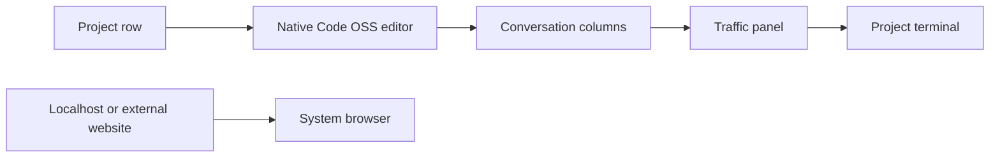
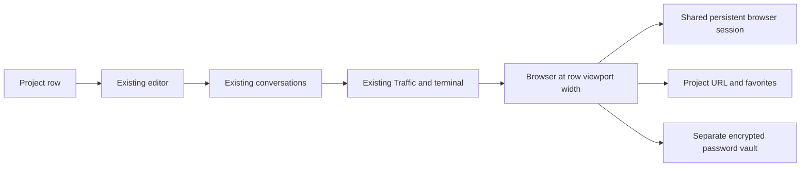
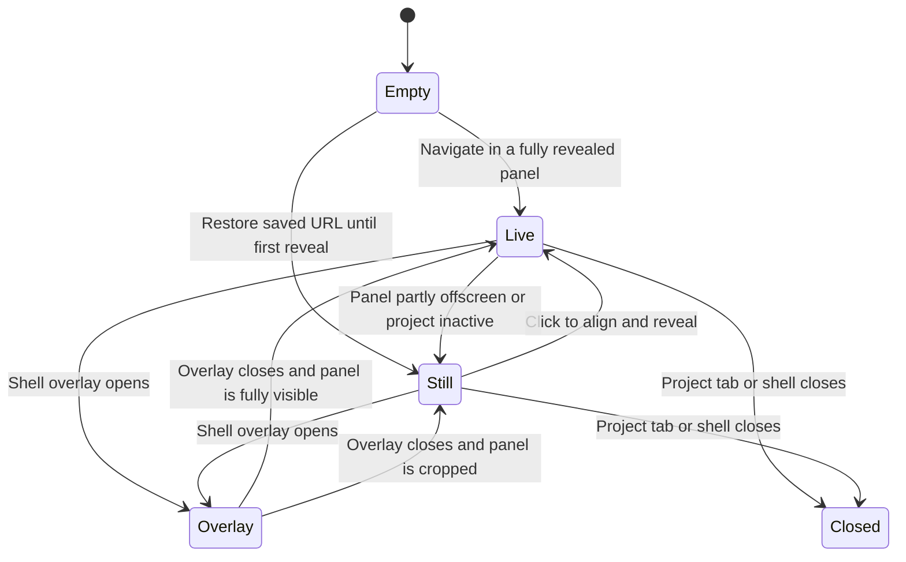
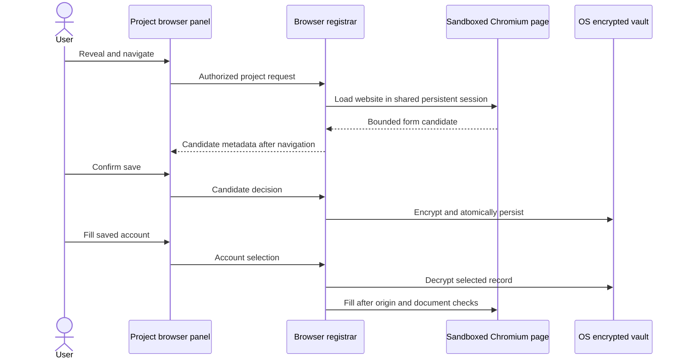

# A browser in every project

## Status

| Unit                                    | Result                                                                                                                                                                                                                                                                                                                                                                                                                                                                                                                                                                                                                                                                                                                                                                                                                                                                                                                                                                                                                                                                                                                                                                                                                                                                                                                                                                                                                                                                                                                                                                                                                                                                                                                                                                                                                                                                                                                                                                                                                                                                                                                                                                                                                        |
| --------------------------------------- | ----------------------------------------------------------------------------------------------------------------------------------------------------------------------------------------------------------------------------------------------------------------------------------------------------------------------------------------------------------------------------------------------------------------------------------------------------------------------------------------------------------------------------------------------------------------------------------------------------------------------------------------------------------------------------------------------------------------------------------------------------------------------------------------------------------------------------------------------------------------------------------------------------------------------------------------------------------------------------------------------------------------------------------------------------------------------------------------------------------------------------------------------------------------------------------------------------------------------------------------------------------------------------------------------------------------------------------------------------------------------------------------------------------------------------------------------------------------------------------------------------------------------------------------------------------------------------------------------------------------------------------------------------------------------------------------------------------------------------------------------------------------------------------------------------------------------------------------------------------------------------------------------------------------------------------------------------------------------------------------------------------------------------------------------------------------------------------------------------------------------------------------------------------------------------------------------------------------------------- |
| Independent research                    | Codex and Claude checked Electron, Google and website vendor documentation; login compatibility NOT VERIFIED                                                                                                                                                                                                                                                                                                                                                                                                                                                                                                                                                                                                                                                                                                                                                                                                                                                                                                                                                                                                                                                                                                                                                                                                                                                                                                                                                                                                                                                                                                                                                                                                                                                                                                                                                                                                                                                                                                                                                                                                                                                                                                                  |
| Plan challenge                          | Resolved: row scroll access, clipping fallback, overlay participants, lazy loading, preload isolation and async credential storage                                                                                                                                                                                                                                                                                                                                                                                                                                                                                                                                                                                                                                                                                                                                                                                                                                                                                                                                                                                                                                                                                                                                                                                                                                                                                                                                                                                                                                                                                                                                                                                                                                                                                                                                                                                                                                                                                                                                                                                                                                                                                            |
| U1: contracts and persistence           | Codex reviewed all six files and the correction diffs; read/plaintext/per-origin limits corrected. Source review complete; tests, typecheck, lint and format NOT RUN                                                                                                                                                                                                                                                                                                                                                                                                                                                                                                                                                                                                                                                                                                                                                                                                                                                                                                                                                                                                                                                                                                                                                                                                                                                                                                                                                                                                                                                                                                                                                                                                                                                                                                                                                                                                                                                                                                                                                                                                                                                          |
| U2: native browser and IPC              | Codex reviewed the new files, wiring, authorization tests and correction diffs. Attach/shutdown admission and overlay owner generations corrected. Source review complete; compilation, runtime behavior, site login and performance NOT VERIFIED; tests, typecheck, lint and format NOT RUN                                                                                                                                                                                                                                                                                                                                                                                                                                                                                                                                                                                                                                                                                                                                                                                                                                                                                                                                                                                                                                                                                                                                                                                                                                                                                                                                                                                                                                                                                                                                                                                                                                                                                                                                                                                                                                                                                                                                  |
| U3: browser panel                       | Codex reviewed the panel, integration, geometry, styles, translations and correction diffs. CSS sizing, address editing, hide-capture coalescing, layout measurement and stale UI replies corrected. Source review complete; compilation, native geometry, site login and performance NOT VERIFIED; tests, typecheck, lint and format NOT RUN                                                                                                                                                                                                                                                                                                                                                                                                                                                                                                                                                                                                                                                                                                                                                                                                                                                                                                                                                                                                                                                                                                                                                                                                                                                                                                                                                                                                                                                                                                                                                                                                                                                                                                                                                                                                                                                                                 |
| Integrated and adversarial review       | Complete by source inspection. Codex reviewed the integrated implementation and every correction diff. Claude's first adversarial review returned F1–F6; supported findings F1–F5 were corrected, and F6 remains an unverified back-forward-cache case with a lifecycle defense. Claude's final targeted review returned no supported defects                                                                                                                                                                                                                                                                                                                                                                                                                                                                                                                                                                                                                                                                                                                                                                                                                                                                                                                                                                                                                                                                                                                                                                                                                                                                                                                                                                                                                                                                                                                                                                                                                                                                                                                                                                                                                                                                                 |
| Adversarial corrections                 | Reviewed by Codex against the pre-correction baseline. Registered shell identity guards general, detached-window and workbench shell IPC, shell broadcasts, zoom and dialog parents. Restored URLs are validated before view creation, stored non-web URLs are rejected, Show restores discarded pages, startup prunes settings and persisted `pageshow` refreshes the preload token. Source review complete; all executable checks NOT RUN                                                                                                                                                                                                                                                                                                                                                                                                                                                                                                                                                                                                                                                                                                                                                                                                                                                                                                                                                                                                                                                                                                                                                                                                                                                                                                                                                                                                                                                                                                                                                                                                                                                                                                                                                                                   |
| Executable verification                 | NOT RUN; the user has not authorized tests, typechecks, builds, app launches or benchmarks                                                                                                                                                                                                                                                                                                                                                                                                                                                                                                                                                                                                                                                                                                                                                                                                                                                                                                                                                                                                                                                                                                                                                                                                                                                                                                                                                                                                                                                                                                                                                                                                                                                                                                                                                                                                                                                                                                                                                                                                                                                                                                                                    |
| Local delivery                          | Implementation and source reviews complete. Changes remain local and uncommitted. Compilation, runtime behavior, site login and performance NOT VERIFIED                                                                                                                                                                                                                                                                                                                                                                                                                                                                                                                                                                                                                                                                                                                                                                                                                                                                                                                                                                                                                                                                                                                                                                                                                                                                                                                                                                                                                                                                                                                                                                                                                                                                                                                                                                                                                                                                                                                                                                                                                                                                      |
| Follow-up: local-network HTTP passwords | Local implementation and source reviews complete. The user's `http://192.168.1.23:30010/login` was ineligible under the loopback-only HTTP policy. Claude extended the shared helper to private IPv4 ranges `10/8`, `172.16/12` and `192.168/16`; Codex inspected the complete five-file diff and capture/vault/fill callers. Help strings and unrun exact-URL, range-boundary, lookalike and exact-origin vault cases are included. Claude's final targeted review returned no supported defects. Public HTTP remains ineligible. All executable checks NOT RUN; the save prompt on the user's form NOT VERIFIED                                                                                                                                                                                                                                                                                                                                                                                                                                                                                                                                                                                                                                                                                                                                                                                                                                                                                                                                                                                                                                                                                                                                                                                                                                                                                                                                                                                                                                                                                                                                                                                                             |
| Follow-up: automatic filling            | The user reports saving worked and requests automatic filling. The initial manual-only behavior is confirmed in source. Claude challenged the plan; Codex selected form-first signaling before vault access, immediate automatic filling on eligible origins including the requested LAN HTTP, bounded readiness retries, separate username/password phases and a first-reveal probe. Claude implemented it in `shared/browser-ipc.ts`, `main/browser-surface.ts` and `preload/browser.ts`, with unrun cases in `shared/browser-ipc.test.ts` and `main/browser-surface.test.ts`; see "As written" below. Codex's first review found four supported defects: a page still being hidden counted as showing; an interrupted attempt consumed its phase, so reveal could not retry; there were no ready/load probes; and the password was written without rechecking after the username's page handlers ran. Claude corrected all four, with unrun cases for each. Claude's final adversarial review found two supported defects, both since corrected. First, one delivery consumed a phase for the whole document, so a login form that was replaced or reset was never refilled; that is now a bounded retry, at most `BROWSER_AUTOFILL_DELIVERIES_MAX` (3) deliveries per key and phase, with password signals only for an empty field. Second, a formless password could fill the first global identifier-like field. Now a structurally ambiguous formless target gets no phase signal, and its automatic fill is skipped entirely. A last review found two more defects caused by the retry, both corrected. A filled username-only field kept signalling, so no-op deliveries used up its cap. And a password the user had just cleared could be refilled while they typed. Now the identifier phase requires an empty field, and fields the user has typed into are never filled automatically. The pre-hydration fill concern remains a runtime gap. Codex inspected the final diffs. Claude's final targeted review returned no further supported defects. Local implementation and source reviews complete; changes remain uncommitted. All executable checks NOT RUN; automatic fill on the user's form NOT VERIFIED |
| Follow-up: browser at row end           | Written and source-reviewed: the existing browser section and its leading sash now follow the Traffic/terminal section. Browser width, project instances and horizontal gesture forwarding are unchanged. Tests, typecheck, lint, format, build and launch NOT RUN; visual result NOT VERIFIED.                                                                                                                                                                                                                                                                                                                                                                                                                                                                                                                                                                                                                                                                                                                                                                                                                                                                                                                                                                                                                                                                                                                                                                                                                                                                                                                                                                                                                                                                                                                                                                                                                                                                                                                                                                                                                                                                                                                               |

The user authorized implementation after the research. Codex leads and reviews. Claude implements one unit per handoff. Delivery is reviewed local changes, without commit, push, packaging or installation. Existing staged changes are preserved. Incremental review baselines are in `/private/tmp/chorus-project-browser-ayj564bo`.

## Current / Issue



`EditorPane.tsx` owns the horizontal row. `PaneWorkbench.tsx` keeps project editors mounted across tab switches. `TrafficIpc` registers shell roles and checks main-frame identity and project scope. `workbench-surface.ts` owns native overlay visibility and stills. The existing workbench and agent secret stores are separate capabilities; neither is a browser password vault.

## Proposed





One page per project. Create its native view only when the active project's panel is first revealed or the user deliberately navigates there. Retain loaded pages while their project tabs remain open. Closing the tab releases its page. Detaching a project reloads its page in the new shell; arbitrary in-page state is not transferred.

The panel is always present at the right end after Traffic in the existing row. Its width is the scroller's available viewport, excluding the pinned activity-bar gutter. A full-width panel shares the screen through horizontal scrolling. It cannot simultaneously occupy the full width and show all neighboring panes.

Native parent clipping remains unverified, so v1 uses a DOM still while any part of the panel lies outside the row. Clicking the still or the reveal control aligns the panel with `revealInRow`. No scroll-snap and no website viewport shrink on each scroll frame. Capture only on a live-to-hidden transition; coalesce requests and guard asynchronous results with a revision. Screenshots stay transient.

Horizontal wheel gestures and Shift+wheel now move the project row through the primary-page preload bridge in [plan 18](18-browser-row-wheel.md). Vertical gestures and Ctrl/Cmd zoom stay with the website. Explicit previous/next-pane toolbar controls and the existing scrollbar also preserve access to the row. Browser shortcuts stay browser-local.

## Code Changes

### NEW: `apps/desktop/src/shared/browser-ipc.ts`

Use the repository's zod contract and API pattern. Separate shell invoke contracts from validated website-preload events. Bound strings, arrays, rectangles and payload sizes. Responses and pushes carry browser state, favorite data and credential metadata, never passwords.

```ts
export const BrowserFavorite = z
  .object({ id: BrowserId, url: BrowserUrl, title: BrowserTitle, icon: BrowserIcon.nullable() })
  .strict()

export const BrowserPageCandidate = z.discriminatedUnion('kind', [
  z.object({ kind: z.literal('identifier'), documentToken, username }).strict(),
  z.object({ kind: z.literal('credential'), documentToken, username, password }).strict(),
])

export const BrowserPasswordAccount = z
  .object({ id: BrowserId, origin: BrowserOrigin, username: BrowserUsername })
  .strict()
```

The shapes above are abbreviated from the shipped `shared/browser-ipc.ts`. `BrowserIcon` is a raster data URL of at most 32 KiB, and `BrowserOrigin` is at most 2048 characters. The full contract and bounds follow.

Shell capabilities cover opening/closing, state, bounds/active visibility, navigation actions, favorites and password decisions/fill/removal. Every operation is owner/project scoped. Candidate acceptance and fill delivery additionally bind to the current page document. Candidate ids are opaque, short-lived and scoped to the owning browser.

Final U1 contract, as written:

| Shell channel                                    | Request                                                           | Response                                  |
| ------------------------------------------------ | ----------------------------------------------------------------- | ----------------------------------------- |
| `browser:attach`                                 | `{projectId}`                                                     | `{browserId, state, favorites, settings}` |
| `browser:detach`                                 | `{browserId}`                                                     | `{ok}`                                    |
| `browser:restore`                                | `{browserId}`                                                     | `{state, failure}`                        |
| `browser:navigate`                               | `{browserId, address}`                                            | `{state, failure}`                        |
| `browser:action`                                 | `{browserId, action: back/forward/reload/stop/devtools/external}` | `{state, failure}`                        |
| `browser:geometry`                               | `{browserId, revision, rect, active, fullyVisible}`               | `{revision, still}`                       |
| `browser:favoriteAdd`                            | `{browserId}`; main reads the current page                        | `{favorites, failure}`                    |
| `browser:favoriteRemove`, `browser:favoriteOpen` | `{browserId, favoriteId}`                                         | favorites or state result                 |
| `browser:passwords`, `browser:passwordAllow`     | `{browserId}`                                                     | `{passwords, failure}`                    |
| `browser:passwordDecide`                         | `{browserId, candidateId, decision: save/update/never/dismiss}`   | `{passwords, failure}`                    |
| `browser:passwordFill`                           | `{browserId, accountId, documentId}`                              | `{failure}`                               |
| `browser:passwordRemove`                         | `{browserId, accountId}`                                          | `{passwords, failure}`                    |

`browser:push` carries `state`, `favorites`, `prompt` and `passwords` variants. `BrowserState` holds `status`, `live`, `url`, `title`, `icon`, back/forward flags, a main-minted `documentId`, the eligible `passwordOrigin` and the load `error`. `BrowserPasswords` holds `storage`, `origin`, metadata-only `accounts` and `neverSave`. Every shell schema is strict, so no response or push can carry a password field.

Website preload channels are separate constants and never appear in `BROWSER_CONTRACT`. `browser:page:ready` sends a preload-minted `documentToken`; main records it against the sender's own main-frame origin. `browser:page:candidate` is an `identifier` or `credential` variant carrying that token. `browser:page:fill` goes from main to the page with `{documentToken, origin, username, password}`, so the preload can refuse a fill for a document or origin that has changed.

Bounds: ids 128, project ids 256, URLs and addresses 8192, origins 2048, titles 512, raster data-URL icons 32 KiB, JPEG stills 16 MB, 48 favorites per project, 64 accounts per origin, usernames 1024, passwords 8192, rectangle coordinates ±32768.

Pure policy helpers live in the same file. `isBrowserNavigable` admits `http`, `https` and `about:blank`. `browserPasswordOrigin` admits HTTPS. It admits HTTP only on loopback (`localhost`, `*.localhost` (each with an optional single trailing dot, matching Chromium's `IsLocalHostname`), `127.0.0.0/8` and `[::1]`) and on private local-network IPv4 addresses (`isPrivateNetworkHostname`: `10.0.0.0/8`, `172.16.0.0/12`, `192.168.0.0/16`, as exact dotted octets of the parsed hostname with numeric range checks). IPv4-mapped IPv6, public HTTP, invalid addresses and suffix or lookalike domain names are refused. `isLoopbackHostname` still means loopback only. `browserAddress` normalises typed input, prefers HTTPS, uses HTTP for loopback and refuses user-info. `browserScrubUrl` removes credentials, OAuth and signing parameters, and token-bearing fragments, from saved addresses.

### NEW: `apps/desktop/src/main/browser-settings.ts`

Async atomic JSON under `userData/browser/`. Store a bounded set of project last URLs and favorites outside the conversation event log. Serialize mutations so simultaneous project updates cannot lose each other. Keep navigation persistence off the per-keystroke path. Missing files start empty; corrupt files must not silently become destructive replacements. Expose an async flush for shutdown.

As written, `BrowserSettingsStore` holds `settings.json` as a project array, never as object keys, so a `__proto__` project id is data. It allows up to 512 projects and caps the file at 16 MiB, with favorite writes held to a smaller budget. Every operation runs on one promise queue. Last-URL changes are debounced, 1.5 s by default, and favorites write immediately. Writes go through `writeAtomically`: a random temp file with exclusive create and mode 0600, then rename. `readBounded` stats the file, then reads in 64 KiB chunks and stops one byte past the cap. A file that grows after the stat still cannot pull more than `maxBytes + 1` bytes into memory. A corrupt or oversized file reports `settings-corrupt` and is never rewritten. A read error reports `settings-unreadable` and is retried. `prune(known)` needs an explicit authoritative set. `flush()` cancels the debounce and drains the queue.

### NEW: `apps/desktop/src/main/browser-vault.ts`

One encrypted, schema-validated blob for origin-bound username/password records and never-save origins. Use async `safeStorage` and atomic async filesystem writes with serialized read-modify-write operations. Expose metadata and fill-only main-process access; no generic renderer secret read.

```ts
import { safeStorage } from 'electron'

async function encryptBrowserPasswords(value: string): Promise<Buffer> {
  if (process.platform === 'linux') {
    const backend = safeStorage.getSelectedStorageBackend()
    if (backend === 'basic_text' || backend === 'unknown') {
      throw new Error('browser.storageUnavailable')
    }
  }
  if (!(await safeStorage.isAsyncEncryptionAvailable())) {
    throw new Error('browser.storageUnavailable')
  }
  return safeStorage.encryptStringAsync(value)
}
```

Handle decrypt failures and key rotation. Installed Electron 43.2.0 returns `{result, shouldReEncrypt}`; do not depend on the undocumented `isTemporarilyUnavailable` property. Refuse persistence if the platform cannot provide protected storage. The Linux sync-backend check is conservative, not proof of the async provider's protection. macOS and Windows are the release targets. Windows DPAPI protects against other OS users, not other applications under the same user account.

As written, `BrowserVault` keeps `passwords.bin` as one encrypted blob holding record ids, origins, usernames, passwords, timestamps and never-save origins. It allows 2000 records, 64 records per origin (`BROWSER_VAULT_ORIGIN_RECORDS_MAX`, equal to the shell's `BROWSER_ACCOUNTS_MAX`), 2000 never-save origins, 8 MiB of plaintext and a 16 MiB file. The plaintext cap applies on read as well as write: a decrypted payload over 8 MiB is `corrupt` before `JSON.parse` and the file is left untouched. A new account at a full origin is refused with `limit`; updating an existing account at the cap still succeeds. A stored vault with more than 64 records for one origin fails schema validation on load and is `corrupt`, so the vault and the account chooser always agree. Crypto sits behind `BrowserVaultCrypto`, with `electronVaultCrypto` as the async safeStorage implementation. Before writing, every write decrypts the new ciphertext again and compares it with the plaintext. `shouldReEncrypt` re-encrypts with the current key and rewrites atomically. A cached `locked` or `corrupt` state refuses every mutation until `reload()`; `unavailable` and `unreadable` are retried. Metadata goes through `accounts`, and `classify` returns save/update/same/never for prompts. `credential(origin, accountId)` is main-only, for fill.

HTTPS credentials, actual loopback HTTP origins and private local-network IPv4 HTTP origins (`10/8`, `172.16/12`, `192.168/16`) are allowed. Reject credentials for other plain HTTP origins, opaque origins and privileged schemes. Keep schemes, hosts and ports distinct. Corrupt or undecryptable vaults reject mutation rather than overwrite existing credentials as an empty store. Do not persist known OAuth callback tokens in restored URLs.

### NEW: `apps/desktop/src/main/browser-surface.ts`

Use `WebContentsView` without the Code-OSS host, editor session policy or workbench preload.

```ts
import { join } from 'node:path'
import { session, WebContentsView } from 'electron'

function createBrowserView(): WebContentsView {
  return new WebContentsView({
    webPreferences: {
      session: session.fromPartition('persist:chorus-browser'),
      preload: join(__dirname, '../preload/browser.js'),
      sandbox: true,
      contextIsolation: true,
      nodeIntegration: false,
      nodeIntegrationInSubFrames: false,
      webSecurity: true,
      backgroundThrottling: true,
    },
  })
}
```

Allow HTTP, HTTPS and internal `about:blank`. Block privileged navigation and nested webviews. Keep website headers unchanged. Keep normal certificate validation. Permission requests default to denial; calls, notifications and other permission-dependent features are outside v1. Keep permission handling separate from the existing shell/editor sessions.

Popup handling must preserve POST bodies, opener relationships and the shared session. Use real sandboxed child windows with an explicit browser session and security preferences for website-created windows. Apply the same navigation and permission policy to them. Tie them to their parent project lifecycle. Do not convert an arbitrary popup into `loadURL`, which discards window-open semantics. Never open a website's custom protocol externally without a user action. Password capture and fill are primary-page only in v1: popups get neither, and no callback relay exists.

Fetch favicons asynchronously through the browser session with timeout, byte and MIME limits. Admit raster image types only; do not pass arbitrary SVG/HTML or unbounded data to the shell. Keep the existing shell CSP. Use a letter badge on failure. Cancel or discard stale favicon results after navigation or teardown.

Source-owned visibility is distinct from overlay visibility. Bounds use the existing shell zoom convention. Retain pages while hidden without claiming they stop all background work. Main-frame cross-document shell navigation and shell destruction release owned pages and candidate state. Close timers, listeners, popups and overlay registrations when a page is destroyed.

As written, `BrowserSurfaces` creates no view on `attach`; it only reads settings and holds the saved URL as `pendingUrl`. `attach` calls `admit` before awaiting the settings read and again immediately before inserting, with no await in between. `admit` enforces `BROWSER_RECORDS_PER_OWNER` (64) and a terminal `stopping` flag set first by `shutdown()`. The owner-generation check also runs after the await, so concurrent attaches cannot exceed the cap and a pending attach cannot insert after shutdown or a reload. A view is created on the first `geometry` request that is active, fully visible and non-empty, or on `restore`, `navigate` or `openFavorite`.

- **Geometry.** Revisions must strictly increase per browser; U3 starts at 1. A stale revision returns the current revision with no still. A wanted geometry places the view in the shell's CSS pixels × `currentScale()` and shows it. A live-to-hidden transition goes through `hide(record, view)`. There is one pending capture per view (`record.capture`), and every hidden request that arrives while it is pending awaits the same promise and returns the same still. When the capture resolves, the view is hidden if it is still the same view and the latest desired state is still not wanted, even if newer hidden revisions arrived meanwhile. A wanted request in between wins, because it sets `wanted` and `live` and the resolution then leaves the view shown. `releaseView` clears the pending capture. Hidden views keep their last bounds, so a website is never resized on every scroll frame. `onScaleChange` re-places live views.
- **Visibility reasons.** The participant's own reason is `live`; overlay hiding is separate and owned by `workbench-surface.ts`.
- **`BrowserState.live`** means that a native page exists.
- **Navigation policy.** The main frame and its redirects may only go to `isBrowserNavigable`. Subframes may use `http`, `https`, `about`, `blob` and `data`. `will-attach-webview` is denied.
- **Popups.** A navigable popup becomes a real child window, up to 8 per page, adopted recursively under the same project. All of them close with the project's page.
  - **Explicit preferences apply only to ordinary popups.** Electron 43.2.0's `guest-window-manager.ts` applies the explicit browser session and security preferences, without the website preload, to ordinary children.
  - **Electron documents that `about:blank` children copy the parent's preferences and cannot be overridden.** So an `about:blank` popup may still run the browser preload.
  - **That preload is inert there.** The candidate and ready listeners are registered on the primary contents' own `contents.ipc` only, so messages from any popup are never accepted. Toolbar fill sends only to the primary page's main frame.
  - Sources: [guest-window-manager.ts](https://raw.githubusercontent.com/electron/electron/v43.2.0/lib/browser/guest-window-manager.ts), [window-open](https://www.electronjs.org/docs/latest/api/window-open).
- **Permissions.** Only `fullscreen` and `clipboard-sanitized-write` are granted.
- **Unchanged browser defaults.** Downloads, certificate errors and HTTP auth keep Electron's defaults.
- **Console logs.** Website console output is excluded from `chorus.log` through `isBrowserPage`.

Passwords, as written:

- **Document binding.** The preload's `documentToken` is bound in main to the sender's own main-frame origin.
- **Candidates.** A credential candidate is accepted only from the current primary page's main frame, with a matching token and an eligible origin. It is held for 2 minutes. An identifier-only step is remembered for 5 minutes, same origin only.
- **Prompt.** The next main-frame commit, cross-document or in-page, triggers `vault.classify`. A save/update result pushes a prompt bound to that destination `documentId`, with the original login origin kept explicit. A later cross-document commit clears the prompt; otherwise it expires after 5 minutes.
- **Decisions.** A decision must name the live candidate. A failed save keeps the candidate for retry.
- **Fill.** Fill captures the page identity (contents, origin, token, `documentId`, navigation count). It then awaits the vault, rechecks that identity and sends to `mainFrame` only.
- **Locked vault.** `browser:passwords` calls `vault.reload()`, so opening the chooser is the user-triggered retry for a locked vault.
- **Popups.** Popup logins are neither captured nor filled in v1, because only the primary page's `contents.ipc` accepts page messages and fill targets only the primary main frame. This holds even for an `about:blank` popup that inherited the preload. The shared session still keeps the cookies a popup login sets.

### `apps/desktop/src/main/workbench-surface.ts`

Add a small native-overlay participant registry rather than widen the editor-only `Surface` type. Participants supply an id, a native view and their own visibility reason. Overlay-wide capture/hide/show, heartbeat expiry and teardown include participants. Editor-only toggles do not affect them. Their stills use the existing `{viewId, dataUrl}` response and `useWorkbenchStill`.

Preserve the existing two-reason rule. Async capture must not hide a page after a newer show or restore a page hidden by its project/geometry. Newly registered participants inherit current overlay visibility.

As written:

- **Exports.** `OverlayParticipant {id, owner, view, shown}`, `registerOverlayParticipant`, which returns an unregister function and applies visibility immediately, and `applyParticipant`.
- **Overlay paths.** Overlay show, heartbeat, hide and watchdog expiry apply participants for the caller. The hide path appends participant stills from views that are visible and shown.
- **Stale hides.** Every overlay-wide call (no `viewId`) takes the next value of one module-wide, never-reused `overlaySequence` and records it in a `WeakMap` keyed by owner. A capture-then-hide that finds a different value when it resumes returns its stills without marking or applying. Because the sequence is global, a reloaded document's first hide can never reuse an old pending capture's number. This also closes the same stale-hide race for editors.
- **Watchdog.** Expiry advances the owner's revision, so a capture still pending when the watchdog fires cannot re-hide afterwards. The cost: a genuine hide that is still capturing at that moment is skipped until the next 3 s heartbeat marks it again.
- **Editor-only calls.** Calls carrying a `viewId` never touch participants.
- **Teardown.** `registerOverlayParticipant` calls the existing `watchOwner`, so an owner with only browser views gets the same reload and destroy cleanup as an editor owner. `releaseOwner` advances the owner's revision and drops its participant set. `BrowserSurfaces`, which watches the same owner, releases the views; whichever listener runs first, the other is safe.

### NEW: `apps/desktop/src/main/browser-ipc.ts`

Mirror `TrafficIpc` shell registration, main-frame authorization and adopted/detached project scope. Deny calls from website contents and unknown shell documents. Validate both requests and responses. Register browser preload events separately; only known browser main frames may submit bounded candidates. Derive origin from the sender, never from a website-provided origin.

Candidate plaintext is kept briefly in main memory. Save only after shell confirmation of the same opaque candidate. Fill after a user selection, or automatically when the origin has exactly one saved account (see "Follow-up: automatic filling"), with current-origin and navigation/document checks before and after async vault access. Send the selected password to that browser's main frame only, never to the shell. Expire stale candidates and identifiers. A navigation signal may follow a failed login, so the prompt offers saving without asserting authentication success.

### NEW: `apps/desktop/src/preload/browser.ts`

Self-contained sandboxed preload: runtime import from `electron` only, optional type-only imports. Expose no `contextBridge` API. Send captured form candidates and receive fill messages from main. Never stream keystrokes; the only form polling is the bounded login-field scan added for automatic filling. Capture ordinary form submission before navigation, including identifier-only steps where usable. Use native input setters and input/change events for user-requested fill. Recheck origin and current document before filling.

Isolated globals do not conceal filled values from the target website's scripts; the DOM is shared. Cross-origin iframe login forms and custom SPA submissions may need later compatibility work. Password capture must not attempt to bypass Google's embedded SSO restriction.

As written, the preload declares only the DOM shapes it uses locally, because `tsconfig.node.json` has no DOM library.

- **Token.** It mints a 32-hex `documentToken` with `crypto.getRandomValues`, which works in insecure contexts, and sends `browser:page:ready` once per document.
- **Capture.** It listens only for trusted, capture-phase `submit` events.
  - It skips forms that have more than one filled password field or any `new-password`/`one-time-code` field.
  - It finds the username through `autocomplete` `username`/`email`, `type=email`, or a `user|email|login|account|identifier` name or id hint.
  - It sends an `identifier` or `credential` candidate. Over-length values are dropped, never truncated.
- **Fill.** It refuses unless the token and `location.origin` match. It fills only visible, enabled, writable fields: the first suitable password field, and a username field in the same form, or on the page when no password field is visible. Values are set through the native `HTMLInputElement` setter, followed by `input` and `change` events.
- **Automatic fill.** Same token and origin checks, stricter field rules; see "Follow-up: automatic filling".
- **Not captured.** Script-driven logins that never fire `submit` are not captured.

### `apps/desktop/electron.vite.config.ts`

```ts
input: {
  index: resolve(__dirname, 'src/preload/index.ts'),
  workbench: resolve(__dirname, 'src/preload/workbench.ts'),
  browser: resolve(__dirname, 'src/preload/browser.ts'),
},
```

Preserve CJS output and existing entries. The new browser preload must not introduce a shared runtime chunk.

### `apps/desktop/src/main/index.ts`

Create the browser registrar before windows, register/release shell roles at the existing call sites and drain async persistence on shutdown. Browser disposal stays independent of the Code-OSS extension host. No dependency or native rebuild changes.

As written:

- **Startup.** `BrowserIpc` is constructed right after `RunIpc`, before the main window, with `isAdopted` from the project registry.
- **Shells.** They register and release beside Traffic and Run.
- **Shutdown.** `shutDownEverything` starts `browserIpc.close()` synchronously: it removes the handlers, releases every page and flushes settings and vault. The result is awaited first among the async steps.
- **Console logs.** The global `console-message` logger skips browser pages.

### `apps/desktop/src/preload/index.ts` and `apps/desktop/src/shared/ipc.ts`

Mix `BrowserApi` into `ChorusApi`. Add validated invoke methods and a bounded browser-state subscription. Never expose passwords or a general browser-preload IPC bridge.

### NEW: `apps/desktop/src/renderer/src/BrowserPanel.tsx`

One component owns its browser state, address draft, account chooser and password prompt. It subscribes to main state; screenshots remain transient. Keep each open project's component mounted, with active visibility and geometry tracking only for the active project. Measure on resize/scroll/layout events; coalesce geometry updates and send only changed rectangles. Avoid another perpetual per-project animation loop.

Use i18n for address controls, back/forward, reload/stop, DevTools, Open externally, reveal, adjacent panes, favorites, save/update/never/dismiss, account selection, remove password and all empty/error/status text. Represent loading, empty, error and ready states. No Chrome account/Sync claims or automatic Google login claims.

As written, `BrowserPanel` takes `{projectId, active, scroller, onReveal}`.

- **Attach and pushes.**
  - It subscribes to `onBrowser` before calling `attachBrowser`, and filters pushes by the attached id.
  - A late attach result after cleanup is detached at once; cleanup detaches the attached record. This covers StrictMode's mount, unmount and mount.
  - `Try again` re-runs attach after a failure.
  - Every async reply is dropped unless `idRef` still names the same browser.
- **Geometry.**
  - Only the active panel installs measurement listeners: a `ResizeObserver` on the panel, the body, the scroller and every row item, re-collected by a `childList` `MutationObserver`; passive row `scroll`; and window `resize`, which also fires on shell zoom.
  - A layout effect with no dependency list also schedules a measurement after every commit of an active panel. A same-sized pane that moves, for example from left to right, re-renders its `EditorPane` and therefore the panel, and gets remeasured without any size change.
  - These coalesce into one scheduled `requestAnimationFrame`. There is no perpetual loop.
  - `browserViewport(panel, body, scroller)` gives the body's CSS rectangle, cropped at `ROW_EDGE_INSET` on the right and `ROW_SCROLLBAR_STRIP` at the bottom. `fullyVisible` allows `BROWSER_FIT_TOLERANCE` (1 px) and needs a non-empty body.
  - A wanted geometry identical to the last one sent is not resent. Any two hidden geometries count as equal, so cropped rectangles that change during a scroll are not resent once the view is hidden; the next fully visible measurement carries fresh bounds.
  - Revisions restart at 1 for each attached browser.
  - A rejected geometry invoke clears the matching `lastSent`, so the next measurement can retry. There is no immediate re-send.
  - Deactivation and unmount send one hidden geometry, unless the last sent was already hidden.
- **Stills.**
  - A reply to a hidden geometry with a still becomes the local crop still. A live reply clears it. Replies whose revision is not the latest are ignored.
  - The body draws `useWorkbenchStill(browserId)` first, then the crop still while a page exists, inside a reveal button. The `` is clipped by CSS.
- **Revealing.** Reveal and the still call the pane's `revealInRow` on the browser section, then schedule a measurement. Previous/next pane reveal the nearest non-sash row item on either side. Deliberate navigation and opening a favorite reveal on success.
- **Toolbar.** Previous pane, back, forward, reload/stop, the address form, add favorite, Passwords, Open externally, DevTools, Show, next pane.
  - The address shows `state.url` until focused or edited, then a draft. Any edit sets `editing` again, including while the field is still focused after a submission. Submitting uses the displayed value: the draft while editing, otherwise the current URL. Escape abandons the draft.
  - Favorite badges are an open button and a separate remove button, never nested. They show the raster icon or a host letter, and a project at its favorite limit gets a specific message.
- **Status line.** Settings corruption, load errors and request failures appear in a status line with Dismiss.
- **Save offer.** An inline group shows the credential's own origin and username from main, with Save/Update, Never for this site and Not now. It states that the offer does not mean sign-in worked.
  - A persistence failure stays retryable. The failure message is stored with its `candidateId` and shown only while that same offer is current, so an older failed decision never labels a newer offer.
  - A successful decision refreshes a still-current chooser from the reply, which lists the current page's origin.
- **Password chooser.**
  - Inline, opened through `readBrowserPasswords`, which also retries a locked vault.
  - Every opening takes a new request number and records the `documentId` and `passwordOrigin` it was opened for. It is shown only while both are current.
  - Replies are applied only to the chooser with the same request number, and only if their origin matches; a mismatch is marked `stale-document`. Replies to a closed or reopened chooser are dropped.
  - Lists metadata only, with Fill and Delete per account and Offer again for a never-save site. Storage problems have a retry.
  - Fill sends the chooser's `documentId`. It closes that same chooser on acceptance, and no success message is shown. A rejected fill, delete or allow shows a translated failure in that chooser only.
- **Help text.** The empty state explains the shared profile, and both the empty state and the chooser note that Google sign-in may need the default system browser.
- **Rejected alternatives.** Nothing overlays the native region, so `useShellOverlay` is not needed. No scroll-snap. Plan 18 adds horizontal wheel forwarding; vertical and zoom gestures stay with the website.

### `apps/desktop/src/renderer/src/workspace/EditorPane.tsx`

Insert a fixed-width browser section just before `traffic-box`, retain one keyed browser per `pane.tabs`, and pass row geometry/reveal/neighbor callbacks. Its section is fixed in the divider algebra so dragging neighboring sashes never resizes it. Preserve saved row offsets, activity-bar/editor geometry, Traffic and terminal state.

As written:

- **Width.** A new `rowWidth` state holds the scroller's `clientWidth`. The scroller sits after the pinned activity-bar gutter, so the gutter is excluded. It is measured in the existing layout effect, whose `ResizeObserver` now also observes the scroller.
- **Section.** `<section className="browser-box">`, with `flex: 0 0 rowWidth px`, renders one keyed `BrowserPanel` per `pane.tabs`, with `active={id === projectId}`.
- **Placement.** It is the last row section, after the combined Traffic/terminal section, with a `rowSash` between them.
- **Sashes.** `row-drag.ts` classifies `.browser-box` as `fixed`, so `rowWidths` never applies a width to it. The leading sash follows the existing Traffic/fixed-panel divider rules. There is no trailing sash after the browser.
- **Untouched.** Row scroll persistence, editor geometry, Traffic and the terminal.

### `apps/desktop/src/renderer/src/styles.css` and `apps/desktop/src/renderer/src/i18n/en.json`

Match the existing conversation dock and surface palette. Clip DOM stills within the panel and reserve `ROW_EDGE_INSET`/`ROW_SCROLLBAR_STRIP` in native geometry. Keep password prompts and chooser in the toolbar region, outside the native page rectangle. Accessibility labels and keyboard-reachable actions use translation keys.

As written:

- **CSS.** `styles.css` gains the `browser-*` rules after `.traffic-box`. They use only existing tokens and add no CSP change.
  - The toolbar, favorites, notice, prompt and chooser rows use `.conversation-body > .browser-*` selectors, which outrank the later generic `.conversation-body > * { flex: 1 1 auto }`, the same way `.traffic-panel` does. Only `.browser-body` fills the remaining height.
  - All rows wrap. The address takes `flex: 1 1 200px` with a 120 px minimum, and `.browser-box` has `min-width: 0`, so a narrow row wraps instead of growing the panel past the full-fit condition.
  - Favorites are capped at 72 px tall and the prompt and chooser at 160 px; each scrolls so every control stays reachable.
- **Translations.** `en.json` gains a `browser` block: toolbar, favorites, empty and pending, help, prompt, chooser, `storage.*` for the four non-ready states, and `failure.*` for all 17 `BrowserFailure` values. Every literal `t('browser…')` key in the panel exists.

### Adversarial corrections: website renderers are not Chorus windows

Adding arbitrary website renderers invalidated the existing assumption that every `BrowserWindow` and every IPC sender is a Chorus window. A website popup is a real `BrowserWindow`, and a compromised website renderer can send any IPC.

- **NEW `main/shell-windows.ts`.** `registerShellWindow(window)` is called in `index.ts → createWindow` right after construction, before the document loads. Entries are removed on `destroyed` or `closed`.
  - `shellWindows()` lists registered, non-destroyed windows.
  - `focusedShellWindow()` returns the focused window only if it is registered, so it is null while a website popup has focus.
  - `isShellSender(event)` requires a registered `WebContents` and `senderFrame === sender.mainFrame`.
  - It is an allowlist, never a denylist of browser pages or URLs. Browser, Traffic and Run keep their own project scoping on top.
- **Registrars.** The first thing each of these does is refuse a non-shell sender, before parsing: `ipc.ts → registerIpcHandlers` (every `IPC_CONTRACT` channel, including `terminal:write`), the `detached-windows.ts` registrar, and the `workbench-surface.ts` `WORKBENCH_SHELL_CHANNELS` registrar. In the workbench registrar the existing "not available to a workbench surface" check still runs first. The workbench-preload channels keep their `byContents` checks.
- **Broadcasts.** Every `getAllWindows()` push in `ipc.ts` and `detached-windows.ts` now uses `shellWindows()`: settings, limits, context, tasks, activity, terminal, IDE, diagnostics, events and conversations. `scale.ts → applyScale` zooms only shell windows.
- **Dialogs and attention.** Folder dialogs are parented to `focusedShellWindow() ?? shellWindows()[0]`. Attention toasts go to the focused shell window only; otherwise banners go to shell windows. The `workbench-surface.ts` calls that find an editor view's parent by child identity are not broadcasts and are unchanged.
- **Navigation guard.** `browser-surface.ts → load()` returns `blocked-address` for any URL `isBrowserNavigable` rejects, before `ensureView` or `loadURL`. That covers `restore`, geometry-driven loads of `pendingUrl`, favorites and typed addresses. `browser-settings.ts` validates persisted `lastUrl` and favorite URLs with `isBrowserNavigable` (`StoredUrl`, `StoredFavorite`), so a tampered file is `settings-corrupt` and left byte-identical. `BrowserUrl` itself is unchanged.
- **Show.** `BrowserPanel.tsx → showBrowser` calls `restoreBrowser` when the page is not live but has a URL, then reveals. It is wired to the pending placeholder and to the toolbar Show button. An already-live page is only revealed, never reloaded; still clicks keep `reveal`.
- **Prune.** `index.ts` builds one `BrowserSettingsStore`, starts `prune(new Set(opened.projects.list().map((project) => project.id)))` on the store's queue at startup, and hands the same store to `BrowserSurfaces`. A returned failure or rejection is logged, and a corrupt file is never rewritten. The password vault is not pruned.
- **Token refresh.** `preload/browser.ts` keeps `documentToken` in a `let`. On `pageshow` with `persisted`, it mints a new token and calls `announce()` again; the initial `ready` is unchanged. Capture and fill read the current token. Only a structural `pageshow` overload was added to the local `window` declaration.
- **Unrun tests.**
  - `shell-windows.test.ts`: unregistered popup refused; registered main frame accepted; subframe and null frame refused; destroyed window excluded; focused popup yields null.
  - `scale.test.ts` mocks `shellWindows`.
  - `workbench-surface.test.ts`: every fake `WebContents` is a registered shell unless it belongs to a view, plus a new case refusing a non-Chorus sender on `workbench:setVisible`.
  - `browser-surface.test.ts`: a restored `file:` address is never loaded.
  - `browser-settings.test.ts`: non-web saved addresses and favorites are corrupt and preserved.
- **Gaps.** Runtime behavior is NOT VERIFIED. That includes whether back-forward cache restores happen in Electron 43.2.0, the registry under real window lifecycles, and dialog and attention behavior with popups focused.

### Follow-up: automatic filling

The user's report resolves the missing-offer investigation: saving worked. Before this follow-up, `fill()` ran only after the user selected Fill in the chooser. The new requirement authorizes filling saved credentials automatically. It supersedes the earlier manual-only fill requirement; password storage still requires the user's Save confirmation.

Proposed behavior:

- Fill the primary page's visible login fields automatically when the exact eligible origin has one saved account. Multiple saved accounts keep the explicit chooser.
- Keep scheme, host, port, owner, main frame, document token and navigation identity checks. Revalidate after asynchronous vault access. Keep passwords out of shell messages and responses.
- Automatic mode must preserve an existing password and a username that differs from the saved account. Do not submit the form. Preserve the existing explicit Fill action.
- Handle normal page load, same-document application navigation and reveal of a previously hidden page. Deduplicate automatic attempts so geometry updates do not cause repeated vault reads or fills.
- Account for asynchronously mounted login fields with a short, bounded readiness mechanism. No perpetual polling, page-wide observer or per-frame loop. Any pending automatic password, timer and observer must be cleared on completion, expiry or page lifecycle change.

Resolved design: the isolated preload sends a strict token-bound form-ready signal only after it finds visible login fields. Main then selects one account and sends a fill payload marked manual or automatic, using the existing post-await origin/document/navigation checks. Use distinct identifier and password phases so a username-first form does not consume the only attempt before its password step. Deduplicate each phase for the current document, token and navigation identity without retaining keys from old navigations.

Main sends secret-free scan probes on page readiness/load, relevant in-page navigation and the transition to a visible browser. The reveal probe covers the earlier unverified behavior of `setVisible(false)` and the Page Visibility API. Geometry updates that leave the view visible send no further probes or vault reads. The preload scans on DOM/load lifecycle events, a finite short schedule, trusted login-field focus and scan probes. One pending timer at most; cancel on pagehide and expiry, and clear the schedule once the password phase is signaled. An identifier-phase signal must still permit detection of a later password stage. No indefinite interval or observer.

The user explicitly requested automatic filling after enabling password saving on local HTTP. Fill immediately on those eligible origins; no extra permission gate or delayed secret held in the preload. The preload rechecks token, origin and field values immediately before assignment and retains no credential for later interaction. Multiple accounts keep the chooser, and Save consent remains. Plain HTTP still has its ordinary unencrypted transport properties; this change does not add transport protection.

Expected files are `shared/browser-ipc.ts`, `main/browser-surface.ts`, `preload/browser.ts`, focused unrun regression cases, optional existing help text and this plan. No new dependencies, website edits, history/profile work or login automation.

Acceptance: a single saved account is eligible for automatic fill on the user's LAN HTTP origin; public HTTP and other origins remain excluded; multiple accounts are not picked arbitrarily; typed fields are preserved; stale document/navigation requests deliver no credentials; retries and readiness observation are bounded; explicit Fill and Save consent remain. Source review and written regression cases are required. Runtime form behavior remains NOT VERIFIED until the user tries it. Tests, typecheck, lint, formatting, builds and launches remain unauthorized.

As written:

- **Contracts.** `shared/browser-ipc.ts` adds `browser:page:form` (`{ documentToken, phase }`, phase `identifier` or `password`) and `browser:page:scan` (`{ documentToken }`), both strict. `BrowserPageFill` now requires `mode`, `manual` or `automatic`. Neither page message carries a username or password.
- **Form signal in main.** `browser-surface.ts` accepts a form signal only from the record's own main frame, with the current token, on an origin `isBrowserPasswordOrigin` admits. Public HTTP pages never get a token, so their signals stop before any vault call.
- **Showing.** `showing()` means not closed, `live` and `wanted`. A page whose hide capture is still pending is `live` but no longer `wanted`, so it does not count.
- **Selection.** `autofill()` requires the page to be showing and a full page identity. `attemptAutofill()` reads `vault.accounts` without `reload`. It rechecks showing and identity (`stillShowing`) before reading the credential, and again before delivery. It continues only when storage is `ready` and exactly one account exists, then sends `mode: 'automatic'` to the main frame.
- **Dedupe and cap.** One `AutofillState` per record, keyed by token, document id and navigation count. It holds three things per phase: `pending` (an attempt in flight), `settled` (completed without a delivery), and a `deliveries` count. A new key replaces the old state, so nothing accumulates across navigations. `did-navigate`, `release` and `discard` clear it.
  - A signal is dropped when its phase is pending, settled, or has reached `BROWSER_AUTOFILL_DELIVERIES_MAX` (3) deliveries.
  - `attemptAutofill()` returns `delivered`, `settled` or `interrupted`. `pending` is cleared when the attempt ends. The outcome is recorded only if the state object is still current.
  - `delivered` increments the count, so a later signal for a replaced or reset form can fill again until the cap.
  - `settled` is no account, several accounts, storage not `ready`, or a credential that vanished between reads. It ends that phase for the key.
  - `interrupted` (hidden, identity changed, or an exception) records nothing, so the next signal retries.
  - There is no loop; every attempt needs a signal.
- **Probes.** Main sends a secret-free scan probe after a valid `browser:page:ready`, after `did-finish-load`, after main-frame `did-navigate-in-page`, and when a geometry update turns a not-live view live. Every probe requires a full identity and a showing page, so whichever of ready and load arrives second, after commit, issues the usable probe. Visible geometry updates that keep the view live send nothing. The earlier departure (no ready/load probe) is withdrawn.
- **Preload scanning.** A scan cycle starts on `DOMContentLoaded`, `load`, a persisted `pageshow`, `visibilitychange` to visible, a matching scan probe, and trusted `focusin` on a password or identifier-like field. Each cycle scans once, then at roughly 300 ms, 1 s and 3 s, with at most one timer. `pagehide` cancels it. The schedule always runs to its end. The identifier phase is signalled at most once per cycle. The password phase is signalled on every scan that finds an empty password field, so a field replaced or cleared later in the cycle is reported again. Main's in-flight dedupe and cap bound the vault reads, and a filled field stops the signals.
- **Phases.** `password` means exactly one visible password field, it is empty, and there is no `new-password` or `one-time-code` field. A single non-empty password field gives no phase. A formless password with more than one visible identifier-like field also gives no phase. `identifier` means no visible password field and exactly one visible field whose `autocomplete` includes `username`, and that field is empty, so a filled username never reads the vault or spends a delivery. Neither phase is signalled when the password field or any identifier candidate has received trusted user input. Name or id hints alone do not start the identifier phase. `loginPhase` and `autoTarget` share `identifierCandidates`, so the two apply one structural rule.
- **Automatic fill in the preload.** It refuses on token or origin mismatch, several visible password fields, an excluded field, or a non-empty password field. It refuses if any identifier-like field in the password's form (or on the page when there is none) holds a different non-empty value. The identifier target is the first identifier-like field in the password's form. When there is no form (a formless password, or the identifier phase), it must be the only visible candidate. Two or more candidates make the whole target ambiguous, and `autoTarget` returns null. Neither username nor password is written automatically; the explicit Fill chooser still works. Form-owned targets are unchanged.
  - **User-edited fields.** A capture-phase `input` listener records, in a module-level `WeakSet`, every input element that received a trusted (`isTrusted`) event. It records the element only, never its value.
  - `loginPhase` and `autoTarget` share `userEdited()`. Both refuse the target when the password or any identifier candidate is in that set, even if the field has since been cleared. A clear-and-retype is therefore never refilled. An edit made while the vault read is pending still stops the fill at delivery.
  - `assign()` dispatches untrusted `input`/`change` events, as do page scripts, so neither marks a field. A page-driven reset or replacement of an untouched element stays retryable within the cap. Manual Fill and saving ignore the set. It fills an empty identifier with the saved username. Assigning it runs the page's `input` and `change` handlers synchronously, so before writing the password `autoFill` checks again: token and origin still match, and the same rules re-run on the current visible fields must pick the same password and identifier elements. The password must still be empty and the identifier must still hold the saved username. A password field that was detached, retyped, excluded, hidden or replaced fails closed. It never submits.
- **Manual Fill** is unchanged apart from carrying `mode: 'manual'`.
- **Unrun cases.** `shared/browser-ipc.test.ts` covers strict form, scan and fill schemas. `main/browser-surface.test.ts` covers: simultaneous signals of one phase read the vault once; later signals fill again up to the cap, then make no vault call; the identifier and password phases have independent caps; several, zero or locked accounts stay settled across repeated signals and never reload; a credential that vanished between reads stays settled; foreign frames, stale tokens and public HTTP make no vault call; a pending hide capture blocks the vault read; hiding during the accounts read, or during the credential read, delivers nothing and lets reveal retry; navigation during either read delivers nothing; in-page navigation probes and starts a fresh cap after the old one is exhausted; a first reveal probes once and a visible resize does not; load before ready and ready before commit each probe once identity exists; two probes with duplicate phase signals fill once; and manual Fill still sends `manual`.
- **Limits.** The preload's field rules have no DOM harness and are covered by source review only. That includes the empty-field requirements, the finite retry signals, the formless ambiguity rule, the user-edited guard and the post-username recheck. A user who typed the username themselves gets no automatic password fill for that element; the explicit Fill chooser covers it. A field cleared by the site's own control (for example a clear "×" button that sets the value from script) is indistinguishable from a page-driven reset. It can be refilled, typically as soon as it is focused, until the three-delivery cap is spent. Inputs inside shadow roots or subframes are outside both detection and the edited guard. A page that refuses each automatic fill while its password stays empty can receive up to three deliveries per phase on one key before the cap stops them. For example, the site pre-filled a different username, or a hidden field in the form holds one. A username the user typed no longer causes this, because the edit guard stops the signal. A page that fills fields before the site's framework attaches its listeners (SSR hydration) may show values its application state never saw. A field replaced or cleared after mount is refilled within the cap, but values that diverge from application state still need a real-page check. Runtime compatibility with real login pages is NOT VERIFIED. Event order between `did-navigate`, `did-finish-load` and the preload's ready message is NOT VERIFIED; the probes are written to cover any order. On a cross-document navigation where ready arrives before `did-navigate`, an attempt may run under the previous document id. `did-navigate` then changes the key, so the load probe can cause one more vault read and one more automatic delivery to the same token-bound document. The preload refuses it because the password field is already filled.

## Acceptance and Verification

| Criterion                                                      | Evidence required                                                                                                                                                                                                                                                                                                                                             | Current result                                                 |
| -------------------------------------------------------------- | ------------------------------------------------------------------------------------------------------------------------------------------------------------------------------------------------------------------------------------------------------------------------------------------------------------------------------------------------------------- | -------------------------------------------------------------- |
| Browser at the right end after Traffic, at available row width | `EditorPane.tsx` fixed-width section and `layout.ts` geometry reviewed                                                                                                                                                                                                                                                                                        | NOT VERIFIED in the running app                                |
| Localhost navigation preserves HMR                             | `browserAddress` and navigation load the real dev-server origin, bypassing Traffic                                                                                                                                                                                                                                                                            | NOT VERIFIED; no localhost app was launched                    |
| External navigation, popups, back/forward and errors           | Native navigation, popup security and UI response paths reviewed                                                                                                                                                                                                                                                                                              | NOT VERIFIED in the running app                                |
| Project pages survive switches and close with their project    | Retained keyed panels, owner generations and teardown reviewed                                                                                                                                                                                                                                                                                                | NOT VERIFIED in the running app                                |
| Successful sessions persist across restart                     | Shared `persist:chorus-browser` session configured                                                                                                                                                                                                                                                                                                            | NOT VERIFIED; no login or restart performed                    |
| Favorites survive restart                                      | Serialized atomic settings and metadata-only UI reviewed                                                                                                                                                                                                                                                                                                      | NOT VERIFIED; persistence tests NOT RUN                        |
| Password consent, encryption, fill, update and removal         | Contract, async vault, dedicated preload and request-bound UI reviewed                                                                                                                                                                                                                                                                                        | NOT VERIFIED; real forms and OS storage NOT exercised          |
| Automatic fill for a single saved account                      | Form-first signals, per-identity in-flight dedupe with settled outcomes and a three-delivery cap per phase, release on interruption, `wanted`-aware post-await revalidation, ready/load/reveal/in-page probes, empty-field password and username signals, formless ambiguity refusal, the trusted-edit guard and the preload's post-username recheck reviewed | NOT VERIFIED on a real form; regression tests NOT RUN          |
| Origin/document/sender binding and bounded IPC                 | Codex and Claude inspected exact-origin checks, page tokens, post-await fill checks, strict bounded schemas and shell registration                                                                                                                                                                                                                            | PASS by source review only; regression tests NOT RUN           |
| Passwords excluded from shell responses and pushes             | Strict shell schemas and main-frame-only fill delivery inspected                                                                                                                                                                                                                                                                                              | PASS by source review only; regression tests NOT RUN           |
| Reuse existing Chromium without another native dependency      | `WebContentsView` and existing Electron runtime; no dependency manifest changes                                                                                                                                                                                                                                                                               | PASS by source review                                          |
| Overlay and clipping do not obscure shell controls             | Participant visibility, monotonic revisions, shared captures and full-fit geometry reviewed                                                                                                                                                                                                                                                                   | NOT VERIFIED; native compositing and screenshots not exercised |
| Existing editor, layout, Traffic and terminal are retained     | Incremental baseline diffs reviewed, including shell registration and adjusted test fixtures                                                                                                                                                                                                                                                                  | NOT VERIFIED in the running app; adjacent tests NOT RUN        |
| Google SSO                                                     | Actual Google and organization acceptance                                                                                                                                                                                                                                                                                                                     | NOT VERIFIED; no supported guarantee                           |
| Performance                                                    | Whole-process-tree benchmarks under representative sites                                                                                                                                                                                                                                                                                                      | NOT VERIFIED; no zero-cost claim                               |

When the user requests verification, use the repository's actual targeted vitest commands, desktop typecheck and `pnpm check`, then exercise navigation, HMR, popups, login, restart, form save/fill, project switches/close/detach, row scrolling, overlays, resize and zoom on macOS/Windows. Nothing in this plan authorizes those commands now. No tests or experiments have run for this task.

Verification performed was read-only source inspection using file reads, `rg`, `git diff --stat`, `git status --short` and incremental diffs against the saved baselines. Those inspected changes and evidence; they did not compile or execute the product. Tests, typecheck, lint, formatter, build, launch, screenshots and benchmarks are all NOT RUN under the global and project instructions. New regression cases are written but unrun in `browser-ipc.test.ts`, `browser-settings.test.ts`, `browser-surface.test.ts`, `browser-vault.test.ts`, `shell-windows.test.ts` and `shared/browser-ipc.test.ts`; existing scale, workbench and layout test files were extended or adapted.

The only expansion beyond the browser modules was the required shell boundary in `shell-windows.ts`, `ipc.ts`, `detached-windows.ts`, `scale.ts` and the workbench shell registrar. Arbitrary websites and their popup windows make the former all-windows-are-shells assumption unsafe. Existing editor-specific IPC and parent lookups retain their ownership checks. No dependencies, commits, pushes, package installation or release artifacts were added.

Remaining limits: Google SSO has no supported embedded-login guarantee; popup, cross-origin-frame and script-only login forms are not captured by the primary-page submit preload; saved-password filling depends on real form compatibility. Pages stay alive while their project tabs remain open and hidden pages can continue background work. Horizontal gestures on the primary page now move the row, while vertical gestures, zoom and focused-page shortcuts stay with websites. Embedded-frame wheel events remain outside the primary preload bridge. Detach/return recreates the browser page and loses in-memory page state. Native clipping, overlays, zoom, real popup behavior, OS credential encryption and process-tree performance need runtime verification. No zero-cost or successful-login claim is made.

Implementation order is U1 contracts/persistence, U2 native/preload/IPC/overlay integration, U3 renderer/i18n/CSS, Codex integrated review, Claude adversarial review, supported corrections, reviewed local delivery. Update this Status table after each unit. No new code comments or explicit `any` types.

## Research and Constraints

[Electron WebContentsView](https://www.electronjs.org/docs/latest/api/web-contents-view), [sessions](https://www.electronjs.org/docs/latest/api/session), [safeStorage](https://www.electronjs.org/docs/latest/api/safe-storage), [sandbox](https://www.electronjs.org/docs/latest/tutorial/sandbox), [context isolation](https://www.electronjs.org/docs/latest/tutorial/context-isolation) and [security](https://www.electronjs.org/docs/latest/tutorial/security) define the browser boundary.

[Google OAuth policy](https://developers.google.com/identity/protocols/oauth2/policies) restricts embedded authentication. A Chorus Google identity does not sign the user into Jira, Slack or GitLab. The user's organization login policy is still unknown; ordinary password/code login and other SSO providers also require actual compatibility verification. Import/export, Chrome Sync, extension bridges, agent page-reading/automation and an OAuth callback relay are excluded from this implementation.

## Final Flow


