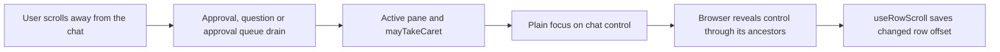
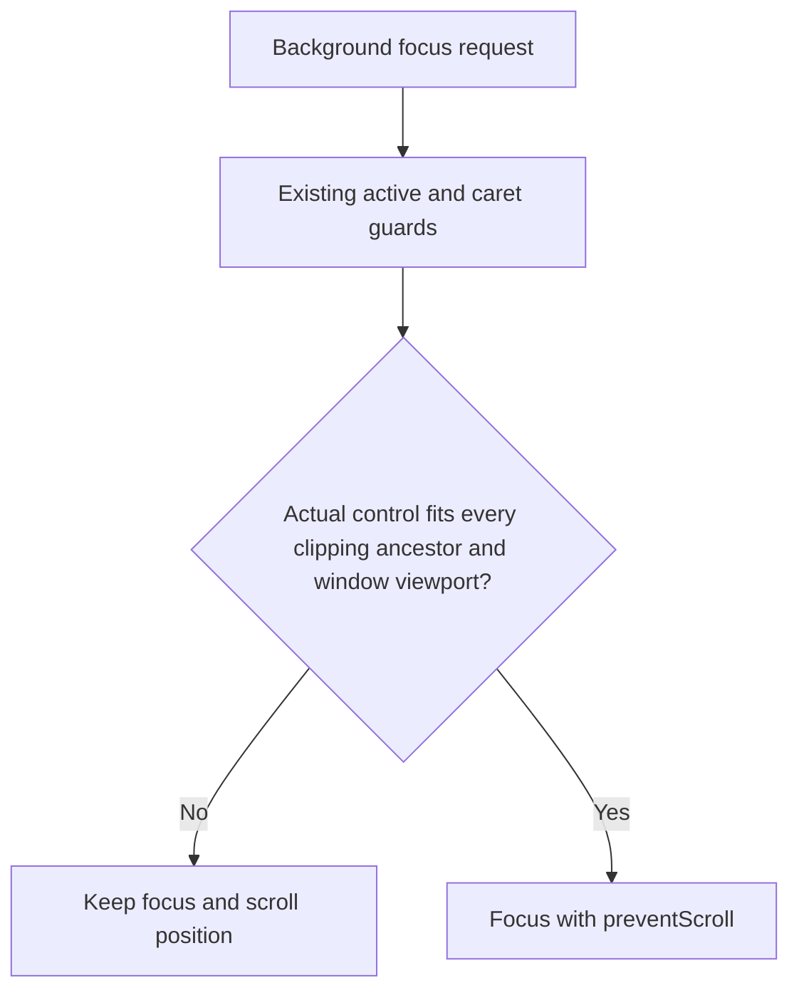
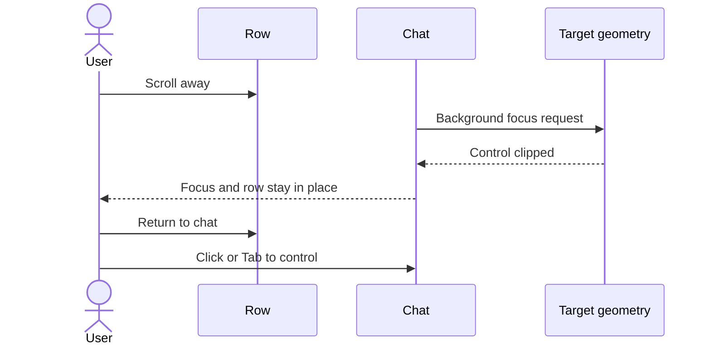

# Keep the row in place during chat activity

## Status

| Unit                       | Result                                                                                                                                             |
| -------------------------- | -------------------------------------------------------------------------------------------------------------------------------------------------- |
| Independent investigation  | Codex and Claude traced three background focus paths; runtime NOT VERIFIED                                                                         |
| Plan challenge             | Accepted dock clipping finding; composer must guard its actual input while a question may remain                                                   |
| U1: guard background focus | Implemented by Claude; Codex reviewed actual product and test diffs and full changed source                                                        |
| U1 fixture correction      | Existing ApprovalCard jsdom fixture supplies geometry; four component regression cases added, NOT RUN                                              |
| Final adversarial review   | Claude found F1; Claude implemented local question-item reveal and Codex inspected the correction; corrected review returned no supported findings |
| Delivery                   | Reviewed local edits complete; runtime behavior remains NOT VERIFIED                                                                               |
| Executable verification    | NOT RUN under project instructions                                                                                                                 |

## Current / Issue



`Session.tsx` focuses `ApprovalCard.allow`, `QuestionCard.first`, and the composer after approvals clear. `mayTakeCaret` protects existing typing and modal, terminal and editor focus, but does not inspect the target. `EditorPane` puts chats inside the horizontally scrolling `.conversation-scroller`. `.dock` can also scroll vertically in short panes. These source paths support the reported jump; no app reproduction was run.

## Proposed



Read geometry only when an existing focus effect fires. Accept one CSS pixel of rounding. Refuse null, disconnected, zero-size and clipped targets. Check each ancestor's client box on the axes its computed overflow clips; exclude borders and scrollbars. Check the window viewport on both axes.

F1 refinement: a question's first control can start below the fold of `.question-item`, the card's intended internal scroller. If the control is clipped but that item is fully visible, reveal the control by adjusting only the item's `scrollTop`, then recheck actual-control visibility before focus. Handle controls above and below the item's client box. Offscreen row or dock targets cannot cause a reveal. A control taller than its internal viewport is still refused.

The actual composer textarea owns its visibility check. A question can remain when approvals clear, so checking the enclosing session would miss clipping inside the dock. Add a dedicated `focusIfVisible` handle method instead of coupling visibility to optional native focus options. Keep the existing `focus` method and deliberate navigation unchanged.

No observer, timer, visibility state, dependency or component extraction is needed. Transcript following, carry restoration, row persistence, native surfaces and unrelated dirty files are outside this change. Offscreen cards do not automatically take focus when scrolled back into view; the user clicks or tabs to them. A control wider than its viewport cannot take background focus.

## Code Changes

### `apps/desktop/src/renderer/src/focus.ts`

Keep the existing pure decision plus DOM reader pattern. The implementation adds a pure containment predicate and a reader that checks the actual target against the viewport and each ancestor that clips it:

```ts
export type FocusRect = Pick<DOMRectReadOnly, 'left' | 'right' | 'top' | 'bottom'>

const ROUNDING_PX = 1

function fitsAxis(start: number, end: number, clipStart: number, clipEnd: number): boolean {
  return clipEnd > clipStart && start >= clipStart - ROUNDING_PX && end <= clipEnd + ROUNDING_PX
}

export function withinFocusClip(
  target: FocusRect,
  clip: FocusRect,
  clipX = true,
  clipY = true
): boolean {
  if (target.right <= target.left || target.bottom <= target.top) return false
  return (
    (!clipX || fitsAxis(target.left, target.right, clip.left, clip.right)) &&
    (!clipY || fitsAxis(target.top, target.bottom, clip.top, clip.bottom))
  )
}
```

The DOM reader `fullyVisible(el: HTMLElement | null): boolean` measures the target once. For each clipping ancestor, its visible left/top are `rect.left + clientLeft` and `rect.top + clientTop`; right/bottom add `clientWidth` and `clientHeight`. Apply only the clipped axes. Preserve `mayTakeCaret` and `focusedNow` unchanged.

### `apps/desktop/src/renderer/src/Session.tsx`

At each card effect, retain the current active and caret guards, then guard the actual control:

```ts
if (!fullyVisible(allow.current)) return
allow.current?.focus({ preventScroll: true })
```

For `QuestionCard.first`, if the actual control is clipped, require its `.question-item` to be fully visible, adjust only that item's `scrollTop` to reveal the control on the nearest vertical edge, and recheck `fullyVisible(control)` before focusing with `preventScroll`. No outer row or dock scroll is written. After approvals clear:

```ts
if (props.active && mayTakeCaret(focusedNow())) composer.current?.focusIfVisible()
```

### `apps/desktop/src/renderer/src/Composer.tsx`

Add `focusIfVisible: () => void` to `ComposerHandle` and its imperative implementation:

```ts
focusIfVisible: () => {
  if (fullyVisible(input.current)) input.current?.focus({ preventScroll: true })
},
```

Leave `focus`, quote, insert, attachments, diagnostics, mount and body-click behavior unchanged.

### `apps/desktop/src/renderer/src/focus.test.ts`

Extend the existing node-environment suite with containment cases for hidden/clipped targets, both axes and axis-specific clipping, zero-size targets/viewports, oversized targets and rounding. Keep all existing caret tests. Tests are written but unrun.

```ts
it('refuses a control outside the visible row', () => {
  expect(
    withinFocusClip(
      { left: 900, right: 980, top: 20, bottom: 60 },
      { left: 0, right: 800, top: 0, bottom: 600 }
    )
  ).toBe(false)
})
```

### `apps/desktop/src/renderer/src/ApprovalCard.test.tsx`

The existing mounted keyboard tests require nonzero target geometry because jsdom has no layout. `beforeEach` supplies a visible bounding rect, and cleanup restores mocks and removes fixture elements. Four cases exercise the real visibility reader: an off-window button preserves focus, horizontal ancestor clipping preserves focus, a dock's client box excludes borders and scrollbars, and an in-bounds clipping-container control still arms the narrow grant. All cases are written but NOT RUN.

One atomic unit U1 covers these five files. The fixture correction is directly required by the new visibility guard. Done means the actual diff is reviewed and limitations recorded; passing runtime behavior is not implied. Claude implemented U1, its fixture correction and F1. Codex reviewed the actual changes. Claude's corrected adversarial review returned no supported findings, which Codex evaluated against the actual F1 diff and surrounding source.

## Acceptance and verification

| Criterion                                                                                     | Source review                                                                                          | Runtime      |
| --------------------------------------------------------------------------------------------- | ------------------------------------------------------------------------------------------------------ | ------------ |
| Offscreen approval/question arrivals preserve focus and row offset                            | PASS: both card effects require actual-control visibility                                              | NOT VERIFIED |
| Approval drain and active-pane flips do not reveal hidden chat controls                       | PASS: drain uses guarded actual textarea; card guards run on active changes                            | NOT VERIFIED |
| Controls clipped inside a short dock never receive background focus                           | PASS: reader checks all clipping ancestors' client boxes                                               | NOT VERIFIED |
| Long questions retain keyboard focus through their own visible internal scroller              | PASS: reveal only within fully visible question-item, reject invalid size, then recheck actual control | NOT VERIFIED |
| Fully visible controls retain keyboard focus without scrolling                                | PASS: eligible targets use preventScroll; existing handlers retained                                   | NOT VERIFIED |
| Explicit new-chat, body-click, quote, insert and diagnostic navigation retain reveal behavior | PASS: original focus and insert paths unchanged                                                        | NOT VERIFIED |
| Existing draft/modal/terminal/editor protections remain intact                                | PASS: mayTakeCaret and focusedNow unchanged                                                            | NOT VERIFIED |
| Detached panes inherit the guard and row persistence ownership stays unchanged                | PASS: shared components changed; EditorPane and useRowScroll untouched                                 | NOT VERIFIED |
| Transcript follow and carry paths stay unchanged                                              | PASS: no changes to score, following, restoration or carry                                             | NOT VERIFIED |
| Unrelated working-tree edits stay intact                                                      | PASS: only five previously clean source/test files and this plan edited for the task                   | NOT VERIFIED |

Tests, typecheck, lint, formatting checks, build, app launch and UI verification are NOT RUN because the project explicitly reserves those runs for a user request. When requested, use `pnpm exec vitest run apps/desktop/src/renderer/src/focus.test.ts apps/desktop/src/renderer/src/ApprovalCard.test.tsx`, then `pnpm check` as appropriate. Exercise the original horizontally scrolled-away case with approval, question and queue-drain events, active-pane changes, a vertically overflowing dock with a remaining question, and detached windows. Check retained explicit navigation and normal transcript following.

Performed source review commands:

```sh
git diff -- apps/desktop/src/renderer/src/ApprovalCard.test.tsx apps/desktop/src/renderer/src/Composer.tsx apps/desktop/src/renderer/src/Session.tsx apps/desktop/src/renderer/src/focus.test.ts apps/desktop/src/renderer/src/focus.ts
git diff --numstat -- apps/desktop/src/renderer/src/ApprovalCard.test.tsx apps/desktop/src/renderer/src/Composer.tsx apps/desktop/src/renderer/src/Session.tsx apps/desktop/src/renderer/src/focus.test.ts apps/desktop/src/renderer/src/focus.ts
rg -n 'fullyVisible|withinFocusClip|focusIfVisible|focus\(' apps/desktop/src/renderer/src/focus.ts apps/desktop/src/renderer/src/Composer.tsx apps/desktop/src/renderer/src/Session.tsx
git status --short
```

The final diff shows 246 additions and eight removals across five source/test files. F1 adds the question-item reveal path. Symbol reads confirm three guarded background paths and retained intentional focus calls. Existing working-tree changes remain separate. Full changed source was read in bounded sections, and the actual Session diff was read again after F1. Installed jsdom 30.0.1's computed-style implementation and property definitions were inspected to establish fixture defaults. These commands inspect source; they do not execute regression proof. Fourteen pure geometry cases and four mounted approval cases are added. Question and composer wiring, including F1, are reviewed but have no new component test.

Both agents reviewed F1's guard ordering, upward/downward client-box reveal, actual-control recheck and exclusive question-item scroll write. All focus calls introduced by the task use `preventScroll`. No supported source-review finding remains. The original runtime reproduction, detached-window interaction, actual keyboard/grant behavior and long-question reveal remain NOT VERIFIED. Baseline executable checks were also NOT RUN, so no test/build pass or new-versus-existing failure classification is claimed.

No external research is required: ownership, clipping and focus call paths are explicit in the repository. The source-supported cause is background focus without target-visibility checks; runtime confirmation remains open. Scope deviation: none beyond the required plan and focused regression cases.

## Final Flow


