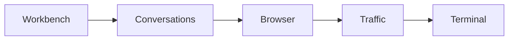
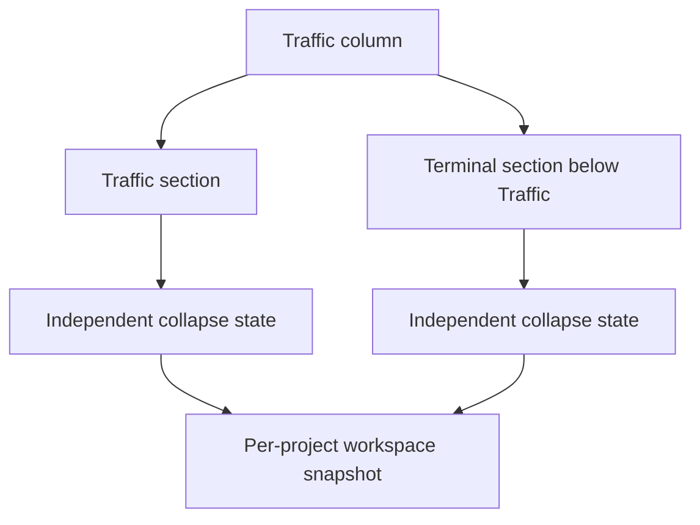
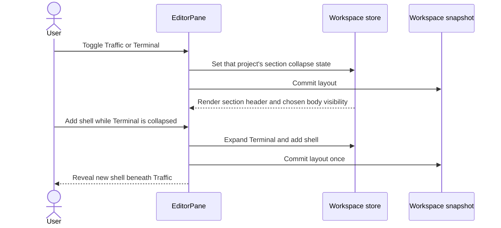

# Terminal beneath Traffic

## Status

| Phase          | Result                                                                                                                                                                                                                                                                                                                                                                              |
| -------------- | ----------------------------------------------------------------------------------------------------------------------------------------------------------------------------------------------------------------------------------------------------------------------------------------------------------------------------------------------------------------------------------- |
| Investigation  | Codex and Claude independently read the renderer layout, store, schema, resize paths and terminal lifecycle                                                                                                                                                                                                                                                                         |
| Plan challenge | Claude found that normalization and shell creation must preserve the new collapse field                                                                                                                                                                                                                                                                                             |
| Implementation | Written by Claude across the ten listed files. Shell-add focus follows `opened === null` on the run view, so a Run started after a shell was added in this pane no longer takes focus                                                                                                                                                                                               |
| Final review   | Two supported regressions, plus one accessibility regression Codex raised, listed below                                                                                                                                                                                                                                                                                             |
| Correction     | Written by Claude in `TrafficPanel.tsx`, `EditorPane.tsx` and `ProjectTerminalPane.tsx`; accepted by Codex after reading the actual correction diff and integrated diff. Claude's revised source review returned no further supported findings                                                                                                                                      |
| Follow-up      | The user's screenshot showed Run at about two thirds of Terminal's width and Shell 1 at one third, because `.project-terminal-slot--run` raised Run's minimum to 640px inside the 960px column. That rule is removed, so every slot shares `flex: 1 1 0; min-width: 320px` and one shell splits 50/50. The class stays in the JSX for the existing test. Visual result NOT VERIFIED |
| Verification   | Static source and incremental diff review only; tests, checks, builds and UI runs remain NOT RUN under the standing user instruction                                                                                                                                                                                                                                                |

### Final review findings

| Finding                                                           | Cause                                                                                                                                                                  | Correction                                                                                                                                                                     |
| ----------------------------------------------------------------- | ---------------------------------------------------------------------------------------------------------------------------------------------------------------------- | ------------------------------------------------------------------------------------------------------------------------------------------------------------------------------ |
| Expanding Terminal could stop Traffic following new requests      | Traffic's height now changes with Terminal. Keeping the previous `scrollTop` after a shrink makes `followsRows` count lost viewport height as distance from the bottom | The follow check uses `Math.max(previous.clientHeight, list.clientHeight)`. It re-pins on the next row, not at the moment of resize                                            |
| A Run failure could be hidden while Traffic was collapsed         | `run.actionFailed` renders inside the hidden Traffic body, and the header button shows no failure state                                                                | `act`'s rejection, inside its lifetime guard, reveals Traffic. `revealTraffic` reads the store's current collapse state, so a callback from an earlier render still expands it |
| Expanding Terminal could move keyboard focus into the run process | The run view focuses on attach, and expanding mounts it                                                                                                                | `focusRunOnOpen` starts as `!collapsed` and turns false on any use of the toggle. A pane opened expanded keeps its first autofocus, and new-shell autofocus is unchanged       |

## Current / Issue



`EditorPane` renders Traffic and the project terminal as separate horizontal columns. Neither column has an independent collapse control.

## Proposed



Both expanded sections split the available height equally. A collapsed section keeps its header while the other fills the remaining space. Both may collapse. Terminal availability follows the existing `run.available` condition.

Traffic stays mounted because it owns subscriptions, request selection and the Run/Stop portal. Its scroll-follow effect skips measurements while collapsed. The terminal controller stays mounted, but hidden body children detach their views without disposing the underlying processes.

The shared column uses Traffic's saved width and the minimum required by the existing horizontal terminal slots. Collapse does not change width. Starting Run leaves Terminal's chosen collapse state alone. Run requiring setup expands Traffic. Adding a shell expands Terminal.

## Code Changes

### `apps/desktop/src/shared/workspace-layout.ts`

Add `collapsed: z.boolean().optional()` to `TrafficPanelState` and `ProjectTerminalPaneState`. Missing values mean expanded. Keep legacy width and open fields compatible.

### `apps/desktop/src/renderer/src/workspace/layout.ts`

Preserve fields when normalizing terminal state:

```ts
{
  ...pane,
  width: clampProjectTerminalWidth(pane.width),
  shells: normalizeProjectShells(pane.shells),
}
```

Use a small pure sizing helper that derives the combined minimum from Traffic's floor and the terminal shell count. Keep existing browser helpers intact.

### `apps/desktop/src/renderer/src/workspace/store.ts`

Expose `setTrafficCollapsed(projectId: string, collapsed: boolean): void` and `setProjectTerminalCollapsed(projectId: string, collapsed: boolean): void`. Each action spreads the existing entry. Shell creation also stores `{ ...current, width, shells }`.

### `apps/desktop/src/renderer/src/workspace/hooks.ts`

Expose both actions through the existing narrow action selector.

### `apps/desktop/src/renderer/src/workspace/row-drag.ts`

Read the combined column's `data-min-width` using Traffic's existing minimum as the floor. Keep the legacy terminal item support compatible.

### `apps/desktop/src/renderer/src/workspace/EditorPane.tsx`

Place two vertical sections inside `traffic-box` and remove the separate terminal column and its sash. Use unique controls and body IDs, translated toggle labels, and `commitLayout` after changes. Expand Traffic before its existing reveal action. Expand Terminal before adding a shell, then commit once.

### `apps/desktop/src/renderer/src/ProjectTerminalPane.tsx`

Add optional collapse props, a header toggle, and an always-present body with conditional children. Clear the last-added focus target when collapsing. Suppress run-view autofocus while a newly added shell is the intended focus target.

### `apps/desktop/src/renderer/src/TrafficPanel.tsx`

Accept optional collapse state and skip the request-list follow effect while hidden. Include collapse state in that effect's dependencies so expansion settles the visible geometry.

### `apps/desktop/src/renderer/src/styles.css`

Add section flex sizing, collapsed header sizing, a definite hidden-body override and toggle styling. Remove only the obsolete terminal-column rules. Keep terminal-slot sizing and the existing browser styles.

### `apps/desktop/src/renderer/src/i18n/en.json`

Add independent expand/collapse labels for Traffic and Terminal.

## Acceptance criteria

| Criterion                                                                                                                     | Required evidence                                                 |
| ----------------------------------------------------------------------------------------------------------------------------- | ----------------------------------------------------------------- |
| Terminal appears below Traffic in one column when available                                                                   | Source review; UI NOT VERIFIED until explicitly requested         |
| Independent accessible toggles and correct height allocation                                                                  | Source review; keyboard and visual behavior NOT VERIFIED          |
| Traffic remains mounted with its Run/Stop portal, capture and selection                                                       | Lifecycle review; live capture NOT VERIFIED                       |
| Hidden Traffic does not replace settled scroll geometry with zero measurements                                                | Effect review; browser scroll restoration NOT VERIFIED            |
| Traffic keeps following new requests after Terminal expands and Traffic shrinks                                               | Follow-calculation review; live scrolling NOT VERIFIED            |
| A Run, Stop or Stop-recording failure reveals Traffic and its message, even if Traffic was collapsed after the action started | Lifetime-guard and store-read review; failure path NOT RUN        |
| Using the Terminal toggle keeps keyboard focus on the toggle, and the run view does not autofocus afterwards in that mount    | Focus-flag review; keyboard behavior NOT VERIFIED                 |
| Collapse detaches terminal views without killing processes; shell add expands and reveals                                     | Lifecycle and handler review; running shell behavior NOT VERIFIED |
| Collapse survives normalization, add/remove, reset, serialization and transfer                                                | Schema and store review; relaunch/transfer NOT VERIFIED           |
| Old snapshots remain valid and expand by default                                                                              | Optional-schema review; parser execution NOT RUN                  |
| Combined resizing respects terminal minimum and collapse preserves width                                                      | Layout and drag review; pointer/keyboard resizing NOT VERIFIED    |
| Existing browser and other worktree changes survive                                                                           | Compare task diff against saved pre-edit baseline                 |

## Final Flow



## Delivery report

### What changed

The project terminal is nested below Traffic in one column. Each section has an independent translated expand/collapse button and per-project saved state. Both expanded sections share height equally. A collapsed section retains its header. The combined column respects the existing terminal-slot minimum when resized.

Setup and failed Run/Stop actions reveal Traffic. Adding a shell expands Terminal. Collapsing Terminal detaches its views through the existing lifecycle rather than requesting process termination. Toggle expansion suppresses run-view autofocus.

### Cause of the original layout limitation

`EditorPane` rendered `traffic-box` and `project-terminal-box` as separate row siblings. The state schemas had no section-collapse field. This is a feature change, not a reproduced runtime bug.

### Files changed by this task

All paths below are under `apps/desktop/src/`:

- `shared/workspace-layout.ts`: optional collapse fields in both persisted schemas.
- `renderer/src/workspace/layout.ts`: terminal-state preservation and combined column minimum.
- `renderer/src/workspace/store.ts`: independent collapse actions and preservation during shell creation.
- `renderer/src/workspace/hooks.ts`: existing action-selector wiring.
- `renderer/src/workspace/row-drag.ts`: declared minimum support for the combined column.
- `renderer/src/workspace/EditorPane.tsx`: stacked layout, controls, commits and current-state reveal behavior.
- `renderer/src/ProjectTerminalPane.tsx`: conditional view mounting, accessible toggle and focus policy.
- `renderer/src/TrafficPanel.tsx`: hidden follow guard, viewport-shrink calculation and error reveal.
- `renderer/src/styles.css`: section sizing, hidden-body override and toggle appearance.
- `renderer/src/i18n/en.json`: four translated control labels.

This plan records the decisions and review evidence. The task authored no test, dependency, main-process or preload changes.

### Acceptance results

| Criterion                                                           | Result        | Evidence and limit                                                                                             |
| ------------------------------------------------------------------- | ------------- | -------------------------------------------------------------------------------------------------------------- |
| Terminal below Traffic in one column                                | NOT VERIFIED  | JSX nesting reviewed; rendered placement not observed                                                          |
| Independent toggles, header-only collapse and 50/50 expanded height | NOT VERIFIED  | Separate store fields, handlers and flex rules reviewed; UI not driven                                         |
| Traffic portal, capture and selection survive collapse              | NOT VERIFIED  | Traffic remains mounted; live subscription behavior not exercised                                              |
| Hidden Traffic preserves settled scroll geometry                    | NOT VERIFIED  | Follow effect skips collapsed state; Blink scroll restoration not observed                                     |
| Traffic follows after Terminal expansion shrinks the viewport       | NOT VERIFIED  | Previous/current height arithmetic reviewed; live scrolling not exercised                                      |
| Failed Run/Stop actions reveal their feedback                       | NOT VERIFIED  | Guarded rejection and current-store reveal path reviewed; failure not triggered                                |
| Keyboard toggle retains focus                                       | NOT VERIFIED  | Remounted run-view autofocus is suppressed; keyboard interaction not driven                                    |
| Collapse preserves processes and shell creation expands/reveals     | NOT VERIFIED  | Existing detach-only cleanup and shell handlers reviewed; process lifetime/replay not exercised                |
| Per-project collapse survives updates, relaunch and transfer        | NOT VERIFIED  | Normalization, add/remove/reset, serialization and transfer shapes reviewed; relaunch/transfer not exercised   |
| Old snapshots expand by default                                     | NOT VERIFIED  | Optional schema fields and `=== true` defaults reviewed; parser not executed                                   |
| Resizing respects the combined minimum and collapse keeps width     | NOT VERIFIED  | Rendered basis and row-drag use the same minimum; pointer/keyboard resize not driven                           |
| New control copy uses translations                                  | PASS (source) | All four labels use literal `t()` keys declared in `en.json`                                                   |
| Existing browser edits preserved in shared files                    | PASS (diff)   | Incremental comparisons against the pre-edit baseline retain browser JSX, helpers, CSS and translation entries |

### Verification performed

Codex inspected the actual ten-file task diff against `/private/tmp/chorus-traffic-stack-ev1s1c_2`, the integrated Git diff and the three-file correction diff. Claude independently investigated, challenged the plan, implemented and performed adversarial source reviews. No supported findings remain after the corrections. This is source-review evidence, not runtime proof.

Final correction comparisons used these exact commands from the repository root:

```sh
diff -u /private/tmp/chorus-correction-fpP1/apps/desktop/src/renderer/src/TrafficPanel.tsx apps/desktop/src/renderer/src/TrafficPanel.tsx
diff -u /private/tmp/chorus-correction-fpP1/apps/desktop/src/renderer/src/workspace/EditorPane.tsx apps/desktop/src/renderer/src/workspace/EditorPane.tsx
diff -u /private/tmp/chorus-correction-fpP1/apps/desktop/src/renderer/src/ProjectTerminalPane.tsx apps/desktop/src/renderer/src/ProjectTerminalPane.tsx
git diff -- apps/desktop/src/shared/workspace-layout.ts apps/desktop/src/renderer/src/workspace/layout.ts apps/desktop/src/renderer/src/workspace/store.ts apps/desktop/src/renderer/src/workspace/hooks.ts apps/desktop/src/renderer/src/workspace/row-drag.ts apps/desktop/src/renderer/src/workspace/EditorPane.tsx apps/desktop/src/renderer/src/ProjectTerminalPane.tsx apps/desktop/src/renderer/src/TrafficPanel.tsx apps/desktop/src/renderer/src/styles.css apps/desktop/src/renderer/src/i18n/en.json
```

Each `diff -u` returned 1 for expected changes. The integrated `git diff` returned 0 and its output was read. The Git diff includes existing browser work, so the saved pre-edit baseline distinguishes this task's changes.

Typecheck, lint, formatting checks, tests, build, screenshots, app launch and runtime verification: NOT RUN under the standing user instruction. There is no passing test or build claim.

### Regression coverage

Static review covered width dragging and reset, shell add/remove, close confirmation, terminal detach/attach ownership, project switching, snapshot normalization and transfer, Traffic setup/rejection lifetime guards, request paging/follow behavior, unique control IDs and existing browser content. No automated regression coverage was added or executed.

### Research

Repository source and existing tests were the evidence. No external sources were needed.

### Remaining risks

Actual height allocation, collapsed-header appearance, browser scroll restoration, focus behavior, terminal replay and saved-state restoration remain unverified. Follow recovery occurs on the next arriving request. Run autofocus stays suppressed for the rest of a terminal pane's mount after its toggle is used. Failed actions may reveal an off-screen Traffic column.

### Scope deviations

None beyond changes necessary for the requested stacked, collapsible layout. The review corrections prevent regressions introduced by the new height and visibility behavior. No commit, push, package, install or deployment was performed.
