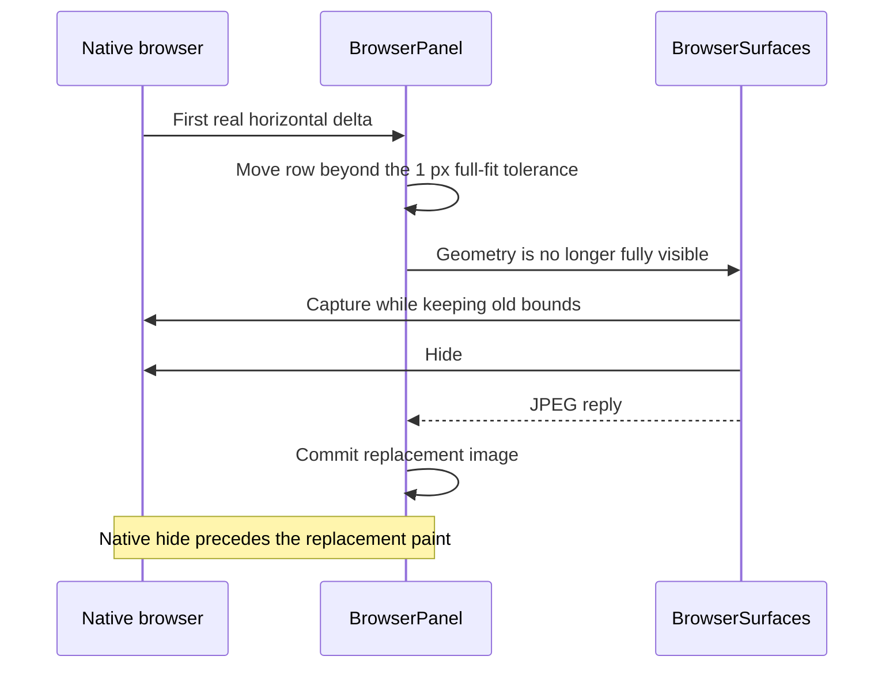

# Horizontal row scrolling over the browser

## Status

| Unit                  | Status                                                                                                                                                                                                                                                                                                                                                                                                                                      |
| --------------------- | ------------------------------------------------------------------------------------------------------------------------------------------------------------------------------------------------------------------------------------------------------------------------------------------------------------------------------------------------------------------------------------------------------------------------------------------- |
| Investigation         | Source path confirmed. No app launch or runtime reproduction.                                                                                                                                                                                                                                                                                                                                                                               |
| Implementation        | Written, including two shared and five surface regression cases. All unrun.                                                                                                                                                                                                                                                                                                                                                                 |
| Review                | Codex and Claude source review complete. Cancelability guard added after review.                                                                                                                                                                                                                                                                                                                                                            |
| Verification          | Build, packaging, local installation and installer signature verification PASS on 2026-10-05. Tests, standalone typecheck, lint, format and launch NOT RUN.                                                                                                                                                                                                                                                                                 |
| First-swipe follow-up | Local implementation and integrated source review complete. Codex and Claude reviewed the stationary native input carrier, presentation corrections, lifecycle exits and document-bound captures. The final three Codex reviewers found no defect in the narrowed capture guard. Built and installed on 2026-10-05 at the user's request. Regression cases are written and unrun; native continuity and visual smoothness are NOT VERIFIED. |

## Symptom and evidence

Horizontal gestures over a focused browser do not move the row between chats.
The browser is a separate native `WebContentsView`. Its DOM events never bubble
to `workspace/row-drag.ts`. The editor already bridges wheel events through its
preload, main and `WorkbenchFrame` into the row's `scrollLeft`.

Electron 43.2.0's native `input-event` observer does not expose wheel deltas in
its output converter. The supported path here is a DOM wheel listener in the
existing isolated browser preload. Relevant primary sources:
[web contents implementation](https://github.com/electron/electron/blob/v43.2.0/shell/browser/api/electron_api_web_contents.cc)
and [input converter](https://github.com/electron/electron/blob/v43.2.0/shell/common/gin_converters/blink_converter.cc).

## Fix

The preload captures trusted, cancelable horizontal gestures, including Shift+wheel.
It cancels the webpage's horizontal default and forwards a bounded snapshot on
`browser:page:row-wheel`. Vertical gestures and Ctrl/Cmd gestures remain with
the page. Horizontal intent follows the existing `horizontalRowWheel` rule.

Main accepts the message only from the current primary page's main frame. It
validates the snapshot and pushes
`{kind: 'row-wheel', browserId, wheel}` only to the owning shell. This does not
depend on password eligibility or password document tokens. Public HTTP pages
and `about:blank` need row scrolling too. Popups are separate windows.

`BrowserPanel` checks the attached browser id and its latest committed active
state. It uses `horizontalRowWheel(wheel, row.clientWidth)` and changes
`row.scrollLeft` directly. No gesture updates React state. The existing row
scroll listener coalesces geometry work into a single animation frame.

## Files and contract

- `shared/browser-ipc.ts`: a strict `BrowserPageRowWheel` snapshot schema, its
  page channel, and the `row-wheel` push variant. Deltas must be finite and at
  most 10,000 in magnitude. Delta mode is 0, 1 or 2. Vertical, zero and zoom
  snapshots are refused.
- `preload/browser.ts`: a capture-phase, non-passive wheel listener and local
  structural event types. Runtime imports remain limited to `electron`.
- `main/browser-surface.ts`: a current-primary-frame handler.
- `renderer/src/BrowserPanel.tsx`: the existing push subscription scrolls the
  active row using the existing pixel, line and page unit normalizer.
- Shared and surface regression files: strict bounds, ownership, capture/hide
  continuation, teardown and public HTTP cases, written but unrun.

The preload repeats only the small intent and bounds checks because it must be
self-contained under Electron's sandboxed CommonJS preload build. The renderer
owns unit conversion through the existing helper.

## Risks and verification

Horizontal website content, including boards, wide tables, diffs and carousels,
yields to row navigation. This follows the user's request to scroll between
chats from the focused browser. Vertical page scrolling, pinch/zoom, password
handling and browser shortcuts retain their current path. Non-cancelable wheel
events stay with the page so the bridge does not move the row when it cannot
suppress the page's own default. The
[DOM cancellation rule](https://dom.spec.whatwg.org/#dom-event-preventdefault)
defines this gate; Electron's exact gesture dispatch order remains unverified.
Wheel events inside embedded frames do not bubble to the primary
page preload. This fix covers the primary page; subframe preload privileges are
not widened. Main does not gate this stream on native visibility: a gesture can
remain routed to its original contents as the row crops and hides the page.
Any continuation that still reaches that preload is forwarded. The renderer's
committed active-project check is the destination gate. Detached pages cannot
forward. Real native gesture latching and overlay interaction are unverified.

No executable checks are authorized. The focused-browser swipe, Shift+wheel,
vertical scroll, zoom, gesture continuation after hiding and real iframe behavior
remain unverified until the user tries the running app.

## Delivery

Claude's read-only review found no supported code defects. Codex applied its
suggested cancelability guard and corrected the risk wording for all horizontal
page content and both same-origin and cross-origin iframe documents. Codex read
the final incremental diff. Seven regression cases are written and unrun.
Compilation and real gestures remain unverified. Nothing was staged or committed.

## Follow-up: the first swipe flickers and stops

### Current / issue



The hide and replacement ordering is confirmed in source. The observed swipe
interruption is consistent with AppKit selecting the view beneath the pointer
for each direct scroll event and a newly targeted Chromium input router lacking
the gesture's beginning. This combination has not been observed in the app.

Primary sources: [AppKit trackpad event routing](https://developer.apple.com/library/archive/documentation/Cocoa/Conceptual/EventOverview/HandlingTouchEvents/HandlingTouchEvents.html),
[Chromium 150 input routing](https://github.com/chromium/chromium/blob/150.0.7871.129/components/input/render_widget_host_input_event_router.cc)
and [Electron 43 wheel conversion and injection](https://github.com/electron/electron/blob/v43.2.0/shell/common/gin_converters/blink_converter.cc).

### Accepted transition design

Keep the original native input area stationary during a row-owned gesture.
Present the captured page in the shell while forwarding only measured deltas.
The native page temporarily renders transparently beneath a decoded shell still,
within its original pane bounds. Claude challenged this design with three native
workers. Codex checked the supported findings with three independent workers.
The corrections below are part of the implementation contract. Native behavior
remains unverified.

```mermaid
sequenceDiagram
    participant Page as Native browser
    participant Main as BrowserSurfaces
    participant Shell as BrowserPanel
    Page->>Main: First real horizontal delta
    Main->>Page: Capture, retain original bounds
    Main-->>Shell: Gesture id and still
    Shell->>Shell: Decode and commit still
    Shell->>Main: Ready for this gesture
    Main->>Page: Activate conditional transparency; retain native hit area
    Page-->>Main: Matching page paint acknowledgement
    Main-->>Shell: Forward queued and subsequent real deltas
    Shell->>Shell: Move row and its still
    Main->>Main: Gesture settles without generating motion
    Main->>Page: Hide if cropped, or restore if fully visible
```

Moving a full-size view outside the pane would cover another split pane. Merely
cropping or moving a live native view can still switch its input target when it
leaves the pointer. A layer mask does not establish matching native hit-test
clipping. A zero-delta injected wheel bypasses Chromium's outer router and cannot
establish its target. These are not sufficient transition fixes.

### Transparency and input

Electron 43's removal path defaults to author origin even when insertion used
user origin. An author sheet can be defeated by inline important page styles.
Use one lazily inserted conditional user-origin sheet per page document. The
preload toggles its namespaced root marker; removing that marker deactivates the
sheet. Do not accumulate sheets per gesture or depend on user-sheet removal.
The native background is made transparent by main and restored to its explicit
configured default during cleanup.

```css
:root[data-chorus-row-hold],
:root[data-chorus-row-hold] *,
:root[data-chorus-row-hold]::backdrop,
:root[data-chorus-row-hold] *::backdrop {
  opacity: 0 !important;
  transition: none !important;
  pointer-events: none !important;
  cursor: default !important;
}
```

Superseded by "Final-review correction" below. That stylesheet made the page fade in after every hold, and cancelled its running transitions. The mask now has `hidden` and `settling` states, and covers only the root and top-layer surfaces.

Top-layer elements render outside ancestor opacity, so their own drawing and
backdrops need explicit suppression. Closed shadow-root top-layer content is a
remaining runtime limitation; the implementation must not claim universal
transparency without evidence. Primary sources:
[Electron insertion and removal](https://github.com/electron/electron/blob/v43.2.0/shell/renderer/api/electron_api_web_frame.cc),
[Chromium's default stylesheet origin](https://github.com/chromium/chromium/blob/150.0.7871.129/third_party/blink/public/web/web_document.h),
[cascade precedence](https://www.w3.org/TR/css-cascade-5/#cascade-sort) and
[top-layer styling](https://www.w3.org/TR/css-position-4/#top-layer-styling).

The preload takes local row ownership on the first forwarded event, including
preparation. While owned, it suppresses cancelable non-zoom wheel samples even
when later samples drift vertical or have zero horizontal delta. Only snapshots
accepted by the existing row-wheel schema are forwarded. A release notice is
bound to the current gesture. Pointer movement, button/context-menu input,
Ctrl/Meta wheel, keyboard or composition input ends the hold. The triggering
input is blocked while the page is invisible or release is pending; it is not
replayed. An already active composition aborts preparation. A local inactivity
watchdog must remove the marker and release the matching gesture rather than
silently clearing ownership while the page remains invisible.

### Protocol and lifecycle

`main/browser-surface.ts` owns the current gesture object, original bounds,
document/navigation identity, phase, capture, queue and timers. Every async
continuation validates that exact object, view and document. Shared contracts
explicitly carry a gesture id on preparation, readiness, page paint/release and
end messages. The shell ready request is restricted to the owning shell main
frame. Page messages retain the current-primary-frame check and do not depend
on password origin eligibility.

Preparation captures without hiding and queues at most 64 original validated
wheel snapshots in FIFO order. Do not coalesce opposite directions or different
units. A single 250 ms deadline bounds preparation; additional events do not
restart it. The renderer commits and decodes its still, then allows two animation
frames before acknowledging. Main requests page transparency and awaits its
matching paint acknowledgement before draining the queue once. Failure or
overflow rolls back and routes the real queued deltas through the ordinary path
once. It generates no extra deltas.

While held, geometry records the latest desired state without moving the native
view. Positioning is guarded centrally, including scale changes. A 150 ms idle
timer starts after queue delivery and is re-armed by actual row-wheel IPC and
native mouse-wheel notifications. It is a gesture-end heuristic, not momentum.
Cleanup and a subsequent gesture are serialized so an old cleanup cannot
restore or hide a newer carrier. Two animation frames provide paint
opportunities, not synchronization between compositor surfaces.

When cropped, hide the native view before removing transparency and keep the
shell still. When fully visible, place the latest bounds while transparent,
restore page drawing and background, await the page's paint acknowledgement,
then remove only the matching shell still. Deactivation, navigation, crash,
popup creation, scale or body size changes, discard, detach and owner shutdown
cancel the hold. Old hide capture completions cannot hide a current hold.
Autofill's showing gate excludes held pages.

Overlay visibility remains authoritative. A narrow participant conceal hook
ends a hold before ordinary overlay capture and before heartbeat concealment.
It must not capture a transparent page over the existing usable still, reveal a
cropped page on overlay close, or bypass the overlay's visibility calculation.
All cancellation and cleanup paths are bounded.

### Renderer ownership and implementation units

`BrowserPanel.tsx` keeps gesture presentation separate from ordinary `crop`.
A wanted geometry reply cannot clear it. Preparation acknowledgement starts
from the committed image effect, not immediately after setting React state.
Decode and frame continuations check the current browser, gesture, document and
active project. End, navigation, deactivation and unmount invalidate them.
A cropped end transfers the still to crop; a restored end clears only its id.
`sameGeometry` compares `active` before suppressing two cropped geometries.

`useRowScroll` returns a stable `markTouched(projectId)` that affects only the
matching pending restore. `EditorPane` passes it to the browser. The browser
marks the row when accepting the gesture and before any native-origin movement.
Do not fabricate a DOM wheel or expand this to unrelated editor scrolling.

The implementation is one atomic batch. Freeze strict contracts first, then
use disjoint writers for contracts/preload, main/overlay and renderer/restore
plumbing. Update the plan from the final written behavior after those edits.
No dependency, native addon, viewport resize, animation pacing or perpetual
frame loop is introduced.

Regression cases should cover FIFO drainage, timeout/late acknowledgement,
capture failure, inactivity, geometry deactivation, navigation and scale,
overlay priority, teardown, interrupted restoration, and the project-bound
touch marker. Extend existing test files without a new DOM harness. Cases are
written for later execution and remain unrun under the user's testing preference.

### As written

- **Contract (`shared/browser-ipc.ts`).**
  - Constants: `BROWSER_ROW_HOLD_QUEUE_MAX` (64), `BROWSER_ROW_HOLD_PREPARE_MS` (250), `BROWSER_ROW_HOLD_IDLE_MS` (150).
  - `BrowserGestureId`, plus the owner-checked `browser:rowHoldReady` request `{browserId, gestureId}`, which answers `{accepted}`.
  - Pushes `row-hold` `{browserId, gestureId, still}` and `row-hold-end` `{browserId, gestureId, restored}`.
  - Page channels:
    - `browser:page:row-hold` (main to page, `{gestureId, state: 'preparing'|'transparent'|'ended'}`);
    - `browser:page:row-painted` (page to main, `{gestureId, transparent}`);
    - `browser:page:row-release` (page to main, `{gestureId}`).
  - All are strict, and `BrowserApi.readyBrowserRowHold` exposes the ready request.
- **Preload.**
  - **Ownership.** It takes local row ownership on the first forwarded snapshot. While owned, it blocks every cancelable non-zoom wheel event and forwards only snapshots that pass the horizontal rule.
  - **Transparency.** The conditional user-origin sheet above is inserted once per document via `webFrame.insertCSS`. The `data-chorus-row-hold` marker is set on `transparent` and removed on `ended`; each is acknowledged after two animation frames.
  - **Release triggers.** Pointer travel of more than 2 px from where the swipe started, button and context-menu events, keydown, compositionstart, and Ctrl/Meta wheel. The trigger is blocked while the page is transparent or a release is pending, and is never replayed. A composition already active when `preparing` arrives requests release.
  - **Watchdog.** Ownership is dropped after 400 ms with no gesture id. After 1500 ms with an id, the watchdog removes the marker and sends a release.
- **Main.**
  - **State.** `BrowserRecord.hold` holds the gesture id, view, document and navigation identity, phase (`preparing`, `shell`, `page`, `held`, `ending`), FIFO queue, timers, and the still and transparency flags.
  - **Preparation.**
    - The first snapshot from a live, fully visible, visible view with no capture in flight starts a hold. It sends `preparing`, starts the single 250 ms deadline, and captures without hiding.
    - The snapshots are queued, with the 65th rolling back.
    - The shell's ready request switches the view background to transparent and sends `transparent`. The page's paint acknowledgement drains the queue once and starts the 150 ms idle timer.
    - That timer is re-armed by row-wheel IPC and by `input-event` `mouseWheel`. Superseded: only validated horizontal row-wheel IPC re-arms it now (see "Final-review correction").
  - **Rollback** (deadline, capture failure, overflow, release or cancel before held):
    - It tells the page `ended`.
    - It restores the explicit `#ffffff` background, which is now also set when the view is created. Superseded for a pending rollback whose page is already transparent: that one now stays covered (see "Final-review correction").
    - It pushes `row-hold-end` if a still was sent.
    - It delivers the queued real snapshots once as ordinary `row-wheel` pushes.
  - **Ending, cropped:** hide first, send `ended`, push `restored:false`. The background stays transparent until the cleanup completes; see "Second correction round", which superseded the earlier immediate restore.
  - **Ending, fully visible:** place at the latest rect while still transparent, send `ended`, then wait for the page's paint acknowledgement or the deadline. Only then restore the background and push `restored:true`.
  - **Guards.**
    - `place()`, `geometry()` and the scale path never move or hide a held view.
    - `hide()` completions cannot hide a held view.
    - Autofill's `showing()` excludes holds.
    - Navigation starts and commits, render crashes, popup creation, scale changes, inactive geometry and y/height changes all cancel the hold. `releaseView` drops it.
  - **Overlays.** `OverlayParticipant` gained an optional `conceal`, called before overlay capture and before heartbeat concealment. The browser's conceal hides a transparent or cropped view before capture, keeps `live` equal to `wanted`, and pushes `row-hold-end`.
- **Renderer.**
  - `BrowserPanel` keeps the gesture still separate from `crop` and shows it only for the browser and document it was captured from.
  - The still is acknowledged from the committed image: `decode()`, then two animation frames, then the ready request, guarded by browser, gesture, document and active project.
  - `row-hold-end` with `restored:false` moves the still into `crop`. Since the final-review correction, it moves together with its captured frame.
  - `sameGeometry` now sends a change in `active` even between two cropped geometries.
  - `useRowScroll` returns a stable `markTouched(projectId)`. `EditorPane` passes it to the browser, which calls it before any non-zero browser-origin row movement and when it accepts a hold.
- **Integration fixes made during Claude's review.**
  1. Rollback and overlay conceal now always send the page `ended`. Before this, a failed preparation left the preload blocking all wheel input for up to its 1.5 s watchdog.
  2. A fully visible end now restores the opaque background only after the page's paint acknowledgement. Before this, white would flash between restoring the background and the page repainting.
  3. The renderer no longer shows a gesture still from another document, because detach and discard drop a hold without an end push.
- **Departures from the design text.**
  - Navigation within the same document also cancels a hold.
  - A click made during preparation reaches the page as `pointerdown`; its later button events are blocked, because a release is then pending.
  - The preload acknowledges `ended` only after two animation frames, so a hidden page acknowledges once it is shown again; main does not wait for that on a cropped end.
- **Limits.**
  - Closed shadow-root top-layer content is not proven transparent.
  - A wheel event that starts inside a cross-origin iframe never reaches the preload.
  - Two animation frames are paint opportunities, not synchronisation between the two views' compositor frames.
  - Gesture end is a heuristic: resting fingers can end a hold mid-gesture.
  - The capture-to-acknowledge delay before the first motion is unmeasured.
  - Real AppKit/Chromium continuity is NOT VERIFIED.

### Correction round

- **The captured document identity.** The `row-hold` push now carries `documentId: BrowserId.nullable()`, taken from the hold. `BrowserPanel` uses that value instead of the document from its last React commit. A null identity stays null, and the existing stale-document guards are unchanged.
- **Motion while ending.** Snapshots that arrive while a full-fit hold is ending are queued in its bounded FIFO and no longer move the row. Ending finishes on the matching paint acknowledgement or the bounded deadline. Only the acknowledgement renews: if the record is eligible, it begins a new preparation whose queue starts with those snapshots in their original order; otherwise it pushes them once as ordinary `row-wheel`. The deadline always pushes them once as ordinary; it renewed too until the timeout correction below. An overflow finishes the hold and pushes everything once as ordinary.
- **Cleanup barrier.**
  - Rollback, a cropped end, an overlay conceal, and an end whose identity was invalidated set `record.cleanup` (gesture id, view, bounded queue, 250 ms deadline) while the page still exists.
  - While it exists, no new hold begins, and snapshots queue in it.
  - It ends on a `row-painted {transparent:false}` acknowledgement that matches the gesture id and the current view. Document and navigation identity are not required, so it still works after same-document navigation.
  - It also ends on its deadline, which pushes its queue once as ordinary motion. It renewed with that queue until the timeout correction below. A replacement document commit (`did-navigate`) also ends it, but since the second correction round that drains the queue as ordinary motion instead of renewing.
  - A render crash, teardown, detach, owner close or shutdown drops it.
  - A held hold cancelled by same-document navigation now waits for that acknowledgement instead of finishing at once.
  - An ending hold that is still wanted keeps waiting even when other cancel triggers fire; one that is cropped still hides first.
- **Page adoption.** `prepareRowHold` replaces a row that is still ending an older gesture with a fresh row for the new id. Claude also made it adopt a `preparing` that arrives after the old row has already cleared, using the last trusted wheel position as the pointer origin. That closes the case where a wheel already in flight when `ended` was sent was queued by main, but its renewed preparation found no row on the page. Late `transparent` and `ended` messages for an older id, and old two-frame callbacks, never affect the replacement row. The preload anchor correction below narrowed this. The anchor is now the last forwarded horizontal wheel, and adoption is refused, with a release, once it is invalidated.
- **Overlay authority.** `applyParticipant` calls `conceal` before setting visibility whenever its owner is overlay-hidden; the early conceal before capture remains. `rowHoldReady` also refuses unless the native view is actually visible.
- **Geometry dedupe.** For two cropped geometries, `sameGeometry` now sends a change in `active`, `rect.y` or `rect.height`, and still suppresses changes in x or width alone. Main's y/height cancellation therefore receives them. Changes to body width are still indistinguishable from horizontal clipping in the clipped-rect contract, so a width-only resize does not cancel a hold.
- **Remaining limits.**
  - A page whose view is hidden (a cropped end, or an overlay) runs no animation frames. Its cleanup usually ends on the 250 ms deadline rather than on the acknowledgement. Since the timeout correction, that also means its queued motion moves the row as ordinary motion rather than through a renewed hold.
  - Renewal right after a committed replacement document may prepare on a document that has not painted yet.
  - A row adopted from `preparing` carries no pending release from the old gesture. Corrected by the preload anchor correction below.
  - All runtime continuity remains NOT VERIFIED.

### Second correction round

- **A replacement commit cancels the old gesture.** `did-navigate` ends any hold or cleanup with exit `replaced`. It restores a transparent background, sends a covered cleanup's closing `row-hold-end`, and pushes the queued original snapshots once as ordinary `row-wheel`. It never prepares a hold on the fresh document. The next real wheel there starts its own claim.
- **Presentation safety through cleanup.**
  - `RowCleanup` gained `transparent`, `covered` and `released`.
  - A cropped end, a hidden rollback and a hidden overlay conceal hide the view first and keep its background transparent. They send `ended` and push `restored:false`, which moves the still into the shell's crop, and leave a covered cleanup.
  - A cleanup created while hidden has no deadline, because a hidden page runs no animation frames. Superseded in part: a cleanup that queues real motion now always arms it (see "Final-review correction"). Its bounded 250 ms deadline starts when:
    - geometry reveals the view;
    - a row-wheel arrives while the view is visible;
    - a matching page release arrives, which includes the preload's watchdog release;
    - or the lifecycle was already released when the cleanup was created.
  - **Returning to full fit during cleanup.** Geometry reveals the view with its transparent base kept. The shell's crop stays underneath.
  - **Crop or overlay during a transparent cleanup.** A crop hides the view directly, with no capture of a transparent page, and replies `still: null`. Overlay conceal hides a transparent cleanup's view before capture.
  - **Completion** (matching acknowledgement by gesture id and current view, or the deadline):
    1. restore `#ffffff`;
    2. push a closing `row-hold-end` for the same gesture, with `restored` equal to live, wanted and visible;
    3. on the acknowledgement, renew unless released or the view is gone. On the deadline, or in those two cases, push the queue once as ordinary. The deadline renewed as well until the timeout correction below.
  - **Renderer.** `BrowserPanel` records a crop cover when a `restored:false` end moves the still into crop. While that cover matches the current browser and document, wanted replies keep the crop. The closing push clears the cover, and also clears the crop if `restored` is true. A document change or detach drops the cover. The preload needed no change: it removes its marker as soon as `ended` arrives and acknowledges after two frames once visible.
- **The release veto.**
  - `RowHold` gained `released`.
  - A page release matching the current hold (any phase, including ending) or the current cleanup sets the veto. Acceptance uses gesture id and current view identity, so it still works after same-document invalidation. A release for an older gesture changes nothing.
  - A released ending or cleanup pushes its queued real snapshots once as ordinary and never prepares another hold.
  - **The preload matched this at the time.** After its end acknowledgement, `endRowHold` claimed a fresh local row only for motion that continued while ending (`renew`) and was not released (`releaseWanted` false). Before that, a released ending re-claimed a row with no gesture id and kept blocking vertical wheels, re-arming its 400 ms watchdog on each one. The preload anchor correction below removed this post-end claim and the `renew` flag entirely. A released lifecycle leaves neither side owning a gesture, and a later horizontal wheel claims normally.
  - **Timer race, corrected by the timeout correction below.** Main's 250 ms ending or cleanup deadline could expire and renew before a late release for the old gesture arrived. That release was then ignored by id, and the page's replacement row started with `releaseWanted` false, so the release intent was lost for the new gesture. Neither deadline renews any more.
- **Remaining limits.**
  - A cleanup that stays hidden with no reveal, wheel or release waits without a timer. Since the final-review correction, only an empty one does; a queued wheel arms the deadline. It is still cleared by reveal, acknowledgement, release, `did-navigate`, a crash or teardown, and while hidden it blocks only the start of new holds.
  - After the deadline fallback the background is opaque again. So a page revealed later, with no paint since its marker was removed, can briefly show its stale frame over white.
  - A crash during a hidden end pushes `restored:false` with no closing push; the renderer's cover lasts until the document changes.
  - Two animation frames are a paint opportunity, not compositor synchronisation.
  - Everything at runtime remains NOT VERIFIED.

### Timeout correction

- **Only the acknowledgement renews.**
  - The ending deadline in `endHeld` now finishes with a private `expired` outcome rather than `settled`. It restores the background, pushes `row-hold-end` with `restored:true`, then pushes the queued real snapshots once as ordinary `row-wheel`, in order. It starts no successor hold and no further timer.
  - The cleanup deadline in `armCleanup` calls `endCleanup(record, false)`, which drains the same way.
  - A matching opaque `row-painted` still renews an unreleased ending or cleanup, as before.
- **Why.** The timer was the only renewal that could run ahead of the page:
  1. G is ending, with motion queued.
  2. Trusted input requests a release, and the page sends release G.
  3. Main's 250 ms deadline fires before that message is handled, and renews the queue as a new gesture H.
  4. Release G arrives and is ignored by id.
  5. The page's `prepareRowHold(H)` replaces the ending row with a fresh claim, `releaseWanted` false.

  The page could then turn transparent again after the user had ended the carrier.

- **Why the acknowledgement path is safe.** The preload sends release, painted and row-wheel with `ipcRenderer.send` from the same frame. So a release requested before the two-frame end acknowledgement reaches main first, sets the veto, and the acknowledgement then drains as ordinary.
- **What it costs.** A page slow to acknowledge, such as a hidden one or one with a long frame, now moves the row by its continued motion as ordinary deltas rather than under a renewed carrier. The next real wheel after that starts a fresh hold normally.
- **No protocol, preload or renderer change.** There is no new lineage id, no sticky release marker, and no timer-driven motion.
- **Found reviewing this correction. Both are corrected by the preload anchor correction below.**
  - **A narrower release loss.**
    - The trigger: the page forwards a wheel under G's ending row, and that wheel reaches main just after the expiry, so it starts H. The user then requests a release. The page attributes it to G and sends release G, which main ignores. The page's `prepareRowHold(H)` then claimed a fresh row without it.
    - This was the "a row adopted from `preparing` carries no pending release" limit. On the acknowledgement path, the same wheel would have queued in G and been vetoed.
  - **An unadopted claim after expiry.**
    - When the page's end acknowledgement ran after main's expiry, with motion that continued while ending, `endRowHold` claimed a fresh row with no gesture id. Main would never adopt it.
    - Until 400 ms after the last wheel, it swallowed vertical wheels, each of which re-armed it. After a first release trigger, it also blocked pointer, button and key events.

### Preload anchor correction

Only `preload/browser.ts` changed. There is no protocol, main, renderer or timer change.

- **No post-end claim.**
  - `RowHold.renew` is gone.
  - `endRowHold` clears the marker, then after two frames acknowledges opaque and clears its row. Nothing more. Since the final-review correction it switches the marker to `settling` instead, and removes it, generation-checked, in the same callback.
  - Main's acknowledged renewal still sends a fresh `preparing`, and the page adopts it from the anchor below.
- **The anchor.**
  - `lastWheel` is set only when an unreleased row actually forwards a trusted, cancelable horizontal wheel.
  - Vertical and Ctrl/Cmd wheels never set it.
- **Invalidation.**
  - Every trusted release trigger clears the anchor before its no-row early return: buttons, keydown, `compositionstart`, Ctrl/Cmd wheel, and pointer movement past the 2 px slop.
  - Pointer slop is measured from `row ?? lastWheel`. So movement after the old row has cleared still cancels a delayed adoption.
  - With no row, none of these events is blocked; only the anchor changes.
  - Watchdog expiry and `pagehide` also clear the anchor.
  - `requestRowRelease` clears it first, before any early return. So a release requested from `prepareRowHold` or `hideRowPage`, for example during composition, also leaves no anchor.
  - An unowned wheel that the row does not take clears it too: a non-cancelable one, or one `rowWheel` rejects, such as a vertical-dominant sample. Both still keep their native default. So input the row did not forward cannot authorise a delayed preparation from an older horizontal sample.
- **`prepareRowHold(H)`.**
  - A live, non-ending claim with no id is bound to H. If that claim has a pending release, or composition is active, release H is sent at once. Binding is kept for that case so main's `ended` clears the row with an acknowledgement.
  - Otherwise, the page refuses by sending release H and claims nothing. That happens when there is no anchor, composition is active, or the current row is not ending or has a pending release.
  - Otherwise, it claims at the anchor.
  - No path returns silently while main waits on the page.
- **`hideRowPage(H)`.** A pending release or active composition requests the release once and never sets the marker, even when `transparent` arrives before main has handled the release.
- **A released row.**
  - It blocks later cancelable non-zoom wheels, but never forwards them, anchors them or re-arms its watchdog.
  - Its mask and end bookkeeping stay until `ended` arrives and two frames pass, or until the watchdog fires.
  - Once it clears, a new horizontal wheel claims, forwards and anchors normally.
  - Blocking rather than delivering is deliberate. Those wheels are the tail of an already-prevented sequence, and delivering one could make the rest of a Chromium scroll sequence non-cancelable.
- **Sequences traced in source by Claude's reviewers.**
  - Acknowledged renewal after the old row clears: adopted from the anchor, or bound to a fresher claim. FIFO runs G's queue, then H's.
  - Expiry: the late acknowledgement is ignored, and nothing re-claims.
  - Old wheel after expiry, followed by a release: G is not replaceable, or the anchor is gone, so release H is sent. Main rolls H back, drains it once as ordinary, and its released cleanup ends on the deadline.
  - Release after G cleared: the anchor is gone, so the delayed `preparing` is refused.
  - Late `transparent`: no marker.
  - Vertical, zoom and key input with no row: native.
  - A fresh horizontal gesture after a release: claims normally once the released row clears.
- **Remaining, found reviewing this correction.**
  - **Shift+wheel platform behavior is NOT VERIFIED.**
    - Every trusted keydown requests release, including pressing Shift during a hold. Starting Shift+wheel with no row remains eligible.
    - The earlier Windows modifier-repeat regression claim was not substantiated. [KeyboardEvent.key](https://developer.mozilla.org/en-US/docs/Web/API/KeyboardEvent/key) describes held Shift without repeated keydowns. Generic operating-system repeat documentation does not establish an Electron exception.
    - No repeat filter was added on that evidence. Real Windows modifier behavior remains untested.
  - **IME composition.** Active composition aborts transparency. The first forwarded horizontal snapshot is drained by rollback; later samples while release is pending are blocked. This preserves composition rather than continuing an invisible gesture.
  - **A refused `preparing` costs the full 250 ms released cleanup.**
    - The page never bound H, so no acknowledgement ends it early.
    - H's queued deltas move the row as ordinary motion, without the still in front.
    - Wheels the page forwards during the cleanup are held, then arrive as one burst when it ends. None is lost.
    - The user sees the row freeze for up to 250 ms, then jump.
    - An unconditional immediate opaque acknowledgement is unsafe when an older local row remains transparent. The bounded cleanup fallback is retained. A future earlier acknowledgement would need a truthful restoration check and a paint opportunity.
  - **A refused hold still captures its still.** If the capture and readiness beat the release, the view base is briefly transparent while the page stays painted. Rollback restores it.
  - **A short unclaimed window.**
    - Between the page's end acknowledgement and the renewed `preparing`, a vertical-dominant wheel now reaches the page natively. The removed post-end claim used to block it.
    - That sample also clears the anchor, so the page refuses the renewal and pays the 250 ms cost above.
    - It is likely only at the onset of a resumed swipe, because `rowWheel` counts a tie as vertical. The window lasts one main-process round trip, which is usually shorter than one trackpad sample, but longer when main is busy encoding a still.
    - This regresses the earlier adoption in that one case. Adoption was the worse failure in the mirror case, where a genuine page scroll lands in the same window.
  - Native timing and Electron's per-frame IPC order are NOT VERIFIED.

### Final-review correction

Claude's final adversarial review found three medium presentation defects and several low lifecycle edges. Codex checked the evidence and scoped this batch. Claude froze the contract, then three writers worked in parallel with disjoint files: preload, main with its tests, and BrowserPanel. Claude read every diff and made one integration fix: an overlay still never takes a hold's frame.

- **Contract** (`shared/browser-ipc.ts`).
  - `BrowserPoint {x, y}` and `BrowserStillFrame {left, top, width, height}` are strict, finite and fractional, within ±`BROWSER_RECT_MAX`. Frame sizes are nonnegative. The integer `BrowserRect` is unchanged.
  - `BrowserGeometryRequest` requires `bodyOrigin`, the body's CSS origin in the same viewport space as `rect`.
  - The `row-hold` push carries `frame`.
- **The still is drawn at its captured frame.**
  - Main stores the requested `bodyOrigin` with `rect`. It records a separate `placedOrigin` only when `place()` actually sets bounds, so geometry that a hold kept from placing the view cannot move it.
  - `beginHold` snapshots `view.getBounds()` and `currentScale()` synchronously. The frame is `bounds / scale - placedOrigin`, fixed on the hold. A missing origin, a bad scale or an out-of-bounds frame means no hold, and the wheel is delivered as ordinary.
  - BrowserPanel draws the hold JPEG absolutely inside the body at that frame, with inline `object-fit: fill`. It moves with the row. No stylesheet changed.
  - A `restored:false` end moves the JPEG and its frame into the crop together. An ordinary geometry crop keeps its body-sized presentation.
- **The mask no longer fades the page in, and ordinary descendants keep their transitions** (preload). Running transitions on the root and the selected top-layer surfaces can still be cancelled while masked or settling.
  - The marker has two states. `hidden` sets opacity 0, plus pointer-events and cursor suppression. `settling` keeps only `transition: none`, with opacity already restored.
  - Opacity and transition suppression cover only `:root`, `dialog`, `[popover]`, `:fullscreen` and backdrops. Pointer and cursor suppression stay broad while hidden.
  - `endRowHold` and watchdog expiry switch to `settling`, and remove it after the existing two frames, before the `row !== hold` return. The opaque acknowledgement timing is unchanged. `pagehide` clears the marker directly.
  - A monotonic generation identifies the marker's owner. A late callback can never remove a newer gesture's marker.
- **A masked rollback stays covered.** A pending rollback of a still-sent, transparent, present hold does not restore white. It pushes `restored:false` and retires into a covered, transparent cleanup, so a crop hides directly with no capture. The cleanup ends on the opaque acknowledgement or its deadline. Replacement, crash, cropped and pre-transparency rollbacks are unchanged.
- **Hidden queued motion has a deadline.** A cleanup arms its 250 ms deadline whenever it queues a wheel, or is created with a non-empty queue. Expiry drains once, in order, as ordinary motion, and never renews. An empty hidden cleanup stays timerless.
- **A crop during preparation returns a still.** Before a still is sent, a cropped geometry cancels the hold and falls through to the ordinary awaited `hide()`, which shares the rollback's capture. The capture reaches the renderer instead of being dropped.
- **Vertical samples cannot hold the carrier open.** Main's direction-blind `input-event` idle refresh is removed. Only validated horizontal row-wheel IPC re-arms idle. The preload re-arms its watchdog only for forwarded horizontal samples. Owned vertical samples are still blocked while the hold finishes.
- **Stale presentation** (BrowserPanel). Superseded by "Presentation cleanup" below, which no longer keeps ordinary crops across page loss or replacement.
  - The overlay still is shown only for a live page.
  - When a cover closes with `restored:false`, the last sent geometry is reset, so the next wanted measurement can clear the stale crop.
- **Regression cases, all unrun.**
  - Contract: fractional frames and origins, bounds, missing, non-finite and extra fields, and the `row-hold` push with its frame.
  - Main, new cases:
    - frame retention through newer geometry;
    - fractional origin and scale;
    - masked rollback ended by its acknowledgement, with a direct-hide crop;
    - masked rollback ended by its deadline;
    - hidden cleanup with and without queued motion;
    - crop during preparation returning its capture;
    - only horizontal row wheels prolonging a held swipe.
  - Main, changed cases:
    - the two transparent-rollback cases now expect covering;
    - the visible-end case re-arms with a horizontal wheel instead of `input-event`;
    - the hidden-release case queues its wheel after the release;
    - the `row-hold` push expectations include the frame.
- **Remaining, NOT VERIFIED or out of scope.**
  - **Mask compatibility limits, kept deliberately rather than adding another masking mechanism:**
    - Top-layer content inside shadow roots, `::view-transition` and `::picker(select)` are not covered.
    - A closing `dialog` or popover loses its exit transition while masked.
    - A visible popover that removes its `popover` attribute, but keeps an `overlay … allow-discrete` transition, stops matching `[popover]`. It can stay painted in the top layer, unmasked, until that transition ends (Codex's review).
  - Whether root opacity hides the canvas background is unchanged and unverified.
  - The deadline fallback can still reveal a page's stale frame over white, now also after a hidden cleanup's motion deadline.
  - Overlay architecture, autofill retries, composition self-healing, iframes and native z-order are untouched.
  - Native smoothness and continuity, and every executable check, are NOT VERIFIED.

### Presentation cleanup

Codex's review of the final-review batch found that BrowserPanel kept an ordinary cropped JPEG across page loss and document replacement. That was deliberate in `withoutHeldCrop`, so a hidden page that redirected kept showing the old page. A late geometry reply could also restore an obsolete JPEG, because the reply was checked against browser and revision but not page identity. Only `BrowserPanel.tsx` changed. A writer worked alongside two read-only reviewers, and Claude read the diff and made one fix of its own.

- **Crops carry their page.** Every crop records the `browserId` and `documentId` it belongs to, and is shown only when both match the current page, as holds are. A hold-derived crop takes the hold's identity; a geometry crop takes the identity captured when its request was sent. `withoutHeldCrop` is gone.
- **One admission path.** `admitState` handles the `state` push and every reply that carries state: attach, restore, act, navigate and favorite.
  - When the page identity `(live, documentId)` changes, it bumps a page generation and updates `documentRef` synchronously.
  - It then clears the hold refs, the cover and the crop that belong to a different document, or all of them when `live` is false.
  - Presentation already bound to the new document survives, including a hold that arrives in the same React batch. The functional updaters keep that hold whichever order its push and the state arrive in.
  - The `[documentId]` layout effect that cleared on commit is gone. A new attach resets the admitted identity, bumps the generation and clears everything.
- **Geometry replies are bound to the page.** `send` records the generation at request time, and a reply is ignored when the generation has changed since. That holds across page loss and recreation even while `documentId` stays null, because both the `live:false` and `live:true` admissions bump the generation.
- **Claude's fix: no geometry resend on admission.** The writer also reset `lastSent` on every identity change. The lifecycle reviewer showed why that is wrong:
  - On a `live:false` admission it made the next identical wanted measurement reach main, and main's `geometry()` then reloads a lost page from `pendingUrl` at once. A page that closes itself would loop.
  - It gained nothing, since main never recaptures a hidden view and places a recreated view itself.
  - The reset was removed. The baseline's dedupe returns, and the cover-close reset stays.
- **Source-review outcome.**
  - The integrated preload and main review found no defect at medium or above:
    - captured-frame ownership;
    - generation-checked mask restoration;
    - exactly-once FIFO drainage on every exit;
    - the release veto;
    - only `painted` renewing;
    - `held` always having an idle timer;
    - stale-callback rejection;
    - overlay concealment of a masked cleanup.
  - The lifecycle review confirmed:
    - same-batch holds survive;
    - the readiness check cannot fire for an obsolete hold;
    - a late geometry reply cannot restore an obsolete image, because it is checked against browser, revision and page generation;
    - a hold still is shown only for the browser and document it was captured from.

    This does not cover overlay stills, whether captured pixels show the old document, or push-versus-reply ordering.
- **Remaining, low or NOT VERIFIED.**
  - **Shared capture across a commit.** Main's `hide()` shared an in-flight capture across a document commit, so a request for the new document could receive the old document's JPEG labelled with the new one. Corrected (see "Capture identity" below).
  - **Stale replies.** If invoke replies can overtake pushes, a stale reply's state can flip the admitted identity back. That clears a valid new-document hold until the next push corrects it. The ordering is NOT VERIFIED.
  - **Overlay stills.** They are not document-bound. An overlay that spans a navigation keeps its old still.
  - **Cropped page after replacement.** It now shows the placeholder rather than the old page, because main does not recapture a hidden view.
  - **Bounded main fallbacks, unchanged.** These are bounded and are not regressions:
    - the ending overflow restores white early;
    - after a masked rollback, the crop moves while the view waits for placement;
    - closing an overlay does not arm a hidden conceal cleanup's deadline;
    - after the page watchdog expires, main waits its full 250 ms;
    - a superseded overlay hide still captures.

### Capture identity

Both of Codex's reviewers confirmed that `hide()` shared a pending capture by view alone, so a request for document B could receive A's JPEG. Only `main/browser-surface.ts` and its test file changed. A writer worked alongside two read-only reviewers, and Claude read the diff.

- **Identity: the native view plus the committed document.**
  - `record.capture` is `{ view, documentId, promise }`, snapshotted when the capture starts.
  - `hide()` shares a pending capture only when the view and `documentId` match the record. Sharing across geometry revisions, and across in-page navigation, is unchanged.
  - The first version also bound `record.navigation`. That was too broad. [Electron v43.2.0](https://github.com/electron/electron/blob/v43.2.0/docs/api/web-contents.md#in-page-navigation) documents in-page navigation as firing `did-start-navigation` without replacing the document, and `record.navigation` counts every main-frame start. So it rejected valid stills: the owning completion hid the view and returned `null`, leaving a cropped pane on its placeholder.
  - The gesture hold's navigation epoch and the autofill identity still include `navigation`, unchanged.
- **Ownership.**
  - A completion owns the capture when `record.capture` is still its promise. Only an owning completion clears it and applies the unchanged rule that hides a cropped, unwanted, hold-free view.
  - An owning completion applies that rule even when its image is rejected, so a cropped view is never left showing.
  - A superseded completion neither clears its successor nor hides the view while the successor is pending.
- **Output.** The JPEG is returned only if the view and document still match the snapshot; otherwise the reply carries `still: null`.
- **Unchanged:**
  - reveal behaviour;
  - `beginHold` refusing while a capture is pending;
  - `releaseView` clearing the capture;
  - rollback's capture, and its sharing with the cropped-preparation path, which happens in the same turn;
  - queues;
  - teardown.
- **Regression cases, unrun.** They are in a new "hiding a cropped browser across navigation" describe:
  - a stale capture returns null and keeps its successor;
  - a stale capture that completes last changes nothing;
  - an only-and-stale capture still hides the page;
  - one capture is shared across a same-document navigation (`did-start-navigation` with `isSameDocument: true`, then `did-navigate-in-page`), returning the still to both requests and hiding the page;
  - a capture spanning that same-document flow with no successor keeps its still and hides the page.

  The existing same-page sharing, latest-wanted and preparing-crop cases are unchanged.

- **Resolved: `navigation` is not part of the capture identity.** Codex settled it after its own three reviewers and Claude's two confirmed it. A writer applied it alongside two read-only reviewers, and Claude read the diff.
- **Remaining, low and outside this unit.** Codex verified [Electron v43.2.0's `WebContents::DidFinishNavigation`](https://github.com/electron/electron/blob/v43.2.0/shell/browser/api/electron_api_web_contents.cc#L2173): a committed error page emits failure events instead of `did-navigate`.
  - Chorus's `did-fail-load` handler records the error without refreshing `documentId`. That handler is identical in the original transition baseline, so this is an existing load-failure identity gap.
  - The renderer can retain the previous document's crop under the load-failed band, and the capture guard cannot distinguish that error-page commit. It is recorded without expanding this swipe correction into load-failure handling.
- **NOT VERIFIED:**
  - whether a capture taken after a commit can still hold the previous document's pixels;
  - push-versus-reply ordering;
  - whether `capturePage` always settles. A hung hide capture now ends only on a cross-document commit or a view replacement, and blocks holds meanwhile.

### Acceptance and verification boundary

- One focused-browser leftward swipe must continue past the first crop without
  the native-to-placeholder flicker.
- Only actual measured wheel deltas may move the row. No artificial momentum,
  invented deltas or perpetual animation loop.
- Painting and input must remain confined to the original pane. Temporary
  presentation must not resize the site's viewport while the row moves.
- A shell still must be decoded and committed before hiding native drawing.
  Stale captures or acknowledgements must not affect a newer page or gesture.
- Inactive projects, navigation, detach and overlays must cancel or conceal the
  carrier safely. Normal page input must resume when the gesture ends.
- Browser-origin scrolling must mark row restoration touched. Ordinary vertical
  and Ctrl/Cmd gestures retain their existing ownership outside a row hold.
  Input which terminates an invisible hold is blocked rather than delivered to
  the hidden page or replayed.

Existing IPC-only gesture tests do not prove native event continuation. No
tests, typecheck, lint, formatting, build, app launch, UI reproduction or
benchmark is authorized for this follow-up. Native continuity and visual
smoothness remain NOT VERIFIED until explicitly exercised by the user.

### Final source review and delivery

Codex inspected the incremental implementation diffs and evaluated Claude's adversarial findings. The final three read-only Codex workers covered main capture ownership, regression fixtures and renderer compatibility. All finished before delivery. No supported defect remains in the final capture correction.

- **PASS, source review:** row motion uses forwarded real wheel snapshots only; deadlines end or drain ownership and never generate momentum.
- **PASS, source review:** the JPEG and its native frame travel together, restoration uses generation guards, and ordinary captures are shared only by native view and committed document.
- **NOT VERIFIED:** one first swipe continues through the first crop without flicker, and the native carrier remains the gesture target.
- **NOT VERIFIED:** native page input resumes correctly after settling, and vertical, zoom, split-pane, navigation, overlay and teardown behavior on a running app.
- **NOT RUN:** tests, typecheck, lint, formatter, build, launch, UI reproduction, screenshots and benchmarks. Regression cases were written and reviewed, not executed.
- **Initial delivery:** reviewed local changes. Nothing staged, committed, installed or published at that handoff. The existing load-failure identity gap and native presentation limits above remain documented.

### Build and installation — 2026-10-05

The user explicitly requested build and install after the source handoff. Three read-only Codex workers inspected the packaging, installation and delivery instructions; Codex executed the commands sequentially.

- `pnpm exec turbo run build '--filter=@chorus/desktop^...'`: exit 0, all eight dependency builds successful, seven cached.
- `CHORUS_INSTALL_KEEP_RUNNING=1 pnpm --filter @chorus/desktop run app:install`: exit 0. Electron-vite built main, browser preload, shell and workbench renderer; electron-builder packaged the macOS arm64 application and signed it with `Chorus Local Dev`.
- The installer copied the new bundle to `/Applications/Chorus.app` and passed its built-in `codesign --verify --deep --strict` check.
- The running copy was preserved at `/Applications/Chorus.app.replaced-1791175360953`. It continues using the previous build until Chorus is quit and reopened. No app launch or process stop was performed.
- Tests, standalone typecheck, lint, formatter, UI reproduction, screenshots and benchmarks were not run. Native first-swipe continuity and smoothness remain NOT VERIFIED.

## Follow-up: keep the browser live while scrolling — 2026-10-05

### Current / issue

The user still sees a flicker or apparent reload on a short leftward swipe over
the focused browser. The current path captures a JPEG, makes the page
transparent, waits for paint acknowledgements and restores its drawing after
idle timers. Geometry also hides any browser whose panel is not fully visible.
The editor instead moves its live native view using measured bounds.

### Proposed

Use live native bounds updates for the browser too. A horizontal wheel reaches
the owning row immediately. A partially clipped browser remains visible.
An active browser outside the row keeps its contents and its last viewport size
at native coordinates outside the window. Scrolling never captures or changes
page opacity. Inactive project tabs and shell overlays retain their existing
visibility controls.

Delete the gesture hold implementation and its IPC channels, acknowledgements,
preload stylesheet, crop images and watchdog timers. Geometry replies retain
their revision but no longer return scroll screenshots. The native view's
visible bounds can change with clipping, following the existing editor pattern.
No page navigation, document replacement or React state update belongs to a
scroll event.

### Files and verification

Change browser surface, browser preload, BrowserPanel and their shared IPC
bindings. Replace obsolete screenshot and hold regression cases with live
placement and immediate wheel cases. No tests, typechecks, builds or app launch
are authorized. Real focused gestures and native smoothness remain unverified.

### Status

Implementation and source review complete. The browser follows live native
geometry without scroll captures, opacity changes, readiness acknowledgements
or React state updates from geometry replies. The existing page survives partial
clipping, leaving the row and returning. Measured wheel deltas are forwarded
immediately through the owning shell.

Regression cases cover partial placement, off-row placement, stale geometry,
scaling, inactive projects, same-document navigation and immediate wheel
forwarding. They were written and reviewed, not executed. Tests, typecheck,
lint, formatter, build, install, app launch and native UI verification were not
run. Existing installation above predates this change; focused-gesture
continuity and visual smoothness remain NOT VERIFIED.

### Rebuild and reopen — 2026-10-05

The user requested rebuild and reopen after the live-browser source handoff.

- `CHORUS_INSTALL_KEEP_RUNNING=1 pnpm run app:install`: exit 0. All eight
  dependency builds succeeded from cache. Electron-vite rebuilt main, browser
  preload, shell and workbench renderer. Electron-builder packaged macOS arm64
  and the local signing hook signed it with `Chorus Local Dev`.
- The installer copied the bundle to `/Applications/Chorus.app` and passed its
  built-in code-signature check. It preserved the previous bundle at
  `/Applications/Chorus.app.replaced-1791181644396`.
- Reopening uses an independent macOS job so quitting Chorus can close this
  agent session without cancelling the relaunch. The job waits 15 seconds,
  requests a graceful quit and opens `/Applications/Chorus.app` after the old
  copy has stopped. Its log is
  `/private/tmp/chorus-reopen.OBzvCk/restart.log`.
- Tests, standalone typecheck, lint, formatter, screenshots and gesture
  reproduction were not run. Native swipe continuity and visual smoothness
  remain NOT VERIFIED.
