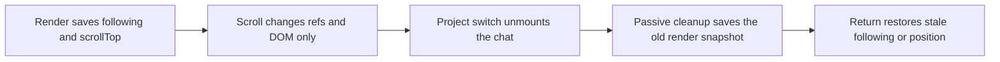
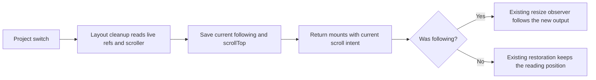

# Keep chat following across project switches

## Status

| Unit                   | Status                                                                                       |
| ---------------------- | -------------------------------------------------------------------------------------------- |
| Investigation          | Stale render snapshot found in `Session.tsx`; no runtime reproduction.                       |
| Implementation         | Written: capture live scroll state during layout cleanup.                                    |
| Review                 | Source diff reviewed; React's deletion path runs layout cleanup before child ref detachment. |
| Build and installation | Production build passed; signed app installed in `/Applications/Chorus.app`.                 |
| Verification           | Installed signature passed; tests, typecheck, lint, format and launch NOT RUN.               |

## Current / Issue



`resumeFollowing`, `stopFollowing` and the resize observer do not require a render.
`latest.current` samples their state only during render. The carry cleanup uses
that sample, after the scroller has been detached. `App.keepCarry` preserves this
snapshot and `Session` restores its `following` flag on mount.

## Proposed



## Code Changes

### `apps/desktop/src/renderer/src/Session.tsx`

```tsx
useLayoutEffect(
  () => () => {
    props.onCarry(conversationId, {
      ...latest.current,
      following: following.current,
      scrollTop: score.current?.scrollTop ?? latest.current.scrollTop,
      ...box.current,
      ...(openCardRef.current === null ? {} : { card: openCardRef.current }),
    })
  },
  [conversationId, props.onCarry]
)
```

Keep the existing carry schema, transcript catch-up, observer and gesture rules.
No additional render, timer, observer or scroll listener is needed.

Runtime verification remains outstanding: resume following, switch projects
before another render, then return during a response; also switch while reading
history and confirm the position stays where it was.
