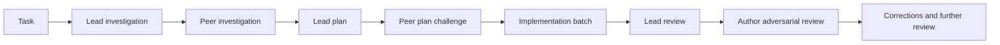
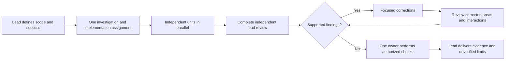
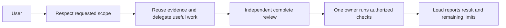

# Faster collaboration with complete review

## Status

| Phase          | Result                                                                                                                                                                                                                                                                                                                                     |
| -------------- | ------------------------------------------------------------------------------------------------------------------------------------------------------------------------------------------------------------------------------------------------------------------------------------------------------------------------------------------ |
| Investigation  | Existing source and event logs: the initial Traffic/Terminal change took 30.5 minutes, ten handoffs, and 12.82 minutes before implementation was assigned. Median handoff-to-turn delivery was 32.5ms. The original workflow contained approximately 4,600 words and a repeated 346-word return rule                                       |
| Authorization  | User requested implementation of the five recommendations with Claude. This run retains its explicit three-worker requirement; future generated defaults adapt delegation to useful work                                                                                                                                                   |
| Compatibility  | Preserve the saved-envelope markers and one-pass template interpolation. Historical fixtures and parser behavior remain compatible                                                                                                                                                                                                         |
| Implementation | Complete local changes by Claude: workflow shortened from approximately 29.4k to 9.7k characters; final generated overhead at most 9,588 characters across the six pairs by static count. Parser markers, template interpolation, and team introduction remain unchanged                                                                   |
| Review         | Complete independent source and diff review by Codex, with three continued workers covering compatibility, quality safeguards, and coverage. Corrections remove prose-mirroring assertions, strengthen actual history/resend coverage, and prevent worker checks during concurrent work. Final delta review returned no supported findings |
| Verification   | No tests, checks, builds, app launches, or benchmarks authorized. Agent behavior, speed, and runtime quality remain NOT VERIFIED                                                                                                                                                                                                           |

## Current / Issue



The original 20-phase workflow required at least three native workers for each substantive turn, including small requests. Handoffs carried a long repeated return rule. Its existing batching of independent units and shared checks is retained.

## Proposed



Research-only and plan-only requests stop at their own deliverables. Uncertain or high-risk work retains a distinct diagnosis or plan challenge. Native workers have distinct, useful assignments; explicit user worker requirements override adaptive defaults.

## Code Changes

### `apps/desktop/src/main/collaboration-prompt.ts`

Replace the repeated phase checklists with a compact contract. Retain these exact parser markers:

```text
@{{leader}} Run this task collaboratively with {{partner}}.
# TASK
# ROLES AND SCOPE
You, {{leader}}, are the lead and coordinator. {{partner}} is your collaborator.
# 0. HOW TO HAND OVER — THE RUN STOPS WITHOUT THIS
- A reply whose next step belongs to {{partner}} and which does not end with an @{{partner}} line stops the run.
```

The actual template keeps the existing blank lines and section order. Keep `collaborationPrompt(pair, task)` and `teamIntroduction(participants, task)` signatures and one-pass interpolation unchanged.

Use this policy in the generated workflow:

```text
Use native workers only for distinct work that benefits from parallel execution. Choose the smallest useful set and reuse findings and workers. Explicit user requirements about worker counts take precedence. Keep one writer per file, including generated files, lockfiles, and snapshots.
```

```text
The lead reviews every changed file and the complete integrated diff independently of the implementation author. Further review targets supported findings, corrected areas, and their interactions. Add a separate specialist review when a concrete risk warrants it. Have {{partner}} review any change you wrote.
```

```text
Assign one verification owner for each batch. Run only authorized checks after writes settle, reuse their evidence, and rerun affected checks after relevant changes or unresolved failures. A summary is not proof; report unverified behavior explicitly.
```

Handoffs retain both roles, scope, objective, file ownership, acceptance criteria, material evidence, permissions, stopping point, and a short return instruction. Every delegated result returns to the lead on a final plain call line. Direct user instructions, stops, and authorization limits continue to take precedence. No instruction grants tests, commits, deployment, or extra scope.

The return rule allows only authorized worker tests or builds and prohibits them while another subagent runs. This preserves the handoff's verification owner and prevents checks against concurrent writes.

### `apps/desktop/src/main/collaboration.test.ts`

Retain current delivery, literal-task, history, legacy-resend, solo-task, and team cases. Extend the existing suite with generated-envelope recovery across all six leader/partner pairs and a workflow-size budget that excludes user task text:

```ts
const task = `@${leader} @${partner}: {{leader}} {{partner}} {{task}} $& $t(example)`
const prompt = collaborationPrompt({ leader, partner }, task)
expect(originalCollaborationText(prompt)).toBe(task)
expect(isExpandedCollaboration(prompt)).toBe(true)
expect(prompt.length - task.length).toBeLessThan(10_000)
```

The six-pair matrix also exercises transcript recovery and resend with literal template-sensitive task text. Two leading mentions ensure ordinary mention routing would reach both agents, so the lead-only assertions protect the collaboration override. It asserts short task logging and attachment preservation. Quality policies are reviewed directly; exact sentence assertions are limited to parser markers and do not claim real agent compliance.

## Acceptance and verification

| Criterion                                                               | Result                                | Evidence                                                                                                                                                               |
| ----------------------------------------------------------------------- | ------------------------------------- | ---------------------------------------------------------------------------------------------------------------------------------------------------------------------- |
| Short workflow without fixed three-worker or repeated 20-phase defaults | PASS (source)                         | Complete source review; generated overhead below 10,000 characters by static count                                                                                     |
| Quality and scope safeguards retained                                   | PASS (source)                         | Independent review of every changed file; explicit acceptance criteria, evidence, permissions, stopping points, and targeted correction handling                       |
| Routing and saved messages remain compatible                            | PASS (source), execution NOT VERIFIED | Stable envelope markers and existing plus six-pair render/recovery/resend coverage; tests written but not run                                                          |
| Verification has one owner and evidence is reused                       | PASS (source), behavior NOT VERIFIED  | Generated instruction assigns ownership, waits for settled writes, and reuses evidence; repeat only for relevant changes or unresolved failures                        |
| Faster completion without more regressions                              | NOT VERIFIED                          | Future authorized comparison of similar tasks: time, handoffs, rework, supported findings, and regressions. No speedup or quality-equivalence claim before observation |

Focused checks, when requested: `pnpm exec vitest run apps/desktop/src/main/collaboration.test.ts apps/desktop/src/shared/collaboration.test.ts`. No checks are run as part of this request.

## Final Flow


