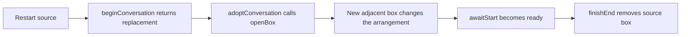
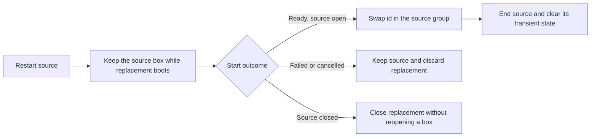
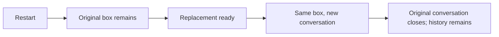

# Close chats and restart in place

## Status

| Unit           | Status                                                                                                                                                                                                                                                                                                                                      |
| -------------- | ------------------------------------------------------------------------------------------------------------------------------------------------------------------------------------------------------------------------------------------------------------------------------------------------------------------------------------------- |
| Investigation  | Codex and Claude traced both flows. User reports that switching the active chat can leave its header unresponsive: the × has no hover feedback or confirmation, dragging and blank-space activation fail, but typing still works. Dragging the blocked header does not move the app window. The exact input blocker is not proven.          |
| Implementation | Claude wrote in-place restart, deferred reconciliation, source/project cancellation and regression cases. Codex deferred conversation pointer capture until the drag threshold, added gesture cleanup and extended the no-drag exclusion across the whole header. The input fix awaits the user's manual test.                              |
| Review         | Codex independently reviewed the integrated changes. Failed close acknowledgements now reject transfer waits, and failed cancellation releases its project hold. No further supported defect was found in the reviewed normal flows.                                                                                                        |
| Verification   | User requested build and install. `CHORUS_INSTALL_KEEP_RUNNING=1 pnpm app:install` completed successfully on 2026-10-05, including installer signature verification. Packaged and installed `app.asar` SHA-256 digests match. Tests, standalone typecheck/lint and runtime behavior checks NOT RUN; user will test after restarting Chorus. |

## Current / Issue



`SessionHost.onRestart` already names the source through `StartOptions.replacing`.
`useConversationStarts` treats its begin response like an ordinary new chat.
`layout.replaceSession` already swaps an id without rebuilding its group.

Both header close buttons have no `disabled` attribute. The chat button reaches
`App.endNow`, which retains confirmation for working agents, pending decisions
and unsent drafts. The user confirmed that the failing chat × neither highlights
on hover nor opens a confirmation. The project tabs explicitly opt out of
Electron's window drag regions; conversation headers did not. Add
`-webkit-app-region: no-drag` to `.conversation-dock` so the title, close control
and empty header area all receive shell input. The intercepting region and
whether this resolves the reported failure remain unverified.

Later reports narrow the trigger to switching the active chat. The blank part
of the header also fails to focus the chat, while the composer remains usable.
`ConversationColumn` already focuses its group on pointer-down capture anywhere
inside the column, including the header's empty area. This is not explained by
a missing close callback or blank-space handler. A focused live inspection is
requested to distinguish interception from an interrupted pointer gesture.
The user authorized this inspection. The computer-use tool then refused access
to the running Chorus app with "Computer Use was not approved to use Chorus".
The user then requested a source fix and will test it manually.

`useConversationDrag` also captured the pointer on every ordinary header click
and listened only on that button for pointer-up and cancellation. It had no
cleanup for lost capture, window blur, unmount or an interrupted previous
gesture. The implementation now waits for the existing five-pixel threshold
before capture, with document listeners tracking the press from pointer-down.
This retains quick-drag tracking outside the button while keeping chat-switch
clicks free of drag capture. All termination paths release listeners and capture;
only a pointer-up commits a split or reorder. A new press clears stale click
suppression. This is a focused correction to the header gesture lifecycle, not
a confirmed runtime diagnosis of the reported input blocker.

## Proposed



The source remains visible until the replacement is ready. Closing it cancels
the replacement rather than reopening a chat. Ordinary new and continued chats
retain their existing immediate placement. No main, IPC or history changes are
planned. Preserve existing comments and all unrelated working-tree changes.

Review found an implementation gap: the hidden replacement is owned by the
initiating renderer. Moving the project can expose it in a second window, and
closing the initiating window can leave it without a box. Cancel pending
restarts before detach, redock or the detached-window flush. Preserve the source
and transfer its existing layout. Close cancellation must await the replacement's
close acknowledgement before the renderer can disappear.

Explicit detach and redock stop if that close fails. The existing error notice
still reports the failure, and the project's restart hold is released. A normal
detached-window close has a fixed two-second main-process flush deadline. If
cancellation fails, the renderer still sends its latest drafts and slice before
that existing deadline. This path cannot guarantee cancellation before a forced
return. Renderer crash, reload and handoff expiry also bypass the pending-restart
registry. Main-process ownership tracking would be needed to cover those paths;
it was not added in this task.

## Code Changes

### `apps/desktop/src/renderer/src/workspace/useConversationDrag.ts`

Track the pending press with document pointer listeners. Capture only when it
crosses the existing drag threshold. Filter by pointer id and cancel if the
button is already released or the source has disconnected. Clean up a previous
gesture before starting another, and cancel on pointer cancellation, lost
capture, window blur and hook unmount. Cancellation must not move a conversation
or suppress a later independent click.

### `apps/desktop/src/renderer/src/styles.css`

Exclude the whole `.conversation-dock` from Electron window dragging instead of
excluding only the close button.

### `apps/desktop/src/renderer/src/workspace/layout.ts`

Reuse the existing implementation with the same generic shape as `closeTab`:

```ts
export function replaceSession<T extends PaneTree>(
  workspace: T,
  previousId: string,
  nextId: string
): T
```

### `apps/desktop/src/renderer/src/workspace/store.ts`

Add `replaceConversation(projectId, previousId, nextId)` over the named project's
`ConversationArrangement`, using `replaceSession`. Keep group ids, tree position,
branch sizes, column widths and focused group unchanged. Do not alter other
projects. A missing source must not silently create a new sibling.

### `apps/desktop/src/renderer/src/useConversationStarts.ts`

Only ordinary starts call `openProject` and `adoptConversation` at begin.
Restart swaps the source id on successful settlement before `finishEnd(source)`.
Failed starts keep the source. Closed sources and rejected await requests must
not leave a hidden running replacement.

Main broadcasts conversations-changed before returning the begin result.
Reconciliation must not adopt that replacement before the initiating window has
identified it. Defer snapshots while begin requests are pending and refresh once
the begin responses settle. Preserve closed-id guards and revision checks.

Expose narrow cancellation actions for a source conversation and a project.
Track the begin request so cancellation before its reply still closes the
replacement. Mark cancellation before waiting; late readiness must never swap
or close the source. Remove a committed restart from this pending registry before
ending the source so the end operation cannot cancel the committed replacement.

### `apps/desktop/src/renderer/src/App.tsx`

Call source cancellation from `finishEnd` before removing the source from the
session list. Await project cancellation before detach, redock and returning a
detached-window flush result. Retain the existing confirmation, draft persistence
and shell-close safeguards. The callback ref for source cancellation must avoid
the declaration-order trap between `finishEnd` and `useConversationStarts`.

### Existing regression files

Write narrow cases in `useConversationStarts.test.tsx`, `workspace/layout.test.ts`
and `workspace/store.test.ts`. Cover deferred begin/ready responses, failure,
cancellation, duplicate restart, source closure, await rejection and detached
reconciliation. Use real store/layout assertions to preserve group, position,
sizes, widths, sibling groups and focus. Do not run these checks without an
explicit user request.

Add deferred cancellation cases that close before begin, cancel while awaiting
readiness, and await the close acknowledgement before the transfer can proceed.
Project cancellation must leave ordinary starts and other projects alone.

## Acceptance

| Criterion                                                                   | Evidence required                                                                                                                             | Current result                                                  |
| --------------------------------------------------------------------------- | --------------------------------------------------------------------------------------------------------------------------------------------- | --------------------------------------------------------------- |
| Every chat can close through the existing confirmation flow                 | Switch active chats, check empty-header activation, hover and close, then drag to split; retain confirmation for busy chats and unsent drafts | NOT VERIFIED; header input correction written, user will test   |
| Restart creates no temporary adjacent box                                   | Source remains placed during startup; ready replacement occupies the same group                                                               | NOT VERIFIED; source and regression cases reviewed, app not run |
| Restart preserves layout and focus                                          | Arrangement assertions for a resized row and vertical split                                                                                   | NOT VERIFIED; store/layout cases written, not run               |
| Failure, cancellation and source closure keep state consistent              | Deferred lifecycle cases with no resurrected source or hidden replacement                                                                     | NOT VERIFIED; cases written, including rejected close, not run  |
| Ordinary starts, continuation, history and detached scope remain compatible | Existing cases plus the pending-begin reconciliation race                                                                                     | NOT VERIFIED; normal transfer wiring reviewed, runtime not run  |

## Final Flow


