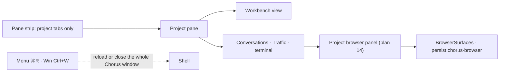
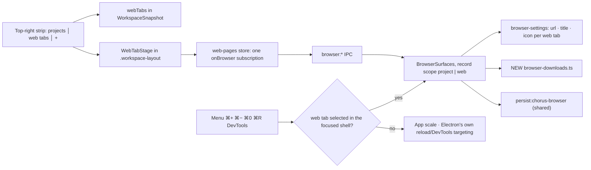
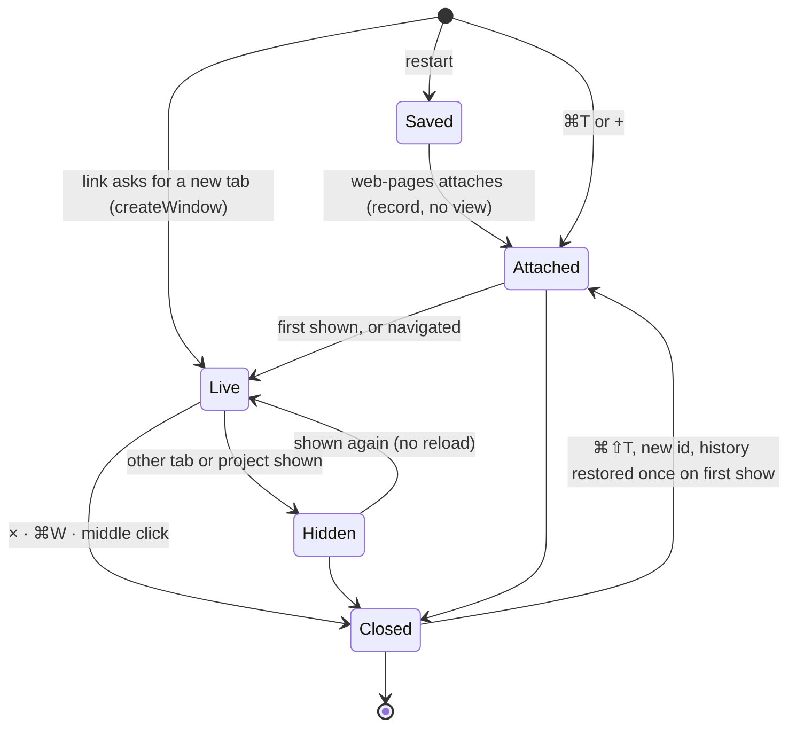
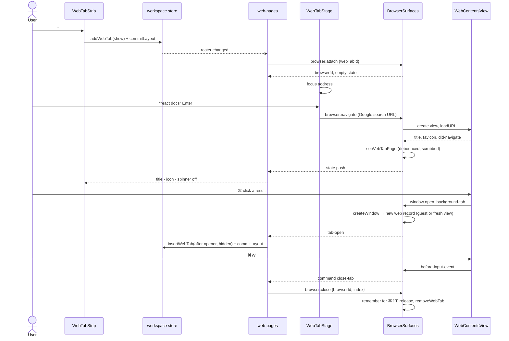

# Web tabs beside the project tabs

## Status

| Unit                         | Result                                                                                                                                                                                                                                                                                                                                                                                                                                                                                                                                                                                                                                                                                     |
| ---------------------------- | ------------------------------------------------------------------------------------------------------------------------------------------------------------------------------------------------------------------------------------------------------------------------------------------------------------------------------------------------------------------------------------------------------------------------------------------------------------------------------------------------------------------------------------------------------------------------------------------------------------------------------------------------------------------------------------------ |
| Questions                    | Answered by the user on 2026-10-09; every recommended default accepted                                                                                                                                                                                                                                                                                                                                                                                                                                                                                                                                                                                                                     |
| Research                     | Claude read the project browser (plan 14), its IPC, settings, surface and preload, the tab strip, the workspace schema and store, the shortcut handler, the menu and startup wiring                                                                                                                                                                                                                                                                                                                                                                                                                                                                                                        |
| Plan challenge               | Codex returned 13 findings. Claude checked the load-bearing ones against source (`store.ts → snapshot`, `open-projects.ts → readOpenProjects`, `layout.ts → onScreenConversations`, `App.tsx` read watermarks and 180 ms debounce, `preload/browser.ts` wheel capture) and folded every supported finding in below. Rejected: making ⌘T/⌘W/⌘⇧T menu accelerators; see "Keys"                                                                                                                                                                                                                                                                                                               |
| User approval                | Approved 2026-10-09, including both behaviour changes outside web tabs                                                                                                                                                                                                                                                                                                                                                                                                                                                                                                                                                                                                                     |
| U1 contracts and persistence | Written by Codex in seven files. Claude reviewed every file: contracts, helpers, preload invokes, the settings store and its tests match the plan. Two corrections sent: drop `.strict()` from `WebTab`/`WebTabsState` (a rejected snapshot loses every conversation), and replace the whole-file `encode` on every `setWebTabPage`/`setLastUrl` with incremental byte accounting (a 16 MiB stringify and zod parse per navigation, on the main thread)                                                                                                                                                                                                                                    |
| U2 main engine               | Written by Codex. Claude reviewed every file against the plan and verified the menu fallback against Electron 43.2's `menu-item-roles.ts`. Corrections sent: `adoptTab` must not throw from inside `createWindow` (no `uncaughtException` handler, so Electron's error dialog), menu DevTools route should open detached like the toolbar, and the row-wheel-enable channel should be a shared constant                                                                                                                                                                                                                                                                                    |
| U3 renderer                  | Written by Codex. Claude reviewed every file: roster, immediate commits, late-attach close, inert covered panes, stage mounting, password binding and every translation key. Corrections sent: drop the no-op Cancel on interrupted downloads, and wrap lines over Prettier's 100 columns                                                                                                                                                                                                                                                                                                                                                                                                  |
| Verification                 | `pnpm check` run once; it stops at pre-existing failures outside this work (`adapter-claude` typecheck), so its steps were carried through with `--continue` and per-file scope. Web-tabs files: typecheck clean, no new lint errors (16 remaining predate this work, matched to baselines), Prettier clean on new lines. Tests: 3719 pass; 3 fail in files this work does not touch (`EditorPane.test.tsx`, `TrafficPanel.test.tsx`, `deferred-restore.test.ts`). Found and fixed on the way: a store-test fixture and a 16 MiB `toEqual` that exhausted the test worker's heap. Claude did not launch the app. The user tried it in the running app on 2026-10-09 and reported it worked |

Roles: Claude leads and reviews. Codex implements U1–U3. Claude reviews every unit and the integrated diff.

## Decisions taken with the user

| Question           | Answer                                                                                                                                                                      |
| ------------------ | --------------------------------------------------------------------------------------------------------------------------------------------------------------------------- |
| Where              | The web group sits after the project tabs, with `+` at the far right, in the **top-right pane's** strip. The main window only                                               |
| What a web tab is  | It belongs to no project. A web tab that is showing covers the pane region below the top strip row                                                                          |
| Features           | Address bar · back/forward/reload/stop · title and favicon · spinner · ⌘T ⌘W ⌘L ⌘F · zoom · DevTools · links that ask for a new tab open a web tab · downloads · ⌘⇧T reopen |
| Search             | Google                                                                                                                                                                      |
| Survives a restart | Tab list, order, active tab, showing or not, each URL, title and icon; cookies and logins. No back/forward history and no scroll position                                   |
| Cookies            | Shared with the project browser, `persist:chorus-browser`. Kept separate from Chorus's own session. Save-password offer and autofill included                               |
| Restore            | Lazy, as Chrome restores tabs: only the shown tab loads, and the rest load on first click. Loaded tabs stay alive                                                           |
| Drawing            | One native `WebContentsView` per page, the Electron equivalent of a Chromium browser's tab view. `BrowserView` is deprecated in the installed 43.2                          |
| Addresses          | Only `http`, `https` and `about:blank`. Page permissions are denied, except fullscreen and sanitized clipboard writes                                                       |
| Traffic            | Web tab requests are not captured                                                                                                                                           |
| Zoom keys          | ⌘+ ⌘− ⌘0 zoom the page while a web tab is showing. Otherwise they scale the app, as today                                                                                   |
| Downloads          | Saved straight to `~/Downloads`, with an inline list: progress, open, show in Finder, cancel. Kept in memory only                                                           |
| Reopen             | The last 20 closed tabs, in memory, with their back/forward history                                                                                                         |
| Out of scope       | Split or pop-out web tabs, bookmarks, a history screen, extensions                                                                                                          |

**Not doing in v1, and not asked for:** dragging web tabs to reorder them, pinned tabs, address suggestions, a custom new-tab page, web tabs in detached windows, remembering zoom or downloads across restarts, permission prompts, and print. Pages also cannot claim ⌘F before the browser does, as Google Docs does in Chrome.

**Two behaviour changes outside the web tabs, for the user to accept:**

- On Windows and Linux, Ctrl+W no longer closes the whole Chorus window. It now reaches the page, so it closes the tab the shell's own handler already targets, or the editor's tab inside the workbench. This uses `registerAccelerator: false`, which in 43.2 exists only for `linux,win32`.
- ⌘R and ⌘⌥I (Ctrl+Shift+I off macOS) act on the page while a web tab is showing. Otherwise they keep Electron's own targeting.

## Current / Issue



The engine is project-scoped all the way down. `BrowserRecord.projectId` drives favorites and `setLastUrl`, `browser:attach` takes `{projectId}`, and `BrowserIpc.mayAttach` checks project adoption. `browser:detach` releases the page, which is right for a panel that unmounts with its project tab. The page preload captures every horizontal wheel for the project row.

## Proposed





Four rules carry the design:

- **A web page belongs to its tab, not to a component.** `browser:detach` is a no-op for web scope. Only `browser:close`, the owner window going away, or shutdown release a web page. Re-attaching the same `webTabId` adopts the live record.
- **Per-tab state lives in the `web-pages` store, not in keyed UI.** The store's single subscription outlives every component. So it holds the page state, a password offer main emits only once, the settings status, find results and each tab's geometry revision counter. Switching tabs therefore loses no offer and never resets a revision.
- **Only the shown tab has UI.** `WebTabStage` mounts the toolbar and body for `activeId` alone.
- **The roster is layout and the page is browser data.** Order, active and showing go in `WorkspaceSnapshot.webTabs`, like the global terminal's roster, and every roster change commits immediately. URL, title and icon go in `browser-settings.ts`, scrubbed and debounced like a project's `lastUrl`, and pruned at startup against the snapshot's ids.

## Code Changes

### U1 — `apps/desktop/src/shared/workspace-layout.ts`

```ts
export const WEB_TABS_MAX = 100

export const WebTab = z.object({ id: z.string() })
export type WebTab = z.infer<typeof WebTab>

export const WebTabsState = z.object({
  tabs: z.array(WebTab).default([]),
  activeId: z.string().nullable().default(null),
  showing: z.boolean().default(false),
})
export type WebTabsState = z.infer<typeof WebTabsState>

export const NO_WEB_TABS: WebTabsState = Object.freeze({ tabs: [], activeId: null, showing: false })
```

```ts
  rowScroll: z.record(z.string(), z.number()).default({}),
  webTabs: WebTabsState.default(NO_WEB_TABS),
})
```

The ids stay permissive here, and `normalizeWebTabs` repairs them. A rejected snapshot loses every open conversation, which is the file's standing warning. `open-projects.test.ts` gains the fixture each defaulted field carries.

### U1 — `apps/desktop/src/shared/browser-ipc.ts`

```ts
export const BROWSER_FIND_MAX = 1024
export const BROWSER_DOWNLOADS_MAX = 50
export const BROWSER_CLOSED_MAX = 20
export const BROWSER_ZOOM_STEPS = [
  0.25, 0.33, 0.5, 0.67, 0.75, 0.8, 0.9, 1, 1.1, 1.25, 1.5, 1.75, 2, 2.5, 3, 4, 5,
] as const

export const BrowserWebTabId = z.string().regex(/^[A-Za-z0-9-]{1,128}$/)

export const BrowserScope = z.union([
  z.object({ projectId: BrowserProjectId }).strict(),
  z.object({ webTabId: BrowserWebTabId }).strict(),
])
export type BrowserScope = z.infer<typeof BrowserScope>

export const BrowserAction = z.enum([
  'back',
  'forward',
  'reload',
  'stop',
  'devtools',
  'external',
  'focus',
  'zoom-in',
  'zoom-out',
  'zoom-reset',
  'find-stop',
])

export const BrowserWebCommand = z.enum([
  'new-tab',
  'close-tab',
  'reopen-tab',
  'focus-address',
  'find',
  'find-next',
  'find-previous',
  'back',
  'forward',
  'next-tab',
  'previous-tab',
])
export type BrowserWebCommand = z.infer<typeof BrowserWebCommand>

export const BrowserDownload = z
  .object({
    id: BrowserId,
    filename: z.string().min(1).max(BROWSER_TITLE_MAX),
    state: z.enum(['progressing', 'paused', 'completed', 'cancelled', 'interrupted']),
    received: z.number().int().nonnegative(),
    total: z.number().int().nonnegative(),
  })
  .strict()
export const BrowserDownloads = z.array(BrowserDownload).max(BROWSER_DOWNLOADS_MAX)
```

`BrowserState` gains `zoom: z.number().min(0.25).max(5)`, read from the contents with `getZoomFactor()` each time state is built. Chromium shares zoom across same-host pages, so a cached value would go stale. Every new `BrowserPush` variant keeps a `browserId`, so `BrowserPanel`'s existing filter compiles unchanged:

```ts
  z.object({ kind: z.literal('found'), browserId: BrowserId, matches: z.number().int().nonnegative(), active: z.number().int().nonnegative() }).strict(),
  z.object({ kind: z.literal('tab-open'), browserId: BrowserId, webTabId: BrowserWebTabId, openerWebTabId: BrowserWebTabId, background: z.boolean(), state: BrowserState }).strict(),
  z.object({ kind: z.literal('command'), browserId: BrowserId, command: BrowserWebCommand }).strict(),
  z.object({ kind: z.literal('downloads'), browserId: BrowserId, downloads: BrowserDownloads }).strict(),
```

| New or changed channel | Request                                        | Response                                                                          |
| ---------------------- | ---------------------------------------------- | --------------------------------------------------------------------------------- |
| `browser:attach`       | `BrowserScope`                                 | unchanged; web scope returns `favorites: []` and the record's own settings status |
| `browser:find`         | `{browserId, text, forward, start}`            | `{failure}`                                                                       |
| `browser:close`        | `{browserId, index}`                           | `{ok}`                                                                            |
| `browser:reopen`       | `{}`                                           | `{reopened: {webTabId, index, state} \| null}`                                    |
| `browser:downloads`    | `{}`                                           | `{downloads}`                                                                     |
| `browser:download`     | `{downloadId, action: open/show/cancel/clear}` | `{downloads, failure}`                                                            |

`start` maps to Electron's `findNext`, which is **true for a new search**, despite the name.

Pure helpers stay in this file:

```ts
const SEARCH_URL = 'https://www.google.com/search?q='

export function browserAddressOrSearch(input: string): string | null {
  const text = input.trim()
  if (text.length === 0 || text.length > BROWSER_ADDRESS_MAX) return null
  const explicit = ADDRESS_SCHEME.test(text) && !ADDRESS_HOST_PORT.test(text)
  const hostLike =
    !/\s/.test(text) &&
    (explicit || /^[^/?#]*[.:]/.test(text) || /^localhost(?:[:/?#]|$)/i.test(text))
  const address = hostLike ? browserAddress(text) : null
  if (address !== null) return address
  const search = `${SEARCH_URL}${encodeURIComponent(text)}`
  return search.length <= BROWSER_URL_MAX ? search : null
}

export function browserZoomStep(current: number, direction: -1 | 0 | 1): number {
  if (direction === 0) return 1
  const steps = direction === 1 ? BROWSER_ZOOM_STEPS : [...BROWSER_ZOOM_STEPS].reverse()
  return (
    steps.find((step) => (direction === 1 ? step > current + 0.001 : step < current - 0.001)) ??
    current
  )
}

export interface BrowserKeyInput {
  readonly type: string
  readonly key: string
  readonly meta: boolean
  readonly control: boolean
  readonly shift: boolean
  readonly alt: boolean
  readonly isAutoRepeat: boolean
  readonly isComposing: boolean
}

const ONCE_PER_PRESS = new Set<BrowserWebCommand>(['new-tab', 'close-tab', 'reopen-tab'])

export function browserWebCommand(
  input: BrowserKeyInput,
  platform: string
): BrowserWebCommand | null {
  if (input.type !== 'keyDown' || input.alt || input.isComposing) return null
  const primary =
    platform === 'darwin' ? input.meta && !input.control : input.control && !input.meta
  if (!primary) return null
  const command = webCommandFor(input.key.toLowerCase(), input.shift)
  if (command === null || (input.isAutoRepeat && ONCE_PER_PRESS.has(command))) return null
  return command
}

function webCommandFor(key: string, shift: boolean): BrowserWebCommand | null {
  if (key === 't') return shift ? 'reopen-tab' : 'new-tab'
  if (shift) {
    if (key === 'g') return 'find-previous'
    if (key === '[' || key === '{') return 'previous-tab'
    if (key === ']' || key === '}') return 'next-tab'
    return null
  }
  if (key === 'w') return 'close-tab'
  if (key === 'l') return 'focus-address'
  if (key === 'f') return 'find'
  if (key === 'g') return 'find-next'
  if (key === '[') return 'back'
  if (key === ']') return 'forward'
  return null
}
```

### U1 — `apps/desktop/src/main/browser-settings.ts`

```ts
const StoredWebTab = z
  .object({
    id: BrowserWebTabId,
    url: StoredUrl.nullable(),
    title: BrowserTitle,
    icon: BrowserIcon.nullable(),
  })
  .strict()

export interface BrowserWebTabPage {
  readonly url: string | null
  readonly title: string
  readonly icon: string | null
}

export interface BrowserWebTabRead {
  readonly status: BrowserSettingsStatus
  readonly page: BrowserWebTabPage
}
```

The file schema gains `webTabs: z.array(StoredWebTab).max(WEB_TABS_MAX * 2).default([])`, so an older `settings.json` still parses. A present but malformed `webTabs` takes the existing corrupt path and is never rewritten. Ids stay unique, and every encode and write path carries the field. The 16 MiB budget accounts for web pages too, beside the favorites budget. The new methods follow `setLastUrl`'s queue, debounce and `browserScrubUrl`:

```ts
webTab(webTabId: string): Promise<BrowserWebTabRead>
setWebTabPage(webTabId: string, page: BrowserWebTabPage): Promise<BrowserFailure | null>
removeWebTab(webTabId: string): Promise<BrowserFailure | null>
prune(projects: ReadonlySet<string>, webTabs: ReadonlySet<string>): Promise<BrowserFailure | null>
```

### U1 — `apps/desktop/src/preload/index.ts`

`attachBrowser` takes `BrowserScope`. New invokes: `findInBrowser`, `closeBrowser`, `reopenBrowser`, `readBrowserDownloads` and `actOnBrowserDownload`.

### U2 — `apps/desktop/src/main/browser-surface.ts`

```ts
type RecordScope =
  | { readonly kind: 'project'; readonly projectId: string }
  | { readonly kind: 'web'; readonly webTabId: string }

interface ClosedWebTab {
  readonly url: string | null
  readonly title: string
  readonly icon: string | null
  readonly entries: NavigationEntry[]
  readonly index: number
  readonly position: number
}
```

`BrowserRecord.projectId` becomes `scope`, plus `settings: BrowserSettingsStatus`, `history: { entries: NavigationEntry[]; index: number } | null` and `findRequest: number | null`. Favorites, `shareFavorites` and `setLastUrl` stay project-only. `committed()` calls `setWebTabPage` for web scope, and so do title and icon updates.

Closed tabs are held in a `WeakMap<WebContents, ClosedWebTab[]>`, capped at `BROWSER_CLOSED_MAX`. Admission has two caps. The existing per-owner total becomes `64 + WEB_TABS_MAX`. A web cap, `webCount(owner) + pendingOpens(owner) < WEB_TABS_MAX`, is checked for attach, reopen and guest adoption alike.

```ts
async attachWebTab(owner: WebContents, webTabId: string): Promise<BrowserResponse<'browser:attach'>> {
  const existing = this.webRecord(owner, webTabId)
  if (existing !== null) return this.attached(existing)
  this.admitWeb(owner)
  this.watch(owner)
  const generation = this.generations.get(owner) ?? 0
  const read = await this.deps.settings.webTab(webTabId)
  if (owner.isDestroyed() || (this.generations.get(owner) ?? 0) !== generation) {
    throw new Error('The window changed before its web tab attached')
  }
  const adopted = this.webRecord(owner, webTabId)
  if (adopted !== null) return this.attached(adopted)
  this.admitWeb(owner)
  return this.attached(this.createRecord(owner, { kind: 'web', webTabId }, read))
}

private attached(record: BrowserRecord): BrowserResponse<'browser:attach'> {
  return { browserId: record.id, state: this.state(record), favorites: [], settings: record.settings }
}

detach(owner: WebContents, browserId: string): BrowserResponse<'browser:detach'> {
  const record = this.records.get(browserId)
  if (record?.owner === owner && record.scope.kind === 'project') this.release(record)
  return { ok: true }
}

close(owner: WebContents, browserId: string, position: number): BrowserResponse<'browser:close'> {
  const record = this.owned(owner, browserId)
  if (record.scope.kind !== 'web') return { ok: true }
  this.remember(record, position)
  this.release(record)
  this.deps.settings.removeWebTab(record.scope.webTabId).catch(() => null)
  return { ok: true }
}

shownWebTab(owner: WebContents): BrowserRecord | null {
  for (const record of this.records.values()) {
    if (record.owner === owner && record.scope.kind === 'web' && record.wanted) return record
  }
  return null
}
```

`shownWebTab` reads `wanted`, not `live`, so an empty selected tab still consumes ⌘R and zoom rather than falling through to the app. A reopened record's first `load()` creates **fresh** contents and calls `navigationHistory.restore(record.history)` once, then clears `history`. Electron refuses a restore onto contents that have already loaded. A restore bypasses `will-navigate`, but the entries came from our own guarded pages, and `will-redirect` still applies.

**New windows from a web page.** A popup that asks for a window, like an OAuth sign-in, keeps today's child `BrowserWindow`. Anything that asks for a tab becomes a web tab. Electron 43.2 reaches `createWindow` by two paths (`lib/browser/api/web-contents.ts`). One carries a native guest in `options.webContents`, and the callback must return that exact guest. The other, a modified-click `OpenURLFromTab`, carries none, and Electron then skips its own `loadURL`:

```ts
private openFromWebTab(record: BrowserRecord, details: HandlerDetails): WindowOpenHandlerResponse {
  if (details.disposition === 'new-window') return this.openPopup(record, details)
  if (record.closed || !isBrowserNavigable(details.url) || !this.mayOpenWeb(record.owner)) {
    return { action: 'deny' }
  }
  this.holdOpen(record.owner)
  return {
    action: 'allow',
    outlivesOpener: true,
    overrideBrowserWindowOptions: { webPreferences: this.preferences(true, 'web') },
    createWindow: (options) => this.adoptTab(record, details, guestOf(options)),
  }
}

private adoptTab(opener: BrowserRecord, details: HandlerDetails, guest: WebContents | null): WebContents {
  this.releaseOpen(opener.owner)
  const view =
    guest === null
      ? new WebContentsView({ webPreferences: this.preferences(true, 'web') })
      : new WebContentsView({ webContents: guest })
  const record = this.adopt(opener, view, details.disposition === 'background-tab')
  if (guest === null) {
    view.webContents
      .loadURL(details.url, {
        httpReferrer: details.referrer,
        ...(details.postBody === undefined ? {} : { postData: details.postBody.data, extraHeaders: contentTypeHeader(details.postBody) }),
      })
      .catch(() => undefined)
  }
  return view.webContents
}
```

`guestOf` narrows the runtime `webContents` property with a type guard, because the public callback type omits it; no `any`. The guest already belongs to the opener's session, which is `persist:chorus-browser`, and 43.2 applies the sandbox and preload overrides before creating it. Codex confirmed both against v43.2.0 sources. **No lossy fallback is needed.** If the renderer's roster is full when `tab-open` arrives, the renderer closes the record, so no adopted guest is left orphaned.

Keys while a web page has focus never reach the shell's document. `preventDefault` here also stops the menu's accelerator, which is what keeps Ctrl+W on Windows inside the tab:

```ts
contents.on('before-input-event', (event, input) => {
  const command = browserWebCommand(input, process.platform)
  if (command === null) return
  event.preventDefault()
  this.push(record, { kind: 'command', browserId: record.id, command })
})
```

Find and zoom:

```ts
find(owner: WebContents, browserId: string, text: string, forward: boolean, start: boolean): BrowserResponse<'browser:find'> {
  const record = this.owned(owner, browserId)
  const contents = this.contents(record)
  if (contents === null) return { failure: 'not-loaded' }
  record.findRequest = contents.findInPage(text, { forward, findNext: start })
  return { failure: null }
}
```

```ts
contents.on('found-in-page', (_event, result) => {
  if (!result.finalUpdate || result.requestId !== record.findRequest) return
  this.push(record, {
    kind: 'found',
    browserId: record.id,
    matches: result.matches,
    active: result.activeMatchOrdinal,
  })
})
contents.on('zoom-changed', (_event, direction) => {
  this.zoom(record, direction === 'in' ? 1 : -1)
})
```

`zoom()` reads `getZoomFactor()`, applies `browserZoomStep` and pushes state. `preferences(primary, kind)` gives web pages `backgroundThrottling: true`, and project panels keep today's value. Electron documents that one unthrottled contents can affect the whole window's frames, and Chorus's editor views are unthrottled. So this is a lever, not a Chrome-equivalent guarantee.

### U2 — `apps/desktop/src/preload/browser.ts`

The row-wheel capture is project-panel behaviour. In a web tab it would swallow every horizontal page scroll. It starts **off**, and main turns it on only for project records, by a `browser:page:row-wheel-enable` message after `browser:page:ready`. Web pages never receive that message.

### NEW U2 — `apps/desktop/src/main/browser-downloads.ts`

```ts
export class BrowserDownloads {
  constructor(deps: {
    readonly session: Session
    readonly ownerOf: (contents: WebContents) => { owner: WebContents; browserId: string } | null
    readonly directory: () => string
    readonly deliver: (owner: WebContents, push: BrowserPush) => void
  })
  list(owner: WebContents): BrowserDownload[]
  act(
    owner: WebContents,
    downloadId: string,
    action: 'open' | 'show' | 'cancel' | 'clear'
  ): BrowserFailure | null
  dispose(): void
}

export function safeDownloadName(suggested: string, platform: string): string
export function uniqueDownloadPath(
  directory: string,
  name: string,
  taken: (path: string) => boolean
): string
```

- **Which downloads it claims.** `will-download` takes an item only when `ownerOf` maps its contents to a web-scope record or one of that record's popups. Project panels keep Electron's default save dialog.
- **File names.** `safeDownloadName` takes the basename and strips characters Windows refuses. It renames reserved device names (`CON`, `PRN`, `AUX`, `NUL`, `COM1–9`, `LPT1–9`) and trims trailing dots and spaces.
- **Unique paths.** `taken` checks both the disk and the paths reserved by in-flight downloads, so two concurrent downloads never get the same name.
- **List state.** The list is per owner window and outlives the tab that started it. At 50 entries the oldest finished item is evicted. Items still in progress are never evicted.
- **Pushes and shutdown.** `updated` pushes are coalesced to one per 250 ms per owner. `dispose()` clears the timers and the session listener at shutdown.

### U2 — `apps/desktop/src/main/browser-ipc.ts`

```ts
this.handle('browser:attach', BROWSER_CONTRACT['browser:attach'], (owner, request, role) => {
  if ('webTabId' in request) {
    if (role.kind !== 'main') throw new Error('Web tabs open only in the main window')
    return surfaces.attachWebTab(owner, request.webTabId)
  }
  if (!this.mayAttach(role, request.projectId)) {
    throw new Error('This window may not open a browser for that project')
  }
  return surfaces.attach(owner, request.projectId)
})
```

Handlers are added for `find`, `close`, `reopen`, `downloads` and `download`, with the same request and response validation.

### U2 — `apps/desktop/src/main/menu.ts`

```ts
export interface MenuRoutes {
  readonly zoom: (direction: -1 | 0 | 1) => boolean
  readonly reload: () => boolean
  readonly devtools: () => boolean
}

export function menuTemplate(routes: MenuRoutes, platform: string): MenuItemConstructorOptions[] {
  const zoom = (direction: -1 | 0 | 1) => (): void => {
    if (!routes.zoom(direction)) stepScale(direction)
  }
  const devtoolsKey = platform === 'darwin' ? 'Alt+Command+I' : 'Ctrl+Shift+I'
```

- **Reload and DevTools.** `{ role: 'reload' }` and `{ role: 'toggleDevTools' }` become `click` items with the same accelerators. When the route declines, they replicate 43.2's `menu-item-roles.ts` targeting exactly: the focused contents, or the inspected contents when DevTools has focus. A focused project browser therefore still reloads itself, not Chorus.
- **Ctrl+W off macOS.** `{ role: 'windowMenu' }` stays as it is on macOS. Elsewhere it becomes explicit `minimize` and `close` items, with `registerAccelerator: false` on `close`.

### U2 — `apps/desktop/src/main/index.ts`

```ts
const webTabIds = new Set(
  (readOpenProjects(userData).workspace?.webTabs.tabs ?? []).map((tab) => tab.id)
)
browserSettings.prune(new Set(opened.projects.list().map((project) => project.id)), webTabIds)
```

This wires `BrowserDownloads` onto `persist:chorus-browser`, disposes it in `shutDownEverything`, and passes `MenuRoutes` and `process.platform` to `installMenu`.

### U3 — `apps/desktop/src/renderer/src/workspace/store.ts`

```ts
function snapshot(state: WorkspaceStore): WorkspaceSnapshot {
  return {
    layout: state.layout,
    panes: state.panes,
    focusedPaneId: state.focusedPaneId,
    sidebarHidden: state.sidebarHidden,
    sidebarWidth: state.sidebarWidth,
    conversationGroups: state.conversationGroups,
    trafficPanels: state.trafficPanels,
    projectTerminals: state.projectTerminals,
    rowScroll: state.rowScroll,
    terminals: state.terminals,
    globalTerminal: state.globalTerminal,
    webTabs: state.webTabs,
  }
}
```

```ts
addWebTab: (show: boolean) => string
insertWebTab: (id: string, index: number, show: boolean) => void
closeWebTab: (id: string) => void
activateWebTab: (id: string) => void
showProjects: () => void
```

- **Snapshot.** `webTabs` is in the empty workspace, in hydration, and in `snapshot()` above. `SNAPSHOT_KEYS` only compares fields; it does not save them.
- **Repair.** `normalizeWebTabs` drops ids `BrowserWebTabId` rejects (blank, whitespace, slashes, over 128 characters), duplicates, anything over `WEB_TABS_MAX`, and an `activeId` that names no tab.
- **Showing.** Every intentional project reveal clears `showing`: `activateTab`, `openProject` (rail clicks and notification reveal both go through it) and `showConversation`. `closeWebTab` shows the right-hand neighbour, else the left one, else returns to the projects.

### U3 — `apps/desktop/src/renderer/src/workspace/layout.ts`

```ts
export function topRightPaneId(node: WorkspaceLayoutNode | null): string | null {
  if (node === null) return null
  if (node.kind === 'leaf') return node.paneId
  const child = node.orientation === 'row' ? node.children.at(-1) : node.children.at(0)
  return child === undefined ? null : topRightPaneId(child)
}
```

`onScreenConversations` takes `webTabs` with its state and skips the panes while `webTabs.showing`, keeping what detached windows report. Covered conversations then stay unread, and their attention toasts still show. A detached window's store holds `NO_WEB_TABS`, so its own reading is unchanged.

### NEW U3 — `apps/desktop/src/renderer/src/workspace/web-pages.ts`

A small zustand store with **one** `onBrowser` subscription, started from `Workspace` with the app's `commitLayout`:

```ts
interface WebPage {
  readonly browserId: string | null
  readonly state: BrowserState | null
  readonly settings: BrowserSettingsStatus
  readonly prompt: BrowserPasswordPrompt | null
  readonly found: { readonly matches: number; readonly active: number } | null
  readonly revision: number
  readonly failed: boolean
}
```

It holds `pages: Record<webTabId, WebPage>` and the owner's `downloads`.

- **Attaching.** Each roster tab is attached once, and pending attaches are deduplicated by id. A reply for a tab no longer in the roster is closed with `browser:close`. A plain detach would be a no-op now. No component effect attaches, so StrictMode cannot double-attach or release a page.
- **Pushes.** `tab-open` becomes `insertWebTab` then `commitLayout()`, or `browser:close` when the roster is full. `command` goes to `runWebCommand`. `prompt` is kept per tab until main clears it.

This is a separate store, not `WorkspaceRuntime`, because it is browser state with its own lifecycle. Its pushes then never run the layout store's selectors.

### NEW U3 — `apps/desktop/src/renderer/src/workspace/WebTabStrip.tsx`

The group is a divider, then the tabs, then `+`. Each tab shows a spinner, the favicon or a globe, then the title, the host or "New tab", then ×, and closes on middle click. One component selects `pages`. It re-renders when a page pushes state, which happens at load-event rate, not frame rate, and a strip of 100 buttons is cheap at that rate.

`PaneTabStrip` renders it when `props.webTabsPaneId === props.paneId`, and `Workspace` renders it when `layout === null`. `DetachedStage` never passes `webTabsPaneId`. While `showing`, project tabs render unselected.

### NEW U3 — `apps/desktop/src/renderer/src/workspace/WebTabStage.tsx`

`Workspace` wraps the existing `LayoutView`/`EmptyWorkspace` and this stage in a bounded `.workspace-layout`, and leaves the global terminal outside it. The stage sits at `top: var(--pane-header)`, a new token equal to the pane grid's existing `40px` row, so no cross-tree strip measurement is needed. Its children are keyed by `activeId`:

- **Toolbar.** Back, forward, reload or stop, the address (Enter → `browserAddressOrSearch`), zoom percentage when not 100% (click resets), find field (⌘F, Enter next, ⇧Enter previous, Esc closes and refocuses the page), downloads button, passwords, DevTools, open externally.
- **Inline rows.** The extracted password prompt and chooser, the downloads list and a status notice. All of them sit above the page rectangle, so nothing is drawn over the native view.
- **Body.** It draws `useWorkbenchStill(browserId)` while a global overlay hides the view, as `BrowserPanel` does. An empty new tab shows a DOM hint and creates no view.

Geometry follows `BrowserPanel`'s revision rules, without the row crop. The revision comes from the tab's `web-pages` entry and is never reset by a remount. One `ResizeObserver` on the body plus `window` `resize` are coalesced into one `requestAnimationFrame`, and only changed bounds are sent. If a position-only move turns up that these miss, reuse `WorkbenchFrame`'s movement tracking, which records exactly that failure. On a switch the stage sends `active: false` for the previous tab.

### NEW U3 — `apps/desktop/src/renderer/src/BrowserPasswords.tsx` and `BrowserPanel.tsx`

The save prompt and chooser, with their request-number and document binding, move out of `BrowserPanel` and are rendered by both. The prompt arrives as a prop: `BrowserPanel` keeps its local state, and the stage passes the `web-pages` entry. Two copies of that binding logic would drift, and that logic is what keeps a password off the wrong page. **This is the only change to the project browser apart from the preload's wheel flag.**

### U3 — `apps/desktop/src/renderer/src/workspace/EditorPane.tsx`

```tsx
<PaneWorkbench key={id} projectId={id} active={id === projectId && !webShowing} />
<BrowserPanel projectId={id} active={id === projectId && !webShowing} />
```

`.workspace-pane-content` takes `inert={webShowing}`, so covered controls lose focus, pointer and accessibility. Pane-level shortcut owners, such as `ProjectNotes`'s ⌘⇧N through `active={focused}`, take `&& !webShowing`. Hiding goes through the existing tab-switch path, which Codex confirmed hides the workbench view and stops its bounds updates.

### U3 — `apps/desktop/src/renderer/src/workspace/Workspace.tsx`

`runWebCommand(command)` is one function, called from two places. One is the capture-phase `keydown` handler, when the shell has focus. The other is the `command` push, when a web page has focus. Every roster change it makes calls `commitLayout()`, the existing immediate write, because the 180 ms debounce loses a change made just before quitting.

| Key                          | Web tab showing                                   | Shell focused, no web tab showing    | Editor or project browser focused |
| ---------------------------- | ------------------------------------------------- | ------------------------------------ | --------------------------------- |
| ⌘T                           | new tab, shown, address focused                   | same                                 | the editor's own (Go to Symbol)   |
| ⌘⇧T                          | reopen                                            | same                                 | the editor's own (reopen editor)  |
| ⌘W                           | close the web tab                                 | close the project tab (today)        | the editor's own (close editor)   |
| ⌘L · ⌘F · ⌘G · ⌘⇧G · ⌘[ · ⌘] | address · find · next · previous · back · forward | not claimed                          | not claimed                       |
| ⌘⇧[ · ⌘⇧]                    | previous or next **web** tab                      | previous or next project tab (today) | not claimed                       |

**Rejected:** making ⌘T, ⌘W and ⌘⇧T menu accelerators so they work from every focus. A menu accelerator fires before any page sees the key, so it would take those three away from the Code-OSS editor. `+` and the strip work from any focus.

### U3 — `apps/desktop/src/renderer/src/styles.css` and `i18n/en.json`

The `--pane-header` token, `.workspace-layout`, and `web-tab*` and `web-stage*` rules, all from existing tokens, including a CSS-only spinner. A `webTabs` block in `en.json` holds every label, tooltip, empty hint, download state and failure.

### Tests, written with each unit, run once in `pnpm check`

| File                             | Cases                                                                                                                                                                                                                                                                                                                                                                                                                                            |
| -------------------------------- | ------------------------------------------------------------------------------------------------------------------------------------------------------------------------------------------------------------------------------------------------------------------------------------------------------------------------------------------------------------------------------------------------------------------------------------------------ |
| `shared/browser-ipc.test.ts`     | `browserAddressOrSearch`: `localhost:3000`, `example.com`, `what is 2.5`, `hello`, `javascript:x`, over-length. `browserZoomStep` at both ends. `browserWebCommand` on darwin and win32, auto-repeat on ⌘T and ⌘G, composition, Alt held                                                                                                                                                                                                         |
| `main/browser-settings.test.ts`  | Web tab page round trip, scrubbed URL, debounce, `removeWebTab`, prune keeps listed ids, an old file without `webTabs` parses, malformed `webTabs` is corrupt and left byte-identical                                                                                                                                                                                                                                                            |
| `main/browser-surface.test.ts`   | Re-attach adopts. Detach keeps a web page. Close releases and remembers (cap 20). Reopen restores history once. `new-window` stays a popup. A guest is returned as-is and not reloaded. No guest → fresh view, `loadURL` with referrer and POST. Web cap holds across attach, reopen and adoption. A stale `found-in-page` is ignored. `before-input-event` maps and prevents. An empty selected tab is `shownWebTab`. Project records unchanged |
| `main/browser-downloads.test.ts` | Reserved names, trailing dots, concurrent reservations, eviction keeps in-progress items, unowned contents left to the default, coalesced pushes, dispose                                                                                                                                                                                                                                                                                        |
| `main/menu.test.ts`              | Routed vs fallback for zoom, reload and DevTools; the fallback targets focused contents. On win32, `close` has `registerAccelerator: false`; on darwin, `windowMenu` is unchanged                                                                                                                                                                                                                                                                |
| `renderer/.../layout.test.ts`    | `topRightPaneId` for a leaf, a row, a column and nested branches. `onScreenConversations` skips panes while showing and keeps reported ids                                                                                                                                                                                                                                                                                                       |
| `renderer/.../store.test.ts`     | Add, insert, close picks the neighbour. `activateTab`, `openProject` and `showConversation` hide web. Normalisation of bad ids. `workspaceSnapshot` includes `webTabs`                                                                                                                                                                                                                                                                           |
| `main/open-projects.test.ts`     | A snapshot without `webTabs` parses with every conversation kept                                                                                                                                                                                                                                                                                                                                                                                 |

## Acceptance

| Criterion                                                                                                 | Evidence                                       | Result       |
| --------------------------------------------------------------------------------------------------------- | ---------------------------------------------- | ------------ |
| `+` at the far right of the top-right strip adds a shown, empty tab with the address focused              | Source + store test                            | NOT VERIFIED |
| Several web tabs; switching shows and hides pages without reloading                                       | Source + surface tests                         | NOT VERIFIED |
| Quit right after a tab change and reopen: same tabs, order, active and showing; only the shown tab loads  | Immediate commit + snapshot and settings tests | NOT VERIFIED |
| Logins survive a restart and are shared with the project browser                                          | Same partition                                 | NOT VERIFIED |
| A non-URL in the address bar searches Google                                                              | Helper test                                    | NOT VERIFIED |
| Links that ask for a tab open as a web tab with opener and POST kept; OAuth popups still work             | Surface tests                                  | NOT VERIFIED |
| ⌘T ⌘W ⌘L ⌘F ⌘⇧T work whether the shell or a web page has focus; the editor keeps its own                  | Command mapping test + key table               | NOT VERIFIED |
| ⌘+ ⌘− ⌘0 and ⌘R act on the page while a web tab is selected, and keep today's targets otherwise           | Menu test                                      | NOT VERIFIED |
| Ctrl+W on Windows closes a tab, not the window                                                            | Menu test                                      | NOT VERIFIED |
| Horizontal scrolling works inside web pages; the project browser still scrolls its row                    | Preload flag                                   | NOT VERIFIED |
| A save-password offer survives switching tabs                                                             | Store holds it                                 | NOT VERIFIED |
| Conversations covered by a web tab still count as unread and still toast                                  | Layout test                                    | NOT VERIFIED |
| Downloads land in `~/Downloads`, uniquely named, with progress, open and show                             | Downloads tests                                | NOT VERIFIED |
| Project tabs, panes, the project browser panel, detached windows and the global terminal behave as before | Diff review + existing tests                   | NOT VERIFIED |
| `pnpm check` passes                                                                                       | Run at the end                                 | NOT RUN      |

Runtime behaviour stays NOT VERIFIED until someone drives the app. That is not authorized here. That covers popup timing, native focus, geometry, throttling and memory. Up to 100 live pages and 20 history snapshots per window are bounded by count only, not measured.

## Final Flow


