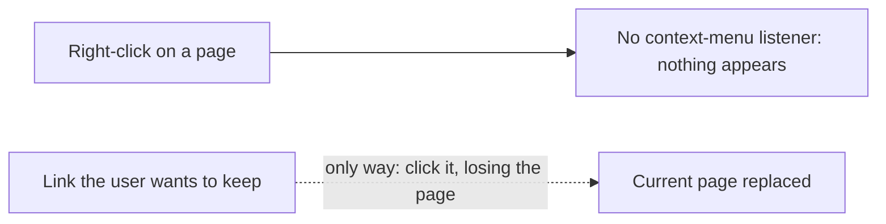
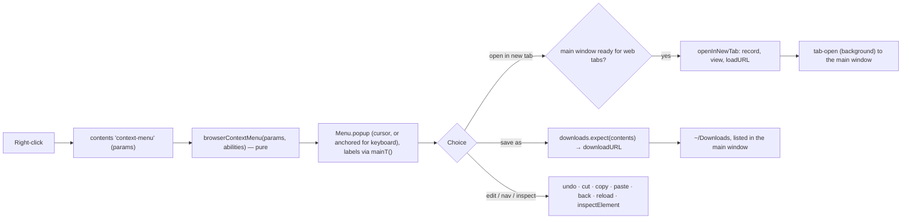
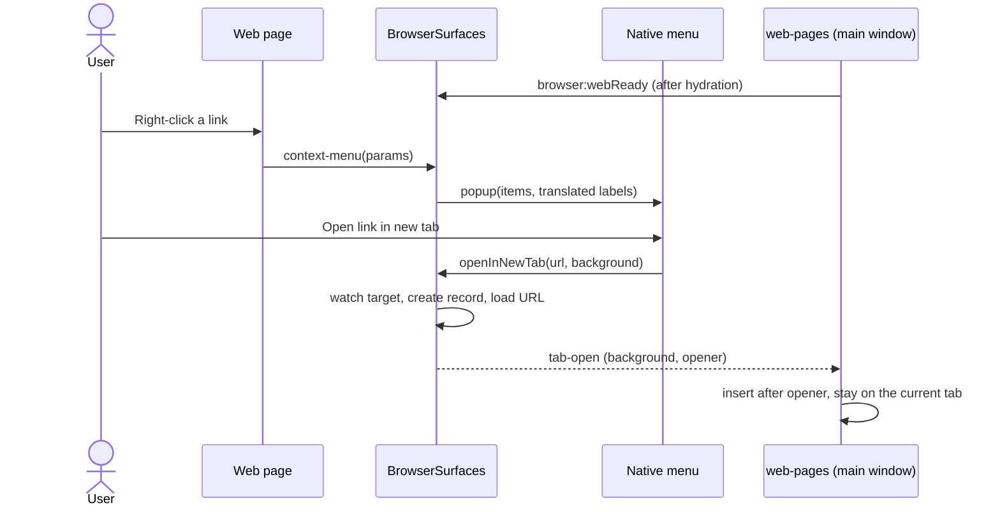

# Right-click menu for web pages

## Status

| Unit           | Result                                                                                                                                                                                                                                                                                                                                             |
| -------------- | -------------------------------------------------------------------------------------------------------------------------------------------------------------------------------------------------------------------------------------------------------------------------------------------------------------------------------------------------- |
| Questions      | Answered by the user on 2026-10-10; every default accepted                                                                                                                                                                                                                                                                                         |
| Research       | Claude read Electron 43.2's `ContextMenuParams`, the page methods, `Menu.popup`, and the renderer's i18n                                                                                                                                                                                                                                           |
| Plan challenge | Codex returned nine supported findings, all folded in below: lifecycle watch and a ready handshake for the main window, refusal and cleanup paths, a Google-only search helper, password and editable rules, keyboard placement, `data:`/`blob:` image copy, project-panel saves into the Downloads list, and the out-of-process iframe limitation |
| Plan approval  | Approved 2026-10-10                                                                                                                                                                                                                                                                                                                                |
| Implementation | Codex, 16 files. Claude reviewed every file against the plan. One spec adjustment: `browserSearchUrl` takes an optional limit, so menu searches cap at 2048 and the address bar keeps 8192. Claude applied one lint fix (optional chain in the menu guard) and Prettier to four files                                                              |
| Verification   | `pnpm check` passes: typecheck 18/18, lint, format, `workbench:check`, 3780 tests. The app was not launched; menu behaviour is NOT VERIFIED                                                                                                                                                                                                        |

## Decisions taken with the user

| Question             | Answer                                                                                                                                                                                                                                                        |
| -------------------- | ------------------------------------------------------------------------------------------------------------------------------------------------------------------------------------------------------------------------------------------------------------- |
| Where                | Web tabs and the project browser panel                                                                                                                                                                                                                        |
| Open link in new tab | Opens a **background** web tab and keeps the current page. From a project panel in a detached window, the tab opens in the main window, where web tabs live                                                                                                   |
| Items                | Link: open in new tab, open in system browser, copy address, save as. Image: open in new tab, copy, copy address, save as. Selection: copy, search Google. Editable: undo, redo, cut, copy, paste, select all. Always: back, forward, reload, inspect element |
| Drawn by             | Electron's native `Menu.popup`, from main                                                                                                                                                                                                                     |
| Labels               | Translated: main creates its own `i18next` instance over the renderer's `en.json`                                                                                                                                                                             |
| Saves                | Straight to `~/Downloads`, no dialog, from both surfaces. They appear in the web tabs' Downloads list in the main window                                                                                                                                      |

**Not doing:** spelling suggestions, menus in popup windows, menus inside Chorus's own UI.

**Known limitation:** Electron sends "Copy image" and "Inspect element" through the page's main frame. For an image or element inside a cross-origin iframe that runs in its own process, copy can miss the image and inspect can select the iframe itself. The image's other actions (open, copy address, save) still work, because they use its URL.

## Current / Issue



## Proposed



## Code Changes

### NEW `apps/desktop/src/main/browser-context-menu.ts`

The menu as data, testable without Electron:

```ts
export type BrowserMenuAction =
  | 'link-new-tab'
  | 'link-external'
  | 'link-copy'
  | 'link-save'
  | 'image-new-tab'
  | 'image-copy'
  | 'image-copy-address'
  | 'image-save'
  | 'selection-copy'
  | 'selection-search'
  | 'undo'
  | 'redo'
  | 'cut'
  | 'copy'
  | 'paste'
  | 'select-all'
  | 'back'
  | 'forward'
  | 'reload'
  | 'inspect'

export type BrowserMenuItem =
  | { readonly kind: 'separator' }
  | { readonly kind: 'item'; readonly id: BrowserMenuAction; readonly enabled: boolean }

export interface BrowserMenuAbilities {
  readonly canGoBack: boolean
  readonly canGoForward: boolean
  readonly canOpenTab: boolean
}

export type BrowserMenuParams = Pick<
  ContextMenuParams,
  | 'linkURL'
  | 'srcURL'
  | 'mediaType'
  | 'hasImageContents'
  | 'isEditable'
  | 'selectionText'
  | 'editFlags'
  | 'formControlType'
>

export function browserContextMenu(
  params: BrowserMenuParams,
  abilities: BrowserMenuAbilities
): BrowserMenuItem[]
```

Groups, each shown only when it applies, with separators only between non-empty groups:

- **Link** when `isBrowserNavigable(linkURL)`. A linked image shows both the link and the image group.
- **Image** when `mediaType === 'image'`. `image-copy` is enabled by `hasImageContents` alone, so `data:` and `blob:` images can still be copied. The URL actions (new tab, copy address, save) appear only for a navigable `srcURL`.
- **Selection** when `selectionText.trim()` is non-empty. Not editable: `selection-copy` and `selection-search`. Editable: `selection-search` only, since the editable group already has Copy. A password field (`formControlType === 'input-password'`) gets no search.
- **Editable** when `isEditable`, each item enabled from `editFlags`. Cut and Copy are always disabled in a password field, even a revealed one.
- **Navigation**, always last.

New-tab items and search are disabled when `canOpenTab` is false.

### NEW `apps/desktop/src/main/i18n.ts`

```ts
import i18next from 'i18next'
import en from '../renderer/src/i18n/en.json'

const instance = i18next.createInstance()
void instance.init({
  resources: { en: { translation: en } },
  lng: 'en',
  fallbackLng: 'en',
  interpolation: { escapeValue: false },
})

export const mainT = instance.t.bind(instance)
```

With bundled resources, i18next 26.3.6 initializes synchronously, so `mainT` is ready on first use. Codex checked this against the installed source. Same keys and interpolation as the renderer.

### `apps/desktop/src/shared/browser-ipc.ts`

```ts
export const BROWSER_SEARCH_MAX = 2048

export function browserSearchUrl(text: string): string | null {
  const query = text.trim().slice(0, BROWSER_SEARCH_MAX)
  if (query === '') return null
  const url = `${SEARCH_URL}${encodeURIComponent(query)}`
  return url.length <= BROWSER_URL_MAX ? url : null
}
```

`browserAddressOrSearch` reuses it for its search fallback, so the address bar is unchanged and "Search Google" always searches, even for selected text such as `example.com`. `tab-open`'s `openerWebTabId` becomes `BrowserWebTabId.nullable()`. New channel: `browser:webReady` (`{}` → `{ ok: true }`), main window only.

### `apps/desktop/src/main/browser-surface.ts`

- **Ready handshake.** A `WeakSet<WebContents>` of owners whose renderer is ready for web tabs. `browser:webReady` adds the caller; `closeOwner` removes it. `canOpenTabIn(target)` means the target is ready and `mayOpenWeb(target)`.
- **Listener.** `observe()` adds `contents.on('context-menu', (_event, params) => this.contextMenu(record, contents, params))` for both scopes, on primary pages only. There is no existing listener to conflict with, and a page that calls `preventDefault` on `contextmenu` gets no menu, as in Chrome.
- **`contextMenu()`.**
  - Resolve the parent with `BrowserWindow.fromWebContents(record.owner)`; return without a menu if it is null or destroyed, or the record is closed.
  - Build the items and map each id to `{ label, enabled, click }`. The search label is `mainT('browserMenu.selection-search', { text })`, with the text capped at 40 characters **for the label only**.
  - Popup options: `{ window: parent, sourceType: params.menuSourceType, frame: params.frame }`. For a keyboard-invoked menu, also `x`/`y`: the view's bounds plus `params.x`/`params.y`. A mouse menu takes no x/y, so it appears at the cursor.
  - Every click first checks the record is open and `contents` not destroyed.
- **Actions.**
  - `link-new-tab` / `image-new-tab` → `openInNewTab(record, url, true)`. `selection-search` → `openInNewTab(record, browserSearchUrl(selection), false)`, in the foreground, as Chrome does.
  - `link-external` → `shell.openExternal(url)`. `link-copy` / `image-copy-address` → `clipboard.writeText`. `image-copy` → `contents.copyImageAt(params.x, params.y)`; those coordinates are already relative to the page, with no window offset. `selection-copy` → `contents.copy()`.
  - `link-save` / `image-save` → `deps.downloads.expect(contents)`, then `contents.downloadURL(url)`.
  - Editable items call `contents.undo()` and the rest. Navigation uses `navigationHistory` and `reload()`. `inspect` → `openDevTools({ mode: 'detach' })`, then `inspectElement(params.x, params.y)`.
- **`openInNewTab(source, url, background)`.**
  - Target: the source's owner if that is the main window, else `deps.mainOwner()`. Return if `!canOpenTabIn(target)`.
  - Call `watch(target)`, then `createRecord` with a fresh `webTabId`.
  - `ensureView` it. If that fails, release the record and return.
  - `loadURL(url).catch(() => undefined)` right away; a background tab loads, as in Chrome. `savePage` it.
  - Push `tab-open` to the target with `background` and `openerWebTabId`: the source's web-tab id, or `null` from a project panel.
  - The view starts hidden with `wanted` false, so it fits the engine's visibility rules and keeps background throttling.

`BrowserSurfaceDeps` gains `mainOwner: () => WebContents | null` and `downloads: { expect(contents: WebContents): void }`, wired in `index.ts`.

### `apps/desktop/src/main/browser-downloads.ts`

`expect(contents)` records one pending explicit save for that contents. `claim()` takes an item when `ownerOf` maps its contents, as today, **or** when it was expected. An expected item is listed under `deps.mainOwner()`'s Downloads, so saves from any project panel appear in the web tabs' list. An expectation is consumed by the next item from that contents, or dropped after 10 s. Ordinary project-panel downloads keep Electron's default dialog, unchanged.

### `apps/desktop/src/main/browser-ipc.ts` and `apps/desktop/src/preload/index.ts`

Register `browser:webReady` (main role only) and expose `announceWebReady()`.

### `apps/desktop/src/renderer/src/workspace/web-pages.ts`

`startWebPages` calls `announceWebReady()` once the workspace is hydrated. A `null` opener already appends at the end through the existing `findIndex` fallback, so `tab-open` handling is unchanged.

### `apps/desktop/src/renderer/src/i18n/en.json`

A `browserMenu` block with one label per `BrowserMenuAction`, the search label taking `{{text}}`.

### Tests

| File                                | Cases                                                                                                                                                                                                                                                                                                                                                                                 |
| ----------------------------------- | ------------------------------------------------------------------------------------------------------------------------------------------------------------------------------------------------------------------------------------------------------------------------------------------------------------------------------------------------------------------------------------- |
| `main/browser-context-menu.test.ts` | Each group only when it applies; separators only between groups; linked image shows both groups; `data:` image keeps Copy image and loses its URL actions; non-navigable link gives no link group; editable items follow `editFlags`; password field has no cut, copy or search; editable selection has search and no duplicate Copy; `canOpenTab: false` disables new-tab and search |
| `main/browser-surface.test.ts`      | `openInNewTab` from a web tab pushes `tab-open` with the opener; from a detached project panel it targets `mainOwner()` with a `null` opener; nothing is created before `webReady` or at the cap; the target is watched, so a reload releases the new record; a failed mount releases it; a closed record's menu click does nothing                                                   |
| `main/browser-downloads.test.ts`    | An expected project-panel save is claimed into `~/Downloads` and listed under the main owner; an unexpected project download is left to the default; an expectation expires                                                                                                                                                                                                           |
| `main/i18n.test.ts`                 | Every `BrowserMenuAction` has a label; search interpolates `{{text}}`                                                                                                                                                                                                                                                                                                                 |
| `shared/browser-ipc.test.ts`        | `browserSearchUrl` searches `example.com` and bounds the query; `browserAddressOrSearch` still navigates `example.com`; `tab-open` accepts a `null` opener                                                                                                                                                                                                                            |

## Acceptance

| Criterion                                                                                                       | Result       |
| --------------------------------------------------------------------------------------------------------------- | ------------ |
| Right-click a link in a web tab: "Open link in new tab" adds a background tab and the page stays                | NOT VERIFIED |
| The same from a project browser panel, including in a detached window                                           | NOT VERIFIED |
| Image, selection, editable and navigation groups appear only where they apply; password fields never offer copy | NOT VERIFIED |
| "Search Google" always searches                                                                                 | Helper test  |
| Saves from either surface land in `~/Downloads` and appear in the Downloads list                                | NOT VERIFIED |
| Labels come from `en.json`                                                                                      | Test         |
| `pnpm check` passes                                                                                             | NOT RUN      |

## Final Flow


