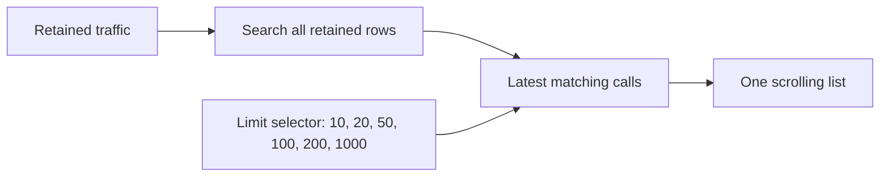
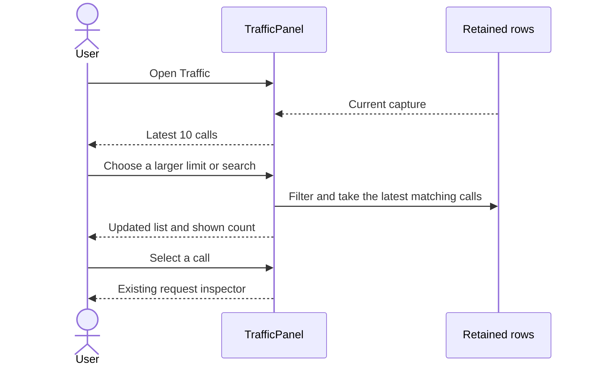

# Traffic call limit

## Status

| Unit           | Result                                                       |
| -------------- | ------------------------------------------------------------ |
| Scope          | Latest 10 calls by default, with an adjustable display limit |
| Implementation | Written and diff reviewed; runtime behavior unverified       |
| Verification   | Not run; the user has not requested tests                    |

## Current / Issue

```tsx
const paged = pageOf(filterRows(stream.rows, search), page)
const shown = paged.rows
```

The list uses 200-row pages and Older/Newer controls.

## Proposed



The display limit is local to the panel. Capture retention stays available when the limit increases. An initial selection belongs to the visible window; an already selected request stays open while new calls arrive.

## Code Changes

### `apps/desktop/src/renderer/src/TrafficPanel.tsx`

```tsx
const DEFAULT_CALL_LIMIT = 10
const CALL_LIMITS = [DEFAULT_CALL_LIMIT, 20, 50, 100, 200, 1000]

const [callLimit, setCallLimit] = useState(DEFAULT_CALL_LIMIT)
const filtered = filterRows(stream.rows, search)
const shown = filtered.slice(-callLimit)
```

Replace paging state and navigation with the limit selector. Report `shown.length` in the existing count label. Preserve scrolling, keyboard selection, capture controls, and the request inspector.

### `apps/desktop/src/renderer/src/i18n/en.json`

```json
{
  "callLimit": "Call limit",
  "lastCalls": "Last {{limit}} calls"
}
```

## Final Flow


