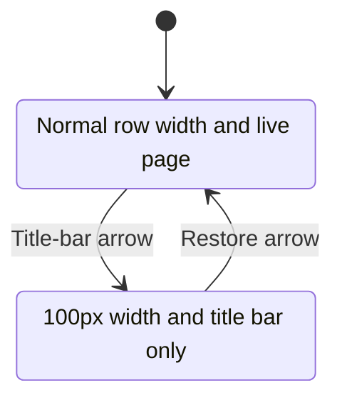
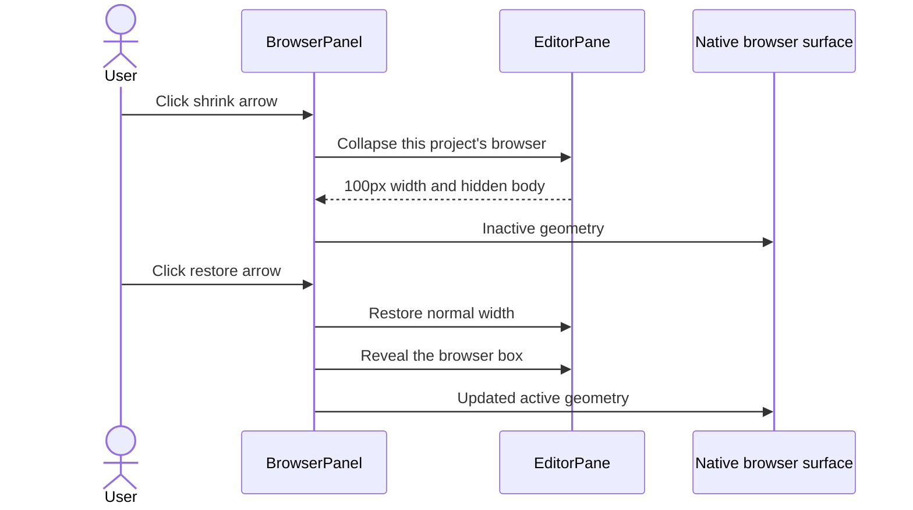

# Browser width toggle

## Status

| Unit           | Result                                                                                   |
| -------------- | ---------------------------------------------------------------------------------------- |
| Scope          | Top-right title-bar arrow toggles the project browser between its normal width and 100px |
| Implementation | Written and diff reviewed; runtime behavior unverified                                   |
| Verification   | Not run; the user has not requested tests                                                |

## Current / Issue

The project browser uses the horizontal row's viewport width. Its title bar has no shrink control.

## Proposed



Collapse is local to each project in the open pane. The browser remains attached; its native surface is hidden through the existing geometry API. Expansion reveals the restored browser in the horizontal row.

## Code Changes

### `apps/desktop/src/renderer/src/workspace/EditorPane.tsx`

```tsx
const COLLAPSED_BROWSER_WIDTH = 100
const [collapsedBrowsers, setCollapsedBrowsers] = useState<Readonly<Record<string, boolean>>>({})
const browserCollapsed = projectId !== null && collapsedBrowsers[projectId] === true
```

Set the browser box's flex basis to `COLLAPSED_BROWSER_WIDTH` when collapsed, otherwise `rowWidth`. Pass each project's collapsed flag and toggle callback to its existing `BrowserPanel`.

### `apps/desktop/src/renderer/src/BrowserPanel.tsx`

```tsx
const visible = active && !collapsed

<button
  type="button"
  className="conversation-dock-toggle"
  aria-expanded={!collapsed}
  aria-controls={bodyId}
  aria-label={collapsed ? t('browser.expand') : t('browser.collapse')}
  title={collapsed ? t('browser.expand') : t('browser.collapse')}
  onClick={() => {
    revealAfterExpand.current = collapsed
    markTouched(projectId)
    onToggleCollapsed()
  }}
>
  <span aria-hidden="true">{collapsed ? '▸' : '◂'}</span>
</button>
```

Hide the browser body, cancel queued measurements, and report inactive geometry while collapsed. Keep attachment and page state intact. Reveal the box after an explicit expansion before measuring the native surface.

### `apps/desktop/src/renderer/src/i18n/en.json`

```json
{
  "collapse": "Shrink browser to 100px",
  "expand": "Expand browser"
}
```

## Final Flow


