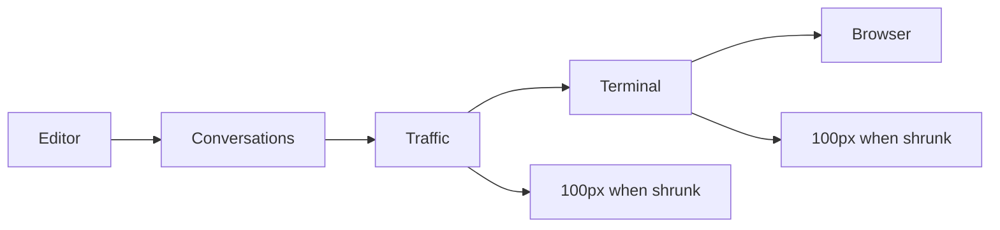
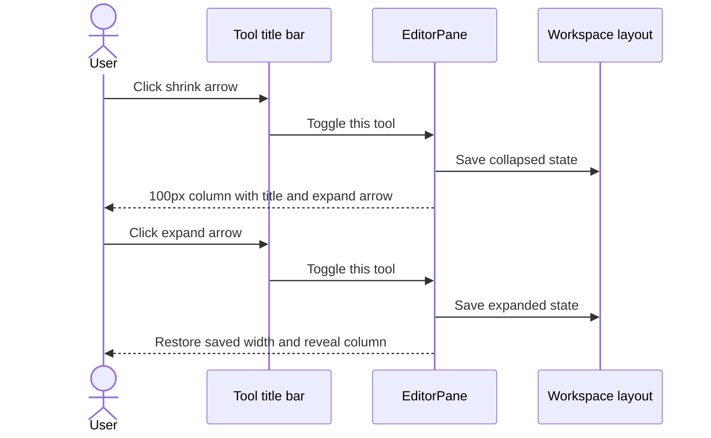

# Traffic and Terminal beside each other

## Status

| Unit           | Result                                                               |
| -------------- | -------------------------------------------------------------------- |
| Scope          | Separate Traffic and Terminal columns with independent shrink arrows |
| Implementation | Written and diff reviewed; runtime behavior unverified               |
| Verification   | Not run; the user has not requested tests                            |

## Current / Issue

Traffic and Terminal share one column and split its height. Their arrows hide their bodies without reducing the column's width.

## Proposed



Each tool uses its own saved width and collapse state. Its title-bar arrow shrinks it to 100px or restores its saved width. The expanded terminal retains enough width for its Run and shell slots. Restoring a column reveals it in the horizontal row.

Traffic stays mounted to retain its selection, subscriptions and Run controls. Terminal keeps its existing detach-only behavior while collapsed. The existing per-project collapse fields continue to be saved through `commitLayout`.

## Code Changes

### `apps/desktop/src/renderer/src/workspace/EditorPane.tsx`

```tsx
const COLLAPSED_TOOL_WIDTH = 100
const terminalMinimum = projectTerminalMinimum(terminalPane.shells.length)
```

Render `traffic-box` and `project-terminal-box` as sibling columns with a resize sash between them. Use Traffic's own width floor and `projectTerminalWidth` for Terminal. Set `data-collapsed` on each column. Apply collapse updates before measuring the restored column for reveal.

### `apps/desktop/src/renderer/src/ProjectTerminalPane.tsx`

```tsx
<span aria-hidden="true">{collapsed ? '▸' : '◂'}</span>
```

Use horizontal arrows for both tools. Hide Terminal's status and add-shell button in its narrow header so the title and expand arrow fit.

### `apps/desktop/src/renderer/src/workspace/row-drag.ts`

```ts
if (element.getAttribute('data-collapsed') === 'true') return 'fixed'
```

Treat collapsed columns as fixed items so divider gestures preserve their 100px width and stored expanded widths.

### `apps/desktop/src/renderer/src/styles.css`

Give both columns the same flex column layout with `min-width: 0`. Replace the stacked-section rules with narrow-header spacing and hidden-body rules for both tools.

### `apps/desktop/src/renderer/src/i18n/en.json`

```json
{
  "traffic": { "collapse": "Shrink Traffic to 100px" },
  "runPane": { "collapse": "Shrink Terminal to 100px" }
}
```

## Final Flow



The five source-file diffs were reviewed against the pre-edit copy in `/private/tmp/traffic-terminal-columns-3ywyc1vo`, then against the existing Git changes. Source review covered independent width floors, fixed collapsed items, hidden bodies, terminal detach ownership and translated arrow labels. Tests, typechecks, builds and live UI verification were not run.
