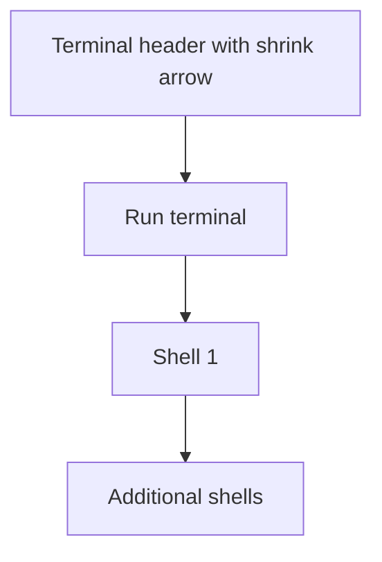

# Shell below Run

## Status

| Unit           | Result                                                         |
| -------------- | -------------------------------------------------------------- |
| Scope          | Place shell views below Run while retaining tool shrink arrows |
| Implementation | Written and diff reviewed; runtime behavior unverified         |
| Verification   | Not run; the user has not requested tests                      |

## Current / Issue

`ProjectTerminalPane` renders Run first, then the project's shells. The surrounding `.project-terminal-slots` flex row puts them beside each other. Traffic and Terminal already have independent arrows that shrink their columns to 100px.

## Proposed

Keep the existing DOM order and use a flex column. Run appears above Shell 1, with additional shells below it. Each row shares the available height and fills the existing terminal column's width. The divider becomes horizontal. Retain the current Traffic and Terminal shrink controls and their saved collapse state.

## Code Changes

### `apps/desktop/src/renderer/src/styles.css`

```css
.project-terminal-slots {
  display: flex;
  flex: 1 1 auto;
  flex-direction: column;
  min-height: 0;
}

.project-terminal-slot + .project-terminal-slot {
  border-top: 1px solid var(--border-default);
}
```

Reuse the existing slot sizing and terminal resize observers. The change applies to both idle Run content and live terminal views.

### `apps/desktop/src/renderer/src/i18n/en.json`

```json
{
  "runPane": { "split": "Open another shell below these" }
}
```

Update the add-shell tooltip to describe where the new shell opens.

## Final Flow



The source diff was reviewed against `/private/tmp/run-shell-rows-z2e7911z`. The existing Run-first DOM order, equal-height slot sizing and Traffic/Terminal shrink controls remain in use. Tests, typechecks, builds and live UI verification were not run.
