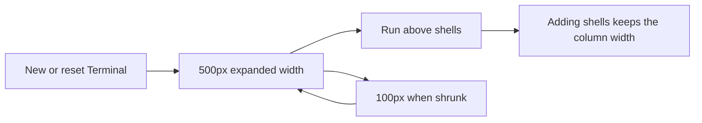

# Terminal default width of 500px

## Status

| Unit           | Result                                                     |
| -------------- | ---------------------------------------------------------- |
| Scope          | Set Terminal's default width to 500px for its stacked rows |
| Implementation | Written and diff reviewed; runtime behavior unverified     |
| Verification   | Not run; the user has not requested tests                  |

## Current / Issue

Terminal's stored default is 640px. Its rendered minimum still adds Run's 640px and 320px per shell, despite the views now being stacked. This forces one shell to render at least 960px wide and makes adding shells widen the column.

## Proposed

Set the shared default to 500px. Keep the existing 480px resize floor and use it for Run's row. Compute the terminal minimum from the widest row rather than adding their widths. New and reset terminals use 500px. Saved custom widths continue to be used. The existing 100px shrink behavior is independent of the expanded width.

## Code Changes

### `apps/desktop/src/shared/workspace-layout.ts`

```ts
export const PROJECT_TERMINAL_WIDTH = { default: 500, min: 480, run: 480, slot: 320 } as const
```

The existing default state, invalid-width fallback and reset action already read this constant.

### `apps/desktop/src/renderer/src/workspace/layout.ts`

```ts
export function projectTerminalMinimum(shells: number): number {
  return Math.max(PROJECT_TERMINAL_WIDTH.run, shells > 0 ? PROJECT_TERMINAL_WIDTH.slot : 0)
}
```

The existing render, divider and shell-add paths already use this helper, so additional stacked shells no longer demand a wider column.

### Existing width assertions

Update the existing default, reset and shell-add expectations in `layout.test.ts` and `store.test.ts` to reflect 500px defaults and a shell-count-independent minimum. Keep wider saved widths covered. Do not run tests.

## Final Flow



The four source and assertion diffs were reviewed against `/private/tmp/terminal-default-width-mh6n6hi2`. The default, fallback, reset, rendered minimum and shell-add paths use the shared values. Existing 100px collapse handling remains independent. Tests, typechecks, builds and live UI verification were not run.
