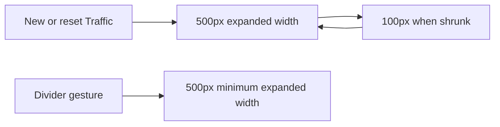

# Traffic default width of 500px

## Status

| Unit           | Result                                                 |
| -------------- | ------------------------------------------------------ |
| Scope          | Set Traffic's default and minimum widths to 500px      |
| Implementation | Written and diff reviewed; runtime behavior unverified  |
| Verification   | Not run; the user has not requested tests               |

## Current / Issue

Traffic's shared width setting defaults to 800px and also enforces an 800px minimum. Changing just the default would still render the panel at least 800px wide.

## Proposed

Set both values to 500px. The existing default state, normalization, render width, resize handlers and reset action already use this setting. New and reset Traffic panes open at 500px. Existing custom widths continue to be used. The 100px shrink arrow uses its separate collapsed width.

## Code Changes

### `apps/desktop/src/shared/workspace-layout.ts`

```ts
export const TRAFFIC_WIDTH = { default: 500, min: 500 } as const
```

### Existing width assertions

Update the default and minimum descriptions in `layout.test.ts` and `store.test.ts`. Update the divider fixtures in `row-drag.test.ts` that represent Traffic at its minimum to 500px. Keep wider stored-width cases covered. Do not run tests.

## Final Flow



The four code and assertion diffs were reviewed against `/private/tmp/traffic-default-width-xqwgyoyb`. The existing default, normalization, render, divider and reset paths read the shared width setting. Tests, typechecks, builds and live UI verification were not run.
