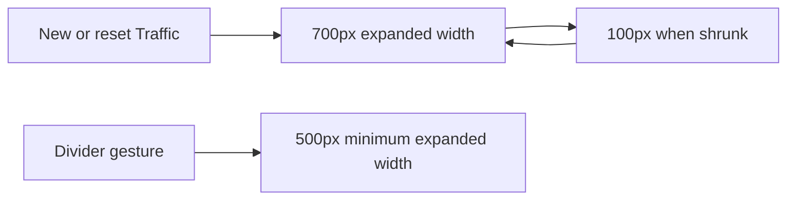

# Traffic default width of 700px

## Status

| Unit           | Result                                                            |
| -------------- | ----------------------------------------------------------------- |
| Scope          | Set Traffic's default width to 700px                              |
| Implementation | Written and diff reviewed; runtime behavior unverified            |
| Verification   | Local build and installation passed; tests and live UI unverified |

## Current / Issue

Traffic's shared width setting defaults to 500px. The requested default is 700px.

## Proposed

Set the default to 700px. The existing default state, normalization and reset action already use this setting. New and reset Traffic panes open at 700px. Existing custom widths continue to be used, with a 500px minimum. The 100px shrink arrow uses its separate collapsed width.

## Code Changes

### `apps/desktop/src/shared/workspace-layout.ts`

```ts
export const TRAFFIC_WIDTH = { default: 700, min: 500 } as const
```

### Existing width assertions

Update the existing default-width assertions in `layout.test.ts` and `store.test.ts` to 700px, including normalization, collapse and reset expectations. Do not run tests.

## Final Flow



The shared default and existing layout and store assertions were updated and diff reviewed. Tests, typechecks, builds and live UI verification were not run.

On 2026-10-15, the local build, signed packaging and installation passed. See the [installation record](50-traffic-endpoint-tooltip.md). Reopen Chorus to load the update. Tests and live UI checks remain unrun.
