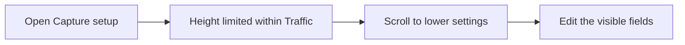

# Scrollable Traffic capture setup

## Status

| Unit           | Result                                                |
| -------------- | ----------------------------------------------------- |
| Scope          | Make the pictured Capture setup section scrollable    |
| Implementation | Written and diff reviewed; runtime behavior unverified |
| Verification   | Build and installation passed; tests and live UI unverified |

## Current / Issue

Capture setup is an unbounded `<details className="traffic-setup">` inside the fixed-height Traffic panel. Long field hints increase its height at the 500px panel width. The panel clips overflow, leaving the lower settings inaccessible.

## Proposed

Use the existing command setup form's sizing pattern. Let Capture setup shrink, cap it at half the panel's height, and scroll overflowing content vertically. The section retains its native disclosure control and existing field labels. The header, request list and detail views keep their existing layout.

## Code Changes

### `apps/desktop/src/renderer/src/styles.css`

```css
.traffic-setup {
  flex: 0 1 auto;
  min-height: 0;
  max-height: 50%;
  overflow-y: auto;
}
```

The existing row wheel handler passes vertical gestures through to their target. Reuse native scrolling and the existing flex height constraints.

## Final Flow



The stylesheet diff was reviewed against `/private/tmp/traffic-setup-scroll-j2b6_m9_/styles.css`. Source review confirmed that the section uses the existing command setup sizing pattern and vertical wheel gestures pass through the row handler.

On 2026-10-11, the user requested build and installation. `pnpm exec turbo run build --filter=@chorus/desktop` succeeded. `node build/package-local.mjs` packaged the arm64 app with the `Chorus Local Dev` signature. The installer copied it to `/Applications/Chorus.app` and completed its code-signature verification. Both commands exited 0.

Installation used `CHORUS_INSTALL_KEEP_RUNNING=1`, retaining the current session and moving its old bundle to `/Applications/Chorus.app.replaced-1791721277776`. Quit and reopen `/Applications/Chorus.app` to use the new build. Tests, standalone typecheck gates and live UI verification were not run.
