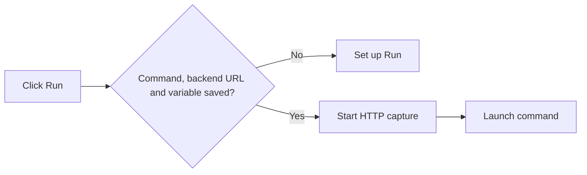
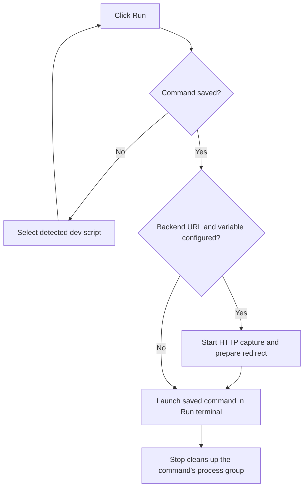

# Run commands without HTTP capture

## Status

| Unit           | Result                                                                                                                                                       |
| -------------- | ------------------------------------------------------------------------------------------------------------------------------------------------------------ |
| Scope          | Run the project's saved command without requiring Forward to or a variable                                                                                   |
| Evidence       | Renderer setup and runner validation both require Traffic settings; the root dev script already starts Chorus                                                |
| Implementation | Written; renderer requirements, runner capture branch, optional field copy and recording ownership updated                                                   |
| Review         | Changes reviewed against `/private/tmp/run-optional-capture-6r2z7jmg`; unrelated workspace edits preserved                                                   |
| Verification   | Runner and renderer regressions written; desktop build, local packaging, signing and installation passed; tests, separate typechecks and live behavior unrun |
| Installation   | 2026-10-11: Signed arm64 build installed at `/Applications/Chorus.app`; current session kept running                                                         |

The requested build and installation used `pnpm exec turbo run build --filter=@chorus/desktop`, then `node build/package-local.mjs` and `env CHORUS_INSTALL_KEEP_RUNNING=1 CHORUS_INSTALL_DIR=/Applications node build/install-local.mjs` from `apps/desktop`. All commands exited successfully. The installer verified the installed signature and retained the running bundle at `/Applications/Chorus.app.replaced-1791724520534`. Quit and reopen Chorus to load the new build.

## Current / Issue



`TrafficPanel.tsx` includes the origin and variable in `needsSetup`. `ProjectRunner.validate` rejects their absence before spawning. Chorus has a working `pnpm run dev` script and does not need a backend redirect to start. The screenshot's Shell SIGINT is a separate interruption; its sender is unproven.

## Proposed

Run requires a saved command. Start automatic HTTP capture only when the backend URL and variable are both configured. Keep validation of nonempty variable names, and stop a recording through Run only when that run used capture. Existing configured projects continue to capture before launching and refuse capture failures.

## Code Changes

### `apps/desktop/src/main/project-run.ts`

```ts
const variable = project.trafficEnvVar
if (variable !== null && !TRAFFIC_ENV_NAME.test(variable)) return 'no-variable'
const captureTraffic =
  project.trafficOrigin !== null && project.trafficOrigin !== '' && variable !== null
return { cwd: project.canonicalRoot, shell, active, captureTraffic }
```

Carry `captureTraffic` in the prepared command and run. Skip starting Traffic for a plain run. Pass a nullable redirect to the existing spawn path: a plain command retains its environment and executes `set +m; ${command}`, while capture uses the existing export after shell startup. Stop and restart retain process-group cleanup.

### `apps/desktop/src/renderer/src/TrafficPanel.tsx`

```tsx
const needsSetup = confirmed === null

<p className="traffic-field-hint">{t('run.captureHint')}</p>
```

Blank capture fields are optional. Nonempty invalid variables still display an error. Reuse the existing command selector and persistence; selecting the detected dev script enables Run.

### `apps/desktop/src/renderer/src/i18n/en.json`

```json
"origin": "Forward to (optional)",
"variable": "Variable your app reads (optional)",
"captureHint": "Run works without HTTP capture. Set both a backend URL and the variable your app reads to capture requests when you run."
```

### Existing runner and panel tests

```ts
projects.set('p1', project({ trafficOrigin: null, trafficEnvVar: null }))
expect((await runner.run('p1')).process.kind).toBe('running')
expect(traffic.starts).toBe(0)
expect(terminals.launches[0]?.spec.args.at(-1)).toBe('set +m; npm run dev:clean')
```

Cover each missing capture field, plain-run spawn failures, Stop and Restart preserving an independent recording, and Run becoming available after command detection without Traffic settings. Update the prior missing-field assertions. Write these regressions without running them.

## Final Flow


