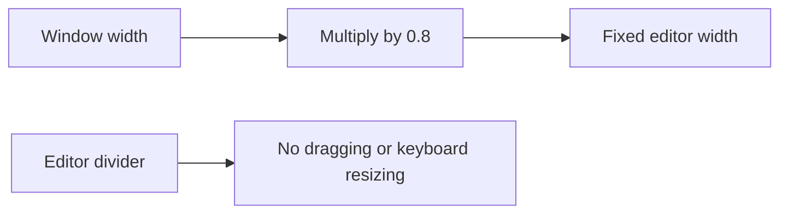
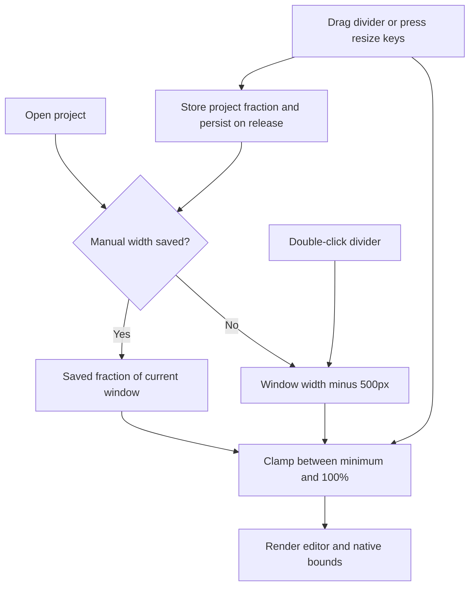

# Resizable editor up to the window width

## Status

| Unit | Result |
| --- | --- |
| Scope | Default editor width: window width minus 500px; resize up to 100% of the window |
| Evidence | `EditorPane` derives a fixed 80% width; its divider has `data-fixed` and no resize handlers |
| Implementation | Written: draggable and keyboard-accessible editor divider, bounded widths, saved project fractions and updated default |
| Review | Product and regression diffs reviewed against `/private/tmp/editor-resize-nqr0d45a`; existing unrelated edits preserved |
| Verification | Regressions written for bounds, window resizing, reset, persistence and older snapshots; desktop build, local packaging, signing and installation passed; tests, separate typechecks and live UI unrun |
| Installation | 2026-10-11: Signed arm64 build installed at `/Applications/Chorus.app`; current session kept running |

Build and installation commands and the retained running bundle are recorded in [plan 31](31-run-without-http-capture.md#status). Quit and reopen Chorus to load the new build.

## Current / Issue



## Proposed

Save a manual width as a per-project window fraction in the existing workspace snapshot. An unset width follows `window width - 500px`. Keep the existing 500px minimum where the window permits it; the 100% ceiling wins on smaller windows. Keep the current native viewport clipping and horizontal row scrolling.

## Code Changes

### `apps/desktop/src/shared/workspace-layout.ts`

```ts
export const EDITOR_WIDTH = { defaultOffset: 500, min: 500, maxFraction: 1 } as const

editorWidthFractions: z.record(z.string(), z.number()).default({}),
```

The project layout slice gains an optional `editorWidthFraction` so detaching and reattaching carries the choice. Older workspace files default to an empty record; obsolete pixel `editorWidths` remain ignored.

### `apps/desktop/src/renderer/src/workspace/layout.ts`

```ts
export function clampEditorWidth(width: number, windowWidth: number): number {
  const maximum = Number.isFinite(windowWidth)
    ? Math.max(0, Math.floor(windowWidth * EDITOR_WIDTH.maxFraction))
    : 0
  const wanted = Number.isFinite(width) ? Math.round(width) : maximum - EDITOR_WIDTH.defaultOffset
  return Math.min(maximum, Math.max(EDITOR_WIDTH.min, wanted))
}

export function editorWidthIn(windowWidth: number, fraction?: number): number {
  const saved = fraction === undefined ? undefined : clampEditorWidthFraction(fraction)
  const wanted = saved === undefined ? windowWidth - EDITOR_WIDTH.defaultOffset : windowWidth * saved
  return clampEditorWidth(wanted, windowWidth)
}
```

Initialize, normalize and carry the new record through the existing snapshot and project-slice helpers. Derive the current pixel width during rendering rather than copying it into React state.

### Workspace store and hooks

`store.ts` exposes `setEditorWidthFraction`, includes the record in persisted snapshots, and clears one project's override when resetting widths. `hooks.ts` exposes the action and a selector for one project's fraction.

### `apps/desktop/src/renderer/src/workspace/row-drag.ts`

Reuse the existing pointer-capture, synchronous resize and commit-on-release pattern in a dedicated editor resize handler. Clamp every pointer and keyboard result. Arrow keys use the current 8px/40px steps; Home selects the minimum and End selects the window width. Chat, Traffic and Terminal row resizing keeps its current path.

### `apps/desktop/src/renderer/src/workspace/EditorPane.tsx`

```tsx
const editorFraction = useEditorWidthFraction(projectId)
const editorWidth = editorWidthIn(windowWidth, editorFraction)
```

Wire the editor's existing separator to the new handlers, with a translated label and accessible min/max/current values. Its existing double-click reset also restores the new editor default.

### `apps/desktop/src/renderer/src/i18n/en.json`

```json
"resizeEditor": "Resize editor — double-click to reset widths"
```

### Existing tests

Write regressions for the 500px default offset, resize bounds, shrinking windows, drag and keyboard behavior, persistence and detach/return, and older snapshots retaining open conversations. Preserve other panel width fixtures. Do not run the tests unless requested.

## Final Flow


