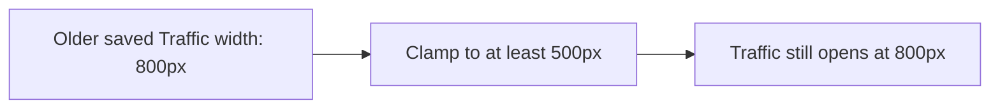
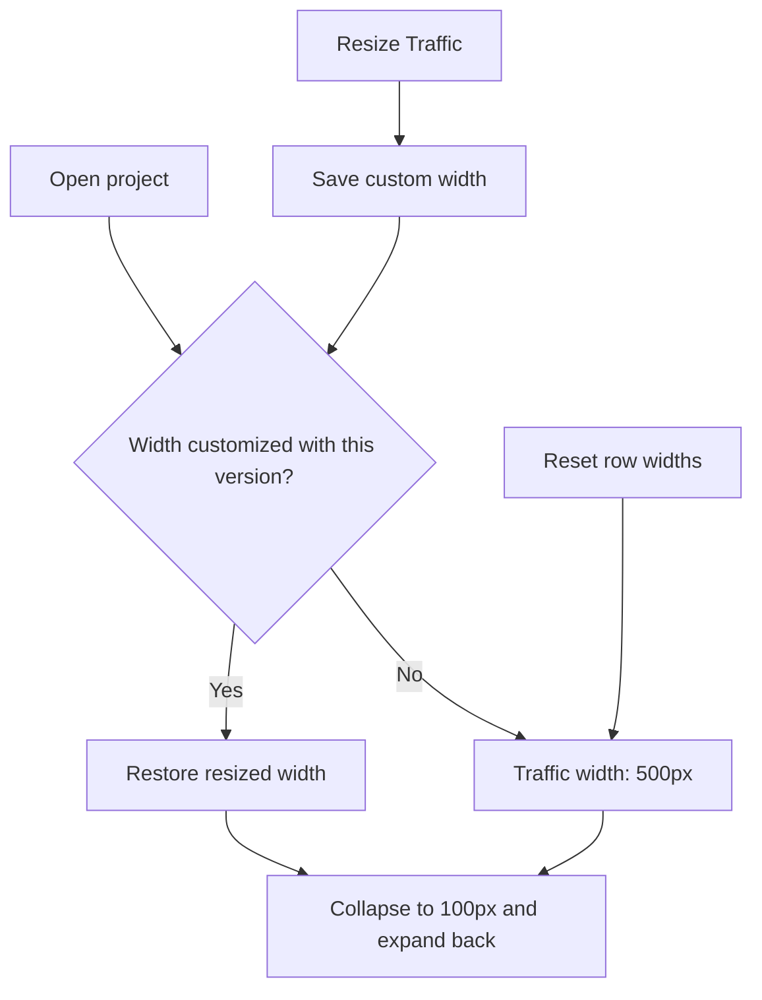

# Traffic opens at 500px for existing projects

## Status

| Unit           | Result                                                                                                                                 |
| -------------- | -------------------------------------------------------------------------------------------------------------------------------------- |
| Scope          | Traffic initially opens at 500px, including projects with older saved widths                                                           |
| Evidence       | The shared default is already 500px; hydration and project slices retain older saved widths                                            |
| Implementation | Written: older widths reset to 500px, future manual widths persist, unchanged row widths stay at the default                           |
| Review         | Source and regression diffs reviewed against `/private/tmp/traffic-default-reset-h1ygusuh`; collapse and project-slice paths inspected |
| Verification   | Desktop build, local packaging, signing and installation passed; regression tests, separate typechecks and live UI checks unrun        |
| Installation   | 2026-10-11: signed arm64 app installed at `/Applications/Chorus.app`; current session kept running                                     |

Built with `pnpm exec turbo run build --filter=@chorus/desktop`. From `apps/desktop`, packaged with `node build/package-local.mjs` and installed with `env CHORUS_INSTALL_KEEP_RUNNING=1 CHORUS_INSTALL_DIR=/Applications node build/install-local.mjs`. Installation signature verification passed. The previous bundle remains at `/Applications/Chorus.app.replaced-1791726955776`. Quit and reopen Chorus to load the update.

## Current / Issue



## Proposed

Reset older Traffic widths to 500px when loading the workspace or returning a project slice. Preserve open and collapsed state. Future divider changes mark the width as customized; collapsing or updating an unchanged row width keeps the default. Older data does not distinguish manual widths from defaults, so those widths reset once.

## Code Changes

### `apps/desktop/src/shared/workspace-layout.ts`

```ts
widthCustomized: z.boolean().optional(),
```

### `apps/desktop/src/renderer/src/workspace/layout.ts`

```ts
export function normalizeTrafficPanel(panel: TrafficPanelState): TrafficPanelState {
  return {
    ...panel,
    width: panel.widthCustomized === true ? clampTrafficWidth(panel.width) : TRAFFIC_WIDTH.default,
  }
}
```

Reuse this normalization for hydration and `mergeSlice`.

### `apps/desktop/src/renderer/src/workspace/store.ts`

```ts
const nextWidth = clampTrafficWidth(width)
if (nextWidth === current.width) return state

[projectId]: { ...current, width: nextWidth, widthCustomized: true },
```

Reset clears customization. Collapse keeps the panel's existing width choice.

### Existing layout and store regressions

```ts
expect(
  normalizeWorkspace({
    ...EMPTY_WORKSPACE,
    trafficPanels: { p1: { open: true, width: 800, collapsed: true } },
  }).trafficPanels['p1']
).toEqual({ open: true, width: 500, collapsed: true })
```

Cover legacy snapshots and project slices, future custom widths surviving hydration, and collapse preserving defaults. Update existing width expectations without running the tests.

## Final Flow


