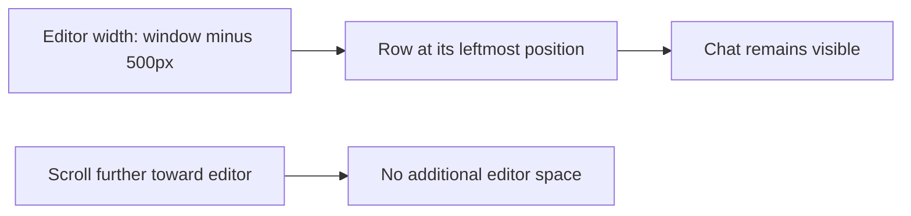
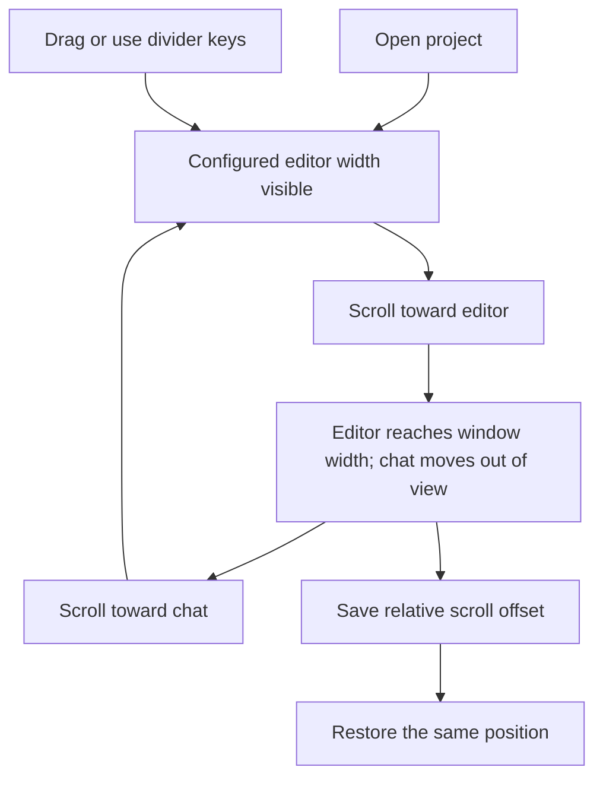

# Scroll back to a full-width editor

## Status

| Unit           | Result                                                                                                                                      |
| -------------- | ------------------------------------------------------------------------------------------------------------------------------------------- |
| Scope          | Scrolling toward the editor can expand it to 100% of the window and hide the first chat                                                     |
| Evidence       | The workbench column ends at its configured width; `scrollLeft` cannot move below zero to reveal more editor                                |
| Implementation | Written: full-width editor capacity, initial offset, relative scroll persistence, resize/reset positioning and native gesture ownership     |
| Review         | Product and regression diffs reviewed against `/private/tmp/editor-scroll-width-yfyu5ku2`; existing Traffic and workspace changes preserved |
| Verification   | Desktop build, local packaging, signing and installation passed; regression tests, separate typechecks and live UI checks unrun             |
| Installation   | 2026-10-11: signed arm64 app installed at `/Applications/Chorus.app`; current session kept running                                          |

The build and installation record is in [the Traffic width plan](33-traffic-default-reset.md#status). Quit and reopen Chorus to load both updates.

## Current / Issue



## Proposed

The workbench column occupies the window's maximum editor width. The initial scroll offset leaves the configured width visible. Scrolling to zero reveals the full editor and moves the chat to the right. Existing native geometry pins the workbench's left edge, so the explorer stays visible as its right edge expands.

## Code Changes

### `apps/desktop/src/renderer/src/workspace/EditorPane.tsx`

```ts
const editorWidth = editorWidthIn(windowWidth, editorFraction)
const editorCapacity = clampEditorWidth(windowWidth, windowWidth)
const rowOrigin = editorCapacity - editorWidth
const bodyWidth = Math.max(0, editorCapacity - gutterWidth)
```

Pass `rowOrigin` to the existing restoration hook. Resize from the currently visible width and move the row to match the new choice. Reset restores the default and its initial offset. Mark native workbench swipes as user input. A separate divider subscribes to its project's scroll offset so scrolling does not rerender the chat row.

### `apps/desktop/src/renderer/src/workspace/hooks.ts`

```ts
const target = Math.max(0, origin + (store.rowScroll[projectId] ?? 0))
row.scrollLeft = target

store.setRowScroll(projectId, row.scrollLeft - origin)
```

Default `origin` to zero for existing callers. Preserve startup clamping and gesture ownership. Store offsets relative to the configured editor width: existing positive values retain their chat positions; negative values record expansion toward the full editor. Restore when the window or configured width changes.

### `apps/desktop/src/renderer/src/workspace/layout.ts`

```ts
export function isRowScroll(left: number): boolean {
  return Number.isFinite(left)
}
```

The existing schemas already accept signed numbers. Retain negative offsets through snapshots and project slices.

### Existing editor, row-scroll, layout and store regressions

```ts
expect(row.scrollLeft).toBe(500)
fireEvent.wheel(row, { deltaX: -500 })
fireEvent.scroll(row)
expect(useWorkspaceStore.getState().rowScroll['p1']).toBe(-500)
expect(divider.getAttribute('aria-valuenow')).toBe('1000')
```

Cover default positioning, full-width scrolling, resizing from that position, preserving mounted chats, signed offset persistence, and restoring after width changes. Write coverage without running it.

## Final Flow


