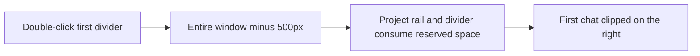
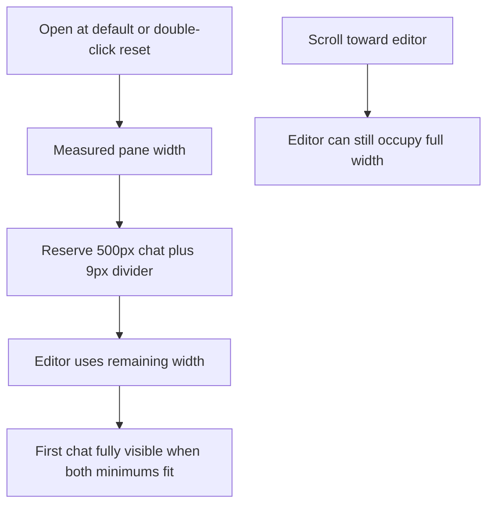

# Reset the editor with the first chat fully visible

## Status

| Unit           | Result                                                                                                                                    |
| -------------- | ----------------------------------------------------------------------------------------------------------------------------------------- |
| Scope          | Default and double-click reset reserve the first chat's full 500px width                                                                  |
| Evidence       | The screenshot shows the chat clipped at the window edge; the default uses the entire window while the pane begins after the project rail |
| Cause          | The reserved 500px includes space outside the pane and the 9px editor divider                                                             |
| Implementation | Written: default and reset use the measured pane and reserve the full chat plus divider; manual widths remain relative to the window      |
| Review         | Product and regression diffs reviewed against `/private/tmp/editor-default-chat-v6mw2x4w`; existing workspace changes preserved           |
| Verification   | Desktop build, local packaging, signing and installation passed; regression tests, separate typechecks and live UI checks unrun           |
| Installation   | 2026-10-11: signed arm64 app installed at `/Applications/Chorus.app`; current session kept running                                        |

Built with `pnpm exec turbo run build --filter=@chorus/desktop`. From `apps/desktop`, packaged with `node build/package-local.mjs` and installed with `env CHORUS_INSTALL_KEEP_RUNNING=1 CHORUS_INSTALL_DIR=/Applications node build/install-local.mjs`. Installation signature verification passed. The previous bundle remains at `/Applications/Chorus.app.replaced-1791727944843`. Quit and reopen Chorus to load the update.

## Current / Issue



## Proposed

Use the existing pane and row measurements. Here, 100% for the default means the available editor-and-chat pane. Reserve 500px for the chat plus 9px for its divider. Retain the existing editor minimum and full-window maximum for manual resizing and scrolling. A narrow pane that cannot fit both 500px minimums still needs horizontal scrolling.

## Code Changes

### `apps/desktop/src/renderer/src/workspace/layout.ts`

```ts
export const ROW_DIVIDER_WIDTH = 9

export function editorWidthIn(
  windowWidth: number,
  fraction?: number,
  paneWidth = windowWidth
): number {
  const saved = fraction === undefined ? undefined : clampEditorWidthFraction(fraction)
  const wanted =
    saved === undefined
      ? paneWidth - EDITOR_WIDTH.defaultOffset - ROW_DIVIDER_WIDTH
      : windowWidth * saved
  return clampEditorWidth(wanted, windowWidth)
}
```

### `apps/desktop/src/renderer/src/workspace/EditorPane.tsx`

```ts
const availableWidth = rowWidth > 0 ? rowWidth + gutterWidth : paneWidth || windowWidth
const editorWidth = editorWidthIn(windowWidth, editorFraction, availableWidth)
const rowOrigin = editorCapacity - editorWidth
```

The first divider uses `ROW_DIVIDER_WIDTH` as its inline flex basis. Reset uses `editorWidthIn(windowWidth, undefined, availableWidth)` after clearing custom widths and the relative scroll offset.

### Existing editor and layout regressions

```ts
expect(editorWidthIn(2_000, undefined, 1_880)).toBe(1_371)
expect(editorWidthIn(2_000, 1, 1_880)).toBe(2_000)
```

Model a 2000px window with a 1880px pane. After reset, the physical editor column, divider and first 500px chat must fit the measured scroll viewport. Preserve the chat draft, full-width resize and default-width restoration after the pane changes. Write coverage without running it.

## Final Flow


