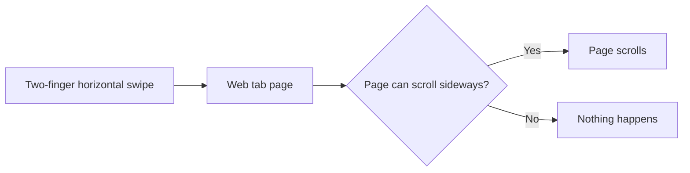
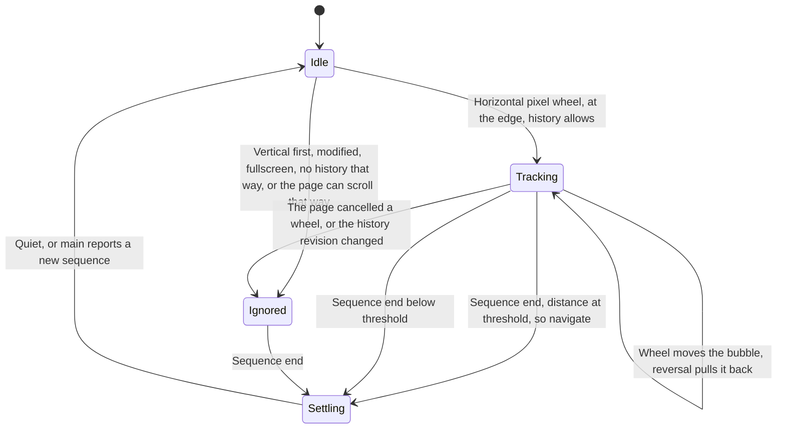
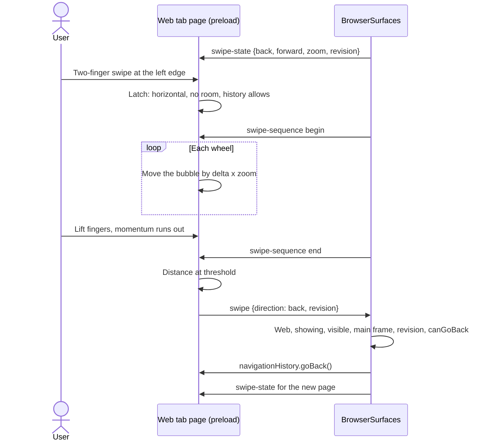

# Two-finger swipe back and forward in web tabs

## Status

| Unit           | Result                                                                                                                                                                                                                                                                                                                                                                                                         |
| -------------- | -------------------------------------------------------------------------------------------------------------------------------------------------------------------------------------------------------------------------------------------------------------------------------------------------------------------------------------------------------------------------------------------------------------------- |
| Questions      | Answered by the user on 2026-10-13: web tabs only, Chrome's arrow bubble, Chrome's direction and edge rule, macOS and Windows, plan first, unit tests written but not run                                                                                                                                                                                                                                      |
| Research       | Claude read `main/browser-surface.ts` (records, `act`, `observe`, `listen`, `pushState`, `showing`), `preload/browser.ts` (the row-wheel path), `shared/browser-ipc.ts`, `main/workbench-surface.ts` (`applyParticipant`), the preload build config and Electron 43.2's typings                                                                                                                                 |
| Plan challenge | Codex returned 8 findings from source (Electron v43.2.0, Chromium 150.0.7871.129, DOM/CSS specs). Claude checked the load-bearing ones: the gesture types in `electron.d.ts`, the overlay hiding views through `setVisible` (`workbench-surface.ts:567`), and the shared-chunk rule (`electron.vite.config.ts:216`). All 8 are folded in below. The first draft's 140 ms idle gap and its plain fixed-position bubble are replaced |
| User approval  | Approved 2026-10-13                                                                                                                                                                                                                                                                                                                                                                                            |
| U1 gesture     | Written by Codex. Claude reviewed both files and traced every test assertion against the reducer. Deviation accepted: `idle` and `settling` keep `gesture`, so ids stay monotonic without an outside counter and a late `consumed` can never match a later gesture. Correction sent: `overscroll-behavior-x` should block only on the root or a box that actually overflows sideways, to be confirmed against Chromium's scroll chain first |
| U2 wiring      | Written by Codex. Claude reviewed all four diffs against `/tmp/swipe-baseline-JTt17n`; the row-wheel path is unchanged and the preload imports IPC as types only. Deviations accepted: a hidden page drops its gesture and ignores sequence messages, and pending cancel checks are flushed before `end` and `tick`. Corrections sent: skip a detached main frame before every new `mainFrame.send`, because Electron 43.2 throws on a disposed frame (`web_frame_main.cc:207`) and `render-process-gone` reaches `swipeState` through `pushState`. Also measure the scroll path only for a horizontal wheel whose direction history allows, so a vertical scroll never forces style and layout |
| Corrections    | Codex fixed the detached-frame guard (both send paths, with a crash regression test whose fake `send` throws when detached) and the path-measurement gate. The `overscroll-behavior-x` correction was withdrawn. Chromium 150 creates a scroll node for a container that blocks propagation even without overflow (`paint_property_tree_builder.cc:538`, `paint_layer_scrollable_area.cc:1391-1405`, `input_handler.cc:2350-2382`), so the reducer was already right. Claude checked the citations and re-reviewed the hunks. Main and the IPC contract are purely additive against the baseline, and `browser-swipe.ts` is imported only by the browser preload and its test |
| Verification   | Not run. Nothing runs until the user asks                                                                                                                                                                                                                                                                                                                                                                      |

Roles: Claude leads and reviews. Codex implements U1 and U2. Claude reviews every file and the integrated diff.

## Decisions taken with the user

| Question  | Answer                                                                                                                                      |
| --------- | ------------------------------------------------------------------------------------------------------------------------------------------- |
| Surface   | Web tabs only (plan 22). The project browser keeps sending horizontal swipes to the project row (plan 18)                                    |
| Feedback  | Chrome's arrow bubble. It slides in from the edge with the fingers and navigates only if the gesture ends past the threshold                |
| Direction | Chrome's: overscrolling past the left edge goes back, past the right edge goes forward. With natural scrolling, fingers moving right go back |
| Edges     | Navigate only when nothing under the pointer can scroll further that way. Wide content still scrolls                                         |
| Platforms | macOS and Windows                                                                                                                           |
| Tests     | Written with the code, not run                                                                                                              |

## Current / Issue



Back and forward exist only as toolbar buttons, the context menu and keys (`BrowserSurfaces.act`, `menuAction`). A web tab is a native `WebContentsView` with `preload/browser.ts` in its main frame. In a project browser that preload already captures every horizontal wheel and forwards it to scroll the row. In a web tab it lets the wheel through.

Chromium's own history swipe is out of reach. Electron's `CanOverscrollContent()` returns false, so Aura never installs its overscroll navigation, and no switch changes that. `BrowserWindow`'s `swipe` event is macOS-only and fires once per gesture, with no progress. It also needs "Swipe between pages" set to two or three fingers.

Two sources remain, and each covers what the other lacks:

- **The page's `wheel` stream** carries the distance, and only the page knows whether something under the pointer can still scroll. On Windows, precision-touchpad pans reach it through Direct Manipulation as pixel deltas (`deltaMode` 0).
- **`webContents` `input-event` in main** reports `gestureScrollBegin` and `gestureScrollEnd`. That is Chromium's own scroll sequence, which the DOM never sees. It carries no deltas and no momentum phase.

## Proposed



The preload owns the gesture, because only the page knows what it can scroll. Main owns the sequence boundaries and the decision to navigate.

- **A gesture is latched once, on its first usable wheel.** That fixes its axis and direction, and whether the page owns it. A gesture that started with room to scroll never navigates, even after it reaches the edge.
- **A gesture ends when Chromium's scroll sequence ends.** Main sends `begin` and `end`, numbered, from `gestureScrollBegin` and `gestureScrollEnd`. An open gesture adopts the first `begin` it sees, then waits for the matching `end`. Pausing with your fingers down does not end it.
  - Sequence end is not finger release. On both platforms the momentum after lifting belongs to the sequence, so a flick commits and a slow drag released early does not.
  - If no `begin` is adopted, a quiet gap of `SWIPE_FALLBACK_MS` (500 ms) ends the gesture. That matches Chromium's fallback for phaseless wheels.
  - If an adopted `end` is lost, `SWIPE_LOST_MS` (2000 ms) of quiet cancels it without navigating.
- **Settling swallows the tail.** Wheels that arrive after an `end` belong to the closed sequence. They are ignored until `SWIPE_SETTLE_MS` (80 ms) of quiet passes, or a new `begin` arrives.
- **Every cancelable wheel is checked.** A `setTimeout(0)` reads `event.defaultPrevented` once dispatch finishes. The check is tied to the gesture it came from. If the page cancelled any of that gesture's wheels, the gesture is ignored. Only trusted, finite, bounded pixel samples count, and a zero-delta wheel never opens a gesture.
- **Distance is in device-independent pixels**: wheel delta times page zoom. The commit threshold is `SWIPE_COMMIT_DISTANCE` (160 px). That is our product choice, not Chrome's, whose Aura threshold is a fraction of the viewport. It is to be tuned by hand. The bubble is sized against the same zoom.
- **Main tells the preload what it may offer.** It sends `{back, forward, zoom, revision}` on page ready and with every `pushState` for a web record. `revision` is `record.navigation`, which rises on every main-frame navigation, same-document ones included. A revision change during a gesture cancels it.
- **The bubble sits in the top layer, unreachable by page CSS.** A plain host `div` is appended to `document.documentElement`, with `all: initial`, fixed and zero-size, set inline with `!important`. It holds a closed shadow root. Inside, the bubble element is a `popover="manual"`, shown with `showPopover()`. That puts it above dialogs, other popovers and any `html` transform.
  - Because it's inside a closed shadow tree, page rules such as `::backdrop` or `[popover]` cannot match it.
  - Its `beforetoggle`/`toggle` events are not composed, so they never leave the shadow root.
  - Every style goes through `style.setProperty`, which CSP does not gate.
  - If `showPopover` throws, or the host is removed, the gesture continues with no bubble.
- **Commit is one message.** `browser:page:swipe` sends `{direction, revision}`. Main accepts it only when all of these hold: a web record, not closed, `showing()`, `view.getVisible()` (false while a shell overlay is up), the main-frame sender (`senderOrigin`), and a matching `revision`. It then calls `goBack()`/`goForward()` behind the same `canGo*` checks as `act`.

**Rejected: a native overlay view for the bubble.** That is a transparent `WebContentsView` stacked over the page. It costs one renderer process per window, its own HTML entry and preload, and two IPC hops per wheel. It must re-stack on every show and join the overlay-stills protocol. Transparent child views are also the least proven part of Electron on Windows. The top-layer popover gets the same stacking without any of that.

## Code Changes

### `apps/desktop/src/shared/browser-swipe.ts` (new, pure)

Imported at runtime by `preload/browser.ts` only. A second preload importing it would make Rollup emit a shared chunk, which a sandboxed preload cannot load (`electron.vite.config.ts:216`). Main does not import it.

```ts
export const SWIPE_COMMIT_DISTANCE = 160
export const SWIPE_FALLBACK_MS = 500
export const SWIPE_LOST_MS = 2000
export const SWIPE_SETTLE_MS = 80
export const SWIPE_EDGE_TOLERANCE = 1
export const SWIPE_DELTA_MAX = 10_000

export type SwipeDirection = 'back' | 'forward'

export interface SwipeHistory {
  readonly back: boolean
  readonly forward: boolean
  readonly zoom: number
  readonly revision: number
}

export interface ScrollBox {
  readonly root: boolean
  readonly horizontal: boolean
  readonly overflowX: string
  readonly overscrollX: string
  readonly rtl: boolean
  readonly scrollLeft: number
  readonly scrollWidth: number
  readonly clientWidth: number
}

export interface SwipeWheel {
  readonly deltaX: number
  readonly deltaY: number
  readonly deltaMode: number
  readonly modified: boolean
  readonly fullscreen: boolean
  readonly path: readonly ScrollBox[]
}

export type SwipeInput =
  | { readonly kind: 'wheel'; readonly time: number; readonly wheel: SwipeWheel; readonly history: SwipeHistory }
  | { readonly kind: 'begin'; readonly time: number; readonly sequence: number }
  | { readonly kind: 'end'; readonly time: number; readonly sequence: number }
  | { readonly kind: 'consumed'; readonly time: number; readonly gesture: number }
  | { readonly kind: 'history'; readonly time: number; readonly history: SwipeHistory }
  | { readonly kind: 'tick'; readonly time: number }

export type SwipeState =
  | { readonly kind: 'idle'; readonly begin: { readonly sequence: number; readonly time: number } | null }
  | {
      readonly kind: 'tracking'
      readonly gesture: number
      readonly sequence: number | null
      readonly direction: SwipeDirection
      readonly revision: number
      readonly distance: number
      readonly last: number
    }
  | { readonly kind: 'ignored'; readonly gesture: number; readonly sequence: number | null; readonly last: number }
  | { readonly kind: 'settling'; readonly last: number }

export interface SwipeStep {
  readonly state: SwipeState
  readonly navigate: { readonly direction: SwipeDirection; readonly revision: number } | null
}

export function swipeReduce(state: SwipeState, input: SwipeInput): SwipeStep
export function swipeProgress(state: SwipeState): number
export function pathYields(path: readonly ScrollBox[], deltaX: number): boolean
export function usableWheel(wheel: SwipeWheel): boolean
```

`usableWheel` requires `deltaMode` 0, finite deltas within `SWIPE_DELTA_MAX`, and no modifier. `deltaX < 0` means back.

`pathYields` walks from the target to the root. A box is a scroll container when it's the root, or its `overflowX` is `auto` or `scroll`. A container yields when any of these holds:

- It has room in that direction beyond `SWIPE_EDGE_TOLERANCE`. RTL ranges run from `-(scrollWidth - clientWidth)` to `0`.
- It is not horizontal-tb and can scroll at all.
- It has no room, but `overscrollX !== 'auto'`. That also stops the chain, so nothing navigates.

Tracking adds `-deltaX` or `deltaX` times `zoom` and floors at 0. `deltaY` is ignored once the gesture is latched. Gesture ids rise monotonically, so a late `consumed` for an old gesture does nothing.

### `apps/desktop/src/shared/browser-swipe.test.ts` (new, not run)

- **Opening:** a horizontal start at the edge tracks. A vertical-first start stays ignored for the whole gesture. Modifiers, fullscreen, non-pixel `deltaMode`, out-of-range deltas and zero-delta starts do not open one. No history that way is ignored.
- **Paths:** room yields, including RTL. Fractional `scrollLeft` within tolerance counts as the edge. Vertical writing modes yield. `overscroll-behavior-x: contain` and `none` block. A gesture that started inside a scroller stays ignored at the edge.
- **Distance:** reversal pulls distance back and floors at 0. Zoom scales distance.
- **Ending with a sequence:** an adopted `end` commits at the threshold and cancels one pixel short. A pause with an adopted `begin` and no `end` does not commit. A non-matching `end` is ignored. A lost `end` cancels after `SWIPE_LOST_MS`.
- **Ending without a sequence:** with no `begin`, the fallback gap ends the gesture.
- **Settling:** tail wheels after `end` are swallowed. A new `begin` during settling opens the next gesture. Two rapid gestures each resolve on their own.
- **Cancelling:** `consumed` for the current gesture ignores it, and a stale gesture id does nothing. A history revision change cancels.

### `apps/desktop/src/shared/browser-ipc.ts`

```ts
export const BROWSER_PAGE_SWIPE_CHANNEL = 'browser:page:swipe'
export const BROWSER_PAGE_SWIPE_STATE_CHANNEL = 'browser:page:swipe-state'
export const BROWSER_PAGE_SWIPE_SEQUENCE_CHANNEL = 'browser:page:swipe-sequence'

const BrowserSwipeRevision = z.number().int().nonnegative().max(Number.MAX_SAFE_INTEGER)

export const BrowserPageSwipe = z
  .object({ direction: z.enum(['back', 'forward']), revision: BrowserSwipeRevision })
  .strict()
export type BrowserPageSwipe = z.infer<typeof BrowserPageSwipe>

export const BrowserPageSwipeState = z
  .object({
    back: z.boolean(),
    forward: z.boolean(),
    zoom: z.number().positive().max(10),
    revision: BrowserSwipeRevision,
  })
  .strict()
export type BrowserPageSwipeState = z.infer<typeof BrowserPageSwipeState>

export const BrowserPageSwipeSequence = z
  .object({ phase: z.enum(['begin', 'end']), sequence: BrowserSwipeRevision })
  .strict()
export type BrowserPageSwipeSequence = z.infer<typeof BrowserPageSwipeSequence>
```

`preload/browser.ts` keeps importing these as types only, and keeps its own local channel strings, as it does today.

### `apps/desktop/src/main/browser-surface.ts`

`BrowserRecord` gains `swipeSequence: number`.

```ts
private swipeState(record: BrowserRecord): void {
  const contents = this.contents(record)
  if (record.scope.kind !== 'web' || contents === null || record.closed) return
  const state: BrowserPageSwipeState = {
    back: contents.navigationHistory.canGoBack(),
    forward: contents.navigationHistory.canGoForward(),
    zoom: contents.getZoomFactor(),
    revision: record.navigation,
  }
  contents.mainFrame.send(BROWSER_PAGE_SWIPE_STATE_CHANNEL, state)
}
```

Call it from `pushState`, and from the `BROWSER_PAGE_READY_CHANNEL` handler for web records. In `observe`'s web branch:

```ts
contents.on('input-event', (_event, input) => {
  if (input.type !== 'gestureScrollBegin' && input.type !== 'gestureScrollEnd') return
  if (input.type === 'gestureScrollBegin') record.swipeSequence += 1
  const message: BrowserPageSwipeSequence = {
    phase: input.type === 'gestureScrollBegin' ? 'begin' : 'end',
    sequence: record.swipeSequence,
  }
  contents.mainFrame.send(BROWSER_PAGE_SWIPE_SEQUENCE_CHANNEL, message)
})
```

In `listen`:

```ts
contents.ipc.on(BROWSER_PAGE_SWIPE_CHANNEL, (event, payload: unknown) => {
  if (record.scope.kind !== 'web' || !this.showing(record)) return
  if (record.view?.getVisible() !== true || this.senderOrigin(record, event) === null) return
  const parsed = BrowserPageSwipe.safeParse(payload)
  if (!parsed.success || parsed.data.revision !== record.navigation) return
  const history = contents.navigationHistory
  if (parsed.data.direction === 'back' && history.canGoBack()) history.goBack()
  if (parsed.data.direction === 'forward' && history.canGoForward()) history.goForward()
})
```

### `apps/desktop/src/main/browser-surface.test.ts` (extended, not run)

- **Commits:** a web page's swipe goes back and goes forward.
- **Rejected swipes:** from a project browser; from a hidden, closed or overlay-concealed record; from a sender that isn't the main frame; with a stale revision; with a malformed payload; and with no history that way.
- **Swipe state:** sent to web pages on ready and on state pushes, never to project pages.
- **Sequences:** `gestureScrollBegin`/`End` become numbered `begin`/`end` messages for web pages only, and other input types send nothing.

### `apps/desktop/src/preload/browser.ts`

It holds one `SwipeState`, driven only through `swipeReduce`. Until the first swipe state arrives, nothing below runs, so project pages never run it.

- **The listener:** a second `wheel` listener on `window`, capture phase, `passive: true`, requiring `isTrusted`. It never cancels the event.
- **Measuring the path:** on a sample that could open a gesture, it reads `composedPath()` synchronously into `ScrollBox`es. It uses `getComputedStyle` for `overflow-x`, `overscroll-behavior-x`, `direction` and `writing-mode`, with `document.scrollingElement` as the root.
- **Cancel checks:** every cancelable sample schedules a `setTimeout(0)` that sends `consumed` for its gesture id if `defaultPrevented` is set.
- **Main's messages:** `swipe-state` becomes a `history` input, and `swipe-sequence` becomes `begin`/`end`.
- **The timer:** a single timer sends `tick` inputs while a gesture is open or settling.
- **Committing:** a step with `navigate` sends `BROWSER_PAGE_SWIPE_CHANNEL`.
- **Page lifecycle:** `pagehide` drops everything.
- **Types:** the minimal `declare const` DOM types grow by exactly what this uses. That is `defaultPrevented`, `cancelable`, `composedPath()`, element narrowing, scroll metrics, the computed properties above, `documentElement`, `scrollingElement`, `fullscreenElement`, `createElement`/`createElementNS`, `attachShadow`, `style.setProperty`, `popover`, `showPopover`/`hidePopover`, `append` and `remove`.

The bubble is a 36 px circle, divided by `zoom`, vertically centred on the page edge. It holds an SVG arrow. Progress moves it from fully off the edge to 24 px in, and its opacity from 0.4 to 1. At full progress it fills with Chrome's blue. It has no focusable content and no text, so it needs no translation. It is hidden and removed when the gesture leaves `tracking`.

## What does not change

The project browser's row wheel; vertical scrolling; pinch and Ctrl/⌘ wheel zoom; Shift+wheel; a page's own horizontal scrolling; the toolbar, menu and key back/forward; detached windows, which have no web tabs.

## Not doing, and known limits

- **Iframes.** A swipe that starts over one never navigates, because its wheel never reaches the main-frame preload. Plan 14 records the same gap.
- **Scroll ownership is not Chrome's in every layout.** `composedPath()` cannot see scrollers inside closed shadow roots. The path also follows the DOM, while real scroll chaining follows containing blocks. A horizontal scroller hidden either way can scroll while the bubble also shows.
- **A propagated `body` overflow is read as its own scroller.** With `body { overflow-x: auto }` and wide content, the body's `scrollLeft` stays 0 while the viewport scrolls. So at the right edge, forward never offers.
- **Reversing a swipe can scroll the page.** The listener is passive, and Chromium makes later wheels uncancelable. So reversing toward a side with room scrolls the page while the bubble pulls back.
- **Mouse tilt wheels** look like a touchpad in the DOM. A horizontal tilt at the page edge also shows the bubble.
- Not doing the previous page's still while swiping, the way Safari does. Not adding a setting to turn it off.

## Acceptance

| Criterion                                                                                                    | Check                        |
| ------------------------------------------------------------------------------------------------------------ | ---------------------------- |
| Swipe toward back at the left edge, with history: the bubble follows, and ending past the threshold goes back | Hand test, macOS and Windows |
| Same for forward at the right edge                                                                           | Hand test                    |
| End short of the threshold, or reverse: no navigation, the bubble leaves                                     | Hand test + unit             |
| Pausing with fingers down past the threshold does not navigate until the gesture ends                        | Hand test + unit             |
| No history that way: no bubble                                                                               | Hand test + unit             |
| Horizontally scrollable content scrolls, and a gesture that started scrolling never navigates                | Hand test + unit             |
| `overscroll-behavior-x: none`, or a page cancelling the wheel: no navigation                                 | Unit                         |
| The bubble shows above an open `<dialog>`                                                                    | Hand test                    |
| Vertical scroll, pinch zoom and Shift+wheel unchanged                                                        | Hand test                    |
| Project browser: horizontal swipe still scrolls the row, no bubble                                           | Hand test + unit             |

## Final Flow


