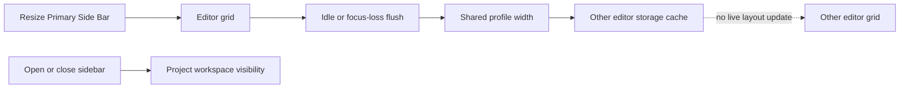
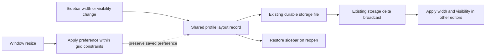
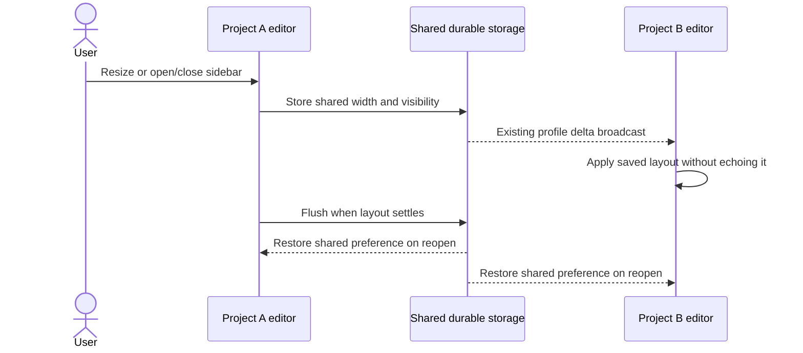

# Shared editor sidebar width and visibility

## Status

| Step | Status |
| --- | --- |
| Scope | Width and open/closed state are shared across projects, confirmed by the user |
| Investigation | Installed Code-OSS layout and Chorus storage/broadcast paths read |
| Implementation | Written in `storage.ts` and `entry.ts`; pre-existing changes preserved |
| Verification | Incremental source diff reviewed; build and installer signature verification passed; sidebar runtime behavior unverified |
| Build and install | `CHORUS_INSTALL_KEEP_RUNNING=1 pnpm app:install` completed; signed arm64 app installed at `/Applications/Chorus.app` |

## Current / Issue



`entry.ts:savePanelLayout` schedules saves for the bottom panel. Installed `LayoutStateModel` loads sidebar width from PROFILE and visibility from WORKSPACE; its live PROFILE listener handles USER runtime keys, excluding sidebar size. Chorus already broadcasts storage deltas to other surfaces.

## Proposed



Use one `chorus.sideBar.layout` PROFILE record. Existing sidebar keys remain legacy fallbacks until a sidebar change writes the record. Automatic layout flushes write their existing keys and cannot replace this authoritative record with a constrained grid width. Incoming updates establish an observed-width baseline so their resulting resize events are not echoed.

## Code Changes

### `apps/desktop/src/renderer/src/workbench/storage.ts`

```ts
export const SHARED_SIDE_BAR_LAYOUT_KEY = 'chorus.sideBar.layout'

export type SideBarLayout = {
  width: number
  hidden: boolean
}
```

Parse stored JSON as `unknown`; accept only finite positive numeric width and boolean hidden state. `ChorusStorageService.get` prefers this record for PROFILE `workbench.sideBar.size` and WORKSPACE `workbench.sideBar.hidden`. Existing defaults, panel routing and all unrelated storage remain in place.

### `apps/desktop/src/renderer/src/workbench/entry.ts`

Extend the existing 200ms scheduler as `saveWorkbenchLayout`. Add a sidebar visibility listener, resize observer, and PROFILE record listener. Restore through the public layout API:

```ts
layout.setPartHidden(sideBarLayout.hidden, Parts.SIDEBAR_PART)
layout.setSize(Parts.SIDEBAR_PART, {
  ...layout.getSize(Parts.SIDEBAR_PART),
  width: sideBarLayout.width,
})
```

Guard incoming updates and viewport relayouts from publishing a new preference. Retain the desired width while the sidebar is hidden or a smaller window constrains it. Resizing the sidebar or changing its visibility stores the shared record and schedules a flush. Bottom-panel behavior remains as implemented in plan 09.

## Verification

The incremental diff against `/private/tmp/workbench-shared-sidebar-20261014/` was read, including initial legacy fallback, hidden width retention, incoming-change echo prevention, viewport resizing, and existing panel save behavior. No code comments, IPC changes, dependencies or tests were added. On the user's build-and-install request, `pnpm app:install` completed successfully, including dependency builds, the Electron/Vite build, local signing with `Chorus Local Dev`, and installer signature verification. The app was installed at `/Applications/Chorus.app` while the previous bundle was retained at `/Applications/Chorus.app.replaced-1791958229126` for the running session. No tests, separate typecheck or app launch was run. Reopening Chorus loads the new build. Runtime acceptance remains unverified: resize and toggle in project A, observe project B, reopen both, and shrink/grow one window while checking that its constrained size does not become the global preference. Closing within the existing debounce/write window can still race persistence.

## Final Flow


