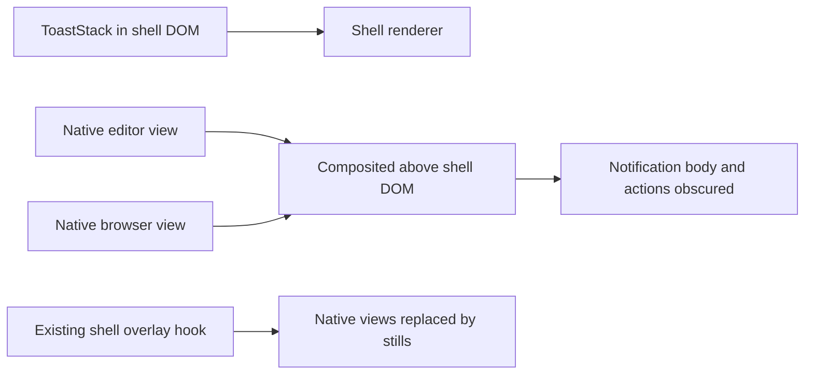
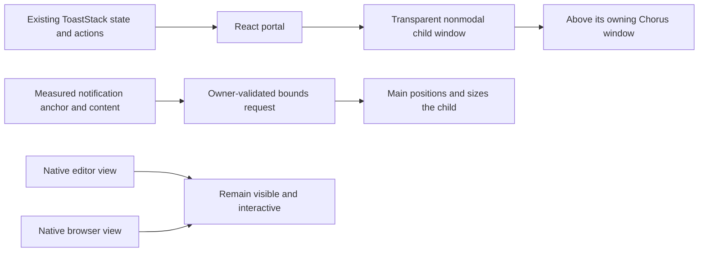
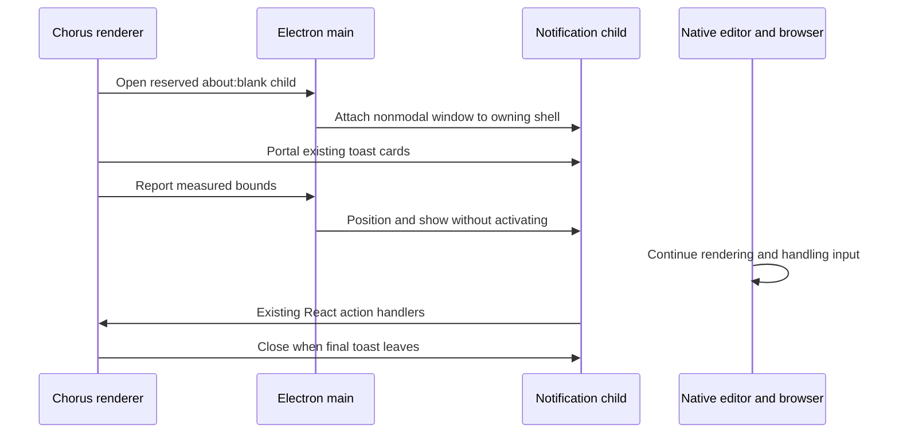

# Notifications above live editor and browser views

## Status

| Step           | Status                                                                                                     |
| -------------- | ---------------------------------------------------------------------------------------------------------- |
| Scope          | Notifications stay above the editor and browser; both remain interactive, confirmed by the user            |
| Investigation  | ToastStack, native-view ownership, overlay handling, navigation guards and Electron child-window APIs read |
| Implementation | Written and source-reviewed; existing working-tree changes preserved                                       |
| Mouse input    | Written and source-reviewed: native pointer tracking and drag retention                                    |
| Verification   | Local build and installation passed; tests, typechecks and live input checks unrun                         |

## Current / Issue



Persistent approval, question and idle notifications cannot use the dialog overlay hook while retaining editor/browser interaction. The user explicitly selected live interaction.

## Proposed



The child is an allowlisted `about:blank` popup from a registered shell. Same-origin access lets the original renderer retain React state and action handlers. Its native window is not registered as a shell and receives no additional IPC authority. Existing dialogs keep their overlay behavior; while one is active, notifications return to the shell DOM so the child does not cover the dialog.

## Code Changes

### NEW: `apps/desktop/src/shared/toast-window-ipc.ts`

Declare one reserved window name and an explicit bounds contract, using the existing `WorkbenchRect` shape. Expose typed bounds and interaction methods through `window.chorusToasts`.

### NEW: `apps/desktop/src/main/toast-windows.ts`

Keep one child per registered shell, resolve ownership from the sender, clamp bounds inside the parent content area, and position with the existing zoom factor. Follow parent movement, resizing, hiding, minimizing, restoring and closing. Use `showInactive()` for arrival without stealing editor focus. Block child navigation, webviews and further popups.

### `apps/desktop/src/main/security.ts` and `apps/desktop/src/main/index.ts`

Only registered shell windows provide the optional popup callback. The navigation guard delegates exclusively for the reserved name and `about:blank`; external-link behavior and all other window restrictions remain in place. Register the bounds handler once alongside existing IPC handlers.

### `apps/desktop/src/main/shell-windows.ts`

Track notification children for focused-shell lookup only. Focusing a notification resolves to its owning shell for existing actions without registering the child as an authorized IPC sender.

### `apps/desktop/src/preload/index.ts` and `apps/desktop/src/renderer/src/env.d.ts`

Expose and type the one bounds operation. Validate its response using the shared schema.

### NEW: `apps/desktop/src/renderer/src/useToastWindow.ts`

Own the child document, style/theme mirroring, DOM measurement and cleanup. Wait for copied stylesheets before first placement. Reuse it while notifications remain visible; changing reply drafts or replacing notifications does not recreate the window. Closing the native notification window dismisses its remaining toasts. Clean up observers and listeners before closing a window from React cleanup.

### `apps/desktop/src/renderer/src/workspace/overlay.ts`

Expose the existing overlay counter's active state through the existing signal pattern. Notifications subscribe to it without requesting that editor/browser views be hidden.

### `apps/desktop/src/renderer/src/ToastStack.tsx`

Keep the existing notification JSX and handlers. Render a hidden position anchor in the shell and portal the existing cards into the child host:

```tsx
{
  host === null ? cards : createPortal(cards, host)
}
```

## Verification

### Mouse input recovery

The user reports that the visible notification cannot be clicked. On macOS, the child starts with mouse events ignored. The native hit test runs on placement, while later recovery relies on `mousemove` forwarded to the popup document. A popup that does not receive that movement remains in click-through mode. The exact runtime event sequence is unverified.

Track the screen pointer in the main process while at least one notification child is visible. Compare its position with the current child bounds and the measured card regions at the current zoom. Enable input over cards and pass it through elsewhere. The existing interaction channel reports mouse press/release only, retaining input throughout a drag. Stop tracking when notifications are hidden or their owner/child closes. Keep existing reply, Open, approval and dismiss handlers.

Source references: [Electron mouse event ignoring](https://www.electronjs.org/docs/latest/api/browser-window#winsetignoremouseeventsignore-options), [cursor screen coordinates](https://www.electronjs.org/docs/latest/api/screen#screengetcursorscreenpoint).

Source review covered owner/main-frame authorization, strict request validation, narrow popup allowance, retained preload isolation, parent-relative geometry and zoom, stable portal host, notification dismissal, reply/approval handlers, existing dialog priority, and cleanup. Pointer tracking changes were compared against the saved main and renderer files at `/private/tmp/chorus-toast-clicks-1792002258912-*`; pre-existing changes were retained. The local app build, signature verification and installation passed. The current session was kept running; a relaunch loads the new build. Tests, typechecks and live UI checks were not run. Runtime acceptance remains unverified: notifications above both native surfaces; typing and browsing continue; toast replies, approval choices and dismiss buttons work; movement, resizing, zoom, minimize/restore and detached-window closure keep the layer aligned.

References: [Electron same-origin renderer windows](https://www.electronjs.org/docs/latest/api/window-open), [parent and child windows](https://www.electronjs.org/docs/latest/api/browser-window#parent-and-child-windows), and [React portals](https://react.dev/reference/react-dom/createPortal).

## Final Flow


