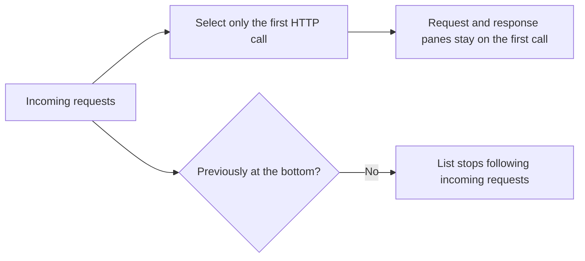
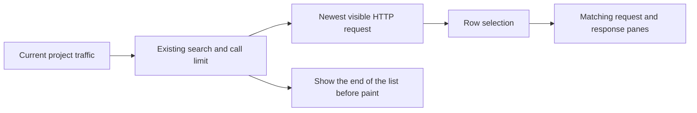
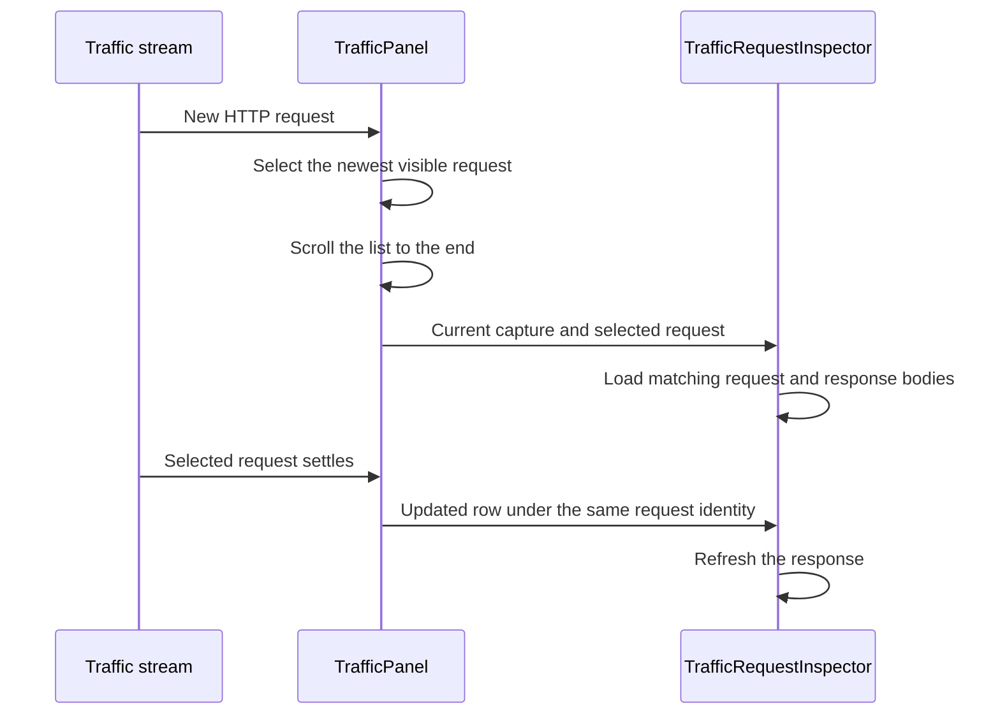

# Follow the latest Traffic request

## Status

| Unit | Result |
| --- | --- |
| Scope | Keep the newest visible request selected and in view as calls arrive |
| Implementation | Written and source reviewed; runtime behavior unverified |
| Verification | Not run; the user has not requested tests or a build |

## Current / Issue



`TrafficPanel.tsx` owns both the selection and list scroll. `TrafficRequestInspector.tsx` already reloads detail and bodies when `row.requestId` or its pending state changes.

## Proposed



Manual row selection remains available between incoming requests. Rewriting an existing pending row does not reset a manual selection. Project and capture changes select from the matching stream. Filters continue to control the visible requests.

## Code Changes

### `apps/desktop/src/renderer/src/TrafficPanel.tsx`

Move the existing visible-row derivation above the selection and scroll effects. Replace the one-time selection guard and conditional scroll tracking with primitive request identities.

```tsx
const filtered = filterRows(stream.rows, search)
const shown = filtered.slice(-callLimit)
const newestSeq = shown.at(-1)?.seq ?? null
const newestRequestSeq = shown.findLast((row) => row.source === 'http')?.seq ?? null

useEffect(() => {
  setSelectedSeq(stream.projectId === projectId ? newestRequestSeq : null)
}, [projectId, stream.projectId, stream.captureId, newestRequestSeq])

useLayoutEffect(() => {
  const list = rowsList.current
  if (list === null || collapsed || stream.projectId !== projectId) return
  list.scrollTop = list.scrollHeight
}, [newestSeq, callLimit, search, projectId, stream.projectId, stream.captureId, collapsed])
```

Guard the selected-row lookup against a stream from another project. Give the inspector a capture/request key so a new request immediately starts with fresh pane state. Keep the existing inspector's detail/body loading and pending-to-response refresh.

## Final Flow



Manual verification remains: attach to existing history, receive one request and a burst, scroll up before another request, inspect a pending response, select an older row between calls, search, clear capture, change projects, and collapse/reopen Traffic.

The final source and diff were reviewed against the pre-edit working copy. Existing Traffic changes were retained. No tests, typecheck, build, installation, or app launch ran for this update.
