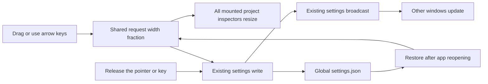
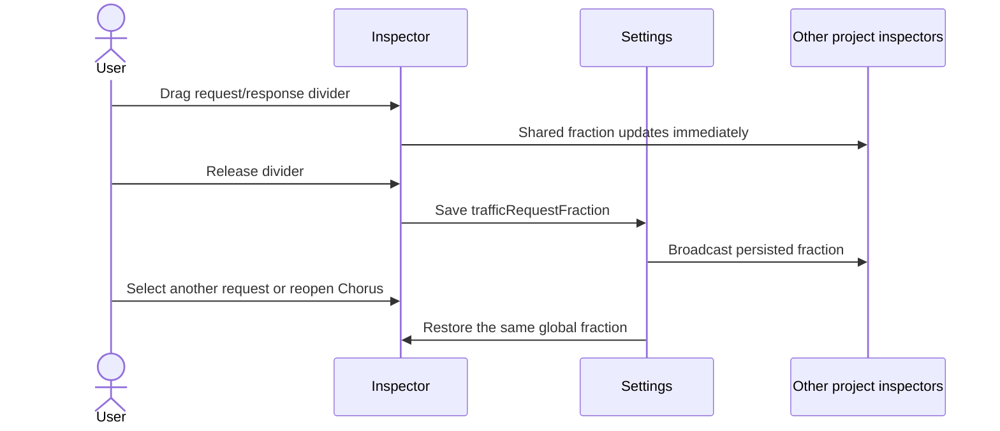

# Shared request and response pane sizing

## Status

| Unit           | Result                                                                           |
| -------------- | -------------------------------------------------------------------------------- |
| Scope          | Draggable request/response divider with one global value that survives reopening |
| Implementation | Written and source reviewed; runtime behavior unverified                         |
| Verification   | Not run; tests and build have not been requested                                 |

## Current / Issue

```tsx
<div className="traffic-panes">
  <div className="traffic-pane" data-side="request" />
  <div className="traffic-pane" data-side="response" />
</div>
```

The inspector's grid always gives each pane half the available width. Its border has no resize interaction or saved value.

## Proposed



Default 50/50. Keep the request share between 10% and 90% so both panes remain available. Store a fraction so the same setting fits projects with different panel widths.

## Code Changes

### `apps/desktop/src/shared/ipc.ts`

```ts
export const DEFAULT_TRAFFIC_REQUEST_FRACTION = 0.5
export const MIN_TRAFFIC_REQUEST_FRACTION = 0.1
export const MAX_TRAFFIC_REQUEST_FRACTION = 0.9
export const TrafficRequestFraction = z
  .number()
  .min(MIN_TRAFFIC_REQUEST_FRACTION)
  .max(MAX_TRAFFIC_REQUEST_FRACTION)
```

Add `trafficRequestFraction: TrafficRequestFraction.default(DEFAULT_TRAFFIC_REQUEST_FRACTION)` to `SettingsShape`. The existing partial settings-write contract and preload expose the new preference automatically.

### `apps/desktop/src/main/settings.ts`

Use the shared schema for the stored fraction and add its default to `DEFAULT_SETTINGS`. Discard an invalid stored fraction before parsing, retaining other readable preferences. Existing atomic writes and global broadcasts handle persistence and synchronization.

### `apps/desktop/src/renderer/src/TrafficRequestInspector.tsx`

Keep a module-level layout signal beside the existing inspector. Initialize it from settings once per renderer, and subscribe to settings broadcasts. Guard the initial asynchronous read against newer local edits or pushes. Repeated settings broadcasts with the same stored fraction must not interrupt an active drag.

```tsx
<div
  className="traffic-panes"
  style={{
    gridTemplateColumns: `minmax(0, ${requestFraction}fr) 9px minmax(0, ${1 - requestFraction}fr)`,
    gap: 0,
  }}
>
  <div className="traffic-pane" data-side="request" />
  <div className="conversation-sash" role="separator" aria-orientation="vertical" tabIndex={0} />
  <div className="traffic-pane" data-side="response" />
</div>
```

Reuse the existing sash style. Capture the pointer during drag, clamp the shared fraction, and save on completion, cancellation, inspector unmount, or a detail reload that removes the panes. Arrow keys resize with the same bounds. Report save failures separately from request-detail failures.

### `apps/desktop/src/renderer/src/i18n/en.json`

Add the divider's accessible label and a pane-size save-failure message under `traffic`.

## Final Flow



Manual verification remains: resize both directions, use arrow keys, switch requests during drag, switch projects, resize the outer Traffic panel, open a second window, and reopen the app.

Reviewed every changed file and the diffs against the pre-edit working copies. Existing work was retained. No tests, typecheck, build, installation, or app launch ran for this change.
