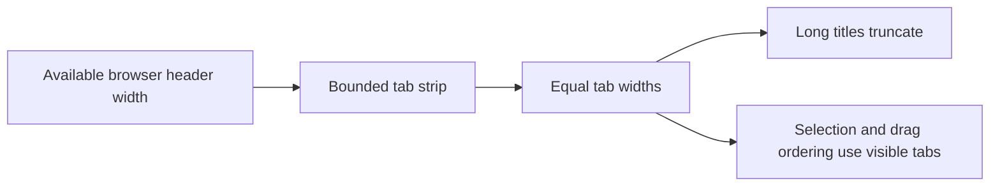
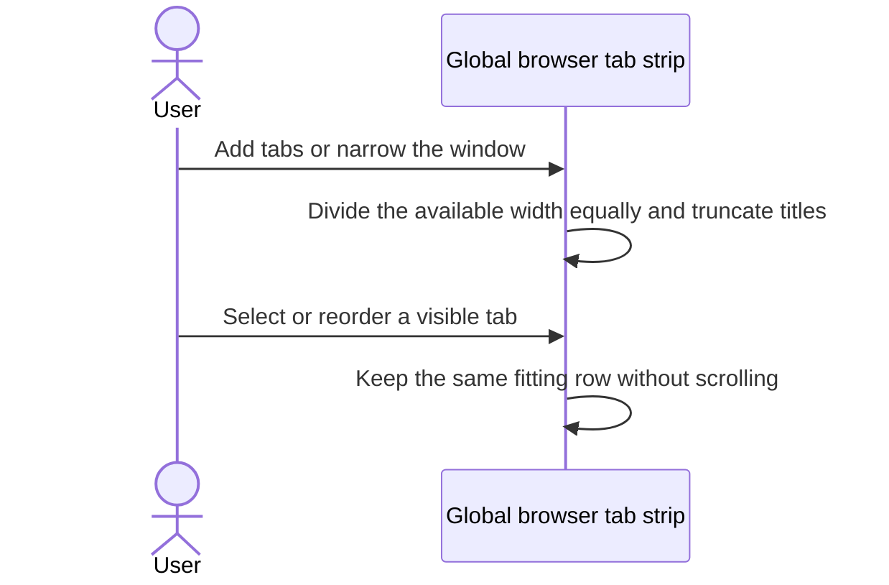

# Global browser tabs fit their available width

## Status

| Unit | Result |
| --- | --- |
| Scope | Global browser tabs share their available width equally without scrolling |
| Implementation | Equal-width follow-up written and diff reviewed; runtime behavior unverified |
| Verification | Not run; tests and build have not been requested |

## Current / Issue

```css
.web-tabs { overflow: clip; }
.web-tab { flex: 0 1 auto; max-width: 220px; }
.web-tab-main { max-width: 186px; }
```

Tabs already shrink without scrolling, but their title lengths still determine their relative widths.

## Proposed



## Code Changes

### `apps/desktop/src/renderer/src/styles.css`

```css
.web-tabs {
  flex: 1 1 auto;
  min-width: 0;
  overflow: clip;
}

.web-tab {
  flex: 1 1 0;
  min-width: 0;
  overflow: clip;
}

.web-tab-main {
  flex: 1 1 auto;
  min-width: 0;
  overflow: hidden;
}
```

Use the existing title ellipsis. Remove the tab and main-button width ceilings so every tab fills its equal share. The add button keeps its existing fixed width.

### `apps/desktop/src/renderer/src/workspace/WebTabStrip.tsx`

Remove selected-tab scrolling, drag edge scrolling, and scroll-offset bookkeeping. Compute insertion markers and drag translations directly from the tab rectangles. Keyboard focus uses `focus({ preventScroll: true })`.

## Final Flow



Manual verification remains: equal widths with mixed title lengths, few and many browser tabs, narrow windows, selection, keyboard focus, closing, adding, and drag reordering.

Source and diffs were reviewed against the pre-edit working copies. Existing changes were retained. No tests, typecheck, build, installation, or app launch ran for this update.
