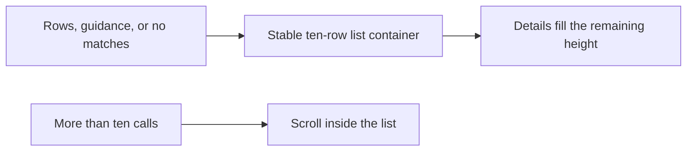

# Ten-row Traffic list

## Status

| Unit              | Result                                                                                                                                                                          |
| ----------------- | ------------------------------------------------------------------------------------------------------------------------------------------------------------------------------- |
| Scope             | Traffic request-list height and its boundary with request/response details                                                                                                      |
| Implementation    | Fixed-height list wrapper, exact header/data grid tracks, and remaining-height inspector written                                                                                |
| Build and install | `CHORUS_INSTALL_KEEP_RUNNING=1 pnpm app:install` completed; signed arm64 app installed at `/Applications/Chorus.app`                                                            |
| Verification      | Incremental source diffs reviewed against `/private/tmp/workbench-ten-traffic-rows-1791977666986`; runtime behavior unverified; no tests, separate typecheck, or app launch ran |

## Current / Issue


`TrafficPanel.tsx` replaces the list with guidance or no-match text. `styles.css` lets `.traffic-rows` grow and shrink against a fixed percentage inspector.

## Proposed



## Code Changes

### `apps/desktop/src/renderer/src/TrafficPanel.tsx`

Wrap the existing rows/guidance/no-match conditional in `<div className="traffic-list">`. Keep selection, call limits, keyboard navigation, and newest-request scrolling.

### `apps/desktop/src/renderer/src/styles.css`

```css
.traffic-list {
  flex: 0 0 auto;
  height: calc(11lh + var(--step) * 23);
  min-height: 0;
  overflow: hidden;
  font-size: 11px;
  line-height: 1.6;
}

.traffic-rows {
  height: 100%;
  grid-template-rows: calc(1lh + var(--step));
  grid-auto-rows: 1lh;
}

.traffic-inspector {
  flex: 1 1 0;
}
```

The height accounts for eleven text lines (column header plus ten data rows), ten two-step gaps, one step of header padding, and two steps of list padding. The sticky header remains inside the grid.

## Final Flow


Manual verification remains: start with an empty capture, receive one through ten calls, append additional calls with a larger call limit, filter to zero matches and clear the filter, and check that the newest request stays selected and visible. Very short panes also need a manual layout check. Runtime behavior remains unverified.

On the user's build-and-install request, `CHORUS_INSTALL_KEEP_RUNNING=1 pnpm app:install` completed successfully on 2026-10-14. Dependency builds were served from the Turbo cache. The Electron/Vite build, local signing with `Chorus Local Dev`, and installer signature verification completed. The updated arm64 app was installed at `/Applications/Chorus.app`. The previous bundle remains at `/Applications/Chorus.app.replaced-1791978327741` for the running session. Quit and reopen Chorus to load the updated build. No tests, separate typecheck, or app launch ran. The installation log is `/private/tmp/workbench-ten-traffic-rows-install-20261014.log`.
