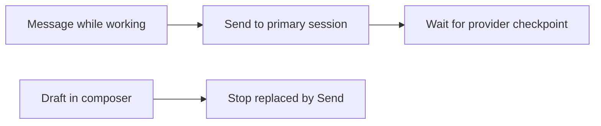
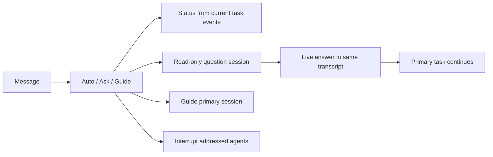
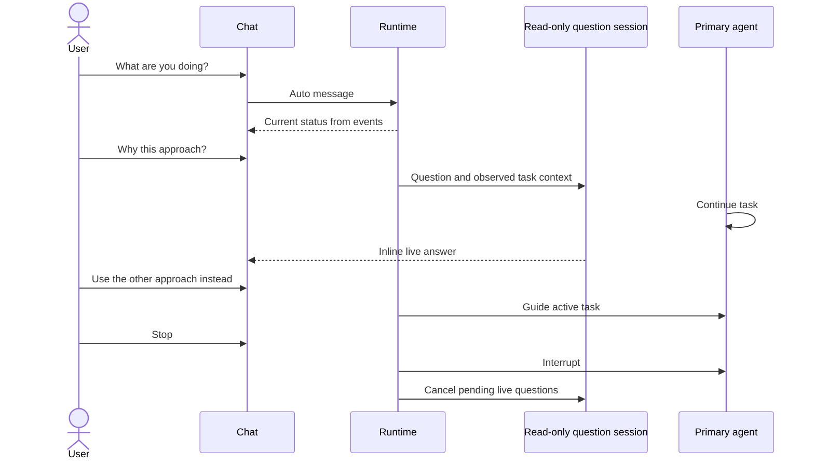

# Live agent chat

## Status

| Unit                | Result                                                                                                                      |
| ------------------- | --------------------------------------------------------------------------------------------------------------------------- |
| Scope               | Live text for Codex, Claude, and DeepSeek; automatic routing with Ask/Guide override                                        |
| Implementation      | Written, formatted, and source reviewed                                                                                     |
| Verification        | Dependency and desktop production builds passed; installed app signature verified. Tests and runtime checks not run.        |
| Installation        | Signed local build installed at `/Applications/Chorus.app`; current session kept running until restart                      |
| Regression coverage | Routing, all three agents, denied live edits, handoff isolation, final-answer state, and Codex admission/Stop cases written |

## Current / Issue

## Proposed

## Code Changes

### Shared routing and IPC

`apps/desktop/src/shared/live-message.ts` (new) owns the routing decision and live-reply key. Existing `conversation:send` carries an optional `mode: 'auto' | 'ask' | 'guide'`. Agent mentions still determine the recipients. Slash commands and the mode control override automatic question detection. Action requests remain task guidance.

### Runtime and replies

`apps/desktop/src/main/live-replies.ts` (new) owns bounded, serialized read-only questions per conversation and agent. It uses the existing adapter fork, forwards only message events, rejects tool approvals, and closes its sessions on Stop, conversation close, and app shutdown. The prompt includes observed transcript context because a fork can miss an unfinished turn.

`apps/desktop/src/main/runtime.ts` returns local status from logged activity, sends questions to the isolated reader, and preserves ordinary task delivery for guidance. Live replies use distinct item keys and cannot complete the primary turn or trigger a handoff. Subsequent guidance carries already answered live questions as context.

`packages/event-store/src/events.ts` stores an optional `live` marker on question/status/Stop messages. The transcript keeps these separate from task-assignment triggers when deciding which answer is final. Old logs remain valid.

### Adapters and composer

`packages/adapter-codex/src/codex-adapter.ts` serializes input admission and uses `turn/steer` while a turn is active. Completion clears the active id. Stop also covers input still being admitted. Forks receive their explicit question instructions. Claude and DeepSeek retain their existing streaming input.

`Composer.tsx` exposes Auto / Ask / Guide while working and keeps Stop visible beside Send. `Session.tsx`, `Entry.tsx`, and `transcript.ts` keep live answers distinct from the primary task. All interface copy uses `i18n/en.json`.

## Final Flow

