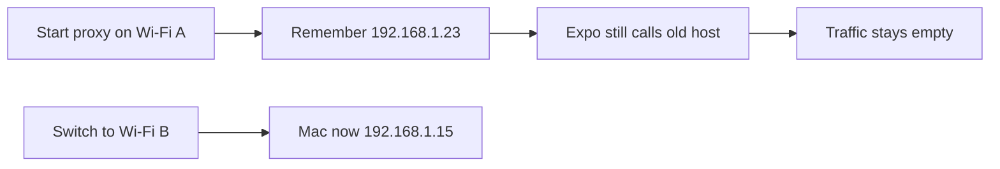
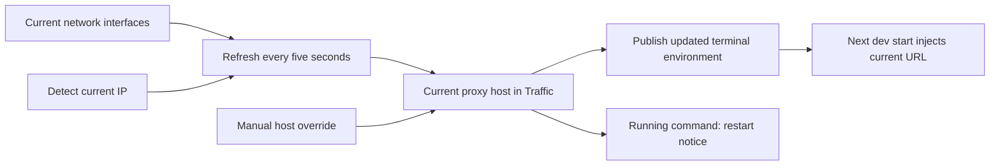
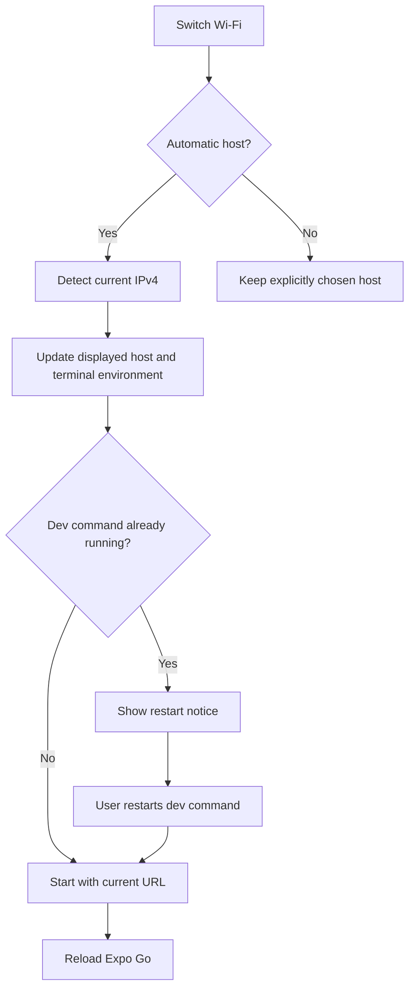

# Automatic Traffic proxy host

## Status

| Unit           | Result                                                                                        |
| -------------- | --------------------------------------------------------------------------------------------- |
| Scope          | Detect changing LAN addresses, expose the injected host, retain a manual override             |
| Implementation | Prepared: five-second refresh, validated host controls, next-run injection and restart notice |
| Capture setup  | Prepared: both rows are inside the collapsible Capture setup section                           |
| Verification   | Local build and installation passed; tests, typechecks and live behavior unrun                |

## Current / Issue



`ProjectTrafficRegistry` records the advertised address when it listens. Calling Start on an active capture returns the cached state.

## Proposed



The listener keeps its access mode and port. Host refresh retains the capture generation, requests and body data. The override lasts for the current Chorus session, so a later app start returns to network detection. Running commands keep their startup environment until restarted. No automatic interruption, backend change or mobile source change is included.

## Code Changes

### `apps/desktop/src/main/project-traffic.ts`

```ts
refreshAddresses(): void {
  for (const entry of this.entries.values()) {
    if (entry.service === null || entry.state.access !== 'lan' || entry.hostOverride !== null)
      continue
    const host = this.hostFor(entry, entry.state.access)
    const address = entry.state.port === null
      ? null
      : `${host ?? EVERY_INTERFACE}:${String(entry.state.port)}`
    if (entry.state.host !== host || entry.state.address !== address) this.publish(entry, {})
  }
}
```

A single unreferenced timer watches active automatic LAN listeners. Disposing the last automatic listener clears it. Start refreshes an already-recording capture before the existing runner reads `terminalEnvOf`.

### `apps/desktop/src/shared/traffic-ipc.ts` and `main/traffic-ipc.ts`

```ts
host: z.string().refine(isTrafficHost).nullable().optional(),
```

Null restores detection. State exposes optional `host` and `hostOverridden` metadata. Invalid IPv4 values and the wildcard bind address are refused. Existing origin, port and access recording guards remain.

### `apps/desktop/src/renderer/src/TrafficPanel.tsx` and `i18n/en.json`

The visible Proxy host IP control uses the existing field and action styles. Apply sets a session override; Detect current IP clears it. A running command whose advertised address changes gets a translated notice and the existing `restartRun` action. Project lifetime checks fence late save replies.

The Android forwarding status and the complete Proxy host IP row belong inside the existing Capture setup details element. Closing the section hides both alongside the other setup fields.

## Final Flow


