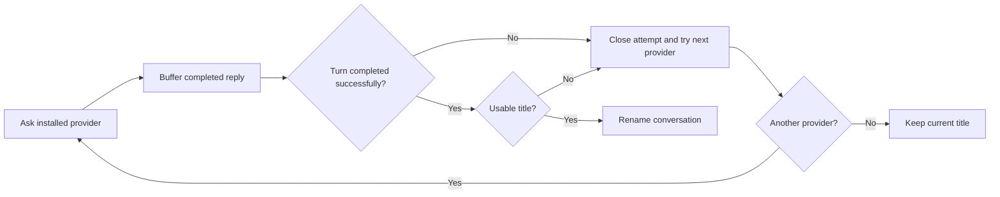
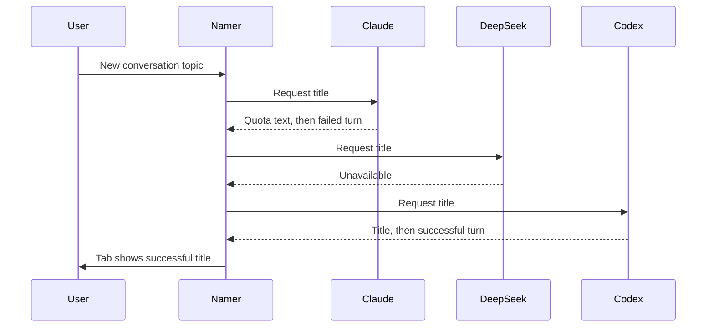

# Conversation titles from an available agent

## Status

| Unit           | Result                                                                         |
| -------------- | ------------------------------------------------------------------------------ |
| Scope          | Skip failed naming attempts and use the next available provider                |
| Implementation | Runtime fix and regression cases written; source and diffs reviewed            |
| Verification   | Local build and installation passed; tests, typechecks and live behavior unrun |

Built the signed macOS arm64 bundle and installed it at `/Applications/Chorus.app` on 2026-10-15. The current session stayed running. Relaunch Chorus to load the title fallback fix.

## Current / Issue

```mermaid
sequenceDiagram
    participant Claude
    participant Namer as startNamer
    participant Tab as Conversation title
    Claude->>Namer: message.completed with quota warning
    Namer->>Tab: Save warning as title
    Claude->>Namer: error and failed turn.completed
    Note over Namer: Request already settled; fallback never runs
```

## Proposed



## Code Changes

### `apps/desktop/src/main/runtime.ts`

Retain the existing Claude, DeepSeek, Codex order, missing-adapter checks, demotion, session queue and timeout. Fatal errors fail the naming attempt immediately. Only a successful turn may publish its buffered reply. An empty or unusable reply follows the same fallback path.

```ts
const outcome: NamerOutcome =
  event.status === 'completed' && reply !== null
    ? { kind: 'title', text: reply }
    : { kind: 'failed' }
reply = null
settle(outcome)
```

### `apps/desktop/src/main/aside.test.ts`

Update existing naming success cases to include the successful turn boundary. Add regressions covering quota text before failed completion, both Claude and DeepSeek exhausted before Codex succeeds, fatal errors, unusable replies and all providers failing without a rename.

```ts
claude?.emit({ type: 'message.completed', itemRef: 'n1', text: 'Parser fix' })
await flush()
expect(titles()).toEqual([])
claude?.emit({ type: 'turn.completed', turnRef: 't1', status: 'completed' })
await flush()
expect(titles()).toEqual(['Parser fix'])
```

## Final Flow


