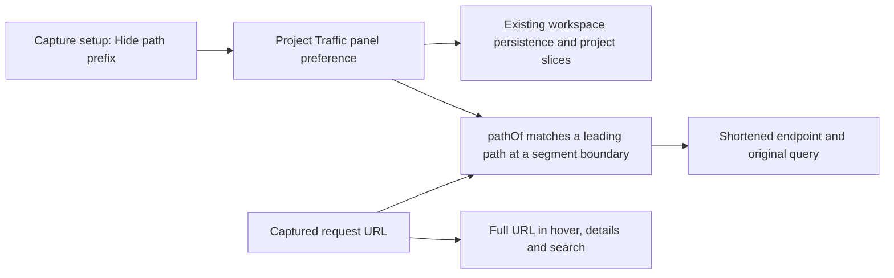
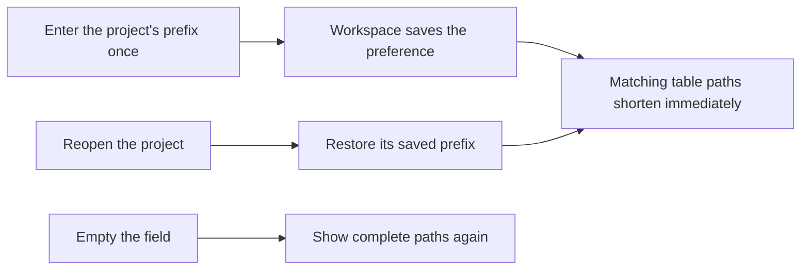

# Hide an API path prefix in Traffic

## Status

| Unit           | Result                                                                        |
| -------------- | ----------------------------------------------------------------------------- |
| Scope          | Agreed: a per-project Hide path prefix field in Capture setup                 |
| Implementation | Written and diff reviewed; runtime behavior unverified                        |
| Coverage       | Prepared: path boundaries, queries, project persistence and the visible field |
| Verification   | Local build and installation passed; tests and live UI checks unrun           |

## Current / Issue


## Proposed



## Code Changes

### `apps/desktop/src/shared/workspace-layout.ts`

Add an optional field to the existing `TrafficPanelState` schema so older workspace snapshots still load:

```ts
hiddenPathPrefix: z.string().optional(),
```

### `apps/desktop/src/renderer/src/workspace/store.ts` and `hooks.ts`

Expose `setTrafficHiddenPathPrefix(projectId: string, hiddenPathPrefix: string): void` through the existing actions hook. Store the input in that project's Traffic panel state. Existing snapshots, hydration and detached-project slices carry the optional field. Width resets preserve it.

### `apps/desktop/src/renderer/src/TrafficPanel.tsx` and `i18n/en.json`

Reuse `useTrafficPanel` and `useWorkspaceActions`. Add a translated, automatically saved text field inside Capture setup. Pass its value only to the table's formatter.

### `apps/desktop/src/renderer/src/traffic-filter.ts`

```ts
export const pathOf = (url: string, hiddenPathPrefix = ''): string => {
  let path: string
  try {
    const parsed = new URL(url)
    path = `${parsed.pathname}${parsed.search}`
  } catch {
    path = url
  }
  const prefix = hiddenPathPrefix.trim().replace(/\/+$/, '')
  if (!prefix.startsWith('/') || /[?#]/.test(prefix)) return path
  const rest = path.slice(prefix.length)
  if (path === prefix || path.startsWith(`${prefix}?`)) return `/${rest}`
  return path.startsWith(`${prefix}/`) ? rest : path
}
```

Blank or root prefixes show the complete path. Trailing slashes and surrounding whitespace are tolerated. Exact matches display `/`; queries remain visible. Similar segment names and prefixes later in a path keep their complete paths. Captured URLs and proxy configuration stay intact.

### Existing regression suites

`traffic-filter.test.ts` covers absolute and relative request URLs, queries, exact prefix matches, trailing slashes and unrelated paths. `workspace/store.test.ts` covers serialization, hydration, clearing one project's prefix, width resets and detached project slices. `TrafficPanel.test.tsx` covers immediate table updates, the original URL in hover and search, and returning to a project's saved input.

```ts
expect(pathOf('/api/v1/provider-online/me', '/api/v1/provider-online')).toBe('/me')
expect(pathOf('/api/v1/provider-online-admin/me', '/api/v1/provider-online')).toBe(
  '/api/v1/provider-online-admin/me'
)
```

The implementation diffs were reviewed. Files with pre-existing edits were compared against `/private/tmp/traffic-hidden-prefix-wng3c4zp`. Tests, typechecks, builds and live UI checks were not run.

On 2026-10-15, the local build, signed packaging and installation passed. See the [installation record](50-traffic-endpoint-tooltip.md). Reopen Chorus to load the update. Tests and live UI checks remain unrun.

## Final Flow


