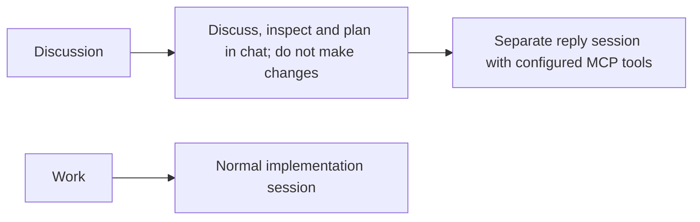
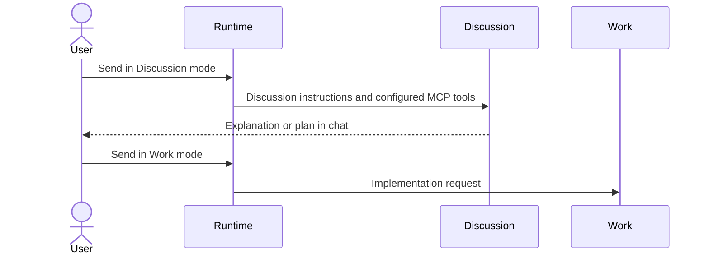

# Discussion keeps configured MCP tools

## Status

| Unit           | Result                                                                                                           |
| -------------- | ---------------------------------------------------------------------------------------------------------------- |
| Scope          | Keep configured MCP tools available in Discussion and inject no-change instructions                              |
| Implementation | Written and diff reviewed                                                                                        |
| Verification   | Production build, signed packaging, installation and signature verification passed; live MCP behavior unverified |

## Current / Issue


## Proposed



## Code Changes

### `apps/desktop/src/main/live-replies.ts`

Remove the Discussion-specific `toolPolicy` option so both adapters load their configured MCP tools normally. Replace the tool-isolation wording with the agreed instruction. Keep existing live-reply session routing, lifecycle and shared permission handling.

```ts
const opts: SessionOpts = {
  ...request.opts,
  sandbox: { mode: 'readOnly', writableRoots: [], networkAccess: false },
  instructions,
}
```

The Discussion prompt allows MCP inspection, keeps plans in chat, and requires Work mode before implementing. Its primary task and collaboration context stay isolated in the existing reply session.

### `apps/desktop/src/main/live-chat.test.ts`

Identify Discussion sessions by their instructions rather than by the removed tool-policy flag. Update existing assertions to require normal tool configuration and the no-change prompt. Preserve the existing checks for isolated primary work, handoffs, queued follow-ups and Work routing. Do not run the tests without a request.

### `apps/desktop/src/renderer/src/i18n/en.json`

Describe Discussion as a request to discuss and inspect with configured MCP tools and no coding or changes. Keep the send label aligned with that wording.

The three changed source files were diff reviewed against `/private/tmp/chorus-discussion-prompt-7x9p8c06`. Codex and Claude/DeepSeek now receive no Discussion-specific `toolPolicy`, so their configured MCPs load through the existing adapter defaults. The shared reply sandbox and approval handling remain in effect. Runtime MCP availability has not been checked.

On 2026-10-15, the user requested a build and installation. `CHORUS_INSTALL_KEEP_RUNNING=1 pnpm --dir /Users/mohamadtaleb/code/workbench app:install` completed with exit code 0. The dependency and Electron renderer/main/preload builds, arm64 packaging and signing with `Chorus Local Dev` passed. Installation to `/Applications/Chorus.app` and deep, strict signature verification passed. The current session stayed running. The replaced bundle is retained at `/Applications/Chorus.app.replaced-1792072910548`. Quit and reopen Chorus to load this revision. Tests, standalone typecheck gates and live MCP checks were not run.

## Final Flow


