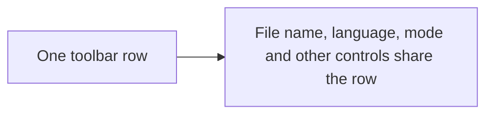
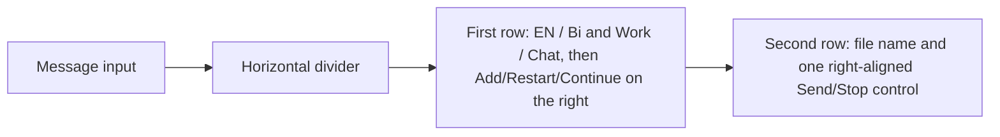
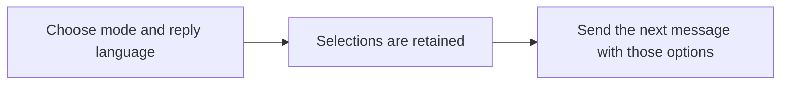

# Compact composer button groups

## Status

| Unit           | Result                                                                                                 |
| -------------- | ------------------------------------------------------------------------------------------------------ |
| Scope          | Compact options and action icons above one right-aligned Send/Stop control                             |
| Implementation | One control switches between Stop and Send from busy/draft state; diff reviewed                        |
| Verification   | Production build, signed packaging, installation and signature verification passed; live UI unverified |

## Current / Issue



## Proposed



## Code Changes

### `apps/desktop/src/renderer/src/Composer.tsx`

Use the existing `messageMode` and `styleOn` state in matching accessible button groups. Each button selects its own option. Clicking an active option is a no-op. Preserve the saved mode, submission behavior and runtime-confirmed language selection. Disable language changes while agents are starting, working, or applying a style change.

Place both button groups in `composer-options-row` immediately after the textarea, below the horizontal divider. The language group comes first, then the mode group. Move Add, Restart and Continue into a right-aligned `composer-options-actions` group on that same row. The hidden file input travels with Add. The existing file name and one Send/Stop control remain in the lower tools row. The divider and its top padding belong to the options row.

Always render a single button. Derive `showStop = props.busy && !hasDraft`. In that state, use a normal button with the Stop icon and existing interrupt handler. When text or attachments are present, use a submit button to send or guide work. Keep idle Send disabled for an empty draft. Retain busy styling and the existing auto margin so the control stays at the right with space after the file name. Typed `stop` and `/stop` also remain supported by the existing router.

```tsx
<div className="composer-live-modes" role="group" aria-label={t('live.mode')}>
  {(['work', 'discussion'] as const).map((mode) => (
    <button
      key={mode}
      type="button"
      className="composer-live-mode"
      aria-pressed={messageMode === mode}
      title={t(mode === 'discussion' ? 'live.discussionHelp' : 'live.workHelp')}
      onClick={() => setMessageMode(mode)}
    >
      {t(mode === 'discussion' ? 'live.chat' : 'live.work')}
    </button>
  ))}
</div>
```

The language group uses the same `composer-live-modes` and `composer-live-mode` classes, with the existing `composer-style` class for its disabled state. Its buttons use `aria-pressed={styleOn === on}`, call `setAnswerStyle({ conversationId: props.conversationId, on })`, and apply the confirmed `result.styleOn`. Return immediately when `on === styleOn`.

### `apps/desktop/src/renderer/src/styles.css`

Share one rounded outline and compact adjoining buttons across both groups. Use the existing theme colors for a filled active button and muted inactive button. Remove the old language-toggle rules and retain its disabled styling. Hover styling applies to enabled buttons.

```css
.composer-options-row {
  display: flex;
  align-items: center;
  flex: none;
  gap: calc(var(--step) * 1.5);
  min-width: 0;
  padding-top: var(--step);
  border-top: 1px solid var(--border-default);
}

.composer-options-actions {
  display: flex;
  align-items: center;
  flex: none;
  gap: calc(var(--step) * 1.5);
  margin-left: auto;
}

.composer-tools .send {
  margin-left: auto;
}
```

### `apps/desktop/src/renderer/src/Composer.test.tsx`

Update existing mode-selection assertions to select the Work or Chat button explicitly. Keep the existing checks for mutual selection, repeated clicks on the active button, submitted mode and restored selection. Do not run tests without a request.

### `apps/desktop/src/renderer/src/i18n/en.json`

Use Work / Chat for modes and EN / Bi for language. Add a translated Reply language group label and retain full explanations in tooltips. Keep Discussion as the transcript's label.

The original mode group was diff reviewed against `/private/tmp/chorus-mode-buttons-3w0m5xrs`. The language-group and compact-label changes were diff reviewed against `/private/tmp/chorus-compact-options-w8tgw660`. The file-name reorder was diff reviewed against `/private/tmp/chorus-file-before-language-2mw9wrmm`. The later row split and divider move were diff reviewed against `/private/tmp/chorus-controls-row-he98q7wi`. The three-action move was diff reviewed against `/private/tmp/chorus-send-options-row-1r4y_lpk`. The single Send/Stop control was diff reviewed against `/private/tmp/chorus-busy-align-q5vqkagl`. Both groups use native buttons, translated names, `aria-pressed` selection and the existing keyboard focus styling. Runtime appearance is unverified.

On 2026-10-15, the user requested a build and installation. `CHORUS_INSTALL_KEEP_RUNNING=1 pnpm --dir /Users/mohamadtaleb/code/workbench app:install` completed with exit code 0. The dependency and Electron renderer/main/preload builds, arm64 packaging and signing with `Chorus Local Dev` passed. Installation to `/Applications/Chorus.app` and deep, strict signature verification passed. The current session stayed running. The replaced bundle is retained at `/Applications/Chorus.app.replaced-1792072910548`. Quit and reopen Chorus to load this revision. Tests, standalone typecheck gates and live UI checks were not run.

## Final Flow


