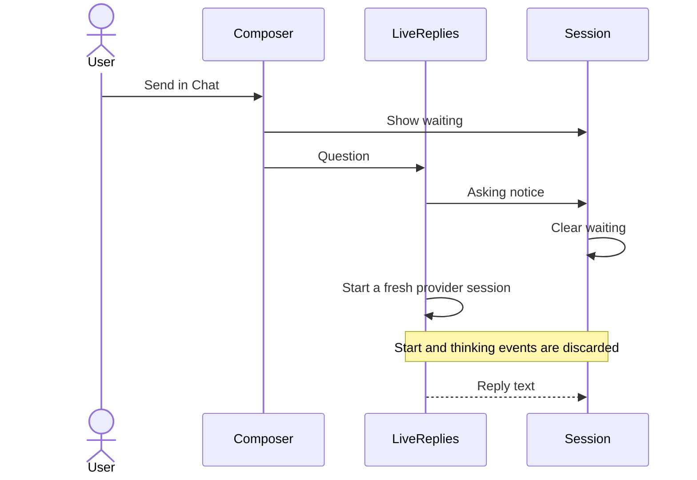
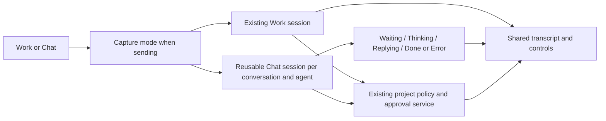
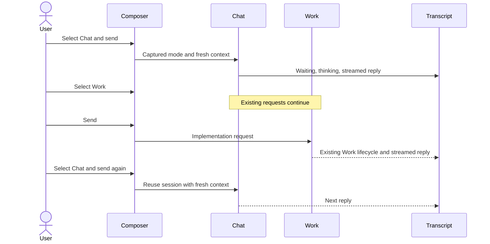

# Smooth Work and Chat switching

## Status

| Unit           | Result                                                                                                            |
| -------------- | ----------------------------------------------------------------------------------------------------------------- |
| Scope          | Approved: mode applies to the next message; shared approvals and reply handling; reusable Chat sessions           |
| Implementation | Written, formatted and diff reviewed                                                                              |
| Agent routing  | Follow-up fix: one recipient for both modes, updated when an agent answers                                        |
| Verification   | Requested local build and installation passed, including signature verification; tests and live UI checks not run |

## Current / Issue



The captured request started its native session within one second and completed after 22 seconds. A persistent reply-display failure remains unproven; the waiting-state failure is confirmed from the event timeline and source.

## Proposed



Chat keeps no-change instructions and receives the same provider sandbox and MCP configuration as Work. Toggling only selects the next send; Work and Chat sessions remain independent. Each Chat send reads fresh task context. Sessions close on Stop, conversation close, shutdown or failure; changed session options recreate an idle reader on the next send.

Recipient selection currently uses `LiveReplies.lastDiscussed()` only in Chat, while Work uses `conversation.lastAddressed`. A Codex Chat answer therefore leaves Work pointing at Claude. Both modes must use the shared conversation recipient. Each addressed send and non-empty completed agent message updates it, including Chat handoffs whose agent has no Work session. Explicit mentions still take precedence.

## Code Changes

### `apps/desktop/src/main/live-replies.ts`

Keep the existing one-shot live-question behavior. Pool Discussion sessions and serialize access per conversation and agent, including handoffs. Use `ConversationService` for approvals, questions, deltas and tools through a scoped store that keeps Chat lifecycle events out of Work projections.

Remove the redundant “Asking … in live chat” system notice and its translation. The request status already provides waiting and thinking feedback.

Remove the separate Discussion recipient map; recipient state belongs to the conversation.

```ts
interface DiscussionParticipant {
  readonly agentId: AgentId
  readonly adapter: AgentAdapter
  readonly opts: SessionOpts
}
```

### `packages/orchestrator/src/conversation-service.ts`

Narrow the store dependency to the methods the existing service uses so Discussion can reuse the full approval service with scoped persistence.

```ts
readonly store: Pick<EventStore, 'append' | 'appendMany'>
```

### `packages/event-store/src/events.ts`

```ts
z.object({
  type: z.literal('reply.status'),
  requestId: z.string(),
  sourceId: z.string(),
  agentId: AgentIdSchema,
  phase: z.enum(['waiting', 'thinking', 'replying', 'done', 'error', 'cancelled']),
})
```

### `apps/desktop/src/main/runtime.ts`

Build Chat options with `sessionOptsFor`, create its approval service with the conversation's project profile and grants, and route decisions by their unique approval/question IDs. Include active Chat statuses in transcript state reads.

Use the same routing input in both modes:

```ts
lastAddressed: conversation.lastAddressed
```

Update `conversation.lastAddressed` for Chat sends and completed replies in the existing store subscription, before requiring a primary participant. This includes Chat-only agents without changing Work handoff processing.

### `apps/desktop/src/main/ipc.ts`, `apps/desktop/src/shared/ipc.ts`

Carry the current Chat statuses alongside the existing transcript snapshot. A new app process has no active requests, so an interrupted historical wait cannot remain busy after restart.

### `apps/desktop/src/shared/transcript-events.ts`, `apps/desktop/src/renderer/src/transcript.ts`, `apps/desktop/src/renderer/src/Session.tsx`

Reduce explicit request states independently of primary Work turns. Use the existing waiting/thinking presentation and one Send/Stop control. Replies render through the ordinary transcript regardless of the selected mode. Informational notices do not imply a completed request.

### `apps/desktop/src/renderer/src/Composer.tsx`, `apps/desktop/src/renderer/src/App.tsx`, `apps/desktop/src/renderer/src/workspace/store.ts`, `apps/desktop/src/renderer/src/workspace/hooks.ts`

Include Chat in the shared busy indicator, sidebar activity and conversation-close protection. Keep the primary Work actor set separate, so completing Chat cannot clear a Work turn and a busy Chat does not mislabel a new Work message as steering.

### `packages/event-store/src/projections.ts`, `packages/orchestrator/src/catchup.ts`

Classify request-status events explicitly without changing primary session projections or replaying UI lifecycle details as instructions to other agents.

### Existing tests

Update Chat tests for session reuse and normal project approvals. Cover queued requests and handoffs sharing a reader, cancellation during startup, partial replies on Stop, approval and question routing without a Work request, and switching modes during a pending send. Reducer coverage must show that a notice leaves Chat pending and that completion removes only the corresponding Chat request. Existing Composer coverage keeps the submitted mode immutable; additional coverage distinguishes a new Work send from a steer while Chat is busy.

Routing regressions cover switching Chat to Work for each agent, the most recent answer overriding a pending request to another agent, Work to Chat follow-ups, explicit mentions, and the final Chat handoff recipient. These checks remain unrun.

## Final Flow



Task baseline: `/private/tmp/chorus-smooth-modes-scppehxa`.

Static review covered the session pool, serialized handoffs, approval/question routing, cancellation before startup completes, partial-reply persistence, independent Work/Chat activity, and out-of-order snapshot records. Existing dirty Traffic and layout work was retained. Runtime behavior, MCP calls and completed-reply visibility remain unverified until the requested checks are run.

The requested `app:install` completed successfully and installed `/Applications/Chorus.app`, signed with `Chorus Local Dev`. The installer passed strict signature verification. The running copy was retained at `/Applications/Chorus.app.replaced-1792142941951`; reopening Chorus loads the new build.
