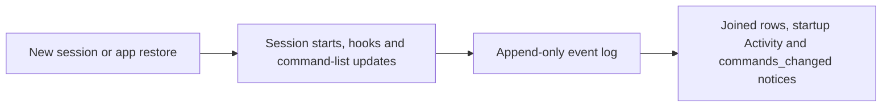
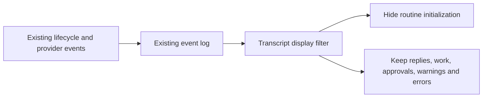
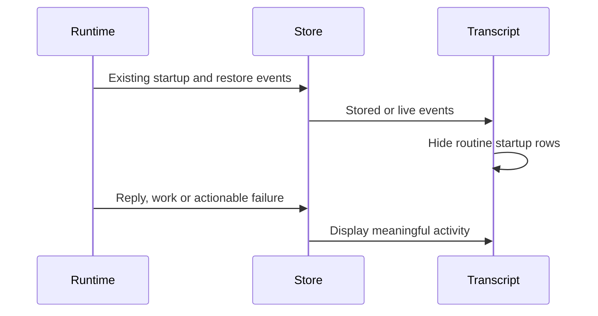

# Quiet startup transcript

## Status

| Unit           | Result                                                                       |
| -------------- | ---------------------------------------------------------------------------- |
| Scope          | Approved: display cleanup; retain current startup behavior and stored events |
| Implementation | Written, formatted and diff reviewed; unverified                             |
| Verification   | No tests, builds, app launch or UI checks requested                          |

## Current / Issue



An unused conversation contains zero user messages and twelve agent starts across four launches. Resumed joins are already hidden; successful SessionStart output and command-list updates continue accumulating.

## Proposed



## Code Changes

### `apps/desktop/src/shared/transcript-events.ts`

```ts
'session.started': 'ignore',
```

Use the existing shared disposition map so live pushes and paged history both hide joined rows. Raw history and internal event processing remain available.

### `apps/desktop/src/renderer/src/transcript.ts`

Remove the joined-row renderer. Extend the existing notice filter: plain agent `info` notices for `commands_changed` are hidden only without diagnostic detail or a code. Successful agent SessionStart hook notices are hidden, including their informational output. Warnings, errors, coded notices, other hooks and actual task activity keep their current presentation.

### `apps/desktop/src/renderer/src/transcript.test.ts`

Update the existing activity-boundary expectation: a plain command-list refresh no longer splits a command group. Keep the controls for real message, actor and error boundaries.

## Final Flow



Task baseline: `/private/tmp/chorus-quiet-startup-lozxb0l8`.
