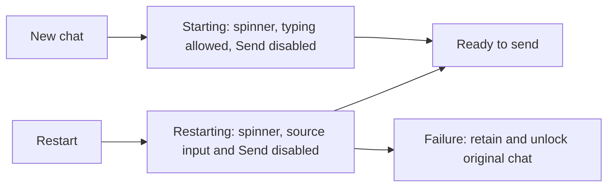
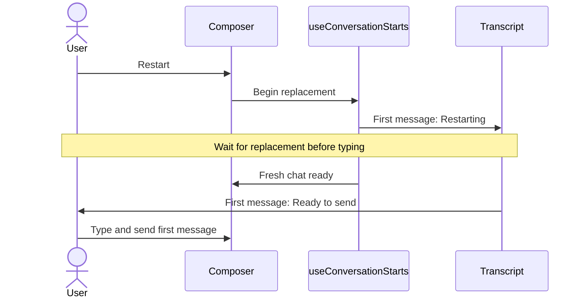

# Session readiness feedback

## Status

| Unit           | Result                                                                                   |
| -------------- | ---------------------------------------------------------------------------------------- |
| Scope          | Requested: startup, restart and readiness as the first message in the chat               |
| Implementation | Written, formatted and diff reviewed; app behavior unverified                            |
| Verification   | Local build, install and signature verification passed; tests and live UI checks not run |

## Current / Issue

```mermaid
sequenceDiagram
    actor User
    participant Composer
    participant Starts as useConversationStarts
    User->>Composer: Restart
    Composer->>Starts: Begin replacement
    Note over Composer,Starts: Old chat stays visible; pending restart is only in a ref
    Starts->>Composer: Replace only when ready
```

New chats already permit typing and disable Send until `starting` clears. Their progress text is easy to miss. Restart keeps the source visible until its replacement is ready, with no pending flag supplied to that source composer.

## Proposed



## Code Changes

### `apps/desktop/src/renderer/src/useConversationStarts.ts`

Mark the source `SessionInfo` as restarting immediately, before begin IPC resolves. Clear the flag when the owning restart fails or settles. Preserve the existing replacement-before-close ordering and duplicate-request guard.

### `apps/desktop/src/renderer/src/Session.tsx`

```ts
readonly restarting?: boolean | undefined
```

Pass the source restart state through to Composer. Render a transient System message before transcript history for Starting, Restarting or an empty chat that is Ready to send. Keep pending readiness visible at the top while the old chat is still present during a restart. It never appends startup messages to the event log.

### `apps/desktop/src/renderer/src/Composer.tsx`

```ts
const restarting = props.restarting === true
const preparing = starting || restarting
```

Keep Send's loading glyph and accessible status, while moving visible readiness text into the first chat message. Keep the existing new-chat draft while starting. Lock the old input during restart so text cannot be lost when it is replaced. Enable the fresh input and Send according to the existing readiness signal. Disable repeated Restart and Continue during preparation.

### `apps/desktop/src/renderer/src/i18n/en.json`, `apps/desktop/src/renderer/src/styles.css`

Reuse translated readiness labels and the existing spin animation, including reduced-motion handling. Style readiness as a System message in the chat rather than an input status strip.

### Existing Composer and start-hook tests

Keep input-control and restart-state coverage, and remove Composer expectations for text that now belongs to the transcript. No test execution is authorized.

## Final Flow



Task baseline: `/private/tmp/chorus-startup-feedback-ya6g7gpt`.

Readiness-message placement baseline: `/private/tmp/chorus-chat-readiness-qp978cbo`.
