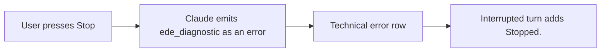
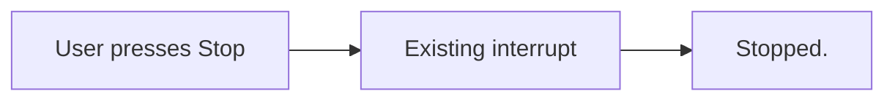

# Short Stop notice

## Status

| Unit           | Result                                                                        |
| -------------- | ----------------------------------------------------------------------------- |
| Scope          | Requested: user Stop shows only Stopped. instead of a cancellation diagnostic |
| Implementation | Written and diff reviewed; unverified                                         |
| Verification   | Tests, builds and live UI checks not requested                                |

## Current / Issue



Stored examples show `[ede_diagnostic] result_type=user ...` immediately before `turn.completed` with `status: interrupted` and `userInitiated: true`. The renderer already supplies the requested Stopped. text.

## Proposed

Suppress this specific diagnostic while the service is processing a user interrupt. Keep ordinary failures and non-interrupted diagnostics intact.

## Code Changes

### `packages/orchestrator/src/conversation-service.ts`

```ts
if (this.interruptRequested && event.message.startsWith('[ede_diagnostic]')) return
```

### `packages/orchestrator/src/conversation-service.test.ts`

Extend the existing interrupt test with the observed diagnostic. Keep the same diagnostic visible in the genuine-failure control. These checks remain unrun.

## Final Flow



Task baseline: `/private/tmp/chorus-stop-notice-1ov3xwwj`.
