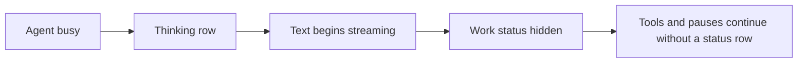
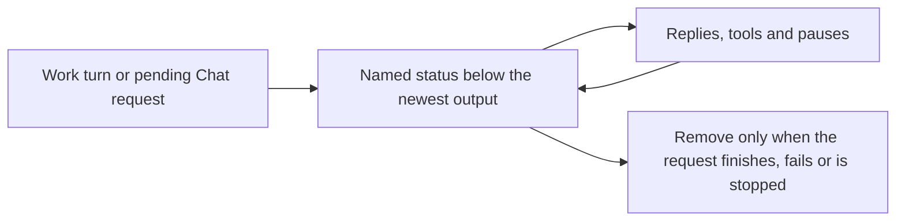
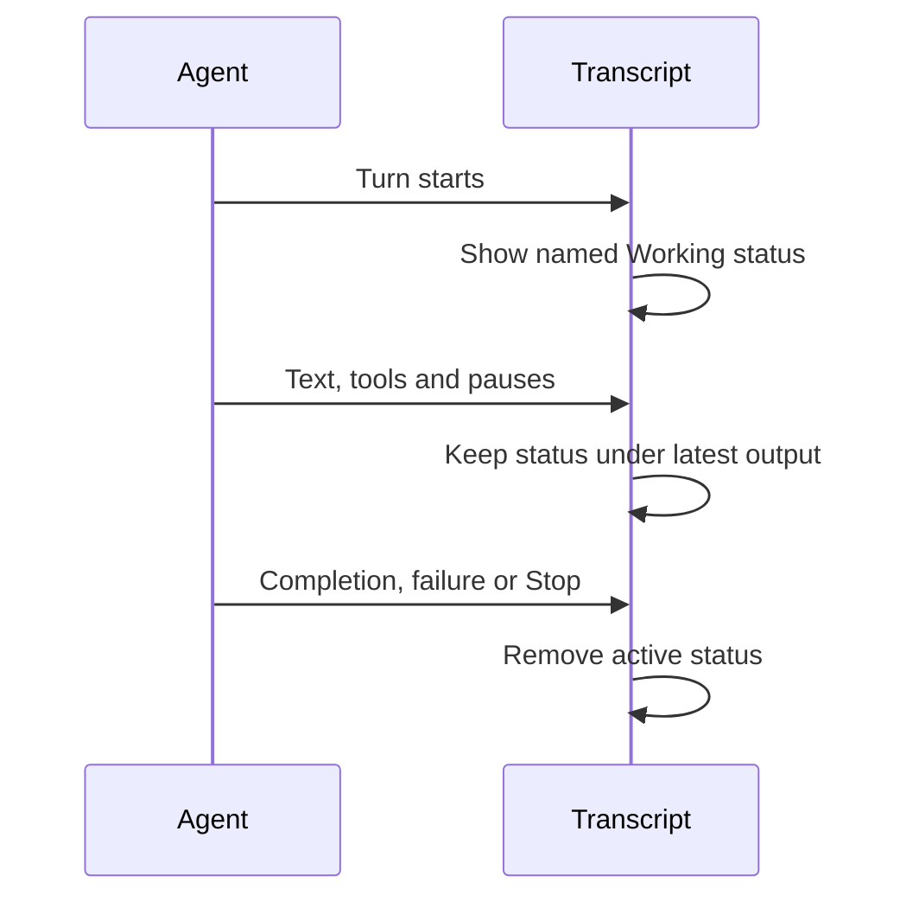

# Persistent chat busy status

## Status

| Unit           | Result                                                                                         |
| -------------- | ---------------------------------------------------------------------------------------------- |
| Scope          | Requested: visible busy status at the end of the chat throughout active Work and Chat replies  |
| Implementation | Written, formatted and diff reviewed; unverified                                               |
| Verification   | Tests, builds and live UI checks not requested; the preceding installation request was stopped |

## Current / Issue

`Session.tsx` excludes Work agents with a streaming message and excludes Chat requests in the replying phase. Busy state and the Send/Stop indicator remain active, so the transcript can look finished while work continues.

## Proposed

## Code Changes

### `apps/desktop/src/renderer/src/Session.tsx`

Render the Work footer directly from `view.working` and the Chat footer from every active `view.replies` entry. Keep the existing footer position in both transcript branches. Work shows the provider's current activity when available and Working otherwise; Chat shows Waiting, thinking or Replying according to its request phase. Remove the streaming-message exclusion and its unused derived set.

### `apps/desktop/src/renderer/src/i18n/en.json`

Add the Replying label. Reuse the existing Working label for the Work fallback.

## Final Flow

Task baseline: `/private/tmp/chorus-persistent-busy-mg6nhwlg`.
